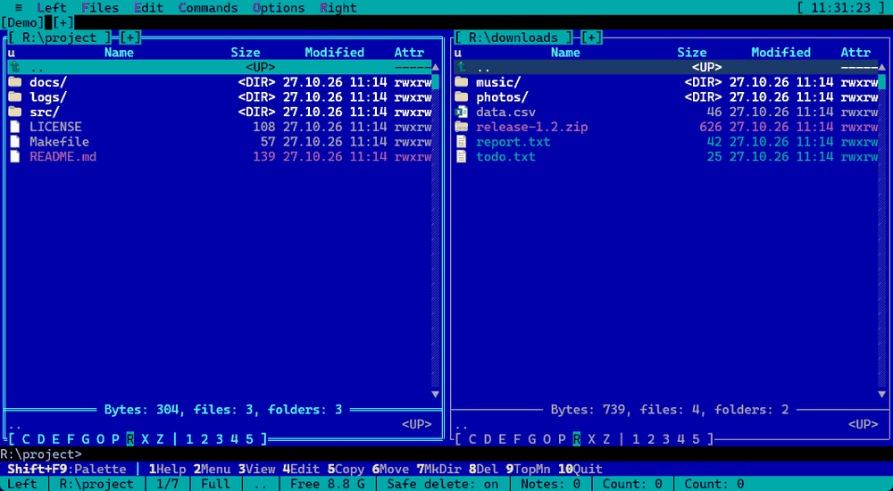
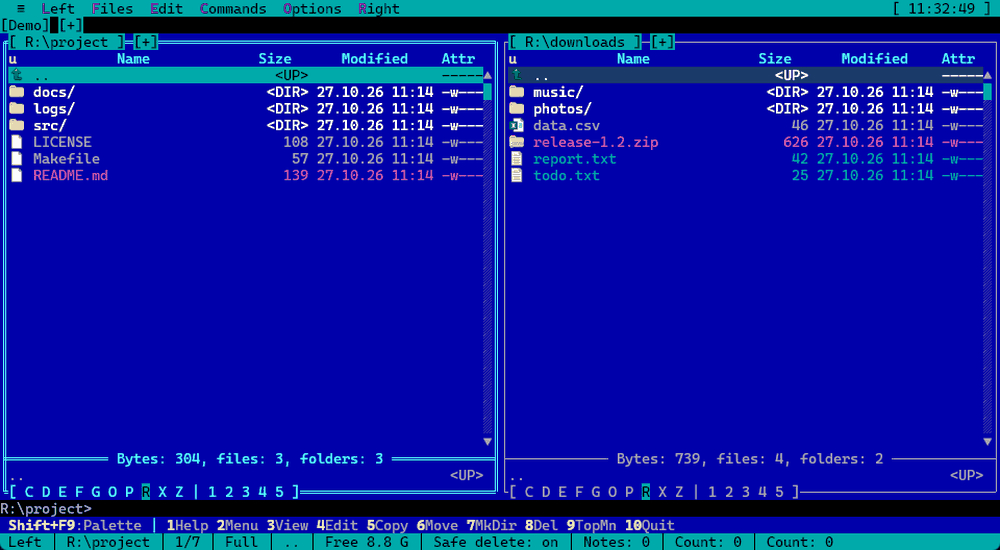
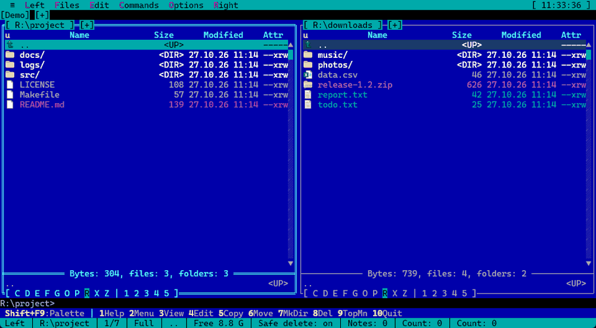

# Modern Terminal Navigator 2 (MTN2)

[English](README.md) | [Русский](README.ru.md) | **Deutsch** | [中文](README.zh.md)

Zweipanel-Dateimanager im Geiste von **Necromancer's DOS Navigator** und **Far Manager** mit integrierter Konsole,
Terminals, Datei-Viewer und Editor. Die Benutzeroberfläche ist textbasiert (TUI), wird jedoch in einem regulären GUI-Fenster gerendert:
ein virtuelles Zeichenraster auf einem Delphi-FireMonkey-Canvas (Skia, mit Fallback auf Standard-Canvas über `--no-skia`)
mit TrueType-Schriftarten, Unicode und 32-Bit-Farben. Chinesische, japanische und koreanische (CJK) Schriftzeichen
nehmen zwei Spalten ein, genau wie in anderen modernen Terminals.

[](https://github.com/Laex/MTN2/actions/workflows/ci.yml)
[](LICENSE)


[Projektseite](https://laex.github.io/MTN2/de/) ·
[Neueste Version herunterladen](https://github.com/Laex/MTN2/releases/latest) ·
[Neuerungen](CHANGELOG.md) · [FAQ](docs/FAQ.md) (auf Englisch) · [Mitwirken](CONTRIBUTING.md) (auf Englisch) ·
[Diskussionen](https://github.com/Laex/MTN2/discussions) ·
[Artikel auf Habr](https://habr.com/ru/articles/1087174/) (auf Russisch)

MTN2 ist für Menschen gedacht, die mit DOS Navigator und Far Manager aufgewachsen sind und von der Tastatur aus arbeiten:
System- und Netzwerkadministratoren, Entwickler. Es ersetzt Far Manager nicht und konkurriert nicht mit Total Commander,
sondern ist ein weiterer Zweipanel-Manager mit eigenen Gewohnheiten.

## Warum MTN2

- **Dateimanager und echtes Terminal in einem Fenster.** Panels, ConPTY-Terminal-Tabs (cmd, PowerShell, WSL, SSH); Vim, htop und andere TUI-Programme laufen wie in einem normalen Terminal.
- **Alles ist ein Ordner.** Archive (zip, 7z u. a.), SFTP, FTP/FTPS, WebDAV, S3 und Plugin-Dateisysteme lassen sich wie gewöhnliche Verzeichnisse öffnen und kopieren.
- **Bleibt bei großen Datenmengen schnell.** Kopieren, Verschieben und Löschen laufen als Hintergrundaufträge; die Suche liefert bis zu 50.000 Treffer direkt in ein Panel; große Dateien werden gestreamt gelesen.
- **Mächtige Suche.** Nach Maske, Text (UTF-8, UTF-16, Windows-1251, CP866), Bytes mit Platzhalter `??`, Größe, Datum und Attributen.
- **Anzeigen und Bearbeiten ohne Zusatzprogramme.** Hex, Markdown, Syntaxhervorhebung, Log-Verfolgung, Bilder in der Schnellansicht, rechteckige Blöcke und Lesezeichen im Editor.
- **Vergleichen und Synchronisieren.** Ordner nach Zeit, Größe und Inhalt; zwei Dateien mit zeilenweisem Unterschied.
- **Nichts auswendig lernen.** Befehlspalette (**Umschalt+F9**) mit Erklärungen, Tastenhinweise in neuen Situationen, kontextbezogene Hilfe auf **F1**.
- **Ihr Aussehen, Ihre Tasten.** Mehr als zehn Themes (Far, Norton, Midnight, Total Commander, Dracula, Nord u. a.), Theme-Editor, Farbgruppen für Dateien, frei änderbare Tastenbelegung.
- **Windows und Linux.** Grafisches Fenster unter Windows; unter Linux `mtn2-tui` (über SSH und in `tmux`) und ein SDL2-Fenster; Pakete `tar.gz`, `.deb`, `.rpm`.
- **Frei und ohne Überraschungen.** MPL-2.0, keine Telemetrie, kein Installer, portable Version, Updates nur mit Ihrer Zustimmung, Plugins (nativ und WebAssembly).

## Schnellstart

1. Laden Sie `MTN2-<Version>-win64.zip` von der [aktuellen Release-Seite](https://github.com/Laex/MTN2/releases/latest) herunter und entpacken Sie es in einen beliebigen Ordner: kein Installer und keine Administratorrechte nötig.
2. Starten Sie `MTN2.exe`. Die Einstellungen liegen in `%APPDATA%\MTN2`; die portable Version (`-portable.zip`) speichert alles neben dem Programm.
3. Beginnen Sie mit diesen Tasten:

| Tasten | Wirkung |
|---|---|
| **Shift+F9** | Befehlspalette: jeder Menüpunkt wird nach Namen gefunden, daneben stehen seine Tasten |
| **F1** | Hilfe zum aktuellen Fenster |
| **Tab**, **F5**, **F6** | anderes Panel, Kopieren, Verschieben |
| **F3**, **F4** | Datei unter dem Cursor ansehen und bearbeiten |
| **Ctrl+Q** | Schnellansicht der Datei im anderen Panel |
| **Alt+F7** | Dateien suchen |
| **Ctrl+O** | Konsole unter den Panels (**Esc** zurück zu den Panels) |
| **Ctrl+Shift+N** | neuer Terminal-Tab |

Für Linux (`mtn2-tui`, `mtn2-sdl`) siehe „Installation“ unten. Das Programm nennt nützliche Tasten außerdem beim ersten Mal in einem neuen Zustand (Archiv, markierte Dateien, Konsole, Viewer u. a.); die Hinweise lassen sich unter **Optionen → Oberfläche** abschalten.

## Grundsätze

- **Keine Telemetrie, keine Cloud-Funktionen.** Der einzige Netzzugriff ist die Prüfung auf eine neue Version bei GitHub
  (einmal täglich beim Start); abschaltbar unter **≡ → Nach Updates suchen...** („Beim Start nach Updates suchen“).
- **Portabel.** Ein Ordner, kein Installer, keine Registry-Einträge; die portable Version legt ihre Einstellungen neben
  `MTN2.exe` ab, die normale in `%APPDATA%\MTN2`. Einstellungen, Themes und Tastenbelegung sind einfache JSON-Dateien.
- **Tastatur zuerst.** Die Belegung ähnelt Far Manager und ist frei änderbar; Tabs und Terminals funktionieren wie in ConEmu.
- **Ein echtes Terminal.** Die Konsole läuft auf ConPTY (cmd, PowerShell, WSL, SSH), keine Nachbildung.
- **Erweiterbar.** Native und WebAssembly-Plugins: eigene Dateisysteme, Panels, Befehle, Dialoge, Textfärbung.

> Der Habr-Artikel löst den Namen als Modern Turbo Navigator auf; der aktuelle Name lautet **Modern Terminal Navigator**.


## Screenshots

| | |
|---|---|
|  |  |
| Panels mit Tabs, Theme Far Classic | Ein Archiv öffnet sich als Ordner |
|  |  |
| Markdown-Anzeige mit Tabellen | Editor; die Hervorhebung kommt von einem Plugin |
|  |  |
| Integrierte Konsole (Strg+O) | Theme Dracula |

## Demo

| | |
|---|---|
|  |  |
| Befehlspalette (**Shift+F9**): Suche nach Namen, Tasten daneben | Ein Archiv öffnet sich wie ein Ordner, mit Tastenhinweis |
|  |  |
| Dateien markieren (**Ins**) und Schnellansicht (**Ctrl+Q**) | Ein Log ansehen und seinem Ende folgen (**Ctrl+Shift+F**) |

## Funktionen

- **Panels:** zwei Panels mit Tabs, Brief-/Full-/Spaltenmodi, Sortierung, Schnellsuche und Live-Filter,
  Maskenauswahl, Verzeichnisvergleich, Verlauf und Ordner-Hotlist (Favoriten), lange Pfade (> MAX_PATH).
- **Dateioperationen:** Kopieren, Verschieben und Löschen über Hintergrundaufträge mit Fortschrittsanzeige, Dateiattribute und Zeitstempel,
  Verknüpfungen/Links, Papierkorb, Prüfsummen, Verzeichnissynchronisierung.
- **Konsole und Terminals:** Befehlszeile unter den Panels, echtes ConPTY (cmd, PowerShell, pwsh, Git Bash, WSL,
  SSH), ANSI/VT-Sequenz-Parsing, alternativer Bildschirmpuffer für TUI-Programme, Terminal-Arbeitsbereiche.
  Aus dem Panel oder der Befehlszeile gestartete Konsolenprogramme laufen in der integrierten Konsole, und ihre Ausgabe
  bleibt auf dem Bildschirm erhalten (`Ctrl+O`).
- **Anzeigen und Bearbeiten:** integrierter Viewer (Text, Hex, Streaming großer Dateien), Editor,
  Quick View (`Ctrl+Q`), Markdown-Vorschau, externer Viewer/Editor.
- **Virtuelle Dateisysteme:** Archive als Ordner (zip, 7z über `7z.dll`), SFTP über SSH, FTP / FTPS / WebDAV / S3 (Plugin „Netzwerkverbindungen“), Plugin-VFS.
- **Suche (`Alt+F7`):** nach Maske, Inhalt (UTF-8, UTF-16, Windows-1251, CP866), Hex-Bytes mit Platzhalter `??`, Größe, Datum und Attributen.
  Treffer erscheinen schon während der Suche in einem Panel (bis zu 50.000 Dateien) und verhalten sich wie ein normaler Ordner. Eine laufende Suche lässt sich in den Hintergrund schicken (ein Chip in der Tab-Zeile zählt die gefundenen Dateien) oder im Panel behalten, wo die Liste weiterwächst.
- **Vergleichen und Synchronisieren:** Ordner nach Zeit, Größe oder Inhalt (im Hintergrund, abbrechbar); zwei Dateien oder Gruppen markierter Dateien mit zeilenweisem Unterschied
  (`Ctrl+Alt+C`); Verzeichnissynchronisierung; Sprung zur gleichnamigen Datei im anderen Panel (`Ctrl+Alt+M`).
- **Logs und Binärdateien:** dem Ende einer wachsenden Datei folgen (`Ctrl+Shift+F`, mit Log-Rotation), Bytesuche im Hex-Modus,
  Hervorhebung von Textdateien und Bilder in der Schnellansicht.
- **Befehlszeile und Automatisierung:** Liste früherer Befehle, die mit der Eingabe beginnen, Umgebungsprofile für Shells (`environment.json`),
  `MTN2 Pfad1 Pfad2` öffnet Tabs, `--view` und `--edit` öffnen Viewer und Editor, `--update` aktualisiert ohne Fenster, Dateilisten als Markdown oder CSV.
- **Makros:** das Plugin „Makros“ führt in Lua geschriebene Makros aus. `Strg+.` zeichnet die gedrückten Tasten in eine Makrodatei auf; ein Makro startet über eine eigene Taste oder das Menü „Makros“ in Panels, Viewer, Editor und Konsole und kann vorher den Zustand des Programms prüfen (Bereich, markierte Dateien, Auswahl). Makros sind einfache Textdateien; drei Beispiele liegen bei (`samples\macros`). Beschreibung: F1-Hilfe in den Makro-Dialogen.
- **Git und mehr:** das Plugin „Git status“ zeigt Branch und Änderungszahlen in der Statuszeile, färbt die Dateinamen in den Panels nach ihrem Git-Zustand, und Strg+Umschalt+D öffnet das `git diff` einer Datei im eingebauten Viewer; Strg+Umschalt+F12 springt zu häufigen Ordnern; optional Vim-Tasten im Panel (`hjkl`, `g`, `G`, `/`, `:`); Farbgruppen mit Prioritäten; Bildschirmschoner mit Haien bei Inaktivität.
- **Anpassung:** anpassbare Tastenbelegung (`keymap.json`), dateibasierte Themes (Far Classic, Norton Commander, Midnight Commander, Total Commander, Gruvbox, Tokyo Night, Dracula, Nord, Solarized, Light, High Contrast usw.; eigene Themes im Theme-Editor),
  Benutzermenü (F2), Befehlspalette (`Umschalt+F9`) zur Suche in den Menüeinträgen, Dateizuordnungen, kontextbezogene F1-Hilfe.
- **Sprachen:** Oberfläche und Hilfe auf Deutsch, Englisch, Russisch und Chinesisch (vereinfacht); Sprache wird unter **Optionen → Oberfläche...**
  ausgewählt und ohne Neustart angewendet; beim ersten Start wird die Windows-Sprache verwendet, sofern eine Übersetzung vorliegt. Eine eigene Sprache wird als Ordner `resource\<sprache>\` neben `MTN2.exe` hinzugefügt (`locale.json`, `strings.json`, Hilfe in `help\`); ein Neukompilieren ist nicht nötig. Nur Englisch ist im Programm eingebaut.
- **Unicode:** CJK-Schriftzeichen (BMP), Hiragana, Katakana, Hangeul und vollbreite Zeichen
  werden in Konsole, Panels, Tabs und Titeln zweispaltig dargestellt; fehlende Glyphen werden aus Systemschriftarten ergänzt.
- **Plugins:** native DLLs und WebAssembly (über Wasmtime) – eigene VFS-Schemata und Panels, Menüeinträge,
  Tastenbelegungen, Nachrichtenbus. Protokolle für Dialoge, Overlays und Statuszeilen sind spezifiziert,
  aktuell jedoch dem Hauptprogramm vorbehalten – siehe [PLUGIN_BOUNDARIES](docs/PLUGIN_BOUNDARIES.md).
- **Updates:** tägliche Prüfung auf neue GitHub-Releases; Download (mit SHA-256-Prüfung), Installation
  und Neustart erfolgen erst nach Bestätigung durch den Benutzer. Menü **≡ → Nach Updates suchen...**.

Unterstützt werden Windows x64 (grafische Anwendung) und Linux x86-64: `mtn2-tui` nutzt das gesamte Textterminal,
bietet dieselben Panels, Viewer, Editor, Konsole und Plugins und funktioniert über SSH sowie in `tmux` (siehe [docs/LINUX.md](docs/LINUX.md)).
Die experimentelle grafische Linux-Version `mtn2-sdl` zeigt dieselben Fenster in einem normalen SDL2-Fenster:
Systemschrift, Maus und Mausrad, Eingabe in jeder Tastaturbelegung, Zwischenablage des Desktops, Bilder in der
Schnellansicht. Sie läuft unter X11 und Wayland (in Windows über WSLg), liegt den Paketen `tar.gz`, `.deb` und `.rpm` bei und
braucht `libSDL2` und `libfreetype` (für PNG und JPEG zusätzlich `libSDL2_image`): Abhängigkeiten und Parameter
stehen in [docs/LINUX.md](docs/LINUX.md) (auf Russisch). Ein macOS-Build ist in Planung.

## Installation

Fertige Builds stehen auf der [Releases](https://github.com/Laex/MTN2/releases)-Seite bereit:

- `MTN2-<version>-win64.zip` – Einstellungen und Verlauf werden in `%APPDATA%\MTN2` gespeichert;
- `MTN2-<version>-win64-portable.zip` – portable Version: alles wird direkt neben `MTN2.exe` abgelegt;
- `MTN2-<version>-linux-x64.tar.gz`, `MTN2-<version>-linux-x64.deb` und `MTN2-<version>-linux-x64.rpm` – Version für Linux: `mtn2-tui` (im Terminalfenster,
  funktioniert über SSH) und die experimentelle grafische `mtn2-sdl` (SDL2-Fenster, braucht `libSDL2` und `libfreetype`):
  Installation, Abhängigkeiten und Parameter – siehe [docs/LINUX.md](docs/LINUX.md).

**Windows:** mit [Scoop](https://scoop.sh): `scoop bucket add mtn2 https://github.com/Laex/scoop-mtn2` und `scoop install mtn2`. Oder das Archiv einfach in einen beliebigen Ordner entpacken und `MTN2.exe` starten. Danach aktualisiert sich das Programm selbst
(Menü **≡ → Nach Updates suchen...**). Das Paket enthält `7z.dll` aus [7-Zip](https://www.7-zip.org) (GNU LGPL; Lizenztexte in
`plugins\mtn.7z\license.txt`, Details in [THIRD-PARTY.md](THIRD-PARTY.md)): damit lassen sich 7z- und andere
7-Zip-Archive öffnen. Sie kann durch eine eigene x64-Version in `plugins\mtn.7z\` ersetzt werden; zip lässt sich auch ohne sie öffnen.

**Linux:** `tar xzf MTN2-*-linux-x64.tar.gz && ./mtn2/install.sh` (für alle Benutzer mit `sudo`) oder
`sudo apt install ./MTN2-*-linux-x64.deb` oder `sudo dnf install ./MTN2-*-linux-x64.rpm`. Danach startet `mtn2` die Terminalversion und `mtn2-sdl` das SDL2-Fenster.
Der entpackte Ordner läuft auch ohne Installation: `mtn2/mtn2-tui` und `mtn2/mtn2-sdl` starten dort, wo sie liegen.

### Dev-Builds

Entwickler-Builds (dev) werden nach jedem Commit auf `main` in einem separaten Repository veröffentlicht:
[Laex/MTN2-dev](https://github.com/Laex/MTN2-dev/releases). Um sie automatisch zu beziehen, öffnen Sie
**≡ → Nach Updates suchen...** und aktivieren Sie den Dev-Kanal; Sie können jederzeit wieder auf stabile Releases zurückkehren.
Dev-Builds enthalten die neuesten Änderungen und sind möglicherweise weniger stabil.

## Kompilieren

Erforderlich sind RAD Studio 13 (Delphi, `Studio\37.0`) und Windows x64; für das WASM-Plugin `mtn.ws` wird Rust benötigt.
Die Linux-Version wird unter Windows mit dem Compiler `dcclinux64` erstellt, die Tests werden in WSL ausgeführt.

```powershell
./src/build.ps1 -Config Release -Platform Win64   # bin\win64\MTN2.exe + bin\win64\plugins\
./src/tests/run-tests.ps1                          # DUnitX-Regressionstests
./src/build-linux.ps1                              # bin\linux64\mtn2-tui
./src/tests/run-tests-linux.ps1                    # dieselben Tests in WSL
```

Start: `bin\win64\MTN2.exe [--no-skia] [--fps] [pfad]`. Details unter [docs/BUILDING.md](docs/BUILDING.md).

## Repository-Struktur

| Pfad | Inhalt |
|---|---|
| `src/Core` | Kern: Panels, VFS, Konsole, Editor, Dialoge, Plugin-Host |
| `src/Platform` | Plattformschicht: `Windows` und `Posix` mit gleichnamigen Modulen |
| `src/Hosts` | Hosts: `Ansi` – Version für das Textterminal |
| `src/Forms`, `src/dialogs`, `src/Assets/themes` | Hauptformular, JSON-Dialoge, Standardthema |
| `src/plugins` | Integrierte Plugins (`mtn.7z`, `mtn.tmp`, `mtn.git`, `mtn.csv`, `mtn.docview`, `mtn.pdf`, `mtn.logfilter`, `mtn.lua`, `mtn.ws`, WASM-Demo) |
| `src/tests` | DUnitX-Regressionstests nach Gruppen und Test-Runner `run-tests.ps1` |
| `src/tools` | DialogDesigner, ExportDialogJson, Projektgruppe `Group.groupproj`, Hilfsskripte |
| `bin/win64`, `bin/linux64` | Build-Ausgabe nach Plattformen |
| `bin/win64/resource` | Sprachpakete (Oberflächentexte und F1-Hilfe: en/ru/de/zh) und mitgelieferte Themes (`themes/`), werden zusammen mit dem Programm ausgeliefert |
| `docs` | Entwicklerdokumentation, Screenshots (`docs/images`) |

## Dokumentation

- [SDS.md](docs/SDS.md) – Vollständige Spezifikation: Konzept, Datenstrukturen, APIs, Roadmap.
- [ARCHITECTURE.md](docs/ARCHITECTURE.md) – Schichten, Datenflüsse und Invarianten.
- [BUILDING.md](docs/BUILDING.md) – Bauen, Tests, CI/CD.
- [LINUX.md](docs/LINUX.md) – Version für das Linux-Terminal: Installation, Parameter, Abhängigkeiten.
- [THEMES.md](docs/THEMES.md) – Theme-Dateiformat und Farbrollen.
- [HELP.md](docs/HELP.md) – Vollständiger Text der Benutzerhilfe in einer Datei.
- Plugin-Schnittstellen: [PLUGIN_BOUNDARIES](docs/PLUGIN_BOUNDARIES.md), [PANEL](docs/PANEL_PLUGIN.md),
  [DIALOG](docs/DIALOG_PLUGIN.md), [INPUT](docs/INPUT_PLUGIN.md), [OVERLAY](docs/OVERLAY_PLUGIN.md),
  [STATUS](docs/STATUS_PLUGIN.md), [TEXTAREA](docs/TEXTAREA_PLUGIN.md), [TOOLBAR](docs/TOOLBAR_PLUGIN.md),
  [UI_PRIMITIVES](docs/UI_PRIMITIVES.md).

## Wie das Projekt entstanden ist

Bei der Entwicklung von MTN2 wurden KI-Assistenten eingesetzt, darunter auch eigene Entwicklungen. Mit ihrer Hilfe entstanden:

- Vorprojektdokumentation – Spezifikation ([SDS.md](docs/SDS.md)), Architekturübersicht, Plugin-Protokollbeschreibungen in `docs/`;
- Nachverfolgung der Roadmap und Arbeitspläne;
- die meisten Codekommentare;
- DUnitX-Regressionstests (`src/tests`);
- textuelle Benutzerdokumentation: F1-Hilfe (`bin/win64/resource/<sprache>/help`), [CHANGELOG.md](CHANGELOG.md), Versionshinweise.

## Lizenz

[Mozilla Public License 2.0](LICENSE).
