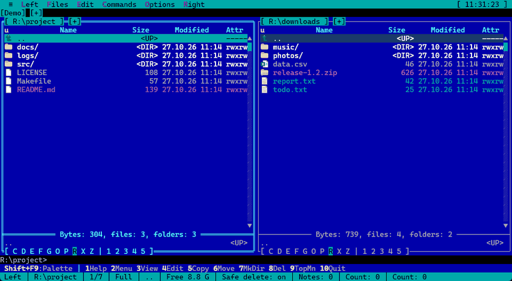
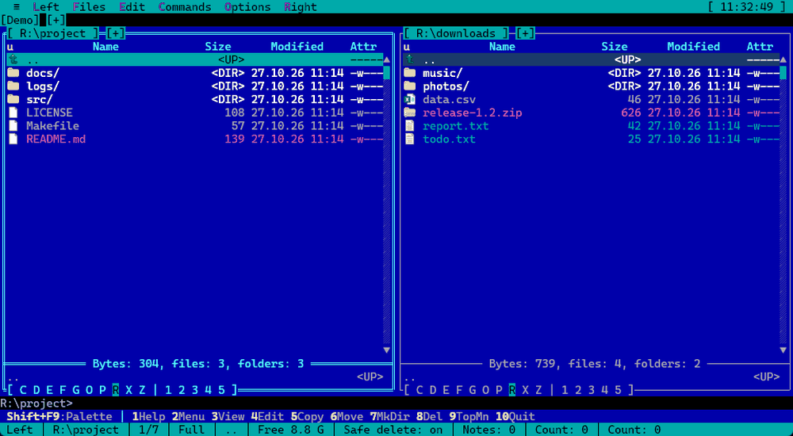
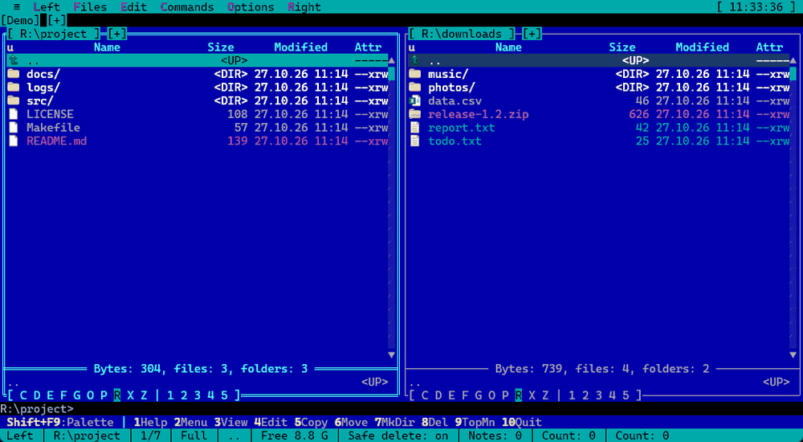

# Modern Terminal Navigator 2 (MTN2)

**English** | [Русский](README.ru.md) | [Deutsch](README.de.md) | [中文](README.zh.md)

A dual-panel file manager inspired by **Necromancer's DOS Navigator** and **Far Manager**, featuring a built-in console,
terminals, file viewer, and editor. The user interface is text-based (TUI), but rendered inside a standard GUI window:
a virtual character grid on a Delphi FireMonkey canvas (Skia-rendered, with fallback to standard canvas via `--no-skia`)
with TrueType fonts, Unicode, and 32-bit color. Chinese, Japanese, and Korean (CJK) characters
occupy two columns, matching standard terminal behavior.

[](https://github.com/Laex/MTN2/actions/workflows/ci.yml)
[](LICENSE)


[Project website](https://laex.github.io/MTN2/en/) ·
[Download the latest version](https://github.com/Laex/MTN2/releases/latest) ·
[What's new](CHANGELOG.md) · [FAQ](docs/FAQ.md) · [Contributing](CONTRIBUTING.md) ·
[Discussions](https://github.com/Laex/MTN2/discussions) ·
[Article on Habr (in Russian)](https://habr.com/ru/articles/1087174/)

MTN2 is made for people who grew up with DOS Navigator and Far Manager and work from the keyboard: system and network
engineers, developers, administrators. It does not replace Far Manager and does not compete with Total Commander;
it is one more two-panel manager with its own habits.

## Why MTN2

- **A file manager and a real terminal in one window.** Panels, ConPTY terminal tabs (cmd, PowerShell, WSL, SSH); Vim, htop and other TUI programs run as in a regular terminal.
- **Everything is a folder.** Archives (zip, 7z and more), SFTP, FTP/FTPS, WebDAV, S3 and plugin file systems open and copy like ordinary directories.
- **Stays fast on big data.** Copy, move and delete run as background jobs; search streams up to 50,000 results straight into a panel; large files are read as a stream.
- **Powerful search.** By mask, text (UTF-8, UTF-16, Windows-1251, CP866), bytes with `??` wildcards, size, date and attributes.
- **View and edit without external tools.** Hex, Markdown, syntax highlighting, log following, images in quick view, rectangular blocks and bookmarks in the editor.
- **Compare and synchronize.** Folders by time, size and content; two files with a line-by-line diff.
- **Nothing to memorize.** A command palette (**Shift+F9**) with explanations, key hints in new situations, context help on **F1**.
- **Your look, your keys.** More than ten themes (Far, Norton, Midnight, Total Commander, Dracula, Nord and more), a theme editor, file color groups, a fully remappable key layout.
- **Windows and Linux.** A graphical window on Windows; on Linux `mtn2-tui` (over SSH and in `tmux`) and an SDL2 window; `tar.gz`, `.deb` and `.rpm` packages.
- **Free and no surprises.** MPL-2.0, no telemetry, no installer, a portable edition, updates only with your consent, plugins (native and WebAssembly).

## Quick start

1. Download `MTN2-<version>-win64.zip` from the [latest release](https://github.com/Laex/MTN2/releases/latest) and unpack it into any folder: no installer and no administrator rights needed.
2. Run `MTN2.exe`. Settings are kept in `%APPDATA%\MTN2`; the portable edition (`-portable.zip`) keeps everything next to the program.
3. Start with these keys:

| Keys | What they do |
|---|---|
| **Shift+F9** | command palette: any menu item is found by name, with its keys shown beside it |
| **F1** | help for the current window |
| **Tab**, **F5**, **F6** | other panel, copy, move |
| **F3**, **F4** | view and edit the file under the cursor |
| **Ctrl+Q** | quick view of the file in the other panel |
| **Alt+F7** | find files |
| **Ctrl+O** | console under the panels (**Esc** goes back to the panels) |
| **Ctrl+Shift+N** | new terminal tab |

For Linux (`mtn2-tui`, `mtn2-sdl`) see "Installation" below. The program also names useful keys the first time it enters a new state (an archive, selected files, the console, the viewer and more); switch the hints off in **Options → User interface**.

## Principles

- **No telemetry, no cloud features.** The only network access is a check for a new version on GitHub (once a day,
  at startup); turn it off in **≡ → Check for updates...** ("Check for updates at startup").
  Details in the [FAQ](docs/FAQ.md).
- **Portable.** One folder, no installer, no registry entries; the portable edition keeps its settings next to
  `MTN2.exe`, the regular one in `%APPDATA%\MTN2`. Settings, themes and key bindings are plain JSON files.
- **Keyboard first.** The key layout is close to Far Manager and fully remappable; tabs and terminals work as in ConEmu.
- **A real terminal.** The console runs on ConPTY (cmd, PowerShell, WSL, SSH), not an imitation.
- **Extensible.** Native and WebAssembly plugins: custom file systems, panels, commands, dialogs, text highlighting.

> The Habr article expands the name as Modern Turbo Navigator; the current name is **Modern Terminal Navigator**.

## Screenshots

| | |
|---|---|
|  |  |
| Panels with tabs, Far Classic theme | An archive opens as a folder |
|  |  |
| Markdown viewer with tables | Editor; highlighting comes from a plugin |
|  |  |
| Built-in console (Ctrl+O) | Dracula theme |

## Demo

| | |
|---|---|
|  |  |
| Command palette (**Shift+F9**): search by name, keys shown beside it | An archive opens as a folder, with a key hint |
|  |  |
| Selecting files (**Ins**) and quick view (**Ctrl+Q**) | Viewing a log that follows its end (**Ctrl+Shift+F**) |

## Features

- **Panels:** two tabbed panels, Brief/Full/column view modes, sorting, quick search and live filter,
  mask selection, directory comparison, history and folder hotlist (favorites), long paths (> MAX_PATH).
- **File operations:** copy, move, and delete via background jobs with progress reporting, attributes and timestamps,
  symlinks/hardlinks, Recycle Bin, checksums, directory synchronization.
- **Console and terminals:** command line under the panels, genuine ConPTY (cmd, PowerShell, pwsh, Git Bash, WSL,
  SSH), ANSI/VT escape sequence parsing, alternate screen buffer for TUI applications, terminal workspaces.
  Console applications launched from panels or the command line run in the integrated console, with their output
  retained on screen (`Ctrl+O`). Search in the console and terminal output (`Ctrl+Shift+F`).
- **View and edit:** built-in Viewer (text, hex, streamed reading of large files), Editor,
  Quick View (`Ctrl+Q`), Markdown preview, external viewer/editor support. The editor has line commands,
  rectangular blocks, bookmarks, and auto-indent.
- **Virtual file systems:** archives as folders (zip, 7z via `7z.dll`), SFTP over SSH, FTP / FTPS / WebDAV / S3 (the Network connections plugin), plugin VFS.
- **Search (`Alt+F7`):** by mask, content (UTF-8, UTF-16, Windows-1251, CP866), hex bytes with `??` wildcards, size, date and attributes.
  Results appear in a panel while the search runs (up to 50,000 files) and behave like an ordinary folder. A running search can be sent to the background (a chip in the tab row counts the files found) or kept in the panel, where the list keeps growing.
- **Compare and synchronize:** folders by time, size or content (in the background, can be interrupted); two files or groups of marked files with a line-by-line diff
  (`Ctrl+Alt+C`); directory synchronization; jump to the same-named file in the other panel (`Ctrl+Alt+M`).
- **Logs and binaries:** follow the end of a growing file (`Ctrl+Shift+F`, handles log rotation), byte search in hex mode,
  highlighting of plain text files and pictures in quick view.
- **Command line and automation:** a list of earlier commands that start with what you typed, environment profiles for shells (`environment.json`),
  `MTN2 path1 path2` opens tabs, `--view` and `--edit` open the viewer and editor, `--update` updates without a window, file lists exported to Markdown or CSV.
- **Macros:** the Macros plugin runs macros written in Lua. `Ctrl+.` records the keys you press into a macro file; a macro starts from its own key or from the Macros menu in the panels, viewer, editor and console, and can check the state of the program (area, marked files, selection) before it starts. Macros are plain text files; three samples ship with the program (`samples\macros`). See F1 help in the macro dialogs.
- **Git and extras:** the Git status plugin shows the branch and change counts in the status bar, colors the file names in the panels by their git state, Ctrl+Shift+D opens the `git diff` of a file in the built-in viewer, and "Git blame of the file" shows the commit and author of each line; Ctrl+Shift+F12 jumps to frequent folders; optional Vim keys on the panel (`hjkl`, `g`, `G`, `/`, `:`); color groups with priorities; a screensaver with sharks when idle.
- **Customization:** remappable key bindings (`keymap.json`), file-based themes (Far Classic, Norton Commander, Midnight Commander, Total Commander, Gruvbox, Tokyo Night, Dracula, Nord, Solarized, Light, High Contrast, etc.; custom themes via built-in theme editor),
  user menu (F2), command palette (`Shift+F9`) to search the menu items, file associations, F1 context help.
- **Languages:** UI and help available in English, Russian, German, and Simplified Chinese; language is selected in **Options → User interface...**
  and applied on the fly without restarting; the first start uses the Windows language when a translation for it exists. A custom language is added as a `resource\<language>\` folder next to `MTN2.exe` (`locale.json`, `strings.json`, help in `help\`); no recompilation is needed. Only English is built into the program.
- **Unicode:** CJK ideographs (BMP), Hiragana, Katakana, Hangul, and full-width forms
  render across console, panels, tabs, and headers in two columns; missing glyphs fall back to system fonts.
- **Plugins:** native DLLs and WebAssembly (via Wasmtime) – custom VFS schemes and dedicated panels, menu items,
  key bindings, and message bus. Dialog, overlay, and status bar plugin protocols are specified,
  though currently reserved for internal use – see [PLUGIN_BOUNDARIES](docs/PLUGIN_BOUNDARIES.md).
- **Updates:** daily check for new GitHub releases; download (with SHA-256 verification), installation,
  and restart occur only after user confirmation. Menu **≡ → Check for updates...**.

### Platforms

- **Windows x64** – GUI application.
- **Linux x86-64** – `mtn2-tui` runs in a full-screen text terminal: the same panels, viewer, editor, console, and plugins; works over SSH and inside `tmux` (see [docs/LINUX.md](docs/LINUX.md)).
- **Linux, SDL2 window** – the experimental GUI version `mtn2-sdl`: system font, mouse and wheel, input in any keyboard layout, desktop clipboard, pictures in Quick View. Runs on X11 and Wayland (in Windows through WSLg), is included in the `tar.gz`, `.deb` and `.rpm` packages, and is built from source with the `-Sdl` switch. Needs `libSDL2` and `libfreetype` (`libSDL2_image` for PNG and JPEG); dependencies and options are described in [docs/LINUX.md](docs/LINUX.md) (in Russian).
- **macOS** – a build is planned.

## Installation

Pre-built binaries are available on the [Releases](https://github.com/Laex/MTN2/releases) page:

| File | Contents |
|------|----------|
| `MTN2-<version>-win64.zip` | Windows; settings and history are stored in `%APPDATA%\MTN2` |
| `MTN2-<version>-win64-portable.zip` | Windows, portable edition: everything is stored next to `MTN2.exe` |
| `MTN2-<version>-linux-x64.tar.gz`, `.deb`, `.rpm` | Linux: `mtn2-tui` (inside a terminal window, works over SSH) and the experimental GUI `mtn2-sdl` (SDL2 window) |

### Windows

With [Scoop](https://scoop.sh):

```
scoop bucket add mtn2 https://github.com/Laex/scoop-mtn2
scoop install mtn2
```

Or without Scoop: extract the archive into any folder and run `MTN2.exe`.

The application then updates itself (menu **≡ → Check for updates...**).

The release includes `7z.dll` from [7-Zip](https://www.7-zip.org) (GNU LGPL; license text in `plugins\mtn.7z\license.txt`, details in [THIRD-PARTY.md](THIRD-PARTY.md)) enabling support for 7z and other 7-Zip formats. You may replace it with your own x64 version in `plugins\mtn.7z\`; zip archives open without it.

### Linux

Any one of:

```
tar xzf MTN2-*-linux-x64.tar.gz && ./mtn2/install.sh
sudo apt install ./MTN2-*-linux-x64.deb
sudo dnf install ./MTN2-*-linux-x64.rpm
```

`install.sh` without `sudo` installs for the current user, with `sudo` for all users. Afterwards `mtn2` starts the terminal version and `mtn2-sdl` the SDL2 window.

The unpacked folder also runs without installing: `mtn2/mtn2-tui` and `mtn2/mtn2-sdl` start where they lie. Dependencies and options are in [docs/LINUX.md](docs/LINUX.md).

#### Tested distributions

The `.deb`, `.rpm` and `tar.gz` packages install and start on clean systems of these distributions; all plugins load, and the Lua library for macros is bundled.

| Distribution | Package | Result |
|---|---|---|
| Debian 12 | `.deb` | works |
| Ubuntu 22.04, 24.04 | `.deb` | works |
| Fedora | `.rpm` | works |
| openSUSE Leap 15.6 | `.rpm` | works once `glibc-locale` is installed (see below) |
| Arch Linux | `tar.gz` | `mtn2-tui` works; `mtn2-sdl` needs `sdl2` and `freetype2` installed |
| Alpine (musl) | `tar.gz` | not supported |

#### Known issues

- **openSUSE and minimal images.** Without the glibc character-set modules (`/usr/lib64/gconv`) the program crashes at startup, before printing anything. Regular installations have them; stripped container images do not. Fix: `sudo zypper install glibc-locale`.
- **musl (Alpine).** The Linux builds need glibc 2.34 or newer.
- **Terminals without the kitty keyboard protocol.** The terminal does not report key releases, so drive selection by `Ctrl+Left/Right` and the `Alt` quick search finish on a timer instead of on key release. `Ctrl+Shift` combinations may be unavailable; use the menu (`F9`). Terminals with the protocol (kitty, foot, WezTerm, Ghostty, Alacritty) and the `mtn2-sdl` window are not affected.
- **`mtn2-sdl`.** No dragging files out of the window (dropping files into it works). Native plugin windows are not supported; image and video plugins draw in a tab instead.
- **Clipboard over SSH and `tmux`.** Copying relies on the terminal's OSC 52 support; in `tmux` enable `set -g set-clipboard on`.

### Dev Builds

Pre-release (dev) builds are published after every commit to `main` in a dedicated repository:
[Laex/MTN2-dev](https://github.com/Laex/MTN2-dev/releases). To receive them automatically, open
**≡ → Check for updates...** and check the dev channel box; you can uncheck it at any time to return to stable releases.
Dev builds contain the latest changes and may be less stable.

## Building

Requires RAD Studio 13 (Delphi, `Studio\37.0`) and Windows x64; the `mtn.ws` WASM plugin requires Rust.
The Linux version is cross-compiled from Windows using the `dcclinux64` compiler, with tests run in WSL.

```powershell
./src/build.ps1 -Config Release -Platform Win64   # bin\win64\MTN2.exe + bin\win64\plugins\
./src/tests/run-tests.ps1                          # regression tests (DUnitX)
./src/build-linux.ps1                              # bin\linux64\mtn2-tui
./src/tests/run-tests-linux.ps1                    # same tests in WSL
```

Run: `bin\win64\MTN2.exe [--no-skia] [--fps] [path]`. Details in [docs/BUILDING.md](docs/BUILDING.md).

## Repository Structure

| Path | Contents |
|---|---|
| `src/Core` | Core engine: panels, VFS, console, editor, dialogs, plugin host |
| `src/Platform` | Platform abstraction layer: `Windows` and `Posix` modules |
| `src/Hosts` | Shell hosts: `Ansi` – text terminal version |
| `src/Forms`, `src/dialogs`, `src/Assets/themes` | Main form, JSON dialogs, default theme |
| `src/plugins` | Built-in plugins (`mtn.7z`, `mtn.tmp`, `mtn.git`, `mtn.csv`, `mtn.docview`, `mtn.pdf`, `mtn.logfilter`, `mtn.lua`, `mtn.ws`, `mtn.winsys`, `mtn.docker`, `mtn.meta`, WASM demo) |
| `src/tests` | DUnitX regression tests by group and test runner `run-tests.ps1` |
| `src/tools` | DialogDesigner, ExportDialogJson, `Group.groupproj` project group, utility scripts |
| `bin/win64`, `bin/linux64` | Build output by platform |
| `bin/win64/resource` | Language packs (interface strings and F1 help: en/ru/de/zh) and shipped themes (`themes/`), bundled with the application |
| `docs` | Developer documentation, screenshots (`docs/images`) |

## Documentation

- [FAQ.md](docs/FAQ.md) – frequently asked questions: network and privacy, SmartScreen, display scaling, themes, plugins.
- [CONTRIBUTING.md](CONTRIBUTING.md) – how to report a bug, suggest an idea, build the project and send a change.
- [SDS.md](docs/SDS.md) – full specification: concept, data structures, API, roadmap.
- [ARCHITECTURE.md](docs/ARCHITECTURE.md) – layers, data flows, and invariants.
- [BUILDING.md](docs/BUILDING.md) – build guide, tests, CI/CD.
- [LINUX.md](docs/LINUX.md) – Linux terminal edition: installation, options, dependencies.
- [THEMES.md](docs/THEMES.md) – theme file format and color roles.
- [HELP.md](docs/HELP.md) – complete user guide in a single file.
- Plugin contracts: [PLUGIN_BOUNDARIES](docs/PLUGIN_BOUNDARIES.md), [PANEL](docs/PANEL_PLUGIN.md),
  [DIALOG](docs/DIALOG_PLUGIN.md), [INPUT](docs/INPUT_PLUGIN.md), [OVERLAY](docs/OVERLAY_PLUGIN.md),
  [STATUS](docs/STATUS_PLUGIN.md), [TEXTAREA](docs/TEXTAREA_PLUGIN.md), [TOOLBAR](docs/TOOLBAR_PLUGIN.md),
  [UI_PRIMITIVES](docs/UI_PRIMITIVES.md).

## How the Project Was Created

MTN2 was developed with the assistance of AI coding assistants, including in-house tooling. They helped create:

- Preliminary project documentation: specification ([SDS.md](docs/SDS.md)), architecture overview, plugin protocol specifications in `docs/`;
- Roadmap tracking and task planning;
- Most source code comments;
- DUnitX regression tests (`src/tests`);
- User-facing text documentation: F1 help (`bin/win64/resource/<language>/help`), [CHANGELOG.md](CHANGELOG.md), and release notes.

## License

[Mozilla Public License 2.0](LICENSE).
