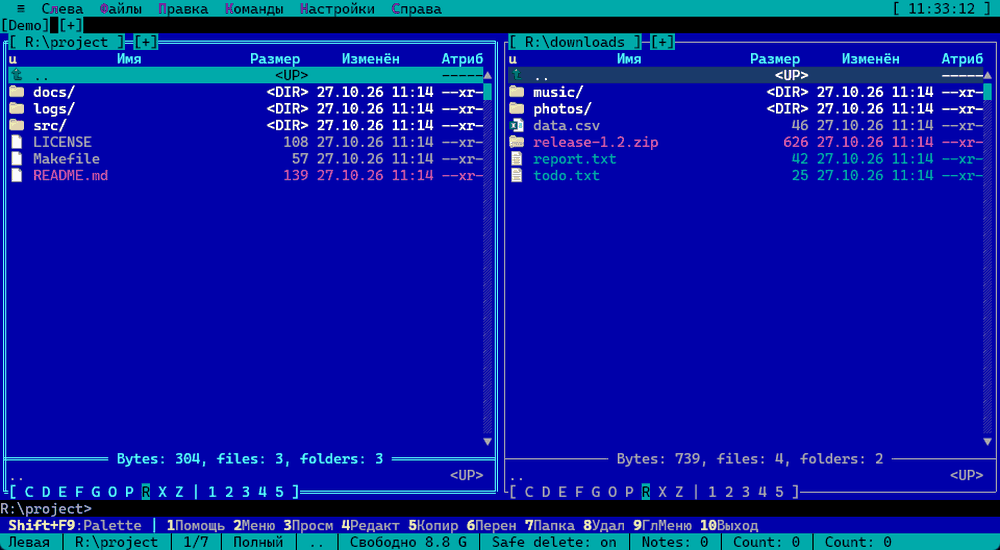

# Modern Terminal Navigator 2 (MTN2)

[English](README.md) | [Deutsch](README.de.md) | **Русский** | [中文](README.zh.md) | [한국어](README.ko.md)

Двухпанельный файловый менеджер в духе **Necromancer's DOS Navigator** и **Far Manager** со встроенной консолью,
терминалами, просмотрщиком и редактором. Интерфейс – текстовый (TUI), но рисуется в обычном GUI-окне:
виртуальная сетка символов на холсте Delphi FireMonkey (Skia, с откатом на стандартный холст по `--no-skia`)
с TrueType-шрифтами, Unicode и 32-битным цветом. Китайские, японские и корейские иероглифы
занимают две колонки, как в других терминалах.

[](https://github.com/Laex/MTN2/actions/workflows/ci.yml)
[](LICENSE)


[Страница проекта](https://laex.github.io/MTN2/ru/) ·
[Скачать последнюю версию](https://github.com/Laex/MTN2/releases/latest) ·
[Что нового](CHANGELOG.md) · [Частые вопросы](docs/FAQ.md) · [Участие в проекте](CONTRIBUTING.md) ·
[Обсуждения](https://github.com/Laex/MTN2/discussions) ·
[Статья на Хабре](https://habr.com/ru/articles/1087174/)

MTN2 сделан для тех, кто привык к DOS Navigator и Far Manager и работает с клавиатуры: системные и сетевые инженеры,
разработчики, администраторы. Он не заменяет Far Manager и не конкурирует с Total Commander, это ещё один
двухпанельник со своими привычками.

## Почему MTN2

- **Файловый менеджер и настоящий терминал в одном окне.** Панели, вкладки-терминалы на ConPTY (cmd, PowerShell, WSL, SSH); Vim, htop и другие TUI-программы работают как в обычном терминале.
- **Всё – папка.** Архивы (zip, 7z и другие), SFTP, FTP/FTPS, WebDAV, S3 и файловые системы плагинов открываются и копируются как обычные каталоги.
- **Не тормозит на больших данных.** Копирование, перенос и удаление идут фоновыми заданиями; поиск выдаёт до 50 000 результатов прямо в панель; большие файлы читаются потоком.
- **Мощный поиск.** По маске, тексту (UTF-8, UTF-16, Windows-1251, CP866), байтам с подстановкой `??`, размеру, дате и атрибутам.
- **Просмотр и правка без внешних программ.** Hex, Markdown, подсветка синтаксиса, слежение за логом, картинки в быстром просмотре, прямоугольные блоки и закладки в редакторе.
- **Сравнение и синхронизация.** Папки по времени, размеру и содержимому; два файла с построчной разницей.
- **Не нужно ничего запоминать.** Палитра команд (**Shift+F9**) с пояснениями, подсказки о клавишах в новых ситуациях, контекстная справка **F1**.
- **Ваш внешний вид и ваши клавиши.** Больше десяти тем (Far, Norton, Midnight, Total Commander, Dracula, Nord и другие), редактор тем, цветовые группы файлов, полностью переопределяемая раскладка.
- **Windows и Linux.** Графическое окно в Windows; в Linux – `mtn2-tui` (по SSH и в `tmux`) и окно SDL2; пакеты `tar.gz`, `.deb`, `.rpm`.
- **Свободно и без сюрпризов.** MPL-2.0, без телеметрии и установщика, переносимая версия, обновления только с вашего согласия, плагины (нативные и WebAssembly).

## Быстрый старт

1. Скачайте `MTN2-<версия>-win64.zip` со [страницы выпусков](https://github.com/Laex/MTN2/releases/latest) и распакуйте в любую папку: установщик и права администратора не нужны.
2. Запустите `MTN2.exe`. Настройки хранятся в `%APPDATA%\MTN2`; в переносной версии (`-portable.zip`) всё лежит рядом с программой.
3. Начните с этих клавиш:

| Клавиши | Что делают |
|---|---|
| **Shift+F9** | палитра команд: любой пункт меню находится по названию, рядом показаны его клавиши |
| **F1** | справка по текущему окну |
| **Tab**, **F5**, **F6** | другая панель, копирование, перенос |
| **F3**, **F4** | просмотр и правка файла под курсором |
| **Ctrl+Q** | быстрый просмотр файла в другой панели |
| **Alt+F7** | поиск файлов |
| **Ctrl+O** | консоль под панелями (**Esc** – назад к панелям) |
| **Ctrl+Shift+N** | новая вкладка с терминалом |

Для Linux (`mtn2-tui`, `mtn2-sdl`) смотрите раздел «Установка» ниже. Программа сама подсказывает полезные клавиши в новых для неё состояниях (архив, выделение, консоль, просмотр и другие); подсказки отключаются в **Параметры → Интерфейс**.

## Принципы

- **Без телеметрии и облачных функций.** Единственное обращение к сети – проверка новой версии на GitHub (раз в сутки,
  при запуске); её можно отключить в **≡ → Обновления...** (флажок «Проверять обновления при запуске»).
  Подробнее – в [FAQ](docs/FAQ.md).
- **Переносимость.** Один каталог без установщика и записей в реестр; в переносной версии настройки лежат рядом с
  `MTN2.exe`, в обычной – в `%APPDATA%\MTN2`. Настройки, темы и раскладка клавиш – обычные JSON-файлы.
- **Клавиатура прежде всего.** Раскладка клавиш близка к Far Manager, полностью переопределяется; вкладки и терминалы – как в ConEmu.
- **Настоящий терминал.** Консоль на ConPTY (cmd, PowerShell, WSL, SSH), а не имитация.
- **Расширяемость.** Нативные и WebAssembly-плагины: свои файловые системы, панели, команды, диалоги, подсветка текста.

> В статье на Хабре название расшифровано как Modern Turbo Navigator; актуальное название – **Modern Terminal Navigator**.

## Скриншоты

| | |
|---|---|
|  |  |
| Панели с вкладками, тема Far Classic | Архив открывается как папка |
|  |  |
| Просмотр Markdown с таблицами | Редактор, подсветка даёт плагин |
|  |  |
| Встроенная консоль (Ctrl+O) | Тема Dracula |

## Демо

| | |
|---|---|
|  |  |
| Палитра команд (**Shift+F9**): поиск по названию, рядом клавиши | Архив открывается как папка, подсказка о клавишах |
|  |  |
| Выделение (**Ins**) и быстрый просмотр (**Ctrl+Q**) | Просмотр лога со слежением за концом (**Ctrl+Shift+F**) |

## Возможности

- **Панели:** две панели с вкладками, Brief/Full/колоночные режимы, сортировка, быстрый поиск и живой фильтр,
  выделение по маске, сравнение каталогов, история и избранные папки, длинные пути (> MAX_PATH).
- **Операции с файлами:** копирование, перенос и удаление в фоновых заданиях с прогрессом, атрибуты и даты,
  ссылки, корзина, контрольные суммы, синхронизация каталогов.
- **Консоль и терминалы:** командная строка под панелями, настоящий ConPTY (cmd, PowerShell, pwsh, Git Bash, WSL,
  SSH), ANSI/VT-разбор, альтернативный экран для TUI-программ, рабочие пространства терминалов.
  Консольные программы, запущенные из панели или командной строки, работают во встроенной консоли, и их вывод
  остаётся на экране (`Ctrl+O`). Поиск по выводу консоли и терминала (`Ctrl+Shift+F`).
- **Просмотр и редактирование:** встроенные Viewer (текст, hex, потоковое чтение больших файлов), Editor,
  Quick View (`Ctrl+Q`), просмотр Markdown, внешние просмотрщик/редактор. В редакторе: команды над строками,
  прямоугольные блоки, закладки, автоотступ.
- **Виртуальные ФС:** архивы как папки (zip, 7z через `7z.dll`), SFTP по SSH, FTP / FTPS / WebDAV / S3 (плагин «Сетевые подключения»), плагинные VFS.
- **Поиск (`Alt+F7`):** по маске, по содержимому (UTF-8, UTF-16, Windows-1251, CP866), по hex-байтам с `??`, по размеру, дате и атрибутам.
  Результаты появляются в панели по ходу поиска (до 50 000 файлов), и с ними работают как с обычной папкой.
- **Сравнение и синхронизация:** папки по времени, размеру или содержимому (в фоне, с прерыванием); два файла с построчной разницей
  (`Ctrl+Alt+C`); синхронизация каталогов; переход на одноимённый файл в другой панели (`Ctrl+Alt+M`).
- **Логи и бинарные файлы:** слежение за концом растущего файла (`Ctrl+Shift+F`, понимает ротацию лога), поиск по байтам в hex-режиме,
  подсветка текстовых файлов и картинки в быстром просмотре.
- **Командная строка и автоматизация:** список прежних команд по началу набранного, профили окружения для оболочек (`environment.json`),
  `MTN2 путь1 путь2` открывает вкладки, `--view` и `--edit` – просмотр и правку, `--update` – обновление без окна, список файлов в Markdown или CSV.
- **Макросы:** плагин «Макросы» выполняет макросы на Lua. `Ctrl+.` записывает нажатые клавиши в файл макроса; макрос запускается своей клавишей или из меню «Макросы» на панелях, в просмотрщике, редакторе и консоли и перед стартом может проверить состояние программы (область, отмеченные файлы, выделение). Макросы – обычные текстовые файлы; три образца лежат в поставке (`samples\macros`). Описание – в справке F1 в диалогах макросов.
- **Git и мелочи:** плагин «Git status» показывает в строке состояния ветку и число изменений, красит имена файлов в панелях по состоянию в git, Ctrl+Shift+D открывает `git diff` файла во встроенном просмотре, а команда «Git blame файла» показывает автора и коммит каждой строки; Ctrl+Shift+F12 – переход по частым папкам; по желанию – Vim-клавиши на панели (`hjkl`, `g`, `G`, `/`, `:`); цветовые группы с приоритетами; заставка с акулами при простое.
- **Настройка:** переопределяемые клавиши (`keymap.json`), темы из файлов (Far Classic, Norton Commander, Midnight Commander, Total Commander, Gruvbox, Tokyo Night, Dracula, Nord, Solarized, Light, High Contrast и др.; свои – в редакторе тем),
  меню пользователя (F2), палитра команд (`Shift+F9`) – поиск по пунктам меню, ассоциации файлов, контекстная справка F1.
- **Языки:** интерфейс и справка на английском, русском, немецком и китайском (упрощённом); язык выбирается в **Настройки → Интерфейс...**
  и применяется без перезапуска; при первом запуске берётся язык Windows, если для него есть перевод. Свой язык добавляется папкой `resource\<язык>\` рядом с `MTN2.exe` (`locale.json`, `strings.json`, справка в `help\`); перекомпиляция не нужна. Встроен только английский.
- **Unicode:** иероглифы CJK (основная многоязычная плоскость), хирагана, катакана, хангыль и полноширинные
  формы показываются в консоли, панелях, вкладках и заголовках в две колонки; шрифт подставляется системный.
- **Плагины:** нативные DLL и WebAssembly (через Wasmtime) – свои VFS-схемы и панели для них, пункты меню,
  привязки клавиш, шина сообщений. Протоколы диалогов, оверлеев и строк состояния для плагинов описаны,
  но пока доступны только самой программе – см. [PLUGIN_BOUNDARIES](docs/PLUGIN_BOUNDARIES.md).
- **Обновления:** раз в сутки проверка новой версии на GitHub; загрузка (с проверкой SHA-256), установка
  и перезапуск – только после вопроса пользователю. Меню **≡ → Обновления...**.

### Платформы

- **Windows x64** – графическая программа.
- **Linux x86-64** – `mtn2-tui` занимает весь текстовый терминал: те же панели, просмотрщик, редактор, консоль и плагины; работает по SSH и в `tmux` (см. [docs/LINUX.md](docs/LINUX.md)).
- **Linux, окно SDL2** – пробная графическая версия `mtn2-sdl`: системный шрифт, мышь и колесо, ввод в любой раскладке, буфер обмена рабочего стола, картинки в быстром просмотре. Работает на X11 и Wayland (в Windows – через WSLg), входит в пакеты `tar.gz`, `.deb` и `.rpm`, из исходников собирается ключом `-Sdl`. Нужны `libSDL2` и `libfreetype`, для PNG и JPEG – `libSDL2_image`; зависимости, параметры и запуск описаны в [docs/LINUX.md](docs/LINUX.md), раздел «Версия с окном SDL2».
- **macOS** – сборка в планах.

## Установка

Готовые сборки – на странице [Releases](https://github.com/Laex/MTN2/releases):

| Файл | Что внутри |
|------|------------|
| `MTN2-<версия>-win64.zip` | Windows; настройки и история хранятся в `%APPDATA%\MTN2` |
| `MTN2-<версия>-win64-portable.zip` | Windows, переносная версия: всё хранится рядом с `MTN2.exe` |
| `MTN2-<версия>-linux-x64.tar.gz`, `.deb`, `.rpm` | Linux: `mtn2-tui` (в окне терминала, работает по SSH) и пробная графическая `mtn2-sdl` (окно SDL2) |

### Windows

Через [Scoop](https://scoop.sh):

```
scoop bucket add mtn2 https://github.com/Laex/scoop-mtn2
scoop install mtn2
```

Или без Scoop: распаковать архив в любую папку и запустить `MTN2.exe`.

Дальше программа обновляется сама (меню **≡ → Обновления...**).

В комплект входит `7z.dll` из [7-Zip](https://www.7-zip.org) (GNU LGPL; тексты лицензий – в `plugins\mtn.7z\license.txt`, подробности – в [THIRD-PARTY.md](THIRD-PARTY.md)): с ней открываются архивы 7z и другие форматы 7-Zip. Её можно заменить своей x64-версией в `plugins\mtn.7z\`; zip открывается и без неё.

### Linux

Один из способов:

```
tar xzf MTN2-*-linux-x64.tar.gz && ./mtn2/install.sh
sudo apt install ./MTN2-*-linux-x64.deb
sudo dnf install ./MTN2-*-linux-x64.rpm
```

`install.sh` без `sudo` ставит программу для текущего пользователя, с `sudo` – для всех. После установки `mtn2` запускает версию для терминала, `mtn2-sdl` – окно SDL2.

Папку из архива можно и не устанавливать: `mtn2/mtn2-tui` и `mtn2/mtn2-sdl` запускаются там, где лежат. Зависимости и параметры – в [docs/LINUX.md](docs/LINUX.md).

### Dev-сборки

Пре-релизные (dev) сборки публикуются после каждого изменения в `main` в отдельном репозитории
[Laex/MTN2-dev](https://github.com/Laex/MTN2-dev/releases). Чтобы получать их автоматически, откройте
**≡ → Обновления...** и включите флажок dev-канала; вернуться на стабильные релизы можно, сняв его.
Dev-сборки содержат свежие изменения и могут быть менее стабильными.

## Сборка

Нужны RAD Studio 13 (Delphi, `Studio\37.0`) и Windows x64; для WASM-плагина `mtn.ws` – Rust.
Версия для Linux собирается из Windows компилятором `dcclinux64`, тесты для неё запускаются в WSL.

```powershell
./src/build.ps1 -Config Release -Platform Win64   # bin\win64\MTN2.exe + bin\win64\plugins\
./src/tests/run-tests.ps1                          # регрессионные тесты (DUnitX)
./src/build-linux.ps1                              # bin\linux64\mtn2-tui
./src/tests/run-tests-linux.ps1                    # те же тесты в WSL
```

Запуск: `bin\win64\MTN2.exe [--no-skia] [--fps] [путь]`. Подробности – в [docs/BUILDING.md](docs/BUILDING.md).

## Структура репозитория

| Путь | Содержимое |
|---|---|
| `src/Core` | ядро: панели, VFS, консоль, редактор, диалоги, плагинный хост |
| `src/Platform` | платформенный слой: `Windows` и `Posix` с одноимёнными модулями |
| `src/Hosts` | оболочки: `Ansi` – версия для текстового терминала |
| `src/Forms`, `src/dialogs`, `src/Assets/themes` | главная форма, JSON-диалоги, корневая тема |
| `src/plugins` | встроенные плагины (`mtn.7z`, `mtn.tmp`, `mtn.git`, `mtn.csv`, `mtn.logfilter`, `mtn.lua`, `mtn.ws`, WASM-демо) |
| `src/tests` | регрессионные тесты DUnitX по группам и раннер `run-tests.ps1` |
| `src/tools` | DialogDesigner, ExportDialogJson, группа проектов `Group.groupproj`, служебные скрипты |
| `bin/win64`, `bin/linux64` | результат сборки по платформам |
| `bin/win64/resource` | языковые пакеты (строки интерфейса и справка F1: en/ru/de/zh) и поставляемые темы (`themes/`), поставляются вместе с программой |
| `docs` | документация разработчика, скриншоты (`docs/images`) |

## Документация

- [FAQ.md](docs/FAQ.md) – частые вопросы: сеть и приватность, SmartScreen, масштаб экрана, темы, плагины.
- [CONTRIBUTING.md](CONTRIBUTING.md) – как сообщить об ошибке, предложить идею, собрать проект и отправить изменение.
- [SDS.md](docs/SDS.md) – полная спецификация: концепция, структуры данных, API, дорожная карта.
- [ARCHITECTURE.md](docs/ARCHITECTURE.md) – слои, потоки данных и инварианты.
- [BUILDING.md](docs/BUILDING.md) – сборка, тесты, CI/CD.
- [LINUX.md](docs/LINUX.md) – версии для Linux (терминал и окно SDL2): установка, параметры, зависимости.
- [THEMES.md](docs/THEMES.md) – формат файла темы и роли цветов.
- [HELP.md](docs/HELP.md) – исходный текст справки пользователя одним файлом.
- Плагинные контракты: [PLUGIN_BOUNDARIES](docs/PLUGIN_BOUNDARIES.md), [PANEL](docs/PANEL_PLUGIN.md),
  [DIALOG](docs/DIALOG_PLUGIN.md), [INPUT](docs/INPUT_PLUGIN.md), [OVERLAY](docs/OVERLAY_PLUGIN.md),
  [STATUS](docs/STATUS_PLUGIN.md), [TEXTAREA](docs/TEXTAREA_PLUGIN.md), [TOOLBAR](docs/TOOLBAR_PLUGIN.md),
  [UI_PRIMITIVES](docs/UI_PRIMITIVES.md).

## Как создавался проект

При разработке MTN2 использовались ИИ-ассистенты, в том числе собственной разработки. С их помощью созданы:

- предпроектная документация – спецификация ([SDS.md](docs/SDS.md)), обзор архитектуры, описания протоколов
  плагинов в `docs/`;
- отслеживание дорожной карты и планов работ;
- большинство комментариев в коде;
- регрессионные тесты на DUnitX (`src/tests`);
- выходная текстовая документация: справка F1 (`bin/win64/resource/<язык>/help`), [CHANGELOG.md](CHANGELOG.md), описания выпусков.

## Лицензия

[Mozilla Public License 2.0](LICENSE).
