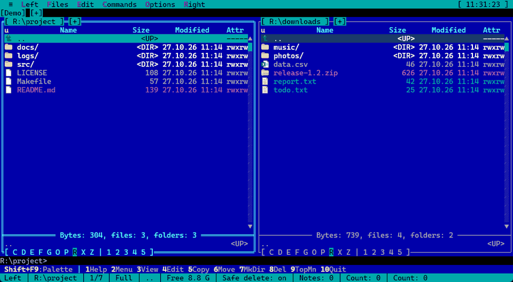
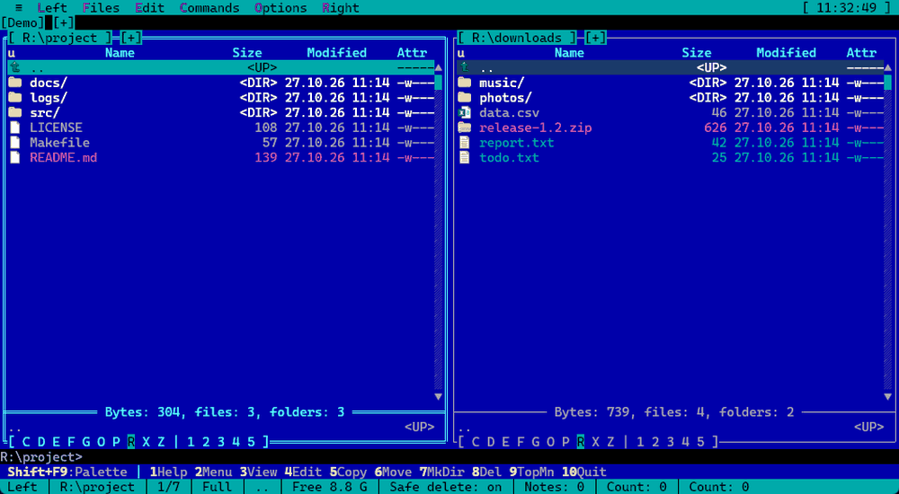
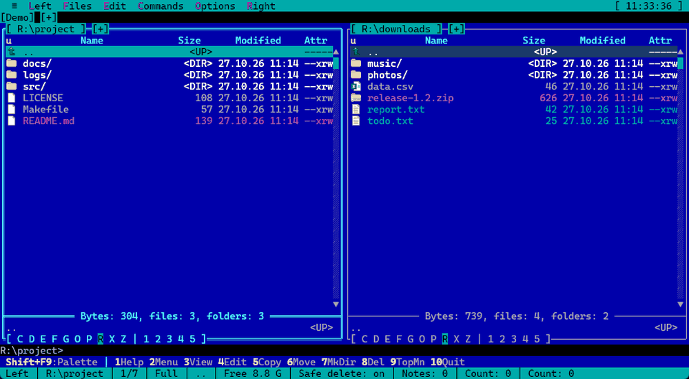

# Modern Terminal Navigator 2 (MTN2)

[English](README.md) | [Русский](README.ru.md) | [Deutsch](README.de.md) | [中文](README.zh.md) | **Türkçe**

**Necromancer's DOS Navigator** ve **Far Manager**'dan esinlenen, yerleşik konsol, terminaller, dosya görüntüleyici ve düzenleyici içeren çift panelli bir dosya yöneticisi. Kullanıcı arayüzü metin tabanlıdır (TUI), ancak standart bir GUI penceresi içinde çizilir: TrueType yazı tipleri, Unicode ve 32 bit renk desteğiyle Delphi FireMonkey tuvali üzerinde sanal bir karakter ızgarası (`--no-skia` ile standart tuvale geri dönüş destekli Skia tabanlı çizim). Çince, Japonca ve Korece (CJK) karakterler standart terminal davranışına uygun olarak iki sütun kaplar.

[](https://github.com/Laex/MTN2/actions/workflows/ci.yml)
[](LICENSE)


[Proje web sitesi](https://laex.github.io/MTN2/en/) ·
[En son sürümü indir](https://github.com/Laex/MTN2/releases/latest) ·
[Yenilikler](CHANGELOG.md) · [SSS](docs/FAQ.md) · [Katkıda Bulunma](CONTRIBUTING.md) ·
[Tartışmalar](https://github.com/Laex/MTN2/discussions) ·
[Habr'daki makale (Rusça)](https://habr.com/ru/articles/1087174/)

MTN2, DOS Navigator ve Far Manager ile büyümüş ve klavyeden çalışan kişiler için yapılmıştır: sistem ve ağ mühendisleri, geliştiriciler, yöneticiler. Far Manager'ın yerini almaz ve Total Commander ile rekabet etmez; kendi alışkanlıklarına sahip bir başka iki panelli yöneticidir.

## Neden MTN2

- **Tek pencerede bir dosya yöneticisi ve gerçek bir terminal.** Paneller, ConPTY terminal sekmeleri (cmd, PowerShell, WSL, SSH); Vim, htop ve diğer TUI programları normal bir terminaldeki gibi çalışır.
- **Her şey bir klasördür.** Arşivler (zip, 7z ve daha fazlası), SFTP, FTP/FTPS, WebDAV, S3, Docker kapsayıcıları, Android cihazları ve diğer eklenti dosya sistemleri sıradan dizinler gibi açılır ve kopyalanır.
- **Büyük verilerde hızlı kalır.** Kopyalama, taşıma ve silme işlemleri arka plan işi olarak çalışır; arama 50.000 adede kadar sonucu doğrudan bir panele akıtır; büyük dosyalar akış (stream) olarak okunur.
- **Güçlü arama.** Maskeye, metne (UTF-8, UTF-16, Windows-1251, CP866), `??` joker karakterli baytlara, boyuta, tarihe ve özniteliklere göre arama.
- **Harici araçlar olmadan görüntüleme ve düzenleme.** Hex, Markdown, sözdizimi vurgulama, günlük takibi, hızlı görünümde resimler, düzenleyicide dikdörtgen bloklar ve yer imleri.
- **Karşılaştırma ve eşitleme.** Klasörleri zamana, boyuta ve içeriğe göre; iki dosyayı satır satır fark (diff) ile karşılaştırın; silmeleri de aktaran iki yönlü eşitleme.
- **Ezberlenecek bir şey yok.** Açıklamalı bir komut paleti (**Shift+F9**), yeni durumlarda tuş ipuçları, **F1** ile bağlamsal yardım.
- **Sizin görünümünüz, sizin tuşlarınız.** Ondan fazla tema (Far, Norton, Midnight, Total Commander, Dracula, Nord ve daha fazlası), tema düzenleyici, dosya renk grupları, tamamen yeniden atanabilir tuş düzeni.
- **Windows ve Linux.** Windows'ta grafiksel pencere; Linux'ta `mtn2-tui` (SSH üzerinden ve `tmux` içinde) ve bir SDL2 penceresi; `tar.gz`, `.deb` ve `.rpm` paketleri.
- **Ücretsiz ve sürprizsiz.** MPL-2.0, telemetri yok, kurulum gerektirmez, taşınabilir sürüm, yalnızca onayınızla güncellemeler, eklentiler (yerel, WebAssembly ve Lua makroları).

## Hızlı başlangıç

1. [En son sürüm](https://github.com/Laex/MTN2/releases/latest) sayfasından `MTN2-<version>-win64.zip` dosyasını indirin ve herhangi bir klasöre açın: kurulum programı veya yönetici hakları gerekmez.
2. `MTN2.exe` dosyasını çalıştırın. Ayarlar `%APPDATA%\MTN2` içinde tutulur; taşınabilir sürüm (`-portable.zip`) her şeyi programın yanında tutar.
3. Şu tuşlarla başlayın:

| Tuşlar | Ne işe yararlar |
|---|---|
| **Shift+F9** | komut paleti: herhangi bir menü öğesi adıyla bulunur, tuşları yanında gösterilir |
| **F1** | geçerli pencere için yardım |
| **Tab**, **F5**, **F6** | diğer panel, kopyala, taşı |
| **F3**, **F4** | imlecin altındaki dosyayı görüntüle ve düzenle |
| **Ctrl+Q** | diğer paneldeki dosyanın hızlı görünümü |
| **Alt+F7** | dosya bul |
| **Ctrl+O** | panellerin altında konsol (**Esc** panellere geri döner) |
| **Ctrl+Shift+N** | yeni terminal sekmesi |

Linux (`mtn2-tui`, `mtn2-sdl`) için aşağıdaki "Kurulum" bölümüne bakın. Program ayrıca yeni bir duruma (bir arşiv, seçili dosyalar, konsol, görüntüleyici vb.) ilk kez girdiğinde yararlı tuşları adlandırır; ipuçlarını **Options → User interface** altından kapatabilirsiniz.

## İlkeler

- **Telemetri yok, bulut özelliği yok.** Tek ağ erişimi GitHub'da yeni bir sürüm kontrolüdür (günde bir kez, başlangıçta); bunu **≡ → Check for updates...** ("Check for updates at startup") içinden kapatabilirsiniz. Ayrıntılar [SSS](docs/FAQ.md) belgesindedir.
- **Taşınabilir.** Tek klasör, kurulum yok, kayıt defteri girdisi yok; taşınabilir sürüm ayarlarını `MTN2.exe` yanında, normal sürüm ise `%APPDATA%\MTN2` içinde tutar. Ayarlar, temalar ve tuş atamaları düz JSON dosyalarıdır.
- **Önce klavye.** Tuş düzeni Far Manager'a yakındır ve tamamen yeniden atanabilir; sekmeler ve terminaller ConEmu'daki gibi çalışır.
- **Gerçek bir terminal.** Konsol bir taklit değil, ConPTY (cmd, PowerShell, WSL, SSH) üzerinde çalışır.
- **Genişletilebilir.** Yerel ve WebAssembly eklentileri ile Lua makroları: özel dosya sistemleri, paneller, komutlar, iletişim kutuları, metin vurgulama. Bir eklenti ilk kullanımda yüklenir, bu yüzden ihtiyacınız olmayan bir eklenti hiç bellek tüketmez.

> Habr makalesi adı Modern Turbo Navigator olarak açmaktadır; geçerli ad **Modern Terminal Navigator**'dır.

## Ekran Görüntüleri

| | |
|---|---|
|  |  |
| Sekmeli paneller, Far Classic teması | Bir arşiv klasör olarak açılır |
|  |  |
| Tablolu Markdown görüntüleyici | Düzenleyici; vurgulama bir eklentiden gelir |
|  |  |
| Yerleşik konsol (Ctrl+O) | Dracula teması |

## Demo

| | |
|---|---|
|  |  |
| Komut paleti (**Shift+F9**): ada göre arama, tuşlar yanında gösterilir | Bir arşiv tuş ipucuyla birlikte klasör olarak açılır |
|  |  |
| Dosya seçme (**Ins**) ve hızlı görünüm (**Ctrl+Q**) | Sonunu takip eden bir günlüğü görüntüleme (**Ctrl+Shift+F**) |

## Özellikler

- **Paneller:** iki sekmeli panel, Brief/Full/sütun görünüm modları, sıralama, hızlı arama ve canlı filtre, maske seçimi, dizin karşılaştırma, geçmiş ve klasör hızlı listesi (sık kullanılanlar), uzun yollar (> MAX_PATH).
- **Dosya işlemleri:** ilerleme bildirimli arka plan işleri aracılığıyla kopyalama, taşıma ve silme, öznitelikler ve zaman damgaları, sembolik/sabit bağlantılar, Geri Dönüşüm Kutusu, sağlama toplamları, dizin eşitleme.
- **Konsol ve terminaller:** panellerin altında komut satırı, gerçek ConPTY (cmd, PowerShell, pwsh, Git Bash, WSL, SSH), ANSI/VT kaçış dizisi ayrıştırma, TUI uygulamaları için alternatif ekran arabelleği, terminal çalışma alanları. Panellerden veya komut satırından başlatılan konsol uygulamaları, çıktıları ekranda tutularak tümleşik konsolda çalışır (`Ctrl+O`). Konsol ve terminal çıktısında arama (`Ctrl+Shift+F`).
- **Görüntüleme ve düzenleme:** yerleşik Görüntüleyici (metin, hex, büyük dosyaların akışlı okunması), Düzenleyici, Hızlı Görünüm (`Ctrl+Q`), Markdown önizleme, harici görüntüleyici/düzenleyici desteği. Düzenleyicide satır komutları, dikdörtgen bloklar, yer imleri ve otomatik girintileme bulunur.
- **Sanal dosya sistemleri:** klasör olarak arşivler (zip, `7z.dll` aracılığıyla 7z), SSH üzerinden SFTP, FTP / FTPS / WebDAV / S3 (Ağ bağlantıları eklentisi); Docker ve Kubernetes kapsayıcıları ve pod'ları; `adb` üzerinden Android cihazları (`PATH` içinden veya Android SDK'dan alınır); diğer eklenti VFS'leri.
- **Arama (`Alt+F7`):** maskeye, içeriğe (UTF-8, UTF-16, Windows-1251, CP866), `??` joker karakterli hex baytlarına, boyuta, tarihe ve özniteliklere göre. Sonuçlar arama çalışırken bir panelde görünür (50.000 dosyaya kadar) ve sıradan bir klasör gibi davranır. Çalışan bir arama arka plana gönderilebilir (sekme satırındaki bir yonga bulunan dosyaları sayar) veya listenin büyümeye devam ettiği panelde tutulabilir.
- **Karşılaştırma ve eşitleme:** klasörleri zamana, boyuta veya içeriğe göre (arka planda, kesintiye uğratılabilir); iki dosyayı veya işaretli dosya gruplarını satır satır fark ile (`Ctrl+Alt+C`); dizin eşitleme (iki yönlü mod, onaydan sonra silmeleri de aktarır); fazla kopyaları bir kurala göre işaretleyebilen SHA-256 ile yinelenen dosya araması (en yenisi, en eskisi, yolu en kısa olanı veya bir klasördeki kalır); diğer paneldeki aynı adlı dosyaya atlama (`Ctrl+Alt+M`).
- **Günlükler ve ikili dosyalar:** büyüyen bir dosyanın sonunu takip etme (`Ctrl+Shift+F`, günlük döndürmeyi destekler), hex modunda bayt arama, düz metin dosyalarının vurgulanması ve hızlı görünümde resimler.
- **Komut satırı ve otomasyon:** yazdıklarınızla başlayan önceki komutların listesi, kabuklar için ortam profilleri (`environment.json`), `MTN2 path1 path2` sekmeleri açar, `--view` ve `--edit` görüntüleyici ve düzenleyiciyi açar, `--update` penceresiz günceller, dosya listeleri Markdown veya CSV'ye aktarılır.
- **Makrolar:** Macros eklentisi Lua ile yazılmış makroları çalıştırır. `Ctrl+.` bastığınız tuşları bir makro dosyasına kaydeder; bir makro kendi tuşundan veya paneller, görüntüleyici, düzenleyici ve konsoldaki Macros menüsünden başlar ve başlamadan önce programın durumunu (alan, işaretli dosyalar, seçim) denetleyebilir. Makrolar düz metin dosyalarıdır; programla birlikte üç örnek gelir (`samples\macros`). Makro iletişim kutularında F1 yardımına bakın.
- **Git ve ekstralar:** Git durum eklentisi durum çubuğunda dalı ve değişiklik sayılarını gösterir, panellerdeki dosya adlarını git durumlarına göre renklendirir, Ctrl+Shift+G bir dosyanın `git diff` çıktısını yerleşik görüntüleyicide açar ve "Git blame of the file" her satırın commit'ini ve yazarını gösterir; Plugins menüsü dosyaları dizine (index) ekler ve dizinden çıkarır, commit yapar ve dal değiştirir; Ctrl+Shift+F12 sık kullanılan klasörlere atlar; panelde isteğe bağlı Vim tuşları (`hjkl`, `g`, `G`, `/`, `:`); öncelikli renk grupları; boştayken köpekbalıklı ekran koruyucu.
- **Özelleştirme:** yeniden atanabilir tuş bağlamaları (`keymap.json`), dosya tabanlı temalar (Far Classic, Norton Commander, Midnight Commander, Total Commander, Gruvbox, Tokyo Night, Dracula, Nord, Solarized, Light, High Contrast vb.; yerleşik tema düzenleyicisi aracılığıyla özel temalar), kullanıcı menüsü (F2), menü öğelerini, ayar alanlarını ve sürücü değiştirme (Change Drive) listesinin öğelerini aramak için komut paleti (`Shift+F9`), dosya ilişkilendirmeleri, F1 bağlamsal yardım.
- **Diller:** Arayüz ve yardım İngilizce, Rusça, Almanca ve Basitleştirilmiş Çince olarak sunulur; dil **Options → User interface...** içinden seçilir ve yeniden başlatmadan anında uygulanır; ilk başlangıçta çevirisi varsa Windows dili kullanılır. Özel bir dil, `MTN2.exe` yanına `resource\<language>\` klasörü (`locale.json`, `strings.json`, `help\` içinde yardım) olarak eklenir; yeniden derleme gerekmez. Programa yalnızca İngilizce gömülüdür.
- **Unicode:** CJK ideografları (BMP), Hiragana, Katakana, Hangul ve tam genişlikli biçimler konsol, paneller, sekmeler ve başlıklarda iki sütun halinde çizilir; eksik glifler sistem yazı tiplerine geri döner.
- **Eklentiler:** yerel DLL'ler ve WebAssembly (Wasmtime aracılığıyla) – özel VFS şemaları ve özel paneller, menü öğeleri, tuş atamaları ve ileti veri yolu. İletişim kutusu, katman ve durum çubuğu eklenti protokolleri belirtilmiştir, ancak şu anda dahili kullanım için ayrılmıştır – [PLUGIN_BOUNDARIES](docs/PLUGIN_BOUNDARIES.md) belgesine bakın. Bir eklenti bildirimi (`plugin.json`) komutlarını, menü öğelerini ve onu uyandıran olayları bildirir, böylece program eklentiyi yalnızca bunlardan biri kullanıldığında yükler.
- **Güncellemeler:** yeni GitHub sürümleri için günlük kontrol; indirme (SHA-256 doğrulamalı), kurulum ve yeniden başlatma yalnızca kullanıcı onayından sonra gerçekleşir. Menü **≡ → Check for updates...**.

### Platformlar

- **Windows x64** – GUI uygulaması.
- **Linux x86-64** – `mtn2-tui` tam ekran bir metin terminalinde çalışır: aynı paneller, görüntüleyici, düzenleyici, konsol ve eklentiler; SSH üzerinden ve `tmux` içinde çalışır ([docs/LINUX.md](docs/LINUX.md) belgesine bakın).
- **Linux, SDL2 penceresi** – deneysel GUI sürümü `mtn2-sdl`: sistem yazı tipi, fare ve tekerlek, herhangi bir klavye düzeninde giriş, masaüstü panosu, Hızlı Görünüm'de resimler. X11 ve Wayland'da (Windows'ta WSLg üzerinden) çalışır, `tar.gz`, `.deb` ve `.rpm` paketlerine dahildir ve kaynak koddan `-Sdl` anahtarıyla derlenir. `libSDL2` ve `libfreetype` (PNG ve JPEG için `libSDL2_image`) gerektirir; bağımlılıklar ve seçenekler [docs/LINUX.md](docs/LINUX.md) içinde (Rusça) açıklanmıştır.
- **macOS** – bir derleme planlanmaktadır.

## Kurulum

Önceden derlenmiş ikili dosyalar [Releases](https://github.com/Laex/MTN2/releases) sayfasında mevcuttur:

| Dosya | İçerik |
|---|---|
| `MTN2-<version>-win64.zip` | Windows; ayarlar ve geçmiş `%APPDATA%\MTN2` içinde saklanır |
| `MTN2-<version>-win64-portable.zip` | Windows, taşınabilir sürüm: her şey `MTN2.exe` yanında saklanır |
| `MTN2-<version>-linux-x64.tar.gz`, `.deb`, `.rpm` | Linux: `mtn2-tui` (bir terminal penceresi içinde, SSH üzerinden çalışır) ve deneysel GUI `mtn2-sdl` (SDL2 penceresi) |

### Windows

[Scoop](https://scoop.sh) ile:

```
scoop bucket add mtn2 https://github.com/Laex/scoop-mtn2
scoop install mtn2
```

Veya Scoop olmadan: arşivi herhangi bir klasöre çıkarın ve `MTN2.exe` dosyasını çalıştırın.

Uygulama daha sonra kendi kendini günceller (menü **≡ → Check for updates...**).

Sürüm, 7z ve diğer 7-Zip biçimlerine destek sağlamak için [7-Zip](https://www.7-zip.org)'ten `7z.dll` dosyasını içerir (GNU LGPL; lisans metni `plugins\mtn.7z\license.txt` içinde, ayrıntılar [THIRD-PARTY.md](THIRD-PARTY.md) içindedir). Bunu `plugins\mtn.7z\` içinde kendi x64 sürümünüzle değiştirebilirsiniz; zip arşivleri onsuz da açılır.

### Linux

Şunlardan herhangi biri:

```
tar xzf MTN2-*-linux-x64.tar.gz && ./mtn2/install.sh
sudo apt install ./MTN2-*-linux-x64.deb
sudo dnf install ./MTN2-*-linux-x64.rpm
```

`sudo` olmadan `install.sh` geçerli kullanıcı için, `sudo` ile tüm kullanıcılar için kurar. Sonrasında `mtn2` terminal sürümünü, `mtn2-sdl` ise SDL2 penceresini başlatır.

Açılan klasör kurulum yapmadan da çalışır: `mtn2/mtn2-tui` ve `mtn2/mtn2-sdl` bulundukları yerden başlar. Bağımlılıklar ve seçenekler [docs/LINUX.md](docs/LINUX.md) içindedir.

#### Test edilen dağıtımlar

`.deb`, `.rpm` ve `tar.gz` paketleri bu dağıtımların temiz sistemlerinde kurulur ve başlar; tüm eklentiler yüklenir ve makrolar için Lua kitaplığı paketlenmiştir.

| Dağıtım | Paket | Sonuç |
|---|---|---|
| Debian 12 | `.deb` | çalışıyor |
| Ubuntu 22.04, 24.04 | `.deb` | çalışıyor |
| Fedora | `.rpm` | çalışıyor |
| openSUSE Leap 15.6 | `.rpm` | `glibc-locale` kurulduktan sonra çalışıyor (aşağıya bakın) |
| Arch Linux | `tar.gz` | `mtn2-tui` çalışıyor; `mtn2-sdl` için `sdl2` ve `freetype2` kurulu olmalı |
| Alpine (musl) | `tar.gz` | desteklenmiyor |

#### Bilinen sorunlar

- **openSUSE ve minimal imajlar.** glibc karakter kümesi modülleri (`/usr/lib64/gconv`) olmadan program hiçbir şey yazdırmadan başlangıçta çöker. Normal kurulumlarda bunlar vardır; kırpılmış konteyner imajlarında yoktur. Çözüm: `sudo zypper install glibc-locale`.
- **musl (Alpine).** Linux derlemeleri glibc 2.34 veya daha yenisini gerektirir.
- **kitty klavye protokolü olmayan terminaller.** Terminal tuş bırakmayı bildirmez; bu yüzden `Ctrl+Left/Right` ile sürücü seçimi ve `Alt` hızlı araması tuş bırakıldığında değil bir zamanlayıcı ile biter. `Ctrl+Shift` birleşimleri kullanılamayabilir; menüyü (`F9`) kullanın. Protokole sahip terminaller (kitty, foot, WezTerm, Ghostty, Alacritty) ve `mtn2-sdl` penceresi etkilenmez.
- **`mtn2-sdl`.** Pencereden dışarı dosya sürükleme yok (içine dosya bırakma çalışır). Yerel eklenti pencereleri desteklenmez; resim ve video eklentileri bunun yerine bir sekmede çizim yapar.
- **SSH ve `tmux` üzerinden pano.** Kopyalama terminalin OSC 52 desteğine dayanır; `tmux` içinde `set -g set-clipboard on` ayarını etkinleştirin.

### Geliştirme (Dev) Derlemeleri

Ön sürüm (dev) derlemeleri `main` dalındaki her commit'ten sonra özel bir depoda yayımlanır:
[Laex/MTN2-dev](https://github.com/Laex/MTN2-dev/releases). Bunları otomatik olarak almak için
**≡ → Check for updates...** menüsünü açın ve dev kanalı kutusunu işaretleyin; kararlı sürümlere dönmek için istediğiniz zaman işareti kaldırabilirsiniz.
Dev derlemeleri en son değişiklikleri içerir ve daha az kararlı olabilir.

## Derleme

RAD Studio 13 (Delphi, `Studio\37.0`) ve Windows x64 gerektirir; `mtn.ws` WASM eklentisi Rust gerektirir.
Linux sürümü `dcclinux64` derleyicisi kullanılarak Windows'tan çapraz derlenir ve testler WSL içinde çalıştırılır.

```powershell
./src/build.ps1 -Config Release -Platform Win64   # bin\win64\MTN2.exe + bin\win64\plugins\
./src/tests/run-tests.ps1                          # gerileme testleri (DUnitX)
./src/build-linux.ps1                              # bin\linux64\mtn2-tui
./src/tests/run-tests-linux.ps1                    # WSL'de aynı testler
```

Çalıştırma: `bin\win64\MTN2.exe [--no-skia] [--fps] [path]`. Ayrıntılar [docs/BUILDING.md](docs/BUILDING.md) içindedir.

## Depo Yapısı

| Yol | İçerik |
|---|---|
| `src/Core` | Çekirdek motor: paneller, VFS, konsol, düzenleyici, iletişim kutuları, eklenti barındırıcısı |
| `src/Platform` | Platform soyutlama katmanı: `Windows` ve `Posix` modülleri |
| `src/Hosts` | Kabuk barındırıcıları: `Ansi` – metin terminal sürümü |
| `src/Forms`, `src/dialogs`, `src/Assets/themes` | Ana form, JSON iletişim kutuları, varsayılan tema |
| `src/plugins` | Yerleşik eklentiler (`mtn.7z`, `mtn.adb`, `mtn.archivetools`, `mtn.bridge`, `mtn.checksums`, `mtn.csv`, `mtn.describe`, `mtn.diskmap`, `mtn.docker`, `mtn.docview`, `mtn.everything`, `mtn.exportlist`, `mtn.git`, `mtn.highlight`, `mtn.jtree`, `mtn.logfilter`, `mtn.lua`, `mtn.meta`, `mtn.multirename`, `mtn.net`, `mtn.pdf`, `mtn.rclone`, `mtn.ripgrep`, `mtn.screensaver`, `mtn.splitfile`, `mtn.thumbs`, `mtn.tmp`, `mtn.winsys`, `mtn.ws`, WASM demosu) |
| `src/tests` | Gruba göre DUnitX gerileme testleri ve test çalıştırıcısı `run-tests.ps1` |
| `src/tools` | DialogDesigner, ExportDialogJson, `Group.groupproj` proje grubu, yardımcı betikler |
| `bin/win64`, `bin/linux64` | Platforma göre derleme çıktısı |
| `bin/win64/resource` | Uygulamayla birlikte gelen dil paketleri (arayüz dizeleri ve F1 yardımı: en/ru/de/zh) ve temalar (`themes/`) |
| `docs` | Geliştirici belgeleri, ekran görüntüleri (`docs/images`) |

## Belgeler

- [FEATURES.md](docs/FEATURES.md) – alana göre özelliklere genel bakış.
- [FAQ.md](docs/FAQ.md) – sıkça sorulan sorular: ağ ve gizlilik, SmartScreen, ekran ölçekleme, temalar, eklentiler.
- [CONTRIBUTING.md](CONTRIBUTING.md) – hata bildirme, fikir önerme, projeyi derleme ve değişiklik gönderme.
- [SDS.md](docs/SDS.md) – tam belirtim: konsept, veri yapıları, API, yol haritası.
- [ARCHITECTURE.md](docs/ARCHITECTURE.md) – katmanlar, veri akışları ve değişmezler.
- [BUILDING.md](docs/BUILDING.md) – derleme kılavuzu, testler, CI/CD.
- [LINUX.md](docs/LINUX.md) – Linux terminal sürümü: kurulum, seçenekler, bağımlılıklar.
- [THEMES.md](docs/THEMES.md) – tema dosyası biçimi ve renk rolleri.
- [LANGUAGE_PACKS.md](docs/LANGUAGE_PACKS.md) – arayüz dili ekleme.
- [HELP.md](docs/HELP.md) – tek bir dosyada eksiksiz kullanıcı kılavuzu.
- Eklenti sözleşmeleri: [PLUGIN_BOUNDARIES](docs/PLUGIN_BOUNDARIES.md), [PANEL](docs/PANEL_PLUGIN.md),
  [DIALOG](docs/DIALOG_PLUGIN.md), [INPUT](docs/INPUT_PLUGIN.md), [OVERLAY](docs/OVERLAY_PLUGIN.md),
  [STATUS](docs/STATUS_PLUGIN.md), [TEXTAREA](docs/TEXTAREA_PLUGIN.md), [TOOLBAR](docs/TOOLBAR_PLUGIN.md),
  [UI_PRIMITIVES](docs/UI_PRIMITIVES.md).

## Proje Nasıl Oluşturuldu

MTN2, kendi geliştirdiğimiz araçlar dahil olmak üzere yapay zekâ kodlama asistanlarının yardımıyla geliştirildi. Şunların oluşturulmasına yardımcı oldular:

- Ön proje belgeleri: belirtim ([SDS.md](docs/SDS.md)), mimari genel bakış, `docs/` içindeki eklenti protokolü belirtimleri;
- Yol haritası takibi ve görev planlama;
- Çoğu kaynak kodu yorumu;
- DUnitX gerileme testleri (`src/tests`);
- Kullanıcıya dönük metin belgeleri: F1 yardımı (`bin/win64/resource/<language>/help`), [CHANGELOG.md](CHANGELOG.md) ve sürüm notları.

## Lisans

[Mozilla Public License 2.0](LICENSE).
