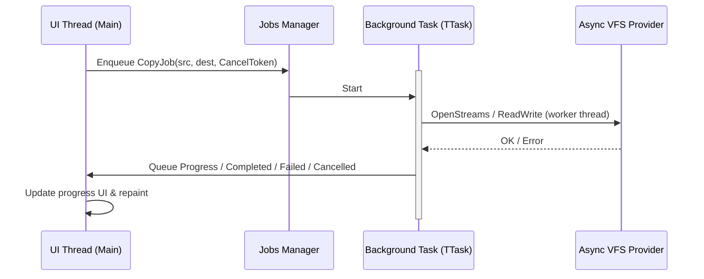

# Architecture Overview – MTN2 (Delphi Edition)

**English** | [Русский](ARCHITECTURE.ru.md)

> **Purpose of this document:** a short overview of the architectural decisions, invariants, and the threading model.  
> **API details, data structures, and roadmap:** see [SDS.md](SDS.md) (System Design Specification).  
> If the wording differs, SDS takes precedence, except for the invariants explicitly marked here.  
> This document was prepared with the help of AI assistants, including in-house ones (see [README](../README.md#how-the-project-was-created)).

This document describes the key architectural decisions of **Modern Terminal Navigator 2 (MTN2)**, implemented in Object Pascal (Delphi) with the FireMonkey (FMX) graphics framework.

**Product focus:** an everyday file manager built on the **NDN** foundation, complemented by **FAR** and **Total Commander** practices. The architecture follows this focus: plugin contracts are mandatory from the start, but the delivery priority is daily-work scenarios, not an ecosystem. Order of extensions: **native MTN2 plugins → Far → Total Commander** (SDS §6.0). More in SDS §1.0.

---

## 1. Architectural layers

The application is split into independent layers to keep it modular, testable, and easy to extend with new features (for example, network VFS protocols or viewer modules).

```text
┌──────────────────────────────────────────────────────────┐
│  Input Layer: FMX Form (KeyDown, Mouse) -> Keymapper     │
├──────────────────────────────────────────────────────────┤
│  MDI Window Manager & Compositor                         │
│  (z-order, focus, TTerminalGrid logical buffers)         │
├──────────────────────────────────────────────────────────┤
│  TTerminalRenderer (FMX Canvas & GPU Double Buffering)   │
├──────────────────────────────────────────────────────────┤
│  Async VFS Core (URI)      │ Background Job Queue (PPL)  │
├──────────────────────────────────────────────────────────┤
│  Local Disk (IOUtils)        │ Network VFS (SFTP/S3)     │
└──────────────────────────────────────────────────────────┘
```

| Layer | Purpose |
|---|---|
| **Input / Keymap** | Intercepts FMX Form events. Translates key presses and mouse actions into internal commands (`uKeymap.pas`). Determines the focused window. |
| **Top Menu Bar** | `TTopMenuBar` (`uTopMenuBar.pas`) – the top drop-down menu in the NDN / FAR Manager style, driven by keyboard (F9 / Alt) and mouse. The hotkey letter of a translation is set with the `&` marker in `strings/<locale>.json` (`"&Files"`) and works in any keyboard layout; the color of the hotkey letters in all menus is `cMenuHotKeyFg` (`uDualPanelOverlays.pas`). A menu that does not fit in height is scrollable (a ▲▼ bar on the right border, mouse wheel). The command palette (Shift+F9) is built from the live menu: `uCommandPalette.pas`, dialog – `uDualPanelPaletteDialog.pas`. |
| **MDI Compositor** | Holds the list of virtual console windows. Merges their individual text buffers into one resulting screen buffer. Uses the `IThemeRenderer` interface to style basic widgets (frames, buttons, scrollbars, tabs, toolbars, status lines). |
| **TTerminalRenderer** | Takes the resulting text buffer and draws it on the form's `TCanvas` through an off-screen `TBitmap` (ping-pong front/back). GPU rendering, cursor blinking (530 ms), dynamic grid on resize/zoom. Optionally **Skia** (`DCC_Define SKIA`): natural-advance text, alpha-blit. Cells with `TCharCell.IconId` are shell icons loaded by a background thread (`uShellIcons`, "Live reload of open files + background loading of shell icons" in SDS). |
| **VFS Core & Registry** | Routes requests by URI scheme (`file://`, `sys://folders`, `recycle://`, `zip://`, `find://`, `ws://`, `sftp://`, …) through `uVfsRegistry.pas`. Caches archive data (`uZipArchiveCache.pas`). All operations are asynchronous (callback / job). Network VFS (`sftp://`, "Network VFS") is the in-process provider `uSftpVfs.pas`, which uses `sftp.exe` in batch mode, with no external libraries; the accounts are the list shared with the SSH console, `uSshConnections.pas`. Copy/Move involving `sftp://` are classified as `vtrSftp` (not File VFS); `sftp://`↔`sftp://` goes through a local temp. |
| **Config Location** | `uConfigLocation.pas` – centralized choice of the configuration path (%APPDATA%\MTN2 or Portable mode with `portable.dat`), including `session.json`, `keymap.json`, `workspaces.json`. Mode switching is handled by `uConfigMode.pas` (a plan with locks and warnings, a transfer with verification and rollback); the file layout is the same in both modes, so no conversion is required. |
| **Shell Icons** | `uShellIcons.pas` – a cache of Windows shell icons keyed by extension / file path; `..` → `parent_up.png`. Extraction (`SHGetFileInfo`/`ExtractIconEx`) runs on a dedicated worker thread that pumps window messages (`MsgWaitForMultipleObjects` + `PeekMessage`), not on the UI thread – otherwise the COM marshaling of shell extensions (cloud overlays, antivirus software) could hang the thread forever. |
| **OLE Drag & Drop** | `uWinFileDragDrop.pas` – a bridge to native Windows OLE Drag & Drop (`CF_HDROP`) for dragging files between MTN2 and Explorer. |
| **Jobs Manager** | `TPanelJobList` (`uDualPanelJobList.pas`) owns several `TPanelJobController`s. I/O already runs in a worker (`CopyAsync`/`DeleteAsync` + `TThread.Queue`). A confirm can go to **Background**: the panels stay live, progress is shown in the status line, and overwrite/I/O ask is modal again. Several jobs: `file://`↔`file://` run in parallel; one zip/`7z://`/sftp authority or overlapping URIs are queued (`pjpQueued`). Limit 8. List: `kaJobList` (Ctrl+Shift+J). Copy/Move: robocopy-lite options and optional `DestURIs` (`BeginJobPairs`). Directory Sync: `uDualPanelSync`. Search is a separate `TSearchController`, not this pool. |
| **Process Bridge** | A real Windows **ConPTY** (`CreatePseudoConsole`/`ResizePseudoConsole`/`ClosePseudoConsole` in `uConPty.pas`, unconditionally for `Start`/`StartShell`, no pipe-only fallback) with a per-profile input/output encoding (`ProfileOutputEncoding`) and a pending multi-byte tail between chunks; pre-warmed at application start (`TMainForm.FormCreate` → `EnsureConsole` + `EnsureShell`), so the first command does not pay the shell start-up latency. Target: PTY (POSIX, `forkpty`) – "PTY on Linux/macOS". |
| **Theme Engine** | `IThemeRenderer` – the visual style of cells (frames, buttons, tabs, toolbar, status line). The only implementation is `TDataTheme` (`uDataTheme.pas`): colors, symbols, and typefaces come from a theme file (`*.theme.json`, format in `docs/THEMES.md`); the default theme is `NDN`. |
| **Plugin Manager** | Lifecycle of **native** plugins: `uPluginHost` → `uPluginLoader` (DLL `plugins\<id>\*.dll`, ABI v1), VFS/panel/menu/keymap registries. Far/TC are separate bridges on top of the native API. |
| **Event Bus / Broker** | `IMessageBus` – pub/sub between plugins and the core. |
| **ANSI Parser** | `IANSIParser` – VT100/xterm → `TTerminalGrid` + scrollback (TrueColor, later alt screen). See §8. |
| **Scripting Engine** | Lua macros – the `mtn.lua` plugin: a Lua sandbox; the `mtn.key` / `mtn.text` / `mtn.action` calls run on the main thread via `PostToMain`. The Lua library is loaded dynamically. SDS §6.6. |
| **Overlay Renderer** | Raster graphics on top of the text grid (previews); requests go through the core, not through the plugin's Canvas. |
| **Far API Wrapper** | A Windows-only bridge for **Far** VFS plugins (after the native Plugin Manager; SDS §6.8.2). |
| **TC Plugin Bridge** | A Windows-only bridge for **Total Commander** WCX/WFX (after the native API; SDS §6.8.3). |

---

## 2. Dynamic Grid (logical screen resolution)

The logical terminal grid is **not fixed**. The number of columns and rows (`Cols × Rows`) is recalculated when the FMX window is resized and when the scale (font/cell zoom) changes:

```text
  ClientWidth / CellWidth   → Cols
  ClientHeight / CellHeight → Rows
```

1. `TTerminalRenderer` measures the monospace glyph metrics (`CellWidth`, `CellHeight`) for the current font and zoom factor.
2. On `OnResize` / zoom change, the core recalculates `Cols`/`Rows`, recreates `TTerminalGrid`, and notifies the MDI compositor (`Resize` of all windows).
3. The physical cell size in pixels changes smoothly; the logical grid structure follows the window and the scale.

Renderer API details are in SDS, §4.

### Wide characters (CJK)

The grid is designed for a fixed-width cell, while CJK ideographs, hiragana, katakana, hangul, and full-width forms occupy two columns.

- **Character width:** the single source is `CharDisplayWidth` in `uCharWidth.pas` (2 columns for the listed ranges of the main Unicode table, 1 for everything else). Any code that aligns, truncates, or measures text width uses `TextDisplayWidth`, `TextFitChars`, and `StripWideFillers`, not `Length`.
- **Cell pair:** the first cell stores the character with the `ccaWide` attribute, the second one a filler (a space with the `ccaWideTail` attribute and the same colors). Writing through `DrawGridChar` creates the pair, overwriting either half clears the other, so there are no "orphaned" halves. A wide character in the last column is not drawn.
- **Console:** `PutCell` of both grids (`TPrimaryScreenGrid`, `TAltScreenGrid`) advances the cursor by 2 and wraps a character that does not fit in the last column. History lines stay cell-aligned so that the selection columns match; fillers are removed on copy.
- **Renderer:** the first cell of a pair is drawn as one glyph spanning two columns; the width attribute is part of the glyph cache key. The filler is skipped. The system supplies fonts for CJK.
- **Not covered:** the cursor and selection in the editor, input fields, and dialog captions count by characters; characters outside the BMP and combining marks are not supported (see SDS).

---

## 3. Dual Panel, Tabs, and MDI

The file manager UI hierarchy:

```text
TDualPanelWindow (one workspace MDI window)
├── Dual Panel level TabBar    ← workspace tabs (each = its own TDualPanelState)
└── Active Dual Panel State
    ├── Left Panel
    │   ├── Panel TabBar       ← directory tabs inside the left panel
    │   └── File list (active tab)
    └── Right Panel
        ├── Panel TabBar
        └── File list (active tab)
```

| Level | Purpose |
|---|---|
| **Dual Panel Tabs** | Tabs for the whole two-panel window. `wkPanels` = a full `TDualPanelState`; `wkDocument` = Viewer/Editor (F3/F4); `wkTerminal` = a live `TTerminalWorkspaceWindow` session (`Ctrl+Shift+N`) – all three on one strip. Not to be confused with the `ws:///` link panel and its snapshot library (`Ctrl+Shift+D`). |
| **Panel Tabs** | Tabs inside each side (`Left` / `Right`). Each is a separate `TTab` with `CurrentURI`, history, cursor, and scroll. |
| **Other MDI windows** | Only **Console** (`TConsoleWindow`, Ctrl+O) – a separate MDI window on top of the cmdline. Terminal Workspace is **not** an MDI window: it lives as a Dual Panel Tab (`wkTerminal`), like Viewer/Editor. |

**Viewer / Editor / Terminal / Console chrome (current):** inside the right edge of the frame there is a vertical scrollbar drawn through `IThemeRenderer.DrawScrollBar` (▲ / track ░ / thumb █ / ▼). The text leaves the right grid column for the scrollbar; the window handles the click (`HandleClick`), the Host (`TMainForm`) routes mouse-down to the Dual Panel (embedded editor/terminal) or the Console MDI. The mouse wheel → `HandleInput` (Up/Down). At the bottom there are the F-key bar and the status line: for `wkTerminal` these are the **shared** Dual Panel lines (the `fbcTerminal` context: `Esc:Close`, `Ctrl+A/C/V`; the status is the shell profile + Running/Not running), not a terminal-owned line – that one is gone, and the freed height is given to the terminal. **Viewer** = `TEditorWindow` ViewOnly (F3) in a Dual Panel tab; there is no separate `uViewerWindow.pas`. Search F7/`/` + F3 / Shift+F3; Far: Shift+F7 / Alt+F7. **F6** switches Viewer↔Editor on the same tab; **F8** / **Shift+F8** encodings; **Alt+F8** goto line (contextual: the same chord in a Dual Panel Tab with focus on the panels/cmdline is the command history, see below; the routing does not conflict, because `wkDocument` intercepts input entirely before the keymap dispatcher, `TDualPanelWindow.HandleInput`); Editor: Ctrl+C/X/V, Ctrl+Z / Ctrl+Shift+Z (Undo/Redo; **Ctrl+Y** = delete line as in Far), Ctrl+D/K/N, Ctrl+Left/Right, Ctrl+F7 Replace. Dual Panel: Shift+F6 rename via `MoveAsync`. Encodings: BOM → UTF-8/UTF-16; otherwise UTF-8; otherwise GBK / GB18030 / Big5 (valid double-byte sequences that do not look like Cyrillic); otherwise ANSI or OEM by Cyrillic features; all encodings are available in the F8 cycle; raw bytes are kept in `TEditorDoc` for re-parsing (`uTextEncoding`). Implementation: `uEditorWindow.pas`, `uEditorDoc.pas`, `uConsoleWindow.pas`, `uTerminalWorkspace.pas`, `uDualPanelWindow.pas`. **F1 Help** (`uHelpViewer.pas`) is the same `TEditorWindow` (`HelpMode`, F-bar context `fbcHelp`) in a modal window on top of the Dual Panel (`TDualPanelWindow.FHelp`: input, mouse, and drawing are intercepted first); topics are `resource\<language>\help\*.md`, with Markdown link navigation and "back" history.

Relation to the compositor: `TDualPanelWindow` is a specialized `TTerminalWindow`. Switching a Dual Panel Tab replaces the whole panel snapshot; switching a Panel Tab changes only the URI/cursor of the active side.

**Live reload ("Live reload of open files + background loading of shell icons" in SDS):** a local (non-streaming, non-archive) file open in Viewer/Editor is watched through `TDirectoryWatcher` (`uDirWatch.pas`) on its containing directory and is re-read silently when the size/write time on disk differs – but only while there are no unsaved edits (`FDirty`); the program's own save does not echo-trigger a reload. `TEditorDoc.ContentGen` is a counter of content reloads, with which consumers that keep their own line cache (the Markdown Viewer) check freshness without reacting to every `OnChanged`.

**Everyday features ("Everyday details: sorting, file history, properties, dates, text Quick View"):**
- **Text Quick View:** `uQuickTextView.pas` holds one `TEditorWindow` in `Chromeless` mode (no frame / F-bar / status; `PaintEmbedded` copies only the interior and does not touch the panel frame). The document is switched through `CloseDocument` / `Open` and is never freed during loading – otherwise the asynchronous `TEditorDoc` callback would hit a freed object. Pictures use the Overlay as before.
- **File history:** `uFileHistory.pas` (like `uFolderHistory`), written in `TDualPanelWindow.OpenDocument`.
- **Properties:** `uShellAssoc.ShellShowProperties`; only `TMainForm` has a window handle, so `TDualPanelWindow` hands the paths out through the `OnShowProperties` event.
- **File dates:** `uWinFileAttr` (`TFileAttrTimes`, `ApplyFileTimes`). Buttons that leave the dialog open restore the dialog kind themselves (`SetKind`): the host resets it before calling the command handler.
- **Name sorting:** `CompareNaturalText` (`uVfsUtils.pas`) splits a name into runs: digit runs are compared as numbers, the rest as a whole through `CompareStringW(LOCALE_USER_DEFAULT, NORM_IGNORECASE or SORT_STRINGSORT)`, and on other OSes through `CompareText(..., loUserLocale)`. A per-character scheme "ASCII by code, the rest by language" is not used: the resulting order would not be transitive.
- **Contextual F1:** `uHelpContext.pas` – pure functions (`THelpScreen`, `HelpTopicForScreen`, `HelpTopicForDialog`); screen priority: menu > dialog > overlays > workspace. Help opens on top of a menu and a dialog without closing them. In console mode F1 goes to the running program.
- **Folder comparison:** `uPanelCompare.ComparePanelRows` is a pure function over the already loaded panel rows, so it works on any VFS and does not read files.
- **History pop-up list:** `uHistoryPopup.pas` – a list attached to a single-line field (the command line, the live filter, the viewer search), with the same keys and look as `dckDropDown`; the value storage is `uDialogHistory` and `uFolderHistory`.
- **Checksums:** `uChecksums.pas` – a streaming hash (`System.Hash`) with cancellation, parsing and formatting of checksum lines; `TDualPanelWindow` is responsible for launching, the "n / N" placeholder, and the dialogs.
- **Keys taken by the system:** Alt bindings are checked before the Alt quick search (`DispatchKeymapActionPrimary`), because `IsAltQuickSearchChord` also accepts Alt+Enter; Alt+F4 with an assigned action does not reach `DefWindowProc` (`TMainForm.TryHandleBoundAltF4`). The right Alt of AltGr layouts arrives as Ctrl+Alt, and `TMainForm.KeyDown` drops the phantom Ctrl.

**Panel layout ("Panel layout / FAR panel chrome"):** each side has `ColumnMode` (Brief…Types), `SortColumn` / direction, `ViewKind` (Files | Info). The file panel shows the FAR sort glyph in the top-left corner of the **work area** (the header row, not the frame): `n`/`x`/`w`/`s`/`u`/`c`/`a`/`t`/`y`, uppercase = descending; the color is `pcpHotMark` on `pcpColumnHeader` through `ContrastingGlyphFg` (`DrawPanelSortLetter` in `uDualPanelPanelDraw.pas`, `PanelSortModeLetter` in `uPanelColumns.pas`). **Ctrl+3** and **Ctrl+F12** – overlay menu (`uDualPanelMenus`); the column geometry and Brief multi-column are in `uPanelColumns` (min. Brief column width 28). **Ctrl+U** swaps `LeftPanel` ↔ `RightPanel` with a model reload; **Ctrl+L** – Info on the opposite side; **Ctrl+F1/F2** – side visibility. Panel polish: Shift+nav inverts selection; Gray+/− act on files only (`*.*` = all names); F3 on directories – parallel folder-size (stub of ½ width, `PathCompactPathEx`); **Ctrl+Enter** / **Ctrl+Shift+Enter** – name / path into the cmdline. **F9 / Alt** activates the drop-down menu (`uTopMenuBar.pas`). **Alt+F1/Alt+F2** opens the Change Drive popup (`uDualPanelDrivePopup.pas`): below the drive list there is a separator and numbered special items `1. System folders` / `2. Recycle bin` / `3. Temporary` / `4. Workspace` (Enter/click/digit 1–4), leading to `sys://folders` (`uSysFoldersVfs.pas`, Windows system folders), `recycle://` (`uRecycleBinVfs.pas`, the Recycle Bin; Ctrl+Alt+R restore, F8 = purge), `tmp:///` (a plugin), and `ws:///` (`uWorkspaceVfs.pas`, a link panel, not copies; F8 = Unlink). The popup cursor is on the tab's current URI (`HostPanelPath` = `ActiveTab.CurrentURI`, `DrivePopupCursorIndex`), not on the first drive. `sys://` and `recycle://` are synthetic – `..` does not go "up the VFS" (there is no parent) but back to the directory the jump was made from (`TDualPanelWindow.HistoryBack` through the tab history), and the F-bar switches to a reduced context (`fbcSysFolders`/`fbcRecycleBin`, `uFunctionBar.pas`) that hides the operations unavailable there. The `ws://` scheme is always in the core (item 4 is visible without WASM). Named snapshots of the live set are `workspaces.json` + the **Commands → Workspaces...** dialog (`Ctrl+Shift+D`, `uWorkspaceLibrary.pas`); restore replaces the live set entirely. `..` after Enter on a link directory returns to `ws:///` only on the panel tab that entered from the Workspace (`TTab.WorkspaceBackUri`). **Alt+F12** – the visited-folder history dialog (`uFolderHistory.pas`, `folderhistory.json`, up to 50 entries, persisted in `folderhistory.json`); **Alt+F8** – the history dialog of commands typed in the cmdline (the list comes from `TDualPanelCmdLineManager.GetHistoryItems`, the same `history.json` as Up/Down in the cmdline; `cmdhistory.json`); picking a line in both dialogs inserts the value (URI / command) without executing it immediately. Dragging files between MTN2 and the external OS is supported through native Windows OLE Drag & Drop (`uWinFileDragDrop.pas`). Input lines (`TInputLine`) and the editor (`TEditorWindow`) have a hardware blinking cursor (530 ms). Selection is unified for input lines, Viewer/Editor, and consoles (`uInputLine.pas`: `TextIsWordChar` / `TextWordStepRight/Left` / `TextWordRangeAt`, `TMouseClickCounter`): Ctrl+Shift+←/→ – to the next delimiter, double click – a word, the next quick click – a line, Shift+click – extend the selection. **F2** – the user menu and the folder menu (`uUserMenu` / `uUserMenuController` / `uDualPanelUserMenu`, see SDS §6.7). Structures – SDS §3.3.

Data structures are in SDS, §3.3. Console models are in §8 below and SDS §5.4.

---

## 4. Threading Model

**Invariant:** the UI thread never performs blocking I/O. Synchronous VFS calls from the UI are forbidden.



### Rules
1. **Main UI Thread** – input, rendering ≤ 60 FPS, applying events from the queue (`TThreadedQueue<TJobEvent>` or `TThread.Queue`).
2. **Worker Tasks** – all disk/network I/O. A blocking `TThread.Synchronize` is **forbidden**.
3. **Cancel** – every job has an `IJobCancelToken`; a VFS provider must check the token periodically and abort the operation.
4. **TProcessOutputReader** – a separate thread reading ConPTY output (implemented on Windows; POSIX PTY – "PTY on Linux/macOS"); data reaches the UI only through `TThread.Queue` with epoch/coalesce.

The async VFS and Jobs contract is in SDS, §5.

---

## 5. Rendering Model (FMX Double Buffering)

```text
  TTerminalGrid (logical cols×rows, optional IconId)
           │  redraw only on FNeedRebuildBuffer
           ▼
  TBitmap frames[0..1] (ping-pong)
           │  every FormPaint / Present
           ▼
  ACanvas.DrawBitmap
```

1. **Text layer** – characters and styles in the dynamic grid; box-drawing is vector strokes.
2. **Icons** – `IconId` in a cell → `ShellIconBitmap` → `DrawBitmap` with alpha (the transparent icon background over the row's BgColor).
3. **Off-screen buffer** – a raster; rebuilt only when the data, the cell metrics, or the dirty flag change.
4. **Canvas** – one GPU copy of the ready front frame per frame.

Optionally Skia: see SDS §4.1; to run without it, use `--no-skia` (§10). The panel icon column is in SDS §4.2.

---

## 6. The Core–Theme–Plugin Pattern

| Role | Responsibility |
|---|---|
| **Core** | Layout, focus, z-order, clipping, scrolling, keymap, compositing, the Jobs pool, building the declarative UI from JSON. |
| **IThemeRenderer** | *How widgets look* in grid cells (pseudographics, palette, states). |
| **Plugins (data)** | *What to show*: list rows, viewer/editor content, replies to logical events. No access to `TCanvas`. |

Pull model: the core asks a plugin only for the visible range of rows (JSON / C-API). Details are in SDS, §6; the UI primitive contracts are in [UI_PRIMITIVES.md](UI_PRIMITIVES.md).

**Host boundaries (in-process, before DLL):** Dual Panel lists data through `IPanelModel` / `TFilePanelModel` (Pull: `ItemCount` / `GetRow` for visible rows on paint; plain footer totals cached until model change); form dialogs go through `TDialogHost` + `OpenJson` / `uDialogJson` (DIALOG_PLUGIN subset) + declarative builders (`uDialogTypes`) drawn via `IThemeRenderer`. Overlay chrome uses `uDualPanelOverlays` + `uDualPanelMenus` (User / Sort by / Column modes / stubs); panel-interior chrome (headers / info strip / tabs / empty rows / frame accents / FAR sort-mode letter) via `ResolvePanelChromeColors` (`DrawPanelSortLetter` after column headers: `pcpHotMark` on `pcpColumnHeader`, `ContrastingGlyphFg`). Column geometry – `uPanelColumns` (Brief + icon reserve + `PanelSortModeLetter`; smoke: `tests/panels/TestPanelColumns.pas`, `tests/panels/TestShellIcons.pas`, `tests/panels/TestDualPanelPanelDraw.pas`). Panel row icons – `uShellIcons` / `TCharCell.IconId`. F-bar labels (`uFunctionBar`) must match implemented `HandleInput` bindings for the active modifiers. Overlay chrome context is `ResolveChromeContext` (`uDualPanelStatus`): stub wins over dialog; `THostDialogKind` maps to `fbcWorkspaceLibrary` / `fbcFolderHotlist` / `fbcColorCoding` / `fbcColorCodingEdit` / `fbcDialogList` / `fbcStubEdit` (generic list+buttons must not fall through to `Enter:OK` only). Paint order (`DispatchDrawOverlays`): dialog, then stub on top, then F9 submenu. Dual Panel local `c*` are Theme-nil fallback only.

**Default JSON assets are RCDATA, not files next to the exe:** the dialogs (`DIALOG_*`, 28 of them), the menu (`MENU_MAIN`), the default keymap (`KEYMAP_DEFAULT`), and the root theme `NDN` (`THEME_NDN`) are compiled into `MTN2.rc`/`MTN2Resource.rc` from the corresponding `src/*.json` and `src/Assets/themes/NDN.theme.json` and loaded from the exe resources – a portable `.exe` with no files next to it starts and looks like classic Far. The other shipped themes are files in `resource\themes\` (like the language packs in `resource\<language>\`). Editing the source JSON requires rebuilding `MTN2.dres` (`brcc32 MTN2Resource.rc`, see `src/build.ps1`) and the exe itself – otherwise the embedded resource stays stale. Literals in `.pas` use the compiler's code page: write Unicode punctuation (em dash) as `#$2014`, not as UTF-8 inside quotes.

A user override (a file in the config directory, `uConfigLocation.GetConfigFilePath` – `%APPDATA%\MTN2\` or next to the exe in portable mode) is supported by some of them, all by **partial merge by key/name**, not by full replacement:

| Asset | RCDATA name | Source | Loader | Override file | Override semantics |
|---|---|---|---|---|---|
| Dialogs | `DIALOG_*` (28 of them, including `DIALOG_FILEDIFF`) | `src/dialogs/*.json` | `uDialogResources.TryLoadDialogResourceJson` | none (loading from disk is explicitly disabled – see the comment in the code) | – |
| Menu | `MENU_MAIN` | `src/config/menu.json` | `uTopMenuBar.LoadMenuFromResource` | none (there is a file fallback to `config/menu.json` next to the exe/`src/`, but only when the resource is not found – a dev mode without a rebuild, not a user customization mechanism) | – |
| Command synonyms | – (the `aliases` field of `MENU_MAIN` items) | `src/config/menu.json`; `menu.alias.<action>` in the language's `strings.json` | `uCommandPalette.BuildPaletteEntries` | `aliases.json` | **Addition**: the words from the language strings file and from `aliases.json` are added to the built-in English ones |
| Keymap | `KEYMAP_DEFAULT` | `src/keymap.json` | `uKeymap.LoadDefaultKeymapProfile` | `keymap.json` | **Merge by key**: `uKeymap.MergeKeymapJson` replaces only the hotkeys explicitly listed in the file, the rest stay the built-in defaults |
| Theme | `THEME_NDN` (root); the others are the files `resource\themes\*.theme.json` | `src/Assets/themes/NDN.theme.json`, `bin/win64/resource/themes/*.theme.json` | `uThemeRegistry` | the files `themes\*.theme.json` in the config directory are **separate user themes**; `NDN` and the shipped themes are read-only | A theme **extends** another one (`extends`) and lists only what it changes; file coloring is a merge by `name` |
| User menu (F2) | none (the examples are code, `uUserMenu.DefaultUserMenu`) | – | `uUserMenu.LoadUserMenu` | `usermenu.json`; the folder menu is `.mtn2menu.json` in the folder or the nearest ancestor | **Full replacement**, not a merge: the file is the whole menu; while there is no file, the examples are shown (for the folder menu – an empty menu) |

When editing the default values in `src/*.json`, keep in mind: if the user already has an override file in the config directory, it partially overrides the new default (by key/name) – changing the values in `src/*.json` for keys already mentioned in the override file has no effect until the user deletes or edits their file.

### Themes: files, inheritance, file coloring

The whole appearance is described by a theme file (`*.theme.json`): colors by role, frame and marker symbols, typefaces, Markdown styles, and file coloring rules. One class, `TDataTheme`, draws any theme; the widget geometry (where the title is, where the close button is, how the thumb is calculated) is the same for all, and a theme changes only the look. The format and the list of roles are in `docs/THEMES.md`.

- **The root theme** is `NDN` (classic Far), the file `src/Assets/themes/NDN.theme.json`, embedded in the exe as `THEME_NDN`; read-only. The other themes use `extends: "NDN"` and list their own values, and if any theme fails to load, the program falls back to it.
- **Shipped themes** are the files `resource\themes\<Id>.theme.json` next to the exe (`NortonCommander`, `MidnightCommander`, `ModernUnicode`, `ASCII`, `TotalCommander`, `Monochrome`, `HighContrast`, `SolarizedDark`, `SolarizedLight`, `Dracula`, `Nord`, `GruvboxDark`, `Monokai`, `TokyoNight`, `OneDark`, `DarkPlus`, `Light`, `GreenPhosphor`, `AmberPhosphor`, `NavigatorGray`, `NavigatorDark`, `NavigatorNight`, `NavigatorLCD`); read-only, listed right after `NDN` in the order of selection. A new shipped theme is one more file in this folder, with no code changes. A file that cannot be read is skipped; `--self-check` reports it. A user file whose identifier matches a built-in or shipped theme is ignored (`ShadowedUserThemes`).
- **User themes** are the files `<config directory>\themes\<name>.theme.json`; the theme identifier is the file name without `.theme.json`. `uThemeRegistry` builds the list (`GetAvailableThemes`), loads the chain of bases (`LoadBaseChain`: `extends` is one theme or a list, bases in order, later ones override earlier ones, a shared base is counted once under both, with protection against cycles and missing bases), and folds it into a `TThemeSpec` (`uThemeSpec.ResolveThemeSpec`). A role that nobody sets takes the value of its fallback role (`ThemeColorRoleFallback`): a theme that changes only the cursor colors gets consistent checkbox and editor selection colors. A color is a literal, a palette name (inherited, bound where it is written), or an `@role` reference to a role of the same theme (resolved against the resulting theme).
- **File coloring** is part of the theme: `fileColoring` stores only the added and changed groups (plus `fileColoringOrder` if the order differs from the merge order), is merged along the chain of bases (`uColorCoding.MergeColorCodingGroups`), and is passed to the panels when a theme is selected (`SetActiveColorCodingGroups`). The merge is by the group's `name` field: an entry with a matching `name` replaces the base one entirely **in its place**; an entry with a new `name` is added **to the beginning** (the first mask match wins, see `ColorCodingResolve`). The editor writes only the differences from the bases into the theme (`ColorCodingDiff`; a deleted base group is a disabled copy), so new groups of a base theme reach the derived ones.
- **Markdown styles** are also part of the theme (`markdown`: `fg`, `bg`, `attrs` for each element); there is no separate user layer. An element without colors takes the colors of the `text` element, and that one takes the window colors; link underlining, italic slant, and strikethrough are set by the theme (`attrs`), and `TMarkdownPainter` draws the style as is. "Markdown colors..." edits the active theme the same way as coloring does (`TThemeDialogController.SaveToActiveTheme`).

**Why coloring is part of the theme and not a separate user file:** the coloring colors must agree with the palette of the specific theme (example: `Archives` is `#FF55FF`, not yellow, because yellow is indistinguishable from the color of marked files in NDN). A separate layer independent of the theme could visually clash with the new palette after a theme change.

**Files of earlier versions.** `NDNtheme.json` (or the file from `themeFile` in `session.json`) with coloring rules, and `markdown-colors.json`, are turned on first start into a user theme "<theme> (imported)" (`uThemeRegistry.ImportLegacyFiles`), and the files themselves are renamed to `<name>.migrated`. The theme format of schema 1 is not supported: schema 2 changes `extends` (a list), `markdown` (`attrs` instead of `bold`), and the storage of coloring.

### The color coding group editor: Options → Color coding...

`uDualPanelWindow.OpenColorCodingDialog` (menu `tmaOptColorCoding`, `dialogs/colorcoding.json` – a list + Add/Edit/Delete/Up/Down/Save/Cancel, mirrors `Ins`/`F4`/`Del`/`Ctrl+Up`/`Ctrl+Down`/`Ctrl+Space` – the same raw-key interception technique as `hdkFolderHotlist`) edits the **effective** list of groups of the active theme (already merged along the `extends` chain) – `uColorCoding.GetActiveColorCodingGroups`. Edits live in a working copy until Save is pressed; Save compares `ColorCodingGroupsToJson` of the current copy with the copy at the time of opening and **only if the list has actually changed**, passes it to the theme (`TColorCodingDialogController.OnSave`, the handler is `TThemeDialogController.SaveColoring`): a user theme is updated in place, and for a built-in (read-only) one a prompt for the name of a new theme opens, which extends the built-in one and stores these rules; the new theme is selected at once. `dialogs/colorcodingedit.json` is the sub-dialog of one group (name, mask, apply-to, enabled, 3×fg/bg).

Taken from FAR (a list of prioritized named groups edited in place, without leaving the dialog – the same pattern as the directory hotlist) and added beyond FAR (partly inspired by TC):
- **Enabled – soft deletion.** `TColorCodingGroup.Enabled` (JSON `"enabled"`, default `true`) – a disabled group is skipped when matching, as if it were absent, but stays in the list. This is not cosmetic: `MergeColorCodingGroups` can only replace/add entries by `name` and never removes an entry of a base theme – so `Delete` in the dialog for a group that existed when the dialog was opened (it came from a base theme or a theme file) is always turned into `Enabled:=False` (a tombstone) rather than a real deletion; only a group added in the same dialog session is really removed by `Delete`.
- **ApplyTo (TC-style).** `TColorCodingApplyTo` (`ccaFilesAndDirs`/`ccaFilesOnly`/`ccaDirsOnly`, JSON `"applyTo"`) restricts a group to files/folders – a condition on top of the mask that FAR groups do not have. `ColorCodingResolve` takes the parameter `AIsDirectory` (on the caller side, `uDualPanelDrawUtils.DrawPanelList`, this is the ready `Row.IsDirectory` field).
- **SortPriority.** `TColorCodingGroup.SortPriority` (JSON `"sortPriority"`, default 0) – the rank of the group's rows when the panel is sorted. `ColorCodingSortPriority` takes the value of the first matching enabled group; `TFilePanelModel.RebuildSortedRows` writes it into `TPanelRow.SortPriority` when the panel has `TPanelState.SortByPriority` on, and `ComparePanelRows` compares the priority after the `..` row and the "folders first" rule (the priority orders folders among themselves and files among themselves), but before the sort column.

- **Condition (`when`).** `TColorCodingGroup.Cond` (JSON `"when"`, a string like `size>10M age<7d +H -R`) – additional conditions on size, age, and attributes; parsing and writing are `ColorCodingParseCondition` / `ColorCodingConditionText`, checking is `ColorCodingConditionMet`. The size and time are known only to panel rows: `ColorCodingResolveItem` / `ColorCodingSortPriorityItem` receive a `TColorCodingItem` (built by `PanelRowColorItem` from a `TPanelRow`), while the name-only versions treat such conditions as unmet. A zero value of an entry means "no restriction", so groups created without the field require nothing. An unreadable string in the JSON leaves the group without a condition. The "Condition" field is in the group editor.
- **Grouping.** `TPanelState.GroupBy` (`pgbNone/pgbType/pgbDate`) reaches the model through `IPanelModel.SetGroupBy`; `RebuildSortedRows` fills `TPanelRow.GroupKey` (`PanelRowGroupKey`), `ComparePanelRows` compares it after "folders first" and before the priority and the column. Drawing (`DrawPanelList`) tints the background of rows with an odd key and writes the title (`PanelGroupTitle`) on the first row of the group. The mode is saved in the session (`groupBy`).

Not provided: Copy/Duplicate of a group. A common Pascal "list + item editor" framework is not factored out either – the existing pattern is reused (`Build*Dialog` + `THostDialogKind` + the `DialogCommand` case + the raw-key block), which `FolderHotlist`/`PluginList` are already written with; the next similar dialog copies the same pattern rather than some common base class.

#### Live color preview and the color picker dialog

`dckColorSample` (`uDialogTypes.pas`) is a control type of the declarative dialog model that is **not tied to color coding specifically** (the first of the family "a read-only widget that reads the state of other controls itself" – to be reused when the next need arises). JSON: `{"type":"colorsample","text":"...","fgFrom":"<id>","bgFrom":"<id>","panelState":"normal"|"selected"|"current"}`. On every draw (`TDialogHost.Draw`, without rebuilding the declaration – hence no need to "close/reopen the dialog on every key press") it finds the `dckInput` controls with the ids from `fgFrom`/`bgFrom`, parses their **current, not yet confirmed** text through `uColorCoding.HexToColor`, and paints the `Text` (for example " filename.txt ") with those colors.

An empty/invalid channel is not an error but a fallback to the default, and the default depends on `panelState`:
- **`panelState` not set** (as with `preview` in `colorpicker.json`, which is not bound to a specific panel row) – fixed black on a neutral gray (`$FFC0C0C0`). Not white: this Host's dialog body is itself white, and a white default would make the swatch border invisible.
- **`panelState` set** (the three Normal/Selected/Current rows of `colorcodingedit.json`) and the Host is opened with a theme – the default comes from `IThemeRenderer.ResolveFileRowColors(..., ASelected, ACursor, ASideActive=True)` for that row, i.e. **the same color the panel will actually show** – not a placeholder. This corresponds directly to `TColorCodingColor.Fg/Bg = 0` ("inherit the theme") – the swatch honestly shows what the user will see, not an abstract "not set".

It is not focusable (it is not part of the Tab traversal – not added to the focusable `Kind`s in `TDialogHost.FirstFocusable`/`NextFocusable`).

In `dialogs/colorcodingedit.json` there is one `colorsample` in each of the Normal/Selected/Current rows (`fgFrom`/`bgFrom` are static ids, known in advance; `panelState` is the matching one). In `dialogs/colorpicker.json` there is one `colorsample` with the id `preview`, whose `fgFrom`/`bgFrom` are patched dynamically on opening (`uDialogResources.DialogSetColorSampleSources`), depending on whether the picker is opened for Fg or Bg; its `panelState` is not set (the picker is not bound to a specific row).

`dialogs/colorpicker.json` (`hdkColorPicker`, `hdkMarkdownPicker`, `uDialogTypes.BuildColorPickerDialog`) is one composite element `dckColorPicker` (`uColorPickerControl.pas`): a hue grid (24 × 9 brightness levels), a gray scale, sliders H, S, L, R, G, B, and a hex field with "before" and "after" swatches. The state (`TColorPickerState`) is stored in the declaration itself, `TDialogHost` draws the element, passes keys and clicks to it, and returns the result through `GetColorPickerHex`; the grid, sliders, and hex are synchronized inside the element, so the dialog needs no post-input hooks. The "Theme color" button returns an empty value (a field with no color of its own). `hdkColorPicker` returns to the color coding group dialog, `hdkMarkdownPicker` to the Markdown colors dialog (`TSettingsDialogController`).

The picker is invoked from `dialogs/colorcodingedit.json` with `F9` on a focused Fg/Bg field (`TDialogHost.FocusedControlId` is a public getter that, unlike `FocusedOrDefaultButtonId`, never substitutes a button for the real answer). Since going into the picker and back **replaces** `FDialog` entirely (rather than patching one field), the transition takes a snapshot of all 10 `colorcodingedit` fields into `FColorCodingEditFields` (`ColorCodingSnapshotEditFields`) and reopens the editor from it (`ColorCodingReopenEditFromFields`) with one field changed.

**The F9 trap:** `TTopMenuController` intercepts `F9` globally to activate the top menu – this check (`FTopMenu.HandleInput`) is at the very start of `TDualPanelWindow.HandleInput`, before any dialog-specific handling. Without an explicit exception, F9 in `hdkColorCodingEdit` would never reach the picker. The guard is `(FDialogKind <> hdkColorCodingEdit)` in the condition of this early check. If a future dialog also needs F9 (or any other key already taken globally), this is the place to extend.

### Choosing the active theme: session.json

`TMtnSession.ThemeName` (the `"theme"` field) stores the theme identifier: a built-in one (`NDN`, `Nord`, ...) or the file name of a user theme. It is read **before** the windows are created, in `TMainForm.FormCreate` (a light `TryLoadSession` "peek" through `PeekSessionTheme`, separate from the full `TryRestoreSession`, which needs the already existing `FDualPanel`/`FRenderer`). `TMainForm.LoadStartupTheme` loads the theme; if it is not found (the file was deleted or is damaged), the classic `NDN` is applied and a message is shown after the window is created. The `themeFile` field of earlier versions is only read (the coloring import, see above) and is not written.

**The theme editor** (`Options → Theme...`, `uDualPanelThemeDialogs.pas`): a list of themes with the buttons "Customize...", "New...", "Delete"; "Customize..." opens the editor of a working copy (`TThemeDoc`) – sections of roles, Markdown, text styles, symbols, frames, base (`extends`). Colors accept a literal, `@role`, and a palette name. Each accepted value is shown at once (`OnThemePreview` -> `TMainForm.ThemePreview`), "Cancel" restores the active theme. Built-in themes are not overwritten: a copy of a built-in theme asks for a name on "Save" and writes a new file, a user theme is edited in place ("Save as..." – under another name). A name cannot be the name of a built-in theme or of an existing one.

**Input Line / Text Area:** `TInputLine` is the shared single-line primitive (command line, dialogs, Viewer find) with blinking cursor support. Editor is a Host Text Area (`TEditorWindow` + `TEditorDoc` + `uEditorPainter.pas`) – not a plugin API yet; extract TEXTAREA_PLUGIN only if a second multiline consumer appears.

**Plugin seams (loader is live; extract of Dual Panel is not):**

| Seam | API | Notes |
|---|---|---|
| Plugin Host | `uPluginHost.StartPluginHost` / `StopPluginHost` | Facade over loader + ABI. `FormCreate` only catalogs `plugins\<id>\`. The DLL/WASM loads on the first use of its `plugin.json` scheme or archive extension, or when the top menu / plugin list opens. |
| Manifest | `uPluginManifest.TryReadPluginManifest` (`plugin.json`) | Optional; `abi` mismatch skips the DLL. |
| VFS Registry | `RegisterPluginScheme` / `UnregisterPlugin` / `IsPluginOwned` / `ClassifyVfsTransfer` | Plugin-owned Copy/Move stay on that backend. Core `file`/`zip`/`find`/`sys`/`recycle`/`ws` routes unchanged. WASM cannot steal `file`/`recycle`/`sys`/`find`/`ws`. |
| Panel registry | `RegisterPlugin` / `UnregisterPlugin` / `ResolvePlugin` | Identity only. Dual Panel still uses `TFilePanelModel`. |
| Panel Pull | `IPanelModel.ItemCount` / `GetRow` / `GetRowJson` / `PluginId` | JSON unused on the paint path; reserved for cdecl Pull. |
| Invalidate | `RegisterInvalidatableWindow` ← Dual Panel | `mtn_host_invalidate` queues a window repaint. |
| Menu / Keymap | `IMenuRegistry` / `IKeymapRegistry` | Menu: new items. Keymap: rebind existing actions only. |
| Dialog / Status / Toolbar | in-process JSON / dry segments | cdecl `mtn_dialog_*` not exported yet. |
| Overlay / Text Area | Host-only | See OVERLAY_PLUGIN.md / TEXTAREA_PLUGIN.md. |
| 7z VFS plugin | `src/plugins/mtn.7z` (`7z://`) | List/exists/read unencrypted `.7z` via a replaceable `7z.dll` next to the plugin. F5 extract to disk is a host copy-bridge (`vtrPluginExtract`). Pack into `7z://` (Shift+F1 / F5 copy onto an open `.7z`) is `CopyItem` + `IOutArchive.UpdateItems`. |
| Network plugin | `src/plugins/mtn.net` (`net://`, `ftp://`, `ftps://`, `nsftp://`, `scp://`, `dav://`, `davs://`, `s3://`) | FTP, FTPS, SFTP, SCP, WebDAV and S3 through a replaceable `libcurl` next to the plugin. Uses the version 2 VFS table (`RegisterVfsSchemeV2`: operation context with progress, cancellation and error text; paged listings) and `RegisterDriveItem` for the Change Drive list. Copy and move between a plugin and a local folder, between two plugins and with `sftp://` are host routes (`vtrCopyThenDelete`, `vtrViaTemp`). Unknown schemes written `scheme://authority/path` are generic folder trees (`IsGenericVfsUri`). |
| WASM host | `uWasmPluginHost` + optional `wasmtime.dll` | `plugins\<id>\*.wat`/`*.wasm`. Guest ABI is JSON/UTF-8 copies in linear memory (no `THostApiTable` pointers, no WASI). Sample: `samples\plugins\mtn.wasm.demo` / `wasmdemo://`. Workspace panel: core `ws:///` (`uWorkspaceVfs.pas`) + optional `mtn.ws` menus; host refuses WASM stealing `file`/`recycle`/`sys`/`find`/`ws`. Named snapshots: `workspaces.json`. Missing runtime skips the WASM module; Change Drive **4** still works. |

Far / TC remain deferred.

### Plugin seam rules

Principle: `TDualPanelWindow` is not cut apart. Panels, viewer, overlay, and theme stay in the host; a plugin is a provider of data and commands, not an owner of windows. Moving the panel itself into a DLL (Pull `get_row_json` / `handle_event`) is a separate step that is not done yet: the rows of a plugin panel go through VFS (`ListDirectory`), and the reaction to Enter is `RegisterPanelActivate`.

```text
DLL  ──cdecl──►  THostApiTable (uPluginHostAbi)
                     ├─ RegisterVfsScheme   → IVfsRegistry (plugin-owned)
                     ├─ RegisterVfsSchemeV2 → IVfsRegistry (progress, cancel, paged listing)
                     ├─ RegisterDriveItem   → IDriveItemRegistry (Change Drive list and bar)
                     ├─ RegisterPanelPlugin → IPanelPluginRegistry
                     ├─ RegisterMenuItem    → IMenuRegistry
                     ├─ RegisterKeyBinding  → IKeymapRegistry (rebind only)
                     ├─ HostPublish         → IMessageBus
                     └─ HostInvalidate      → Dual Panel / windows
TFilePanelModel  ──Pull──►  IVirtualFileSystem  (CreateDefaultVfs)
```

1. **The scheme belongs to the plugin.** A scheme registered through `RegisterPluginScheme` is served by the plugin. The schemes `file`, `zip`, `find`, `sys`, `recycle`, `ws` belong to the core and are reserved (`IsReservedVfsScheme`): for them the host accepts and ignores WASM `register_vfs_scheme`, the native `RegisterVfsScheme` returns a refusal, and the registry itself does not accept such a registration.
2. **Transfer within one backend.** Copy and Move where both URIs belong to plugins and resolve to the same backend go to that backend. Copy plugin -> `file://` is performed by the host through the extraction bridge (`vtrPluginExtract`: the plugin's ReadBytes, written to disk); file -> plugin is the plugin's `CopyItem`. The other cross-scheme pairs (plugin -> zip, Move plugin <-> file) return `vecNotSupported`.
3. **Unloading.** `UnloadAll` removes the keymap, menu, VFS, and panel plugin entries before `FreeLibrary`, so after unloading no cdecl pointers remain in the registries.
4. **Manifest.** `plugins\<id>\plugin.json` is optional; if `abi` is outside the range `cPluginMinAbiVersion`..`cPluginAbiVersion`, the DLL is not loaded. The `THostApiTable` table grows only at the end: a version 1 plugin sees the table prefix and works as before. The plugin's texts are translated through the host (`Translate`, ABI 3; in WASM the `translate` import) using the package `plugins\<id>\resource\<language>\`.
5. **The plugin gets no Canvas.** The overlay, dialog, key bar, and status line are drawn by the host from the plugin's logical data.
6. **Keys and menus.** The enumeration of keymap actions is closed, and new actions cannot be introduced through a DLL: a plugin rebinds existing ones and adds menu items with a cdecl handler.
7. **Handler priorities.** The VFS registry sorts handlers by priority (lower – earlier). A plugin without permission gets a priority not lower than `cPluginMinPriority` (60) and therefore does not outrun the built-in `find`, `sys`, `recycle`, `ws`, `sftp` (10–15), the `!/` chain for zip (20), and the extensions `.zip`, `.jar`, `.apk` (50). Replacement goes through the manifest's `overrides` and the user's permission (`plugins\overrides.json`); a permitted plugin gets a priority not higher than `cOverridePriority` (5) and is loaded immediately at `CatalogPlugins`, because lazy loading does not trigger while a built-in handler answers the same URI. The permission lives while the plugin is loaded. Replacing the `.zip` extension changes only the Enter transition (`<scheme>:///<path>!/`); `file:///x.zip!/` is still served by the built-in zip. A plugin's archive extension leads to the first scheme in `schemes`.
8. **Commands** (`uCommandRegistry`, ABI 2). A built-in command is named like a keymap action (`Copy`, `View`, `Delete`, ...). A hook (`RegisterCommandHook`) is called before the built-in handler on a key press in the panels (`DispatchPanelFreeInput`), for global keys (`HandleInput`), from the top menu (`DispatchTopMenuAction`), and for viewer and editor commands (`DispatchEditorKeysWith`). It receives the command name and the source (`key` / `menu`) and returns 1 if it executed the command itself. Hooks go in ascending priority order, the first to accept ends the chain; an exception in a hook counts as a refusal; re-entering the same command from its own hook does not call it. A plugin command gets an id that does not coincide with the name of a built-in one; its shortcut works only if the built-in action does not take that key. Plugins whose work boils down to hooks and shortcuts declare `"startup": true`, otherwise lazy loading will not start them.
9. **Opening files** (`uDocumentProviders`, ABI 2). All viewer and editor openings go through `TDualPanelWindow.OpenDocument`; it asks the providers matching the extension and the mode (view / edit), in ascending priority order. `dokPass` – not mine, `dokHandled` – the plugin opened the file itself, `dokRedirect` – the built-in window opens the URI named by the plugin (the redirect target is not offered to the providers again). An exception in a provider counts as `dokPass`. From WASM only `dokPass` and `dokHandled` are available: redirect and `OpenExternal` (launching a program through the system) exist only for native plugins, otherwise a guest could launch programs. Quick view (Ctrl+Q) and help do not ask the providers.
10. **Dialogs, panel rows, captions, and status.** A plugin dialog (`uPluginUi`) is the same JSON as the built-in dialogs; it is shown through `TDualPanelWindow.ShowHostDialog` only on top of the panels, is one-shot, and the answer does not reach an unloaded plugin; in WASM, dialog values longer than 2 KiB arrive empty to the guest. Row activation (`RegisterPanelActivate`) is asked before the host's own Enter handling, not for the `..` row; an exception in the handler is a refusal. A command caption (`SetCommandCaption`) is shown in the bottom key bar if the command's shortcut is on F1–F10 with the current modifiers and the slot is free (the captions of built-in actions are not displaced). A status segment (`SetStatusSegment`, `uPluginChrome`) is added after the panels' own status line segments, the text is one line up to 40 characters, the colors are set by the theme.

**What is deliberately not moved into plugins:** Dual Panel, the editor, and the theme; progress and cancellation of `TVfsCallbacksCdecl`, `PreserveTimestamps`, and the `verNeedsBiggerBuffer` retry (ABI v1); `.so` and the manifest as a mandatory file; the Far and Total Commander bridges; the ArcLite / Far ABI wrapper (the archive engine is a separate `7z.dll` next to the plugin, LGPL, not part of the repository).

**The `mtn.7z` plugin.** Layout: `<exe>\plugins\mtn.7z\SevenZipPlugin.dll` + `plugin.json` + `7z.dll`. URI: `7z:///<abs-path>!/<inner>` (an empty inner is the archive root). Enter on `.7z`, `.rar`, `.tar`, `.gz`, `.iso` and others, except `.zip`, goes to this root; the core gives the zip module only `file://` + `.zip` / `.jar` / `.apk`. ABI v1: list, exists, read; extraction to disk is done by the host (`vtrPluginExtract`); packing into `7z://` (a file or a tree into a `.7z`) is `CopyItem` through `SevenZipAddLocalPath` / `IOutArchive.UpdateItems`, the `.7z` format only. Move, Delete, and WriteText return `verNotSupported`. A password -> `verAccessDenied` and a host dialog. Without `7z.dll` the initialization returns -2 and the core works without the scheme.

**The `ws:///` link panel** is a built-in VFS (`uWorkspaceVfs.pas`), not the `mtn.ws` module. The WASM plugin `src/plugins/mtn.ws` only adds menu items (**Commands -> Workspace** / **Clear workspace**) if `wasmtime.dll` is present.

**Seam tests.** `TestVfsRegistry` (classification, removal, the Copy route; `7z://` without the plugin -> `vtrNotSupported`, plugin -> file with a live plugin -> `vtrPluginExtract`), `TestPanelPluginRegistry`, `TestPluginManifest`, `TestPluginLoader` (after `UnloadAll` the scheme does not belong to the plugin; a helper DLL without `mtn_plugin_*` is skipped), `TestSevenZipUri`, `TestSevenZipPlugin` (needs `7z.dll`), `TestWasmHost` (a trap, WASI, and going out of memory bounds do not crash the process; needs `wasmtime.dll`), `TestWorkspacePlugin`, `TestWorkspaceLibrary`.

**Media Overlay:** a plugin publishes a logical preview request (URI + bounds in cells); the core / `Overlay Renderer` draws the bitmap. The plugin gets no Canvas.

---

## 7. Nested VFS (URI chains)

Archives are mounted transparently. The canonical form of a chain is **scheme + authority/path + `!/` segments** (like an archive mount):

```text
sftp://server.example/home/user/outer.zip!/inner.tar!/docs/readme.txt
file:///D:/data/bundle.zip!/nested.zip!/a.txt
```

Parsing rules:
1. The part to the left of the first `!/` is the provider's base URI (`sftp`, `file`, `sys`, …).
2. Each segment after `!/` is a path inside the next archive layer; the archive type is determined by name/signature.
3. The host builds a stack of providers (outer → inner) and exposes a single async API.

**Implemented:** ZIP through `TZipVirtualFileSystem` + `TVfsRouter` on top of `TFileVirtualFileSystem` with directory caching in `uZipArchiveCache.pas`; the grammar `file:///…zip!/…` and nested `…zip!/inner.zip!/`; Enter on a `.zip`, listing/`..`/history, F5 extract to disk; writing into an archive is `vecNotSupported`. The `sys://folders` scheme (`uSysFoldersVfs.pas`) provides navigation over virtual folders of Windows system resources; the `recycle://` scheme (`uRecycleBinVfs.pas`, `IShellFolder2`) – viewing and restoring Recycle Bin files (mostly read-only; `DeleteAsync` = permanent purge). Alt+F7 results are a virtual panel `find://session/<id>/` (`TFindVirtualFileSystem`); rows with `TargetURI` = the real `file://`. The `ws:///` scheme (`uWorkspaceVfs.pas`) is a panel of links (not copies) to real files and directories; F7 virtual groups live only inside `ws://`. Named snapshots are `workspaces.json` in the config directory (not `session.json`). Other formats go through **native** VFS plugins ("Native plugins: Plugin Manager + DLL/SO" and later), then the Far / Total Commander bridges ("Far API Wrapper" – "Total Commander plugin bridge").

The alternative notation `zip://…` is allowed only for a single-layer mount; nesting requires the `!/` form.

### 7.1. The administrator helper

Protected folders (`C:\Program Files` and the like) are served by a separate process with administrator rights, which is started only after the user's consent and communicates with MTN2 through named pipes. The scheme is an ordinary `IVirtualFileSystem`, so the panels, jobs (`uDualPanelJobs`), folder creation, and renaming get progress and errors the same way as for ordinary files.

| Module | Role |
|---|---|
| `uElevatedVfs.pas` | `TElevatedFileVfs` – the client: implements `IVirtualFileSystem` for copying, moving, deleting, creating a folder, and writing text; reading, listing, `Exists`, and free space it hands to the ordinary provider. The helper starts on the first request (`ShellExecuteEx`, verb `runas`, window hidden – only the UAC prompt is on screen), lives while requests keep coming, and closes by itself. A job's cancellation is passed to the helper with a `cancel` message. |
| `uElevatedHelper.pas` | The server: the same exe with the switch `--elevated-helper <pipe> <pid> <SID> <secret>` (`MTN2.dpr`, before `--wait-pid`; no windows or settings). It executes requests with the `TFileVirtualFileSystem` code – the same as in the panels – and replies with progress and one final message with the error. |
| `uElevatedProtocol.pas` | Messages: 4 bytes of length + UTF-8 JSON. A whitelist of operations (`TElevatedOp`) and request validation (`ValidateRequest`): only `file://` with an absolute local or UNC path, no archives or virtual folders; the protocol has no program launching. |
| `uElevatedWin.pas` | Two pipes (`\\.\pipe\mtn2-elev-<GUID>.req` and `.rep`; each direction has its own so that a blocking read does not delay a write), a DACL with the single permitted SID, the PID at the other end of the pipe, reading and writing messages. |
| `uElevation.pas` | `IsProcessElevated`, the rights marker for the window title. |

What keeps the helper from becoming a hole:
1. The pipes are created by the helper: `FILE_FLAG_FIRST_PIPE_INSTANCE`, a single instance, a protected DACL (full access only for the SID of the MTN2 user), remote clients are rejected.
2. The helper accepts a connection only from the process with the PID from the command line whose image is the same exe (`QueryFullProcessImageName`).
3. MTN2 checks that the pipe server is the very process that `ShellExecuteEx` returned (`GetNamedPipeServerProcessId`), so the pipe name cannot be taken in advance.
4. The first message carries the secret from the command line; on a mismatch the helper exits.
5. The helper exits when the connection breaks, when MTN2 exits, on a `quit` message, and after `cElevatedHelperIdleSeconds` without requests; one that has not waited for a client – after two minutes.

The trust boundary stays the same: code running in the MTN2 process or injected into it can ask the helper for file operations while it is alive. That is why the rights are granted only with explicit consent, without launching programs, and for a short time.

---

## 8. Console and terminal

The product goal of this track: to combine the **FAR/NDN cmdline** under the panels with a **modern VT terminal** (workspaces) without breaking the focus of the daily FM. Roadmap: SDS §7.

### 8.1. Three modes (canon)

```text
┌─ Panel Console ─────────────────────────────────────────┐
│  TDualPanelWindow                                        │
│  ├── panels + cmdline (submit → stdin PTY session)       │
│  └── Ctrl+O → show the buffer of the same session        │
└──────────────┬──────────────────────────────────────────┘
               │ shared IPtySession (persistent cmd)
               ▼
┌─ Console Window (MDI) ──────────────────────────────────┐
│  TConsoleWindow – chrome like the Viewer; scrollback/VT grid │
└─────────────────────────────────────────────────────────┘

┌─ Terminal Workspace (Dual Panel Tab, wkTerminal) ────────┐
│  TTerminalWorkspaceWindow – no panels; raw keys→PTY      │
│  profiles: CMD / PowerShell / pwsh / WSL; Ctrl+Shift+N   │
│  lives in TDualPanelWindow.FTerminals, not in FMdi       │
└─────────────────────────────────────────────────────────┘
```

| Mode | Current | Target |
|---|---|---|
| Panel Console | cmdline → **persistent** shell through a real **ConPTY**; sync `cd`; ANSI **cell-scrollback** + TrueColor | a 2D VT grid for the main screen of the panel (currently only the alt screen) |
| Console Window | MDI `TConsoleWindow` + `TANSIParser` → cell rows (≥10k); selection/copying; `Ctrl+O` | the same session; a full VT screen for the main buffer |
| Terminal Workspace | `TTerminalWorkspaceWindow` + profiles through **ConPTY**; raw input; a **Dual Panel Tab** (`wkTerminal`), not an MDI window; ephemeral – not saved/restored in session.json (like `wkDocument`) | Alt screen + 2D VT grid are in place (`uAltScreenGrid.pas`/`uPrimaryScreenGrid.pas`, DECSET/DECRST 1049/47, CUP/CUU/CUD/CUF/CUB) |

**Why ConPTY:** under plain pipes, in PowerShell/pwsh **any** error inside a command (even one caught with `try/catch` and `$ErrorActionPreference='Stop'`, even just `.ToString()` on an error object) hangs the PTY session forever – PowerShell tries to access the state of the host console, which a pipe session does not have. The application-level mitigation (`uShellProfiles.pas`): `ProfileInitCommand` sends `$ErrorActionPreference='SilentlyContinue'` on profile start (the error does not hang, but is not shown either); `PsPipeSafeCommand`/`IsSimplePsExpression` wraps **simple** commands (without `;`/`{}`/`=`/keywords) in `| % {"$_"}` so that the result bypasses the formatting engine (which also hung the session on any non-string object – `Get-Date`, `Get-Process`, `Out-String`, `Format-Table`). This mitigation **is kept in the code** as defense-in-depth, but `uConPty.pas` unconditionally uses the real `CreatePseudoConsole`/`ResizePseudoConsole`/`ClosePseudoConsole` for `Start` and `StartShell` (there is no separate pipe-only path) – the root cause of the hangs is eliminated architecturally: under ConPTY the hang does not reproduce.

### 8.2. Implementation layers

1. **Process bridge** (`TConPtySession` in `uConPty.pas`) – a real ConPTY (`CreatePseudoConsole`/`ResizePseudoConsole`/`ClosePseudoConsole`), per-profile decode (OEM for cmd, UTF-8 for PS/pwsh/WSL with a pending multi-byte tail), coalesce Queue, epoch lifetime, Ctrl+C/`TerminateProcess` (**Esc never stops the process** – it only hides the console; Ctrl+C is the only way to interrupt a command); an ordered `Terminate` (stdin close → `TerminateProcess` → `CancelIoEx` on the read → join the reader with a short timeout → handles; `ClosePseudoConsole` runs on a separate thread, `ReleasePseudoConsole`, because with a pending `ReadFile` it blocks for up to ~5 s). The background console shell **does not start with the program by default**: the first **Ctrl+O** or the first command from the command line (`session.json` → `consoleStartOnLaunch`, default `false`; the check box is in **Commands → Background console...**). When the check box is on, the pre-warm in `FormCreate` runs. A natural shell exit is caught by the watcher thread `StartExitWatcher`; it holds not the session but a ref-counted `IConPtySessionLife`, which `Destroy` detaches first thing under its lock – a late-waking watcher does not touch a freed session (otherwise it would enter an already destroyed `FIoLock`, "Graceful shutdown"). **Persistent shell:** `StartShell` + `WriteInput`. Resize actually changes the size of the pseudo-console (`ResizePseudoConsole`); the alt screen – see §8.1/§8.3, "Alternate Screen Buffer + interactive TUIs".
2. **Buffer:** `TConsoleBuffer` + `TANSIParser` – line-oriented **cell** scrollback (SGR 16/256/TrueColor, EL/ED). A full 2D `TTerminalGrid` VT + CUP for the main screen comes later.
3. **Input routing** – Keymapper: FM mode (Dual Panel) vs raw PTY (Terminal Workspace); system hotkeys always belong to the Host. **Keymap:** `keymap.json` + the `ActiveKeymap` cache / `ReloadKeymap` (`Ctrl+Alt+K`).
4. **Path sync** – a panel change → an invisible `cd` in the panel shell; does not block the UI; an error does not silently roll back the panel URI without a status. **Off by default** (`session.json` → `autoSyncConsoleCwd`, default `false`): the panel and the background console each keep their own directory. Manual synchronization in both directions is `Ctrl+Shift+O` (`kaSyncConsoleDir`): the active Dual Panel → the panel's directory into the console; the active console → its `WorkingDir` into the active panel.
5. **Natural shell exit** – ConPTY does not close the output pipe by itself when the shell exits from inside (`exit`), unlike an explicit `Terminate` (`TerminateProcess`+`ClosePseudoConsole`); without an extra measure `ReadFile` in the reader thread blocks forever and `OnExit` never arrives. `TConPtySession.StartExitWatcher` is a separate thread on a duplicate of the process handle that closes the pseudo-console itself after the process exits, unblocking the reader. The background console (`Ctrl+O`) restarts the shell in place by default (`ConsoleRestartOnExit`, default `true`); a Terminal Workspace tab (`Ctrl+Shift+N`) is closed by default (`TerminalCloseOnExit`, default `true`) – both flags are in `session.json`.
6. **Command history** – shared by the Dual Panel cmdline, the background console, and the Terminal Workspace tabs (`Alt+F8`, `TBaseConsoleWindow.OpenCmdHistoryDialog`/`NoteCommandSubmitted`); in the console/terminal a pick from the history is executed immediately, since there is no input line of its own. Commands typed directly in the shell are also written to the history – intercepted on Enter before being sent to the PTY.

### 8.3. Evolution (do not rewrite the core)

Delivery order: **persistent shell → VT/scrollback → cmdline UX → workspaces → alt screen → POSIX → IPC `mtn2`**. Archives and keymap come before deepening the console – a UX invariant (§9.15). All steps except PTY on macOS are implemented (SDS §7).

The existing code (`uConPty` – a real ConPTY, not pipes; `uConsoleBuffer` line-buffer + alt-screen grid; `uConsoleWindow`) is the foundation, built up as development proceeds, not a parallel second output subsystem.

### 8.4. Platform layers: Windows and Linux

Platform code lives in two directories with identically named units: `src/Platform/Windows` and `src/Platform/Posix`. `MTN2.dpr` includes the `Platform\Windows` units by explicit paths, `build-linux.ps1` puts `Core;Platform\Posix;Hosts\Ansi;Hosts\Common;Hosts\Sdl` on the search path, so the same `uses uPlatformPaths` in shared code gets the right layer. There is no conditional compilation (`{$IFDEF MSWINDOWS}`) in `Core`, `Forms`, and `Hosts`; it is allowed only inside a platform layer unit.

Rules for shared code (`Core`, `Hosts`):
- `Winapi.*`, `Posix.*`, and platform constants – only in `Platform\*`; `Forms\uMainForm.pas` and `Hosts\Fmx` are the Windows graphical shell and follow other rules.
- The difference in paths is decided by `PlatformPosixPaths`, not by checking characters: path comparison is `SameLocalPath`, a dictionary key is `LocalPathKey`, the root is `LocalPathRootOf`, "is the path absolute" is `IsLocalAbsolutePath`, the separator is `PathDelim`. A drive letter (`X:`), `\` as a separator, and the `\\?\` prefix are parsed only in the Windows branches.
- A new feature that has a platform implementation gets a unit with the same name and the same public interface in both directories. A unit for one platform only (`uConPtyApi`, `uElevatedHelper`, `uElevatedWin`, `uSingleInstance`, `uNativeSurface` on Windows; `uSystemClipboard` on Posix) is not used by shared code.

What is implemented differently in each layer:
- `uConPty.pas` – ConPTY on Windows, `forkpty` on Linux, behind the shared `IPtySession` interface.
- `uDirWatch.pas` – `FindFirstChangeNotification` and inotify.
- `uShellProfiles.pas`, `uShellAssoc.pas` – the shell catalog and file associations; `uShellIcons.pas` – Windows Shell icons, on Linux there are no icons and the file type markers remain.
- `uRecycleBinVfs.pas`, `uFileRecycleBin.pas` (`recycle://`) – the Windows Recycle Bin and the Trash directory per the freedesktop.org specification.
- `uPlatformDrives.pas` – Windows drives or mounted Linux file systems, which are assigned letters for the Change Drive menu.
- `uPlatformFileAttr.pas`, `uPlatformFileOps.pas`, `uLinkUtils.pas` – R/H/S/A attributes, owner and ACL, junctions on Windows; permissions, owner, symbolic and hard links on Linux.
- `uElevation.pas`, `uElevatedVfs.pas` – operations with administrator rights: the UAC helper on Windows, commands through `sudo` on Linux.
- `uWinFileDragDrop.pas` – OLE drag-out; on Linux – the file clipboard through `xclip` or `wl-copy`.
- `uOverlayRenderer.pas` – picture preview on top of the grid: on Windows as a raster, on Linux in a text terminal with block characters through `chafa`, in an SDL window with pixels (the unit `Hosts\Sdl\Platform\uOverlayRenderer.pas`, which `MTN2Sdl.dpr` includes by an explicit path instead of the unit from `Platform\Posix`). `DrawOverlayPreview` and `ShellIconBitmap` exist only in the Windows layer, because they are called by the FMX graphical shell, which does not exist on Linux.

#### Hosts

Above the platform layer lies the host layer: it decides what draws the character grid and where input comes from. `Hosts\Common\uHostShell.pas` is the shared controller: theme, the compositor of windows with panels and console, the commands that windows ask of the host, key and mouse routing. It accepts `TTermEvent` events (`uTermInput`) and returns a `TTerminalGrid`; it knows nothing about the terminal and windows. The hosts above it: `Hosts\Ansi` (a text terminal, `MTN2Tui.dpr`), `Hosts\Sdl` (an SDL2 window, `MTN2Sdl.dpr`), and the Windows graphical program (`Forms\uMainForm.pas`, `Hosts\Fmx`), which still has its own copy of the routing.

The SDL2 window (`Hosts\Sdl`):
- `uSdlApi.pas` connects SDL2 through `PlatformLoadLibrary`, stores the event as 56 bytes and reads it by offsets; `uSdlClipboard.pas` – the desktop clipboard as `IClipboardService`.
- `uSdlInput.pas` turns SDL events into `TTermEvent`: typed characters are taken from text input events, Ctrl and Alt combinations from key presses (letters by the physical key, so they work in any layout), mouse positions in pixels are converted to cells, a file dropped into the window arrives as a pasted path.
- `uPixelGrid.pas` draws the grid to memory (32 bits per pixel), redraws only the changed cells, and accumulates the changed rectangle. Frames and block characters are drawn by `uBoxGlyphs.pas` with rectangles, the other characters are taken from an `IGlyphSource`: `uFreeTypeGlyphs.pas` provides FreeType glyphs (`uFreeTypeApi.pas` reads the library structures by 64-bit Unix offsets), and for characters absent from the main font the font file is looked up by `PlatformFontFileForChar`.
- Quick view pictures: the state is kept by `uOverlayModel.pas`, decoded by `uSdlImage.pas` (BMP always, other formats when `libSDL2_image` is installed), scaled by `uPixelBlit.pas`; the window overlays the frame on a copy of the grid pixels.
- `uSdlHost.pas` – the window, the `SDL_WaitEventTimeout` loop with `CheckSynchronize` and `ProcessCoreTimers`, a streaming texture updated only by the changed rectangle. `--snapshot=file.png` draws one frame into a PNG without a window (`uPngWriter.pas`).
- The core does not know what the host draws with: `GModalDimPercent`, `GShadowCover`, and `GGraphicsEngineLabel` in `uThemeDrawing.pas` are set by the host itself (`Hosts\Fmx\uFmxRenderProfile.pas`, `uSdlMain.pas`, `uTuiMain.pas`).
- Tests are the `tests\sdl` group, which runs on Windows and in WSL; the FreeType and SDL checks (with the `dummy` driver) run where the libraries are present.

The SDL window has no shell icons yet (the file type marker stays in the column), no IME input, and no dragging files out of the window; the font size is changed in the window itself (`Ctrl` and the wheel, `Ctrl+` and `Ctrl-`) and is not saved in the session.

What deliberately stays in shared code: parsing of the `cmd` and PowerShell prompts in `uConsoleBuffer.pas` (on Linux a fallback `$`/`#` marker is used), the catalog of shell profiles with the identifiers `cmd`, `powershell`, `pwsh` in `uConsoleLaunch.pas`, `uBaseConsoleWindow.pas`, `uTerminalWorkspace.pas`, and also the protocol `uElevatedProtocol.pas`.

### 8.5. Returning to the panels and background launch

The three cases do not overlap: return when the command finishes, return on a timer, and "stay in the console".

| Case | Where the command is launched from | How it works |
|---|---|---|
| Return on completion | The command line under the panels, plain Enter, with `GConsoleSettings.ReturnToPanels` on; an F2 item with `umrReturn` or with `umrDefault` under the same check box | `TDualPanelWindow.RunConsoleCommand` calls `OnReturnWhenDone`; `TConsoleWindow.ReturnToPanelsWhenDone` remembers the number of shell prompts (`CountPrompts`), and `OutputAppended` returns to the panels when it has grown |
| Return on a timer | Alt+Shift+Enter (`kaRunInBackground`) | `TDualPanelWindow.RunInBackground` sends the command through `SendConsoleCommand` (without `OnReturnWhenDone`) and calls `OnRunInBackground`; `TMainForm.FPeekTimer` runs for `GConsoleSettings.BackgroundShowMs` (0.5–10 s), `PeekTimerTick` returns to the panels if the console is still in front. A key press (`FormKeyDown`) or a click (`FormMouseDown`) stops the timer. The command finishing earlier changes nothing |
| Stay in the console | The command is typed in the console itself (it does not go through `RunConsoleCommand`); plain Enter with the check box off; an F2 item with `umrStay` | Neither mechanism is turned on |

Separate from the three cases is **Ctrl+Alt+Enter** (`kaRunInNewTab`): `TDualPanelWindow.RunInNewTab` opens a terminal tab (`OpenTerminal`) with the shell of the background console (`OnGetConsoleProfile`, cmd by default) and sends the command there (`TTerminalWorkspaceWindow.SendCommand`); the console and the return to the panels are not involved, and the tab stays open.

With an empty command line both keys launch the console program under the cursor: `TDualPanelWindow.RunCursorFile` passes the path to `OnLaunchConsoleFile` with a `TLaunchPlacement`. `lpBackground` (Alt+Shift+Enter) chooses the place like Enter and, after a launch in the console, turns on the return timer; `lpPanelTerminal` (Ctrl+Alt+Enter) sends the program to the terminal of the panels tab, like the `ProgramsInTerminal` check box on, but independently of it. A directory, an archive entry, and a file that is not a console program launch nothing.

Key hints (`uKeyHints.pas`): `HintSituationOfUri` determines the state of the active panel's folder (search, archive, temporary panel, workspace, SFTP, Recycle Bin, plugin folder), `TDualPanelWindow.CurrentHintSituations` adds the window state (selection, tabs, console, terminal, viewer, hex, Markdown, editor, menu, jobs), and `TKeyHintTracker` gives out a hint text once; the ordinal numbers of the states (`THintSituation`) are part of the saved mask, so new states are added only at the end; the set of hints already shown (`Seen`, a bit mask) is saved in `session.json` (`keyHintsSeen`), the switch is `showKeyHints`, and the "Reset hints" button zeroes the mask (`TDualPanelWindow.ResetKeyHints`). The text comes from the string `ui.hint.<state>`; the `{Name}` tag is replaced with the keys of the action from the current keymap. `TDualPanelWindow.ShowSituationHint` is called from `NotifyChanged` and shows the hint through `TToast`, so it obeys the "Show pop-up notifications" setting.

The command palette is supplemented with panel actions that have no menu item: `AppendKeymapOnlyEntries` takes the `kcPanels` context actions with a key that no menu item executes; `TCommandPaletteDialogController.OnRunAction` executes them through `HandleKeymapActionPrimary`.

Showing the item under the cursor on the opposite panel is Alt+Shift+F3 (`WorkspaceGotoOpposite`; in a temporary panel `TmpGotoOpposite`).

Other:
- A focused command line accepts any combination with Enter as Enter (`InputLineHandleInput`), so `TDualPanelWindow.HandleCmdLineInput` first asks the keymap (`MatchActiveAction`) whether this input is bound to `kaRunInBackground` or `kaRunInNewTab`.
- Pasting into the console (`TBaseConsoleWindow.WritePasteText`) converts LF and CRLF to CR (`LineBreaksToEnter`): a bare LF is taken by the shell (PSReadLine) as "add a line", and a continuation prompt would remain after the pasted command.
- Settings in `session.json`: `consoleReturnToPanels`, `consoleBackgroundShowMs`. A user menu item has the key `returnToPanels`: `true` – return, `false` – stay, no key – as in the console settings (`TUserMenuReturnMode`).

---

## 9. Key architectural invariants

1. **UI safety:** any local/network I/O goes only through async VFS / Jobs; the UI thread is not blocked.
2. **Cancellation and errors:** long operations have a cancel token; errors are delivered in a structured way (`TVfsError`), not "swallowed" in a worker.
3. **Streaming Viewer:** files larger than `cEditorMaxBytes` (2 MB) are not loaded into RAM entirely; the UI scrolls by a line index + the Host scrollbar. **Implemented ("Quick View, Hex, and streaming Viewer")** in `uEditorDoc.pas`: a background scan of LF offsets → `FLineOffsets`, lines are read by seek+read on demand with a FIFO cache. The mode is always read-only; UTF-16 and binaries do not enter it (a byte scan for LF is incorrect for them) and get the "File too large" error. Regression test – `TestStreamingViewer.pas`.
4. **URI paths:** all paths inside the application are URIs (`file://`, `sftp://`, chains with `!/`).
5. **Session:** the state (Dual Panel Tabs, Panel Tabs, URI, cursors, zoom, the active MDI) is saved to JSON and restored at start.
6. **Dynamic Grid:** `Cols×Rows` depend on the window size and the scale.
7. **Theming delegation:** widgets have no hard-coded pseudographics; the style is in `IThemeRenderer` (`TDataTheme` from a theme file, `NDN` by default).
8. **View / Model:** core + theme = the view; plugins = data and navigation logic.
9. **Declarative UI:** custom plugin dialogs are described in JSON; the core does the assembly.
10. **Process isolation:** external processes only through the process bridge into the internal console buffer / (later) the VT grid – not through ad-hoc `ShellExecute` for the cmdline.
11. **Archive transparency:** Nested VFS with the `!/` grammar.
12. **Internal associations:** opening a file is decided by the MTN2 subsystem, not by OS associations (unless `ShellExecute` is explicitly chosen).
13. **Core as the artifact:** the main product is a single native core executable; external plugins (DLL/SO/WASM) are optional extensions, not mandatory runtime dependencies.
14. **A monolith with plugin contracts:** for now the code of the system plugins lives in a single codebase, but the boundaries and protocols of interaction with the core (Pull, Host API, no Canvas, async I/O) are observed as for external loading. After stabilization, **first** native DLL/SO/WASM, **then** the Far and Total Commander bridges – without changing the contracts of the native Host API (SDS §6.0).
15. **UX over platform:** roadmap and API decisions are checked with the question "does this improve daily work as in NDN/FAR/TC?". Extensibility must not postpone parity of the basic file scenarios.
16. **WASM isolation:** a Wasmtime sandbox without WASI and without direct access to process memory; exchange only through UTF-8/JSON copies in the guest's linear memory (`uWasmPluginHost`). `wasmtime.dll` is optional.
17. **The panel console canon:** the Dual Panel cmdline and the Console Window work only through a **persistent PTY session**. By default the session starts on the first Ctrl+O or the first command from the command line; `consoleStartOnLaunch` (the "Background console..." dialog) turns on the pre-warm at program start. The cwd synchronization follows `autoSyncConsoleCwd` / Ctrl+Shift+O. The low-level one-shot `cmd /c` in `uConPty.pas` remains only as a fallback primitive in case the persistent shell is unavailable – `TConsoleWindow` does not orchestrate ad-hoc one-shot commands directly.
18. **Two input modes:** the FM keymap (panels) and raw PTY (Terminal Workspace) are not mixed in one focused window; the Host system hotkeys stay above both.
19. **Source encoding:** any `.pas`/`.dpr` containing non-ASCII characters must be saved as **UTF-8 with BOM**. Without a BOM the Delphi compiler reads the file as ANSI, and one such character turns into 2–3 – this is not cosmetic but a quiet functional defect: `Length('…')` gives 3 (breaking the width arithmetic when truncating strings), and the comparison `AKeyChar = 'ы'` for a `Char` becomes a comparison with a multi-character string and is **always** False (this is how the Cyrillic dialog hotkeys silently failed to work). The alternative for single glyphs is to declare them as a code point (`cEllipsis = #$2026`, `chBoxH = #$2500`), which does not depend on the file encoding at all.

---

## 10. Command-line switches

Argument parsing is `StartupTargetsArgument`, `NoSkiaRequested`, and `FpsRequested` in `uUpdater.pas`; paths, `--view`, and `--edit` are collected by `TStartupTargetParser` (`uStartupTargets.pas`) – it is shared by Windows, `mtn2-tui`, and `mtn2-sdl`. Switch names are compared case-insensitively. `--wait-pid` takes itself and the next argument, `--no-skia` and `--fps` only themselves; the other arguments without a hyphen are treated as paths.

| Argument | When it applies | What it does |
|---|---|---|
| `<path> [<path> ...]` | `TMainForm.FormCreate`, after the session is restored | Each existing directory or file is opened in a **new tab** of the active panel (`OpenPathAsNewTab`): a directory – navigate into it, a file – the cursor on this file in its folder. The tabs from `session.json` are not replaced. A nonexistent path is ignored. Relative paths become absolute during parsing. |
| `--view <file>`, `--edit <file>` (`-e <file>`, `--view=<file>`) | there too (`OpenStartupTargets`) | The file is opened in the built-in viewer or editor, as with `F3` and `F4`. For `--edit` a nonexistent name in an existing folder is allowed: the file is created on save. |
| `--update [stable\|nightly]` | `MTN2.dpr`, after `--self-check`, before the single-instance check; in `mtn2-tui` and `mtn2-sdl` – after `--self-check` | An update without a window (`uUpdateCli.pas`): checking the latest release of the channel, downloading with sha256 verification, unpacking and replacing files with rollback, like an update from the program. The channel named in the switch is written to `update.json` (`devChannel`); without it the remembered one is used. A package installation (deb, rpm) is only checked. The progress is written to stdout. Exit code: 0 – updated or the version is the latest, 1 – error, 2 – unknown channel, 3 – a newer one exists but the package manager updates it. |
| `--install-desktop`, `--uninstall-desktop` | `mtn2-tui` and `mtn2-sdl` (Linux) | Write or remove the menu shortcut and the icon in `$XDG_DATA_HOME` or `~/.local/share` (`uDesktopEntry.pas`). The `mtn2-sdl` window does the same by itself on every start unless the variable `MTN2_NO_DESKTOP_ENTRY` is set and the program is not installed from a package. |
| `--no-skia` | `MTN2.dpr`, before `Application.Initialize` | `GlobalUseSkia := False`: the canvas is the standard GDI/FMX one, while the build stays with `DCC_Define SKIA`. `sk4d.dll` next to the exe is still required. The About dialog shows "Standard GDI/FMX Renderer". The `{$IFDEF SKIA}` branches (default font, shadow strength, modal dim depth) do not depend on the switch. |
| `--fps` | `TMainForm.FormCreate` | Once a second appends to the window title `[N fps  compose a/b  render a/b  paint a/b ms]` – frames per second and the average/maximum time of the stages (`uFrameStats.pas`): **compose** – assembling the grid (`ComposeScene`), **render** – rasterizing the grid into a frame (`TTerminalRenderer.OnRasterized`, usually the most expensive), **paint** – outputting the frame to the canvas (`FormPaint`; with GDI/FMX the output is deferred, so ≈0 there). There is no frame loop: at rest it is 0 fps, the frame count is the number of redraws, and the headroom is shown by the milliseconds. The title, not the screen: changing the title does not redraw the client area and does not distort the measurement. |
| `--version`, `--paths`, `--list-commands`, `--list-plugins`, `--check-keymap [file]`, `--export-theme [id]` | `MTN2.dpr` (after `--self-check`, before `--update`), `mtn2-tui`, `mtn2-sdl`; `uCliInfo.pas` | Print information to standard output and exit without a window and without the single-instance check. `--paths` – the folders of the program, settings (with the way it was chosen: regular, portable, `MTN2_CONFIG_DIR`), plugins, resources, and themes; `--list-commands` – the built-in commands with their context and the keys in effect; `--list-plugins` – the plugins from the `plugins` folder with the version and a mark for the disabled ones; `--check-keymap` validates `keymap.json` (unknown actions and keys are an error, one key on two commands of the same context is a warning, exit code 1 on errors); `--export-theme` prints a theme as JSON, without an argument – the list of ids. |
| `--shell-init <bash\|zsh\|fish\|powershell>`, `--cd-file <file>` | there too | `--shell-init` prints the function `mtn`: it starts the program with `--cd-file`, reads the active panel folder written on exit, and changes to it (`eval "$(mtn2 --shell-init bash)"`; in PowerShell – `mtn2 --shell-init powershell \| Out-String \| Invoke-Expression`). The file is written by `WriteCdFile` when the window closes, only for a local folder. `TStartupTargetParser` skips `--cd-file` and its value. |
| `--wait-pid <pid>` | `MTN2.dpr`, before the single-instance check | A service switch of auto-update (`RestartApplication`). The process waits for `<pid>` to finish for up to 30 s (`WaitForSingleObject`), then takes the single-instance lock and cleans up `*.old`. The next argument is a number, not a path. |
| `--elevated-helper <pipe> <pid> <SID> <secret>` | `MTN2.dpr`, after `--self-check`, before `--wait-pid` | A service switch of the administrator helper (§7.1): a process without a window that serves the file operations of the MTN2 that started it over named pipes. It is not started by hand: without a matching PID and secret the process exits. |
| `--self-check` | `MTN2.dpr`, first thing – before `--wait-pid` and the single-instance check | A service switch for release verification (`uSelfCheck.pas`, `src/tools/check-release.ps1`). It checks the embedded resources (menu, keys, theme, icon, the key set number `RESOURCE_VERSION`; all `DIALOG_*` are valid JSON), the language packs `resource\<language>\` (the version of `locale.json`, `strings.json`, `help\index.md`), the loading of `sk4d.dll` (`wasmtime.dll` is only a warning), and `plugins\<id>\plugin.json` with the module. The report is `OK`/`WARN`/`FAIL` lines on stdout, exit code 0/1. No window is opened, and settings are neither read nor written. |

If an instance is already running, the second process passes the paths and modes (`EncodeStartupTargets`) through `WM_COPYDATA` and exits even before `Application.Initialize` (`uSingleInstance`). `--no-skia` has no effect on an already open window. If the first instance's window is not yet published, the second process starts as usual.

```text
MTN2.exe D:\Work
MTN2.exe D:\Work D:\Backup
MTN2.exe --edit D:\Work\notes.txt
MTN2.exe --update nightly
MTN2.exe --no-skia
MTN2.exe --no-skia "D:\My Folder"
MTN2.exe --fps --no-skia
MTN2.exe --wait-pid 12345
```

## 11. Editor and viewer: search and replace

`uEditorSearch.pas` is a pure engine: plain text, whole words, regular expressions (`System.RegularExpressions`, PCRE), reverse search; a match does not cross a line. `FindInLine` / `FindLastInLine` return a match and its length (for a regular expression it is not equal to the pattern length), and on top of them `FindInText`, `FindNextWrapped`, `FindPrevWrapped`, `ReplaceMatch` (in the replacement `$0`..`$9`, `$$`), and `ReplaceAllInLine`. The parameters are `GEditorSearchOptions` (case, words, and regular expressions are stored in `session.json` as `editorSearchCase` / `editorSearchWords` / `editorSearchRegex`; reverse search – until the program is closed). F7 opens the dialog `editfind.json` (`TEditorDialogController.OpenFind`), Ctrl+F7 – `replace.json`; the "Word" and "Selection" buttons do not close the dialog but fill the field through window callbacks (`WordAtCursor`, `SelectionForSearch`). `TEditorWindow.FindMatch` selects the found text and puts the cursor at its end, so the next forward search goes from the cursor and the backward one from the start of the selection.

The "Replace" button of the replace dialog starts a step-by-step replacement (`TReplaceSession` in `TEditorWindow`): `ReplaceNextMatch` looks for the next match from `PosRow/PosCol` line by line (`FindInLine` / `FindLastInLine`), selects it, and opens the question `replaceask.json` (the search string, the replacement with the groups substituted, and the line with the match); the answer "Replace" applies the replacement and searches on, "Skip" moves the position, "All" switches the session to `AllMode` (further without questions), "Cancel" ends it. If the search did not start from the edge of the text, at the end a question about continuing from the other edge is asked; after the wrap-around only matches before the starting position are accepted. The whole session is one undo entry (`PushUndo` at the first replacement), and at the end the cursor returns to the saved place (adjusted for the replacements in its line). The "All" button of the dialog itself replaces the whole text without questions (`ReplaceInDocument`) and shows the number of replacements.

## 12. The shark screensaver

The screensaver lives in a separate subsystem `src\ascii-sharks` and is connected by a single module, `uSharkSaver.pas`: the window (`TDualPanelWindow`) creates a `TSharkSaver`, notifies it of every input (`Wake`, `WakeByMove`, `Poke`), draws its frame last in `DrawContent`, and starts it on a click on the last cell of the menu bar row. The world (schools of fish and sharks on a chain of links) and the cell drawing are ported from the ascii-sharks project (MIT) and work in pixels of a virtual screen of 8 x 16 per cell, so the same code draws on all three hosts. The subsystem is turned off with the condition `NO_ASCII_SHARKS` (see `src\ascii-sharks\README.md`): then `uSharkSaver.pas` contains an empty stub, and the other modules of the folder are not compiled.
