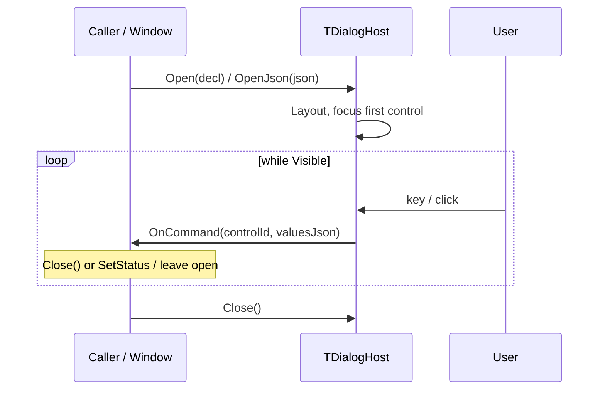

# Dialog and plugin interaction

**English** | [Русский](DIALOG_PLUGIN.ru.md)

> **Document role:** contract of the modal dialog window (declarative UI).  
> **Series:** [UI_PRIMITIVES.md](UI_PRIMITIVES.md).  
> **Context:** [SDS.md](SDS.md) §6.2, [ARCHITECTURE.md](ARCHITECTURE.md) §6; child primitives: [INPUT_PLUGIN.md](INPUT_PLUGIN.md), [STATUS_PLUGIN.md](STATUS_PLUGIN.md).

---

## Implementation status

| Layer | State |
|---|---|
| **Current** | In-process: `TDialogHost` + `uDialogJson` + `uDialogTypes` builders. The JSON declaration and the values snapshot already match the future cdecl seam. |
| **DLL stage (target)** | Exports `mtn_dialog_*` / `mtn_plugin_handle_event` (see §9). The JSON and command-callback semantics do not change. |

Code: `src/Core/uDialogHost.pas`, `uDialogTypes.pas`, `uDialogJson.pas`. Consumers: Dual Panel, Viewer/Editor (through the Host window).

---

## 1. Scope and roles

A dialog is a container that the Host assembles from a declaration (JSON or a Pascal builder). The child controls are core primitives.

```text
TDialogHost
├── TDialogDeclaration (version, title, width, height, flat controls[])
├── Focus chain / layout (v1 flow | v2 absolute cell boxes)
├── TDialogCommandEvent(controlId, valuesJson)
└── IThemeRenderer (frame, buttons, checkbox, list colors)
```

| Participant | Responsibility |
|---|---|
| **Host (`TDialogHost`)** | Parsing/build, focus, modal overlay, drawing, Enter/Esc/clicks -> command. |
| **Calling code / future plugin** | Layout declaration, initial values, reaction to `command` (id + values). In **2.0** – explicit `col`/`row`/`width`/`height` of the controls. |
| **IThemeRenderer** | `DrawDialogFrame` (white body / black text), `DrawButton`, `DrawCheckBox`, `ResolveDialogRowColors`. MDI windows still use `DrawWindowFrame`. |

A plugin does **not** create widgets imperatively and does not position pixels – only a cell declaration and data.

---

## 2. Lifecycle (current)



| Stage | Action |
|---|---|
| **declare** | The caller hands over a `TDialogDeclaration` or JSON. |
| **build** | The Host copies the controls, clamps the size (width >= 28, height >= 6), puts focus on the first focusable control. |
| **interact** | Only `command` (button / Enter / Esc / Y-N / click). There are no `change` / `close_query` events at present. |
| **close** | The caller calls `Close` after handling the command (or the Host stays open – for example Find + Status). |

The DLL version will add `dialog_get_declaration` / `dialog_opened` / `closed` / `ResultCode` – see §9.

---

## 3. In-process API

```pascal
type
  TDialogCommandEvent = reference to procedure(
    const AControlId: string; const AValuesJson: string);

procedure Open(const ADecl: TDialogDeclaration; AOnCommand: TDialogCommandEvent);
function OpenJson(const ADeclJson: string; AOnCommand: TDialogCommandEvent): Boolean;
procedure Close;
function Visible: Boolean;

function GetValuesJson: string;
function GetInputValue(const AId: string): string;
function GetCheckbox(const AId: string): Boolean;
function GetListSelectedIndex(const AId: string): Integer;
function GetListSelectedText(const AId: string): string;
procedure SetStatus(const AId, AText: string);

procedure Draw(...);
function HandleInput(...): Boolean;
function HandleClick(ALocalCol, ALocalRow: Integer): Boolean;
```

JSON <-> model: `TryParseDialogJson` / `DeclarationToJson` (`uDialogJson`).

### 3.1. Declaration example (protocol 1.0)

```json
{
  "type": "dialog",
  "version": "1.0",
  "title": "Find file",
  "width": 58,
  "height": 15,
  "children": [
    { "type": "label", "text": "A file mask or several file masks:" },
    { "type": "input", "id": "search_mask", "value": "*.*" },
    { "type": "checkbox", "id": "search_subdirs", "text": "Search in subfolders", "checked": true },
    { "type": "status", "id": "search_status", "text": "" },
    {
      "type": "button_row",
      "children": [
        { "type": "button", "id": "btn_start", "text": "Find", "default": true },
        { "type": "button", "id": "btn_cancel", "text": "Cancel", "cancel": true }
      ]
    }
  ]
}
```

Example with `list` (Copy/Move):

```json
{
  "type": "list",
  "id": "job_existing",
  "selected": 0,
  "items": ["Ask", "Overwrite", "Skip"]
}
```

### 3.1a. Declaration example (protocol 2.0)

In **2.0** the Host does no flow layout and does not fit the window height to the controls: it only draws each control in its given box. Coordinates are relative to the **client area** inside the frame (`(0,0)` = the first cell inside the border).

```json
{
  "type": "dialog",
  "version": "2.0",
  "title": "Find file",
  "width": 58,
  "height": 8,
  "children": [
    { "type": "label", "text": "Mask:", "col": 1, "row": 0, "width": 8, "height": 1 },
    { "type": "input", "id": "search_mask", "value": "*.*", "col": 10, "row": 0, "width": 44, "height": 1 },
    { "type": "checkbox", "id": "search_subdirs", "text": "Subfolders", "checked": true,
      "col": 1, "row": 2, "width": 20, "height": 1 },
    { "type": "button", "id": "btn_start", "text": "Find", "default": true,
      "col": 20, "row": 4, "width": 12, "height": 1 },
    { "type": "button", "id": "btn_cancel", "text": "Cancel", "cancel": true,
      "col": 34, "row": 4, "width": 12, "height": 1 }
  ]
}
```

**Button row** (the bottom row of `button` controls) is laid out the same way in all built-in dialogs; `TestDialogButtonLayout` checks this on every `DIALOG_*` resource in English and Russian:
- exactly one empty line above the row;
- below the row – only the shadow line (`▀`) and the frame, that is, the buttons' `row` = `height - 4`;
- to the left of the first button and to the right of the last button's shadow (`▄`) – at least one empty cell before the frame: `col` >= 1 and `col + width + 1` <= `dialog width - 3`.

A button below the client area is not drawn at all (the Host skips controls that sit on the frame).

**Labels and fields** (`TestDialogAlignment`, also on every resource in English and Russian): controls do not overlap and do not go beyond the frame; captions are not truncated (the label text fits its box; for a button / checkbox / radio – the caption and the brackets); between the label text and the field to its right – at least one empty cell; rows whose labels start in the same column also start their fields in the same column. A full-width control with `col` 1 has the width `width - 4`, with an indent cell on the right, as on the left.

**Language change** (`FitDialogToTranslatedText`, for non-`en`): controls of one column stay in one column; a caption that has grown pushes only the column of its right-hand neighbour in the row, keeping the author's gap (columns of different rows do not push each other); a row without neighbours on the right grows in place; a pushed field is narrowed only if it does not fit otherwise (no narrower than 8 cells and than its own longest item); a control that reached the right edge is stretched and keeps its indent. Buttons do not take part in column shifts: the button row grows with the captions, keeps its gaps and is centred together with the shadow. The dialog only widens.

Geometry synonyms: `x`/`y`/`w`/`h` ≡ `col`/`row`/`width`/`height`. If `width`/`height` is 0 or absent, the Host substitutes a per-kind default (a button by its text, list/radio_group by the number of rows, input – up to the right edge of the client area).

### 3.2. Root fields

| Field | Current behaviour |
|---|---|
| `type` | `"dialog"` (optional for the root) |
| `version` | `"1.0"` (default) or `"2.0"` |
| `title` | string |
| `width` / `height` | window size in cells; **1.0**: clamp >= 28 / >= 6; **2.0**: as in the declaration (clamped to the screen only) |
| `autoLayout` | `false` turns off automatic fitting: the dialog width and the control columns are taken as written (no widening for captions and translation, no field shifting and no button re-centring). Enabled by default; takes effect only in **2.0** |
| `children` | array of controls (preferred) |
| `controls` | flat fallback if there is no `children` |
| `modal` | **ignored** by the parser (the overlay is always modal at the Host level) |

| `version` | Layout |
|---|---|
| `"1.0"` | Sequential flow: the Host places controls top to bottom; buttons in a row with wrap. Control geometry is ignored. |
| `"2.0"` | Absolute layout: each control has `col`/`row`/`width`/`height`; the Host only draws into the box. |

`button_row` and a nested `dialog` are containers only: their children are flattened into a flat `Controls[]` (in 2.0 a container has no geometry of its own – set the box on the children).

### 3.3. Child types (current)

| `type` | Behaviour |
|---|---|
| `label` | Static text; not in the values without an `id`. `"accent": true` draws it in bold accent colour (for the values entered by the neighbouring caption) |
| `input` | [INPUT_PLUGIN.md](INPUT_PLUGIN.md) / `TInputLine`; fields `id`, `value`, `password` (`true` – asterisks are drawn instead of the typed characters, copying from the field is blocked; the value reaches the plugin as typed), `hotkey` (`true` – key capture field: the pressed combination is stored in the value as text like `Ctrl+Shift+F5`, Backspace and Delete clear the field, Tab, Enter and Esc work as in a dialog; the format is the same as `SendKey` understands), `multi` (together with `hotkey`: the field stores several combinations separated by `; ` – a pressed one is appended, Backspace removes the last, Delete clears the field) |
| `checkbox` | `id`, `text`, `checked`; Space / click toggles |
| `radio` / `radiobox` | `id`, `group`, `text`, `checked`; mutual exclusion within a `group`; Space / click selects |
| `radio_group` / `radiogroup` | `id`, `text` (caption), `items[]` or `children` of `radio`, `selected`, optionally `item_ids[]`; Up/Down / click; in the values – the item id or text |
| `button` | `id`, `text`, `default`, `cancel` -> command |
| `button_row` | A group of buttons in one row (children are flattened) |
| `separator` | Horizontal line (`MakeHRule`): `row`, `col` 0 and `width` across the whole client width. Such a line joins the dialog frame – `╟─╢` for a double frame, `├─┤` for a single one, `+-+` for the ASCII theme (`TDialogHost.JoinSeparatorsToFrame`); when the dialog is widened for a translation it stretches with it. Not in the values. |
| `status` | Single-line `text` by `id`; updated through `SetStatus`. Not in the values. STATUS_PLUGIN segments are outside the current Dialog. |
| `list` | `id`, `items[]`, `selected` (index); arrows / click on a row; in the values – the **text** of the selected item. `"frame": true` outlines the list with a single frame one cell around its area. `"keycommands": true` hands Space (command `toggle`), Delete (`delete`), F2 / F4 / F5 (`f2` / `f4` / `f5`) and Ctrl+Up / Ctrl+Down (commands `up` and `down`) to the dialog owner instead of the buttons while the list has focus; plain arrows still move the selection |
| `dropdown` / `dropdownlist` / `combo` | `id`, `items[]`, `selected`; collapsed combo (text + `↓`); Space / Alt+Down / F4 / click open the popup; Esc closes without a change; in the values – the **text** |

Not implemented: `panel` (see [PANEL_PLUGIN.md](PANEL_PLUGIN.md) separately), arbitrary `set_control_json` other than `SetStatus`.

### 3.4. Values snapshot

`GetValuesJson` / the `AValuesJson` argument in the callback:

```json
{
  "search_mask": "*.pas",
  "search_subdirs": true,
  "job_existing": "Ask"
}
```

| Kind | In the snapshot |
|---|---|
| `input` | string |
| `checkbox` | bool |
| `list` | selected **text** (not the index) |
| `dropdown` | selected **text** (not the index); the index is `GetListSelectedIndex` |
| `radio_group` | selected **item id** (if `item_ids` / an id on the children is set), otherwise the text |
| `radio` | one key per `group` -> the id (or text) of the selected radio |
| `label` / `separator` / `button` / `status` | none |

---

## 4. Commands and input (current)

The only event: `TDialogCommandEvent(controlId, valuesJson)`.

| Action | `controlId` |
|---|---|
| Button (Space / click / Enter on a focused button) | the button's `id` |
| Enter (not on a button) | `default`, otherwise `ok`/`yes`, otherwise the first non-cancel; list-only -> `"ok"` |
| Esc / `[x]` / click outside the frame | the `cancel` button, otherwise `"cancel"` |
| `Y` / `N` | `yes`/`ok` or `no` (if such buttons exist) |

The caller usually closes the dialog in the handler; the Host does not call `Close` itself.

### Keyboard / mouse (brief)

- Tab / Shift+Tab – focus chain (input, checkbox, radio, radio_group, button, list, dropdown).
- List / RadioGroup / DropDown (closed): Up/Down/Home/End.
- DropDown: Space / Alt+Down / F4 / click – open the popup; Enter/click on an item – select; Esc – collapse.
- Radio: Space / click selects within the group.
- Hot letter: in the `text` of a button, checkbox and radio, `&` marks the next letter (`"&Skip"`, `"&Rename"`), `&&` is the `&` character itself. The letter is drawn in the theme colour (underlined for the focused control in dark themes and everywhere in high contrast), `&` takes no space. Pressing the letter – when focus is not in an input field, otherwise with Alt – presses the button, toggles the checkbox or selects the radio; first the typed letter is looked up, then the same key in another layout (ЙЦУКЕН ↔ QWERTY), then the physical key. A caption without `&` has no hot letter. In the built-in dialogs every such control has a letter, except the Enter (`default`) and Esc (`cancel`) buttons, and it is not repeated within a dialog – `TestDialogMnemonics` checks this in English and Russian.
- Input: delegated to `InputLineHandleInput`; Submit -> accept, Cancel -> `cancel`.
- Dual Panel: when a dialog is visible, Enter may call the handler directly (`ok` / `btn_start`), bypassing `FireDefault` – see `TDualPanelWindow`; the button press is shown through `TDialogHost.PressButtonThen`.

**Button press.** A pressed button is drawn shifted one cell to the right, without a shadow. Mouse: on press the button is captured, the command runs on release over the same button (moving the pointer away releases the button, releasing outside it does nothing). Enter and Space: the button is pressed until the key is released (the main form sets `GDialogPressHoldKey` while the key is being handled and calls `DialogButtonKeyUp` on release), the command runs on release; Esc or a click in the meantime lifts the button without a command (`CancelDialogButtonPress`), other keys are ignored. A hot letter and `Y`/`N`: the button is pressed for `cDialogButtonPressMs` (100 ms), then the command runs; the next key or click first runs the deferred command (`FlushDialogButtonPress`). Esc without a held button – immediately, with no press. The timer and mouse capture are wired by the main form (`GDialogButtonPressStart`); without it (tests, DialogDesigner) commands run immediately. An owner that has to finish something after the command (closing the console on `PendingClose`) subscribes to `OnDeferredCommand`.

---

## 5. Host builders (`uDialogTypes`)

Layout source of truth: `src/dialogs/*.json` embedded as **RCDATA** via `MTN2.rc`
(`DIALOG_HELP`, `DIALOG_SEARCH`, ...). Loaded by `uDialogResources.TryLoadDialogResource`.

Pascal `Build*` functions: load RCDATA -> patch runtime fields (title, values, flags);
if the resource is missing, fall back to an in-code layout (used by ExportDialogJson).

| Builder / resource | JSON file | Purpose |
|---|---|---|
| `BuildConfirmDialog` / `DIALOG_CONFIRM` | `confirm.json` | OK / Cancel |
| `BuildHelpDialog` / `DIALOG_HELP` | `help.json` | Help |
| `BuildInputDialog` / `DIALOG_INPUT` | `input.json` | MkDir / Rename (`name`) |
| `BuildAskSaveDialog` / `DIALOG_ASKSAVE` | `asksave.json` | Yes / No / Cancel |
| `BuildSearchDialog` / `DIALOG_SEARCH` | `search.json` | Alt+F7 Find |
| `BuildCopyMoveDialog` / `DIALOG_COPYMOVE` | `copymove.json` | F5/F6 |
| `BuildGotoLineDialog` / `DIALOG_GOTOLINE` | `gotoline.json` | Viewer/Editor |
| `BuildEncodingDialog` / `DIALOG_ENCODING` | `encoding.json` | Code page list |
| `BuildReplaceDialog` / `DIALOG_REPLACE` | `replace.json` | Replace / All / Cancel |
| `BuildWorkspaceLibraryDialog` / `DIALOG_WORKSPACES` | `workspaces.json` | `ws:///` snapshot library (`Ctrl+Shift+D`) |
| `BuildFileDiffDialog` / `DIALOG_FILEDIFF` | `filediff.json` | Line-by-line diff of Compare Files (`Ctrl+Alt+C`) |

The full set is **28** `DIALOG_*` in `src/MTN2Resource.rc` (hotlist, color coding, dirsync, filediff, theme, ...). The runtime loads **only RCDATA**; `src/dialogs/*.json` on disk are not read. After editing JSON, `brcc32` is needed (`src/build.ps1`). The canonical exe is `bin\MTN2.exe`.

JSON files are UTF-8. String literals in `.pas` use the compiler code page (usually Windows-1251): a typographic dash in a title is `#$2014`, not the `—` character in quotes (otherwise the UI shows `вЂ"`).

Dual Panel chrome: `TDialogHost.ChromeContext` gives `fbcDialogList` for a list; `ResolveChromeContext` maps `THostDialogKind` to separate F-bar contexts (`fbcWorkspaceLibrary`, `fbcFolderHotlist`, `fbcColorCoding`, ...). A visible stub is drawn **on top of** the dialog (`DispatchDrawOverlays`: dialog -> stub -> F9 submenu) and intercepts input/clicks before the list.

Edit the layout with **Dialog Designer** (`tools/DialogDesigner`). Re-export from the builders:
`tools/ExportDialogJson` -> `src/dialogs/*.json`, then rebuild MTN2 (brcc32 packs RCDATA).

Control factories: `MakeLabel`, `MakeInput`, `MakeCheckbox`, `MakeRadio`,
`MakeRadioGroup`, `MakeButton`, `MakeStatus`, `MakeList`.

---

## 6. State ownership

| State | Owner |
|---|---|
| Control tree, focus, list selection mirror | **Host** |
| Declaration, command semantics, validation | **Caller / plugin** |
| Values while typing | **Host** (snapshot on command) |

Dynamics at present: `SetStatus`. Full `set_control_json` / rebuild – in the DLL version.

---

## 7. Threads

* Declaration and values – UI thread, no I/O.
* Long work on a button (search, copy job) – Jobs; the dialog may stay open, Status – through `SetStatus` + invalidate.

---

## 8. Invariants

1. A plugin does not call Canvas and does not set pixel coordinates – only cell geometry in the declaration (`width`/`height` of the window; in **2.0** also `col`/`row`/`width`/`height` of the controls).
2. A dialog blocks input to the underlying windows at the Host level (not an OS message box).
3. `default` / `cancel` buttons are handled by the Host (Enter/Esc) -> `command`.
4. Nested primitives obey their own contracts of the series.
5. `list` in the values gives the item text; the index – through `GetListSelectedIndex` on the Host.
6. In **2.0** the Host does not recalculate the window size from the content and does no flow layout.

---

## 9. Target cdecl API (DLL stage)

Not exported yet. Kept for the future seam without changing the JSON:

```pascal
procedure mtn_dialog_get_declaration(WindowId: Integer;
  OutBuffer: PAnsiChar; MaxLen: Integer); cdecl;

function mtn_dialog_open(WindowId: Integer; Modal: Integer): Integer; cdecl;

procedure mtn_dialog_close(WindowId: Integer; ResultCode: Integer); cdecl;

procedure mtn_dialog_get_values_json(WindowId: Integer;
  OutBuffer: PAnsiChar; MaxLen: Integer); cdecl;

procedure mtn_dialog_set_control_json(WindowId: Integer;
  const ControlId: PAnsiChar; const Json: PAnsiChar); cdecl;

procedure mtn_plugin_handle_event(WindowId: Integer; EventType: Integer;
  Param1: Integer; Param2: Integer); cdecl;

procedure mtn_host_invalidate(WindowId: Integer); cdecl;
procedure mtn_host_close_dialog(WindowId: Integer; ResultCode: Integer); cdecl;
```

### Planned EventType values

| EventType | Name | Current |
|---|---|---|
| 60 | `command` | Yes (through the callback, not cdecl) |
| 61 | `change` | No |
| 62 | `close_query` | No (Esc is an immediate cancel) |
| 63 | `closed` | No |

Command payload (target):

```json
{ "control_id": "btn_start", "values": { "search_mask": "*.pas" } }
```

### ResultCode (target)

| ResultCode | Meaning |
|---|---|
| 0 | `ok` / default accept |
| 1 | `cancel` |
| >= 100 | custom |

At present a closure is identified by the string `controlId` (`ok`, `cancel`, `btn_start`, ...), not by a numeric ResultCode.
