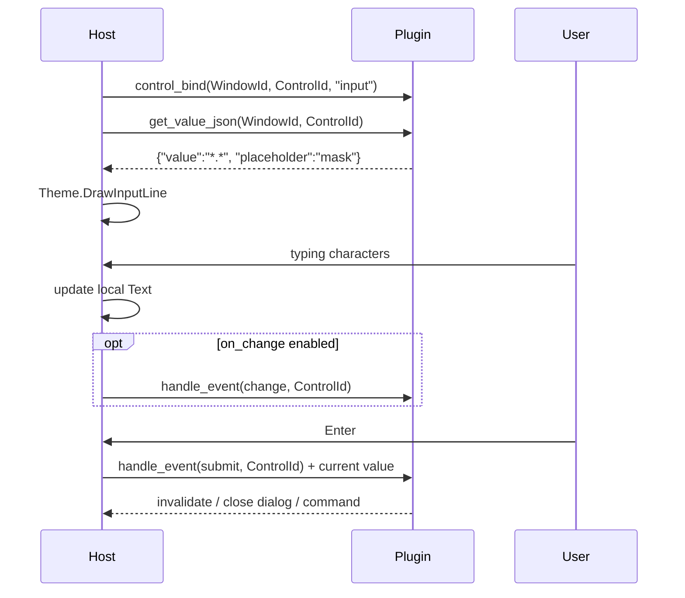

# Input Line interaction with a plugin

**English** | [Русский](INPUT_PLUGIN.ru.md)

> **Document role:** contract between the single-line text field (Input Line) and a plugin.  
> **Series:** [UI_PRIMITIVES.md](UI_PRIMITIVES.md).  
> **Context:** [SDS.md](SDS.md) §6.2, [ARCHITECTURE.md](ARCHITECTURE.md) §6.

---

## 1. Scope and roles

Input Line is a single-line input primitive. Typical uses:

* the command line under Dual Panel;
* a field inside a Dialog (search mask, file name);
* a panel quick filter / quick search.

```text
Host Window / Dialog
└── Input Line (ControlId)
    ├── Text / Caret / Selection
    ├── History (optional, Host or plugin)
    └── Bound Plugin (WindowId) – owner of the submit logic
```

| Participant | Responsibility |
|---|---|
| **Host** | Focus, caret, selection, paste from the clipboard, theme rendering, keymap (Enter/Esc/arrows/history). |
| **Plugin** | Initial value, validation, reaction to submit/change; optionally hints (completion). No Canvas. |
| **IThemeRenderer** | Style of the field and cursor, disabled/focused states. |

---

## 2. Lifecycle



| Stage | Who | Action |
|---|---|---|
| **bind** | Host → Plugin | Bind `ControlId` to the plugin model. |
| **pull value** | Host → Plugin | Initial / restored value. |
| **edit** | Host | Local editing in the UI (by default no round-trip per character). |
| **submit / cancel** | Host → Plugin | Logical confirmation or cancellation. |
| **unbind** | Host → Plugin | Release the binding when the parent closes. |

---

## 3. API and JSON

```pascal
function mtn_input_get_json(WindowId, ControlId: Integer;
  OutBuffer: PAnsiChar; MaxLen: Integer): Integer; cdecl;

procedure mtn_input_set_text(WindowId, ControlId: Integer;
  const Text: PAnsiChar); cdecl;  // Host → Plugin (programmatic set)

procedure mtn_plugin_handle_event(WindowId: Integer; EventType: Integer;
  Param1: Integer; Param2: Integer); cdecl;
// Param1 = ControlId for input events

procedure mtn_host_invalidate(WindowId: Integer); cdecl;
```

### 3.1. Field state JSON

```json
{
  "value": "*.pas",
  "placeholder": "File mask",
  "max_length": 260,
  "read_only": false,
  "password": false,
  "notify_change": false
}
```

| Field | Purpose |
|---|---|
| `value` | Current text (the source on bind / after a programmatic set). |
| `placeholder` | Hint shown when value is empty (drawn by Host/theme). |
| `max_length` | Length limit; enforced by the Host. |
| `notify_change` | If `true`, the Host sends `change` after edits (debounced on the Host side). |

During ordinary typing, **the source of truth for the text is the Host**. The plugin receives the current value at the moment of `submit` / `change` (via a side buffer or `mtn_host_get_control_text`).

```pascal
procedure mtn_host_get_control_text(WindowId, ControlId: Integer;
  OutBuffer: PAnsiChar; MaxLen: Integer); cdecl;
```

---

## 4. Events

| EventType | Name | Param1 | Param2 | Semantics |
|---|---|---|---|---|
| 20 | `submit` | ControlId | 0 | Enter |
| 21 | `cancel` | ControlId | 0 | Esc (if the field is not in a modal with a separate cancel) |
| 22 | `change` | ControlId | 0 | Text changed (`notify_change`) |
| 23 | `complete` | ControlId | Direction† | Autocomplete request (Tab / ↓) |
| 24 | `history_prev` | ControlId | 0 | History up |
| 25 | `history_next` | ControlId | 0 | History down |

† `Direction`: `0` = next candidate, `1` = prev.

### Completion (optional)

On `complete` the plugin calls `invalidate` or provides a list via:

```pascal
function mtn_input_get_completion_count(WindowId, ControlId: Integer): Integer; cdecl;
procedure mtn_input_get_completion_json(WindowId, ControlId, Index: Integer;
  OutBuffer: PAnsiChar; MaxLen: Integer); cdecl;
```

```json
{ "text": "readme.md", "insert": "readme.md" }
```

The Host shows a popup list (the Panel primitive in selection mode) or inserts the single candidate.

---

## 5. State ownership

| State | Owner |
|---|---|
| Text during editing, caret, selection | **Host** |
| Initial value, validation rules, history (if plugin-provided) | **Plugin** |
| Rendering | **Host + Theme** |

---

## 6. Threads

* `get_json` / `submit` handling on the UI thread – no I/O.
* Heavy validation / completion over the VFS – worker + `invalidate`.

---

## 7. Invariants

1. The plugin does not draw the caret and does not set field colors.
2. Submit always goes through the Host (key/button), never through a direct UI call by the plugin.
3. The Dual Panel command line follows the same contract; `submit` is routed to the PTY / internal core commands by the decision of the Host and associations. The canonical panel console (persistent shell + cwd sync) is described in [SDS.md](SDS.md) §5.4 and [ARCHITECTURE.md](ARCHITECTURE.md) §8; Tab-complete / path insertion is planned under the "Cmdline UX: Tab-complete and path insertion" item.
