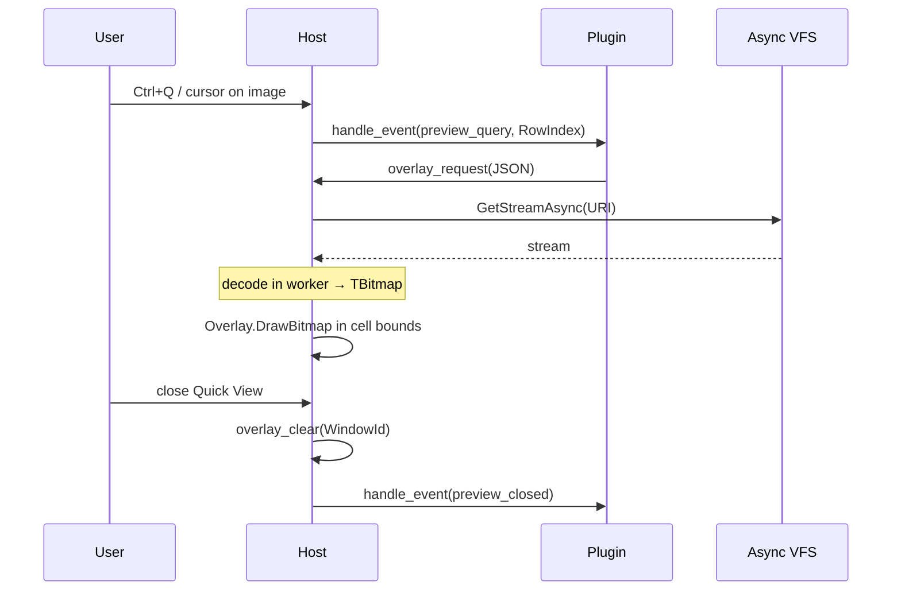

# Media Overlay interaction with a plugin

**English** | [Русский](OVERLAY_PLUGIN.ru.md)

> **Document role:** contract between the graphic overlay (raster preview above the text grid) and a plugin.  
> **Series:** [UI_PRIMITIVES.md](UI_PRIMITIVES.md).  
> **Context:** [SDS.md](SDS.md) §6.2, [ARCHITECTURE.md](ARCHITECTURE.md) (Overlay Renderer).

---

## 1. Scope and roles

Media Overlay is an FMX Canvas layer **above** `TTerminalGrid`. It is the only legal way to show a bitmap (photo, PDF page, video frame) without breaking the "plugin without Canvas" invariant.

```text
FMX Form
├── TTerminalRenderer (text grid)
└── Overlay Renderer
    ├── Requests[] (uri, cell bounds, z)
    └── Bitmaps (decoded by Host worker)
         ▲
         │ logical request
    Plugin (Quick View / preview)
```

| Participant | Responsibility |
|---|---|
| **Host / Overlay Renderer** | Accepting requests, decoding images in a worker, `TCanvas.DrawBitmap`, clipping, z-order above the grid. |
| **Plugin** | Logical preview request: URI + desired bounds in **cells** + mode. No access to Canvas. |
| **Async VFS** | File stream for the Host decoder. |

---

## 2. Lifecycle



| Stage | Action |
|---|---|
| **request** | The plugin or Host forms an overlay request. |
| **load** | The Host loads and decodes in a worker. |
| **present** | Drawing above the grid on every frame / when dirty. |
| **clear** | The overlay is removed on URI change, resize, or Quick View close. |

Currently the plugin does **not** pass raw pixels (marshaling is too heavy). It passes a URI; decoding happens in the core. Planned: an optional shared-memory / host-side cache id.

---

## 3. API and JSON

```pascal
// Plugin → Host
function mtn_overlay_request(WindowId: Integer;
  const RequestJson: PAnsiChar): Integer; cdecl;

procedure mtn_overlay_clear(WindowId: Integer;
  const RequestId: PAnsiChar); cdecl;  // empty id = clear all for the window

// Host → Plugin
procedure mtn_plugin_handle_event(WindowId: Integer; EventType: Integer;
  Param1: Integer; Param2: Integer); cdecl;

procedure mtn_host_invalidate(WindowId: Integer); cdecl;
```

### 3.1. Preview request

```json
{
  "request_id": "qv-left",
  "uri": "file:///D:/Photos/cat.png",
  "bounds": { "left": 40, "top": 2, "right": 78, "bottom": 22 },
  "fit": "contain",
  "priority": 10,
  "mime_hint": "image/png"
}
```

| Field | Purpose |
|---|---|
| `request_id` | Idempotent key (a repeated request replaces the previous one). |
| `uri` | Source via the VFS. |
| `bounds` | Rectangle in **logical cells** of the current grid. |
| `fit` | `contain` \| `cover` \| `stretch` \| `center` |
| `priority` | Order when there are several overlays. |
| `mime_hint` | Hint for the decoder. |

`mtn_overlay_request` return codes: `0` ok, `-1` unsupported type, `-2` busy, `-3` invalid bounds.

### 3.2. Status (Pull, optional)

```pascal
procedure mtn_overlay_get_status_json(WindowId: Integer;
  const RequestId: PAnsiChar; OutBuffer: PAnsiChar; MaxLen: Integer); cdecl;
```

```json
{
  "request_id": "qv-left",
  "state": "ready",
  "width_px": 1920,
  "height_px": 1080,
  "error_code": ""
}
```

`state`: `loading` | `ready` | `error` | `cleared`.

---

## 4. Events

| EventType | Name | Param1 | Param2 | Semantics |
|---|---|---|---|---|
| 100 | `preview_query` | RowIndex | 0 | The Host asks whether a preview is needed for the row |
| 101 | `preview_closed` | 0 | 0 | The overlay was removed |
| 102 | `bounds_changed` | 0 | 0 | Dynamic grid resize – the plugin may re-issue the request |
| 103 | `overlay_failed` | 0 | 0 | Decode/VFS error; details in the status JSON |

In the simple path **without** a preview plugin, the Host itself issues `overlay_request` for Quick View based on the panel's `file_type`/`uri`. The plugin path is needed for non-standard sources (DB blob, diagram generation).

---

## 5. State ownership

| State | Owner |
|---|---|
| Bitmap cache, decode jobs, actual drawing | **Host** |
| The decision of "what to preview" and `request_id` | **Plugin** or Host QV |
| Bounds in cells | Set by the requester; on resize the Host sends `bounds_changed` |

---

## 6. Threads and performance

1. Decoding and VFS – worker only.
2. `DrawBitmap` – UI thread, tied to FormPaint (after the text or in a separate overlay pass).
3. Moving the panel cursor cancels the previous decode via a cancel token.
4. Large images – downscaled to bounds×cell size in a worker.

---

## 7. Relation to the dynamic grid

When `Cols`/`Rows` or zoom change, the Host:

1. recomputes the pixel rect from the cell bounds;
2. sends `bounds_changed`;
3. either keeps the request_id and only redraws, or waits for an updated request from the plugin.

---

## 8. Invariants

1. The plugin **never** receives a `TCanvas` / `TBitmap` handle.
2. The overlay does not replace the text grid and does not take part in `TCharCell`.
3. Clipping and z-order relative to MDI belong to the Host (the overlay is normally within the Quick View window / panel).
4. A decode error does not have to break the panel – status `error` + a text fallback in the Status Line.
5. WASM (planned): only URI/request JSON through the Host API, no shared framebuffer from the module.
