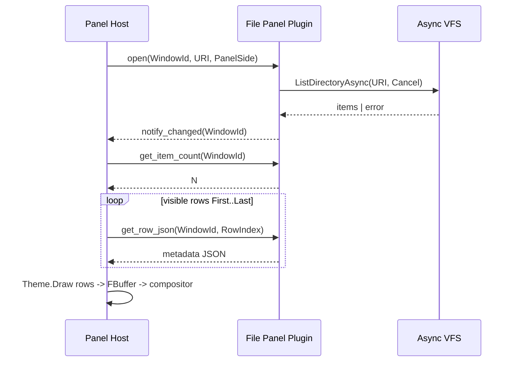
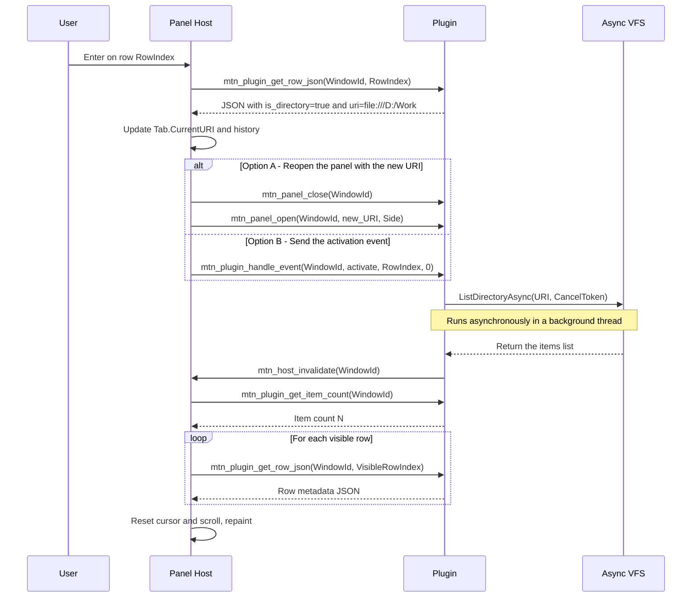

# File panel and plugin interaction

**English** | [Русский](PANEL_PLUGIN.ru.md)

> **Document role:** contract of a single file panel (one side of Dual Panel, the active Panel Tab) with a data-provider plugin.  
> **Series:** [UI_PRIMITIVES.md](UI_PRIMITIVES.md) (the Panel primitive).  
> **Context:** [SDS.md](SDS.md) (SDS §3.3, §6), [ARCHITECTURE.md](ARCHITECTURE.md) (§3, §6).  
> **Related primitives:** [STATUS_PLUGIN.md](STATUS_PLUGIN.md), [TOOLBAR_PLUGIN.md](TOOLBAR_PLUGIN.md), [OVERLAY_PLUGIN.md](OVERLAY_PLUGIN.md).

---

## 1. Scope and roles

The document describes **one** file panel:

```text
TDualPanelWindow
└── Active Workspace (Dual Panel Tab)
    └── Left | Right  <- this side
        └── Active Panel Tab (TTab)
            ├── CurrentURI
            ├── CursorIndex / ScrollOffset / Selection
            └── Bound Plugin Instance (WindowId)
```

| Participant | Responsibility |
|---|---|
| **Panel Host (core)** | List layout, scroll, cursor, multi-select, keymap, requesting visible rows, event routing, drawing through the theme. |
| **File Panel Plugin** | Directory model: item count, row metadata, reaction to logical events (open, refresh, URI change). No `TCanvas` and no colours. |
| **IThemeRenderer** | Style of rows/frame/tabs by logical fields (`is_directory`, `is_hidden`, ...). |
| **Async VFS / Jobs** | I/O by URI; the plugin initiates list loading, the core does not read the disk from the UI thread. |

A plugin does **not draw** the panel. It answers Pull requests and events. The decision "which plugin serves a URI" is made by the core (by URI scheme / associations / explicit mount).

---

## 2. Binding a plugin to a panel

Each active Panel Tab has:

* `CurrentURI` – a logical path (`file:///D:/Work`, `sftp://...`, `...zip!/...`);
* `WindowId` – the identifier of the panel view instance in the Host API;
* `PluginId` – which plugin serves this tab.

### 2.1. Lifecycle



| Stage | Who | Action |
|---|---|---|
| **open** | Host -> Plugin | Create/bind the model to `WindowId`, set the URI. The plugin starts an async list. |
| **ready / changed** | Plugin -> Host | A signal that the model has been updated (through a Host API callback or the Event Bus `panel.model.changed`). |
| **pull** | Host -> Plugin | Request the count and the rows of the visible range. |
| **event** | Host -> Plugin | Logical user actions. |
| **close** | Host -> Plugin | Cancel pending jobs, release the `WindowId` model. |

On a Panel Tab or Dual Panel Tab switch: for the outgoing tab – `close` or `deactivate` (the model cache may be kept); for the incoming one – `open` / `activate` + pull.

---

## 3. Pull protocol (data -> panel)

The Host requests data **only for the visible area** of the list (and, if needed, the cursor row when it is outside the viewport, for the status bar).

### 3.1. C-compatible Host API (panel profile)

```pascal
// Lifecycle
function mtn_panel_open(WindowId: Integer; const URI: PAnsiChar; Side: Integer): Integer; cdecl;
procedure mtn_panel_close(WindowId: Integer); cdecl;

// Pull
function mtn_plugin_get_item_count(WindowId: Integer): Integer; cdecl;
procedure mtn_plugin_get_row_json(WindowId: Integer; RowIndex: Integer;
  OutBuffer: PAnsiChar; MaxLen: Integer); cdecl;

// Events (see §4)
procedure mtn_plugin_handle_event(WindowId: Integer; EventType: Integer;
  Param1: Integer; Param2: Integer); cdecl;

// Plugin -> Host: the model changed, repaint/pull needed
procedure mtn_host_invalidate(WindowId: Integer); cdecl;
```

`mtn_panel_open` returns `0` when the binding succeeds; a negative code is an error (unsupported scheme, plugin refusal).

### 3.2. Panel row JSON

The plugin returns **logical metadata only**. Style fields (`fg_color`, `bold`, ...) are forbidden.

```json
{
  "id": "file:readme.md",
  "text": "readme.md",
  "size": 38063,
  "size_text": "37.2 KB",
  "is_directory": false,
  "is_parent": false,
  "is_hidden": false,
  "is_readonly": false,
  "is_symlink": false,
  "file_type": "document",
  "modified": "2026-07-18T01:00:00Z",
  "attributes": "A",
  "uri": "file:///D:/Work/Delphi/MTN2/readme.md"
}
```

| Field | Required | Purpose |
|---|---|---|
| `text` | yes | Display name in the Name column |
| `is_directory` | yes | Navigation / icon / theme |
| `is_parent` | no | The `..` row; the Host may draw it specially |
| `size` | no | Number of bytes (`-1` for directories if not computed) |
| `size_text` | no | Ready-made string for the column; otherwise the Host formats `size` |
| `uri` | recommended | Full URI of the item for associations / operations |
| `file_type` | no | Logical class for the theme (`executable`, `archive`, ...) |
| `id` | no | Stable row key for selection across refresh |

### 3.3. Indexing rules

* Row indexes are `0 .. Count-1` in the order set by the plugin (after its sorting/filtering).
* The `..` row (`is_parent: true`), if present, usually has index `0`.
* The Host does **not** cache the JSON between `invalidate` calls, except for a short-lived cache of the visible window (until the next `mtn_host_invalidate`).
* `get_row_json` for an out-of-range index: empty buffer / zero length; the Host ignores the row.

### 3.4. Loading and error state

While the async list is not finished, `get_item_count` may return `0` and the panel shows a placeholder (the text is set by the Host/theme: "Reading...").

After a VFS error the plugin calls `invalidate` and returns count = 0 **or** one service row:

```json
{
  "text": "Access denied",
  "is_directory": false,
  "is_error": true,
  "error_code": "access_denied",
  "uri": "file:///D:/Secret"
}
```

The Host does not parse arbitrary error text for logic – only `is_error` / `error_code`.

---

## 4. Events (panel -> plugin)

Physical input (keys, mouse) is handled by the **Host**. Only logical events go to the plugin.

| EventType | Name | Param1 | Param2 | Semantics |
|---|---|---|---|---|
| 1 | `activate` | `RowIndex` | 0 | Enter / double click on a row |
| 2 | `select` | `RowIndex` | `Mode`† | Selection change |
| 3 | `cursor` | `RowIndex` | 0 | Cursor moved (for preview/quick view) |
| 4 | `refresh` | 0 | 0 | Forced list refresh (Ctrl+R) |
| 5 | `set_uri` | 0 | 0 | New URI on a side channel‡ |
| 6 | `back` | 0 | 0 | History back (the Host may change the tab URI itself) |
| 7 | `forward` | 0 | 0 | History forward |
| 8 | `close` | 0 | 0 | The tab is closing |

† `Mode`: `0` = replace selection, `1` = toggle, `2` = range to cursor.  
‡ On `set_uri` the actual URI is passed by a separate call:

```pascal
procedure mtn_panel_set_uri(WindowId: Integer; const URI: PAnsiChar); cdecl;
```

Or the Host calls `mtn_panel_close` + `mtn_panel_open` with the new URI (simpler).

### 4.1. Scenario: entering a directory



* If `is_directory = false`, the Host hands the URI to the associations subsystem (Viewer / PTY / ShellExecute); the panel plugin may receive `activate` to react (for example, mark as recent), but the core opens the file.
* If `is_parent = true`, the Host computes the parent URI (or takes it from the row's `uri`) and performs the same URI change cycle.

### 4.2. Scenario: refresh (Ctrl+R)

1. Host -> `handle_event(refresh)`.
2. The plugin cancels the previous list job (cancel token) and starts a new one.
3. On completion -> `invalidate`.
4. The Host preserves the selection by row `id` if possible; otherwise it resets it.

---

## 5. What the Host stores, what the plugin stores

| State | Owner | Comment |
|---|---|---|
| `CurrentURI`, History, HistoryIndex | **Host (`TTab`)** | Source of truth for the tab path |
| CursorIndex, ScrollOffset, Selection | **Host** | Pure UI |
| List order/filter/sorting | **Plugin** (or the Host through commands – see §7) | At present sorting may live in the system file plugin |
| Cache of raw `TFileAttributes` | **Plugin** | Not on the UI thread while filling |
| Colours, frame, column layout | **Host + Theme** | The plugin does not take part |
| Pending list-job CancelToken | **Plugin** | Cancellation is mandatory on `close` / a new list |

Invariant: after `invalidate` the Host does the Pull again; the plugin does not push ready-made "rendered" rows.

---

## 6. Threads and performance

1. `get_item_count` / `get_row_json` are called from the **UI thread** during rebuild/paint preparation -> they must be **O(1) / O(visible)** with no I/O and no blocking on network/disk.
2. Any VFS work only in a worker; the result is put into the plugin's model structure, then `mtn_host_invalidate` through `TThread.Queue`.
3. Forbidden: reading a directory inside `get_row_json`.
4. Recommended plugin cache: `TArray` or chunked pages; the full directory list in memory after the list is enough for now.

---

## 7. Columns and sorting (extension contract)

At present the Host draws a fixed set of columns (Name, Size, Date, Attr), filling them from the JSON fields. The Host shows the current sort mode itself: a FAR glyph in the top-left corner of the file panel's work area (`DrawPanelSortLetter` / `PanelSortModeLetter`; not on the frame; contrast from `ResolvePanelChromeColors`). The plugin is responsible only for the row order in Pull after the `sort` event.

Later (optionally) a plugin may declare a column schema at `open`:

```json
{
  "columns": [
    { "id": "name", "title": "Name", "field": "text", "width": 0 },
    { "id": "size", "title": "Size", "field": "size_text", "width": 10 },
    { "id": "date", "title": "Date", "field": "modified", "width": 16 }
  ],
  "sort": { "column": "name", "asc": true }
}
```

A sort change is a Host -> Plugin event (`sort`, Param1 = column index, Param2 = 0/1 asc/desc) -> model rebuild -> `invalidate`.

---

## 8. Relation to Dual Panel and the two sides

* The left and right panels are **two independent** `WindowId` values and two model instances (even if the URIs match).
* Copy/Move operations between panels are initiated by the **core** (Jobs + VFS), reading the selection URIs on the active side and `CurrentURI` of the opposite one. The panel plugin provides item URIs through Pull; it does not do the copying itself (unless it is a special VFS plugin with its own API – outside this contract).
* A Dual Panel Tab switches the whole `TDualPanelState`: both sides receive `deactivate`/`activate` for their Panel Tabs.

---

## 9. Event Bus (optional notifications)

A plugin may publish (not instead of `invalidate`):

| EventType | When | JSON (example) |
|---|---|---|
| `panel.model.changed` | The list was rebuilt | `{"window_id": 3, "uri": "file:///D:/Work", "count": 120}` |
| `panel.uri.changed` | The plugin changed the URI itself (rare; the Host is preferred) | `{"window_id": 3, "uri": "..."}` |
| `vfs.directory.changed` | External change (watcher, later) | `{"uri": "file:///D:/Work"}` |

A Host subscribed to `vfs.directory.changed` sends the plugin `refresh` for a tab with a matching URI.

---

## 10. Minimal scenario (system Local FS plugin)

1. The Host opens a tab with `file:///C:/` -> `mtn_panel_open`.
2. The plugin -> `ListDirectoryAsync` -> fills an array -> `invalidate`.
3. The Host pulls the rows `ScrollOffset .. ScrollOffset+VisibleRows-1`.
4. The theme draws names/sizes; directories in the theme colour.
5. Enter on a folder -> the Host changes `TTab.CurrentURI` -> `open`/`set_uri` -> cycle from step 2.
6. Enter on a file -> core associations; the panel stays on the same URI.
7. Closing the tab -> `mtn_panel_close` + cancel the list job.

---

## 11. Contract invariants

1. A plugin does not receive `TCanvas`, `TTerminalGrid` and does not choose row colours.
2. Pull from the UI thread without I/O.
3. The only "repaint" signal from a plugin is `mtn_host_invalidate` (or its Event Bus equivalent).
4. The tab's `CurrentURI` belongs to the Host; the plugin does not change History on its own.
5. List errors are delivered through the model (`is_error`) or an empty list + Host status, not through exceptions across the DLL boundary.
6. On `close` all of the panel's cancel tokens must be requested.
