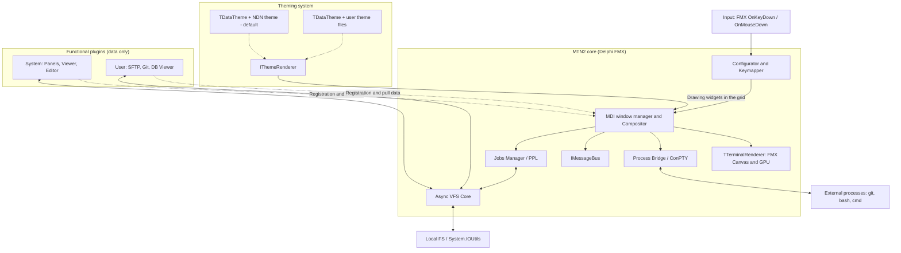

## Technical Description (System Design Specification)

**English** | [Русский](SDS.ru.md)

### Project: Modern Terminal Navigator 2 (MTN2) – Delphi Edition

> **Role of this document:** the full specification (concept, data structures, API, roadmap).
> **Short overview of layers, threads and invariants:** see [ARCHITECTURE.md](ARCHITECTURE.md).
> **Build, tests, CI/CD:** see [BUILDING.md](BUILDING.md). **License:** [MPL-2.0](../LICENSE).
> If wordings differ, this SDS takes priority, except for the invariants explicitly fixed in the Architecture document.
> This document was prepared with the help of AI assistants, including in-house ones.

**MTN2** is a cross-platform dual-panel file manager (a TUI inside a GUI window) with MDI, aimed at **everyday use**. The visual and workflow basis is **Necromancer's DOS Navigator (NDN)**; good practices are borrowed from **FAR Manager** and **Total Commander**. Implementation: Delphi / FireMonkey, a virtual text grid on a GPU canvas.

---

### 1. Introduction and concept

#### 1.0. Product focus

MTN2 is first of all an **everyday file manager**, not a demonstration of a plugin platform and not "yet another terminal".

| Reference           | What is taken                                                                                                                                      |
| ------------------- | -------------------------------------------------------------------------------------------------------------------------------------------------- |
| **NDN (basis)**     | MDI, the look and feel of the interface and dialogs, the default theme (`NDN`), TUI density, "keyboard first" operation.                         |
| **FAR**             | A predictable keymap and panels (F-keys, `Ctrl+O`, user menu / associations), a high-quality Viewer/Editor, familiar navigation and selection workflows. |
| **Total Commander** | Archives as folders, tabs and convenient bulk operations, directory comparison, Multi-Rename, practical search, stable copy/move with progress.   |

**Development priority:** parity in everyday workflows (navigation, copy/delete, search, sessions, associations, archives, network) first, then the extension platform. Plugin ecosystem order: **1) native MTN2 plugins** → **2) Far** → **3) Total Commander** (see §6.0). Architectural contracts are observed from the start, but they **do not run ahead** of file manager UX.

Readiness criterion for replacing NDN/FAR on local disks every day: a user can spend a working day in MTN2 without going back to another file manager for basic operations.

#### 1.1. A GUI-TUI hybrid instead of the classic console

Instead of running inside a system console (cmd.exe, bash), the program creates a standard GUI window (FMX Form). A **dynamic** virtual text grid is rendered inside this window: the number of columns and rows (`Cols × Rows`) is recomputed when the window size and the font/cell zoom change.

**Key advantages of this approach:**

- **Absolute portability**: identical behaviour of graphics, fonts and keyboard shortcuts on Windows, macOS and Linux, with no need to adapt to differences between raw-mode terminals. *(Windows: the interactive ConPTY is implemented; POSIX PTY is on the roadmap, "PTY on Linux/macOS".)*
- **Modern fonts**: support for TrueType/OpenType monospaced fonts with ligatures and Unicode (including emoji and Powerline icons; outside the BMP through grapheme/cluster-aware cell layout).
- **Freedom of colour**: full support for 32-bit RGBA colour, gradients, blur effects and shadows for overlapping windows.
- **High performance**: the text buffer is drawn on the GPU (DirectX, Metal, OpenGL/Vulkan) at 60+ FPS.

#### 1.2. Performance targets

| Metric                       | Target (v0.1)             | Description / implementation mechanism                                                                                                         |
| ---------------------------- | ------------------------- | ---------------------------------------------------------------------------------------------------------------------------------------------- |
| **Memory (private bytes)**   | ≤ 50 MB without plugins   | Delphi compiles to optimized native code with minimal runtime overhead; plugins are loaded on demand                                           |
| **Frame rendering**          | ≤ 16 ms (60 FPS)          | FMX hardware acceleration + double buffering on a texture (Bitmap)                                                                             |
| **Opening files up to 10 GB** | < 0.5 s (first screen)   | A streaming Viewer based on `TFileStream` with background line indexing and lazy loading                                                       |
| **Core binary artifact**     | The executable and two DLLs | A native core; the only libraries it needs are Skia (`sk4d.dll`) and Wasmtime (`wasmtime.dll`). DLL/SO/WASM plugins are optional extensions |

Measured on Windows 11, release build, a few seconds after start with an empty configuration: about 42 MB of private bytes (68 MB working set) with no plugins, about 64 MB (81 MB) with all the plugins that ship with the program. On disk: `MTN2.exe` 22 MB, `sk4d.dll` 22 MB, `wasmtime.dll` 11 MB, the plugins 58 MB. The frame time and the opening of large files have not been re-measured on this build.

---

### 2. System architecture

MTN2 uses a modular architecture that separates the presentation logic (TUI/GUI renderer) from the data-handling logic (VFS, Jobs). An overview of layers and invariants is in [ARCHITECTURE.md](ARCHITECTURE.md).



#### Main layers

1. **FMX Event / Input Layer**: intercepts keyboard and mouse events and translates them into internal commands.
2. **MDI Window Manager & Compositor**: virtual windows (Dual Panel, Viewer, Editor, dialogs), z-order, focus; a shared screen cell buffer.
3. **FMX Canvas Renderer (**`TTerminalRenderer`**)**: dynamic grid + double-buffered GPU drawing.
4. **Async VFS**: a single layer for URIs (`file://`, `sftp://`, archive chains through `!/`). Non-blocking operations only, with cancellation and errors.
5. **Background Jobs (PPL)**: a queue of long operations (copy, delete, search) that keeps the UI responsive.
6. **Process Bridge**: non-blocking process launch and output into an internal console buffer (Windows: a real ConPTY; POSIX PTY is a goal, "PTY on Linux/macOS").
7. **Theme Engine**: delegates widget styling to `IThemeRenderer` (NDN by default).

#### Division of responsibility (in brief)

| Role                            | Responsible for                                          |
| ------------------------------- | -------------------------------------------------------- |
| **Core**                        | Layout, focus, compositing, keymap, Jobs, declarative UI |
| **Theme (**`IThemeRenderer`**)** | The look of widgets in grid cells                       |
| **Plugins**                     | Data and logic ("what to show"), no `TCanvas`            |

---

### 3. Data structure specification (Object Pascal)

#### 3.1. Terminal cell and screen buffer

Every screen position is represented by a `TCharCell` structure. For characters outside the BMP and for emoji, the core uses a grapheme-aware layout (a cluster can occupy one or several logical cells).

```pascal
type
  TCharCellAttribute = (ccaBold, ccaItalic, ccaUnderline, ccaBlink, ccaReverse);
  TCharCellAttributes = set of TCharCellAttribute;

  TCharCell = record
    CharValue: Char;               // Base UTF-16 code unit; clusters are handled at the layout level
    FgColor: TAlphaColor;          // Text colour (32-bit RGBA)
    BgColor: TAlphaColor;          // Background colour (32-bit RGBA)
    Attributes: TCharCellAttributes;
  end;

  TTerminalRow = array of TCharCell;
  TTerminalGrid = array of TTerminalRow;
```

#### 3.2. Window manager (MDI)

Each window (Dual Panel, editor, dialog) encapsulates its interaction logic and delegates widget styling to `IThemeRenderer`. The local `FBuffer` buffer caches the window's visual representation.

```pascal
type
  TWindowState = (wsNormal, wsMaximized, wsMinimized);

  TRectI = record
    Left, Top, Right, Bottom: Integer;
    function Width: Integer;
    function Height: Integer;
  end;

  TTerminalWindow = class
  private
    FId: Cardinal;
    FTitle: string;
    FArea: TRectI;
    FZIndex: Integer;
    FIsFocused: Boolean;
    FState: TWindowState;
    FBuffer: TTerminalGrid;           // Cached buffer of the rendered window
    FTheme: IThemeRenderer;           // Reference to the global/local theme plugin
  public
    // Calls FTheme methods to draw the frame and elements into the internal FBuffer
    procedure RebuildBuffer; virtual;
    procedure Resize(AWidth, AHeight: Integer); virtual;
    // Copies the cached FBuffer into the shared compositor buffer
    procedure Paint(const ACompositorBuffer: TTerminalGrid); virtual;
    procedure HandleInput(var AKey: Word; AShift: TShiftState; var AHandled: Boolean); virtual;
  end;
```

#### 3.3. Dual Panel, tabs and panels

Hierarchy (see also Architecture, §3):

```text
TDualPanelWindow (MDI)
├── Dual Panel Tabs          – workspace tabs
└── Active TDualPanelState
    ├── Left:  Panel Tabs → TTab (URI, history, cursor)
    └── Right: Panel Tabs → TTab
```

- **Dual Panel Tabs** – tabs for the whole two-panel window; each stores a full `TDualPanelState` snapshot.
- **Panel Tabs** – directory tabs inside each side (`Left` / `Right`).
- Viewer / Editor – a Dual Panel Tab (`wkDocument`) on the same strip as Home/Work; Console is a separate `TTerminalWindow`.
- **UI primitive contracts (plugin ↔ core):** [UI_PRIMITIVES.md](UI_PRIMITIVES.md).

```pascal
type
  TTab = record
    Id: Cardinal;
    Title: string;            // Panel Tab caption (home, documents, …)
    CurrentURI: string;       // For example, 'file:///D:/Work'
    History: TArray<string>;  // Navigation history (back/forward)
    HistoryIndex: Integer;
    CursorIndex: Integer;     // Index of the highlighted item
    ScrollOffset: Integer;    // Panel scroll offset
    SelectedURIs: TArray<string>; // multi-select by URI strings
  end;

  TPanelSide = (psLeft, psRight);
  TPanelViewKind = (pvkFiles, pvkInfo); // Ctrl+L – Info on the opposite side
  TPanelColumnMode = (pcmBrief, pcmSize, pcmDate, pcmFull, pcmCreated, pcmTypes);
  TPanelSortColumn = (pscNone, pscName, pscExt, pscSize, pscModified,
    pscCreated, pscAccessed, pscAttr, pscType);

  TPanelState = record
    Tabs: TArray<TTab>;
    ActiveTabIndex: Integer;
    DriveDirs: array['A'..'Z'] of string; // last path per drive (Alt+F1/F2, Ctrl+←/→)
    ColumnMode: TPanelColumnMode;         // Ctrl+3 – modes menu
    SortColumn: TPanelSortColumn;         // Ctrl+F3..F9 / Ctrl+F12 / header click
    SortDescending: Boolean;              // capital letter in the corner of the work area
    ViewKind: TPanelViewKind;
  end;

  TDualPanelState = record
    LeftPanel: TPanelState;
    RightPanel: TPanelState;
    ActiveSide: TPanelSide;
    LeftVisible: Boolean;   // Ctrl+F1
    RightVisible: Boolean;  // Ctrl+F2
  end;

  // One Dual Panel-level tab = a full snapshot of the panels or a document
  TWorkspaceKind = (wkPanels, wkDocument);

  TDualPanelWorkspaceTab = record
    Id: Cardinal;
    Title: string;
    Kind: TWorkspaceKind;   // wkPanels | wkDocument (Viewer/Editor)
    State: TDualPanelState;
  end;

  TDualPanelWindowState = record
    WorkspaceTabs: TArray<TDualPanelWorkspaceTab>;  // Dual Panel Tabs
    ActiveWorkspaceIndex: Integer;
  end;
```

`TDualPanelWindow` is a descendant of `TTerminalWindow` that owns a `TDualPanelWindowState`. Column geometry, Brief multi-column layout, the icon reserve and hit-testing live in `uPanelColumns.pas`. Row shell icons are in `uShellIcons.pas` (§4.2). The Sort / Column modes / User menu overlay menus are in `uDualPanelMenus.pas`.

**FAR sort letter.** Every file panel (`pvkFiles`) draws a glyph for the current `SortColumn` in the top-left corner of the **work area** (the first cell of the column header row, `Left+1` / `Top+1` – not on the frame): `n` name, `x` extension, `w` write time, `s` size, `u` unsorted, `c` created, `a` accessed, `t` attributes, `y` type. A capital letter means `SortDescending`. The colour is the theme accent `pcpHotMark` on the `pcpColumnHeader` background, with a fallback contrast through `ContrastingGlyphFg` (`uThemeDrawing.pas`) so that the glyph is readable on any palette. Info / Quick View do not show the letter. `PanelSortModeLetter` is in `uPanelColumns.pas`; it is drawn after the headers by `DrawPanelSortLetter` in `uDualPanelPanelDraw.pas` (`DispatchDrawPanelFiles`).

The top drop-down menu bar (F9 / Alt / mouse) is managed by `uTopMenuBar.pas`; its structure is loaded from the embedded `MENU_MAIN` resource (RCDATA ← `src/config/menu.json`), with a fallback to a file next to the exe / in the sources and to a hard-coded structure if the resource is missing. A menu taller than the window scrolls (`FSubmenuTop` in `uTopMenuBar.pas`, a `DrawDialogScrollBar` bar on the right border, the mouse wheel moves the selection); in dialogs taller than the window the content shifts following the focus (`FScrollY` in `uDialogHost.pas`), and items outside the visible area are neither drawn nor hit by the mouse. The command palette (Shift+F9; `uCommandPalette.pas`, `uDualPanelPaletteDialog.pas`, `dialogs/commandpalette.json`) lists the live menu (`TTopMenuController.ListItems`), searches by title, category and synonyms, and runs an item through `RunItem`. Synonyms come from three sources: the item's `aliases` field in `menu.json` (English), the `menu.alias.<action>` keys of the selected language's strings file, and an optional `aliases.json` in the settings folder (re-read every time the palette opens). `?` and `*` are allowed in a query word.

The drive change popup (Alt+F1/Alt+F2, `uDualPanelDrivePopup.pas`) shows, below the drive list, a separator and numbered special items `1. System folders` / `2. Recycle bin` / `3. Temporary` / `4. Workspace` (choose with Enter / click / digit 1–4). The popup cursor is placed on the **current** URI of the panel's active tab (`HostPanelPath` = `ActiveTab.CurrentURI`, the index is `DrivePopupCursorIndex` / glyph `DriveBarGlyphFromUri`: a drive letter or `1`–`4`), not always on the first drive. Navigation to the Windows system virtual folders (Desktop, Documents, Downloads, etc.) is the `sys://folders` VFS (`uSysFoldersVfs.pas`); viewing and restoring Recycle Bin files is the `recycle://` VFS (`uRecycleBinVfs.pas`, `IShellFolder2`/`IFileOperation`; Ctrl+Alt+R restore, F8 = permanent purge); `tmp:///` is the Temporary plugin (item 3, if the scheme is registered); `ws:///` is the core link panel (`uWorkspaceVfs.pas`, item 4, F8 = Unlink). The `sys://` and `recycle://` listings are synthetic: `..` does not mean "one level up inside the VFS" (there is no parent there) but returns to the directory the user came from (through the tab history, `TDualPanelWindow.HistoryBack`). In these listings the F-bar (`uFunctionBar.pas`) switches to a reduced context (`fbcSysFolders`/`fbcRecycleBin`) that hides unavailable operations (Copy/Move/MkDir, etc.).

Dual Panel overlays are drawn bottom to top (`DispatchDrawOverlays` in `uDualPanelPanelDraw.pas`): Change Drive / jobs / menu / search → **dialog** → **stub over the dialog** → F9 submenu. Input and clicks go in the reverse order (`uDualPanelWindow` / `uDualPanelClick.pas`): the stub first, then the dialog. The F-bar takes its context from `ResolveChromeContext` (`uDualPanelStatus.pas`): a visible stub takes precedence over a dialog; the dialog kind (`THostDialogKind`) supplies its own set of captions (`fbcWorkspaceLibrary`, `fbcFolderHotlist`, `fbcColorCoding`, `fbcColorCodingEdit`, lists – `fbcDialogList`) instead of a generic `Enter:OK`. String literals in `.pas` files use the compiler code page (usually Windows-1251): write the typographic dash as `#$2014`, otherwise the UI shows `вЂ"`.

Interaction with external OS windows by dragging files is implemented by a native Windows OLE Drag & Drop bridge (`uWinFileDragDrop.pas`).

The hardware blinking cursor (530 ms interval) is integrated into `TInputLine` (the command line and dialog input fields) and `TEditorWindow` (editor/viewer).

Directory history (Alt+F12) is `uFolderHistory.pas` + the dialog `folderhistory.json`.

The history of entered commands (Alt+F8) is stored in `TDualPanelCmdLineManager` (`uDualPanelCmdLine.pas`, `history.json`) + the dialog `cmdhistory.json`, and is shared by the Dual Panel command line, the background console (`Ctrl+O`) and the Terminal Workspace tabs (`Ctrl+Shift+N`) – `TBaseConsoleWindow` (`uBaseConsoleWindow.pas`) provides Alt+F8 to both descendants through `OnGetCmdHistory`/`OnCommandExecuted`, while the bridge host's own input lives in `TMainForm`/`TDualPanelWindow` (`ConsoleGetCmdHistory`/`RecordConsoleCommand`). In Dual Panel, choosing a line puts it into the command line (without running it immediately); in the console/terminal there is no input line of its own, so the command is executed at once (`ExecuteCommandNow`). Commands typed directly in the console/terminal shell (Enter on a non-empty input line, outside an alt-screen TUI) are also recorded in this history – they are intercepted on Enter through `TConsoleBuffer.GetInputAfterPrompt`/`NoteCommandSubmitted`, before being sent to the PTY.

---

### 4. FireMonkey (FMX) renderer implementation

Rendering is double-buffered with a **dynamic grid**: `Cols`/`Rows` depend on the form's client area and the cell scale.

#### 4.1. Optional Skia rendering engine (Skia4Delphi)

By default rendering uses the standard FMX Canvas graphics engine (Direct2D/Metal/OpenGL) with minimal requirements for binary size and environment.

To improve the sharpness of monospaced fonts on HiDPI and to provide subpixel smoothing, optional support for **Skia4Delphi** is provided, with an easy fallback:
* **Enabling Skia**: `MTN2.dproj` must have a `DCC_Define` with `SKIA`; `MTN2.dpr` must have `uses FMX.Skia` and `GlobalUseSkia := not NoSkiaRequested` under `{$IFDEF SKIA}`, before `Application.Initialize`. An exe built this way draws through Skia by default.
* **Running without Skia**: `MTN2.exe --no-skia` keeps the same build but uses the standard FMX canvas (`GlobalUseSkia := False`). `sk4d.dll` is still required next to the exe. The full list of switches is in [ARCHITECTURE.md](ARCHITECTURE.md) §10.
* **Build-time fallback**: remove `SKIA` from `DCC_Define` and the `FMX.Skia` / `GlobalUseSkia` blocks in `MTN2.dpr`. Units with `{$IFDEF SKIA}` switch to the branches without Skia optimizations; the canvas is the standard FMX one.

**What Skia provides in MTN2 (on top of the general FMX→Skia canvas):**

1. **Text without stretching** – glyphs are centred in a snapped cell (natural advance), with no `Scale` matrix, which would blur the anti-aliasing. The glyph cache (`TGlyphCache.GetGlyph`, `uTerminalRenderer.pas`) rasterizes each character in **physical** pixels (`BitmapScale` = scene scale, size = cell × scale). It is therefore copied to the frame 1:1 at any Windows scale (125%, 150%, 200%). The bitmap is not stretched with nearest-neighbour sampling, so strokes stay even and crisp at fractional scales. A scale change (moving the window to a monitor with a different DPI) resets the cache.
   **Vertical fit** – after computing the row height, `CalculateCellMetrics` calls `MeasureInk`: it draws test characters (`W Å É g j p q y [ ] | _ ( ) { } Ё Й Д Ц Щ ф у`) with the same `FillText` call the cache uses and finds the real top and bottom of the "ink". `FitGlyphLine` keeps the cell height equal to the rounded row height and increases it only if the "ink" does not fit (so the tails of `g j p q y [ ] | _` keep their bottom pixel row in Ubuntu Mono 12/18/20). The top of the line inside the cell (`GlyphTop`) is set to a whole physical pixel: the base is centred, then shifted so that the "ink" fits. The glyph is drawn with `TTextAlign.Leading` from `GlyphTop` into a rectangle clearly taller than the cell: `FillText` does not draw a string that does not fit into the rectangle, so only the edge of the bitmap is clipped. The measurement result is cached by font, size and scale. The "Line spacing" option (`TTerminalRenderer.SetLineSpacing`, `session.json` → `lineSpacing`, off by default) passes `FitGlyphLine` an addition `cLineSpacingEm` = 0.15 of the font size: the cell is taller and the line is centred. The fonts themselves report a zero `lineGap` (Skia, GDI and DirectWrite agree), and 0.15 is the Windows Terminal allowance (Cascadia Mono 11 pt: 17 → 19 px). Why MTN2 looks different from Far, and when they match, is explained in the help, `help/*/settings.md`, section "Font and line spacing". The font size inside the program and in `session.json` (`fontSize`) is in FMX pixels at 100%; the "Font / Display" dialog shows it in points (`cFontPoints` in `uDisplaySettings`, 1 pt = 96/72 px, conversion by `DisplayFontSizeAt` / `IndexOfDisplayFontSize`). "OK" without changing the size keeps the exact value even if it is not in the list. Known limitation: under `--no-skia` at 125% the top mark of Й/Ё/Å can lose 1 px in some fonts.
2. **Font** – Cascadia Mono is chosen when `CascadiaMono.ttf` is available, otherwise Consolas.
3. **Dialog shadows** – darkening of the underlying Fg/Bg cells (the content under the shadow is preserved) instead of a flat grey fill.
4. **Modal dim** – before the dialog frame is drawn, the whole grid outside the bounds is darkened (FAR style).
   Shadows and dimming obey `uThemeDrawing.GShadowStyle` (`TShadowStyle` in `uDisplaySettings`: classic / soft / none; the "Font / Display" dialog, `session.json` → `shadowStyle`). For `DrawDialogShadow` and `DrawButtonShadow` the strength comes from `ShadowCoverFor` (`cShadowCover` / 80 / 0), for `DimGridExcept` from `DimCoverFor` (as is / half / 0). All dialog, button and notification shadows go through these functions; themes do not draw their own shadows.
5. **Shell icons in panels** – a `TBitmap` blit with alpha into cells (`TCharCell.IconId`); HighSpeed=False, so that the transparent background (`parent_up.png`) lets the row colour show through.

The Host/Theme/cell-grid architecture is preserved: icons are a hybrid (cell + bitmap overlay in the renderer). Full Quick View / media preview is covered under "Quick View, Hex and streaming Viewer"; a separate Skia-only paint of the whole grid would be done only if profiling justifies it.

#### 4.2. Shell icon column in panels

The first column of the file list holds Windows raster icons (not emoji):

| Item | Source |
| --- | --- |
| Regular files | `SHGetFileInfo` by extension (`*.ext` + `SHGFI_USEFILEATTRIBUTES`) |
| `.exe` / `.dll` / `.ico` / `.lnk` / … | first the icon from the file by URI; otherwise by extension |
| Directory | the system folder icon |
| `..` (parent) | `Assets/parent_up.png` (RCDATA `ICON_PARENT_UP`; a green arrow, transparent background) |

**Loading is done in the background ("Live reload of open files + background loading of shell icons").** `SHGetFileInfo`/`ExtractIconEx` run on a dedicated worker thread (`TShellIconWorker`), not on the UI thread: on a cache miss `ShellIconIdForRow` only queues a task and immediately returns `0` (the fallback glyph stays in place); the finished icon arrives in the cache through `TThread.Queue` and triggers `NotifyChanged` (a real repaint of the form). The worker pumps window messages (`MsgWaitForMultipleObjects` + `PeekMessage`/`DispatchMessage`) – without this, COM marshalling of some shell extensions (overlay icons of cloud clients and antivirus software) could hang the thread forever. `ShellIconIdForRowWait` is a synchronous resolve that bypasses the queue, for smoke tests without a message loop only.

**Units:** `uShellIcons.pas` (the id→bitmap cache + the background worker), `uPanelColumns` (`PanelIconReserve` = 2 icon cells + 1 gap), `TTerminalRenderer` (blit by `IconId`), `TDualPanelWindow.DrawList`.

**Smoke tests:** `src/tests/panels/TestPanelColumns.pas`, `src/tests/panels/TestShellIcons.pas` (covers both the synchronous and the asynchronous resolve path). During the build `build.ps1` copies `parent_up.png` to `bin/Assets/` (a file fallback next to the exe).

```pascal
type
  TTerminalRenderer = class
  private
    FBackBuffer: TBitmap;
    FGrid: TTerminalGrid;
    FCols: Integer;
    FRows: Integer;
    FFontName: string;
    FFontSize: Single;
    FZoom: Single;                 // Scale (1.0 = 100%)
    FCellWidth: Single;
    FCellHeight: Single;
    FNeedRebuildBuffer: Boolean;
    procedure CalculateCellMetrics(ACanvas: TCanvas);
    procedure RecalcGridDimensions(AClientWidth, AClientHeight: Single);
    procedure RenderGridToBitmap;
  public
    constructor Create;
    destructor Destroy; override;
    procedure Resize(AWidth, AHeight: Single; ACanvas: TCanvas);
    procedure SetZoom(AZoom: Single; AClientWidth, AClientHeight: Single; ACanvas: TCanvas);
    procedure Draw(ACanvas: TCanvas; const ADestRect: TRectF);
    property Grid: TTerminalGrid read FGrid write FGrid;
    property Cols: Integer read FCols;
    property Rows: Integer read FRows;
  end;
```

- **Drawing mechanics**:
  1. `Resize` / `SetZoom` → `CalculateCellMetrics` → `RecalcGridDimensions` (`Cols = Trunc(ClientWidth / CellWidth)`, likewise for `Rows`) → re-creation of `FGrid` and `Resize` of the compositor windows.
  2. `RenderGridToBitmap` runs only when the content or the metrics change (`FNeedRebuildBuffer`); front/back frame ping-pong.
  3. `Draw` in `OnPaint` copies the finished front frame through `ACanvas.DrawBitmap`.
  4. Characters are drawn with `FillText` (without stretch under Skia); box-drawing is vector; `IconId` is an alpha blit of a shell icon.
  5. WordWrap is disabled for cell text.

---

### 5. Asynchronous operations and the Virtual File System (VFS)

#### 5.1. The Async VFS contract and URI schemes

The UI thread **does not call** blocking provider methods. All operations run on a Jobs Manager worker thread and finish with a callback / job event.

**URI schemes supported in the core (`v0.2.x`):**

- `file://` – the local file system (`uFileVfs.pas`).
- `sys://folders` – Windows system virtual folders (Desktop, Documents, Downloads, Pictures, Music, Videos, Profile, System32, Program Files, etc.) (`uSysFoldersVfs.pas`). Items are mapped to real `TargetURI` target paths.
- `zip://` and `!/` – transparent ZIP archives (`uZipVfs.pas`) with structure caching through `uZipArchiveCache.pas`.
- `find://` – virtual search result panels (`uFindVfs.pas`).
- `recycle://` – the Windows Recycle Bin (`uRecycleBinVfs.pas`, through `IShellFolder2`, canonical root `recycle:///`). Mostly read-only (`ListDirectoryAsync`/`ExistsAsync`); `DeleteAsync` is a real permanent purge (not another move to the Recycle Bin); `MoveAsync`/`CopyAsync`/`WriteTextAsync` → `vecNotSupported` (to restore a file use `RestoreRecycleBinItem`, Ctrl+Alt+R).
- `ws://` – a panel of links to files and directories (`uWorkspaceVfs.pas`, root `ws:///`). Not copies: F5 records a reference, F8 removes it (Unlink). Virtual groups – F7. Change Drive **4**. Named snapshots of the live set are `workspaces.json` + **Commands → Workspaces...** (`Ctrl+Shift+D`); see `src/plugins/mtn.ws/resource/en/help/readme.md`. The scheme lives in the core; the WASM `mtn.ws` only registers a menu.

**Plugin schemes (present only if the module is loaded):** `7z://` (`mtn.7z`), `tmp:///` (Temporary, Change Drive **3**). The WASM host rejects `register_vfs_scheme` for the core `file` / `recycle` / `sys` / `find` / `ws` schemes, so that an empty panel does not fall into the file VFS with "Invalid path".

**Centralized configuration resolver (`uConfigLocation.pas`):**

Resolves paths to the settings files (`keymap.json`, `session.json`, `history.json`, `workspaces.json`, `associations.json`, `usermenu.json`):
- **Portable mode**: if a `portable.dat` file exists in the application directory, the configuration is read/written next to the `.exe`. Modes are switched with "Options → Settings location..." (`uConfigMode`): permission and conflict checks, copying with a byte-by-byte comparison, changing `portable.dat` and deleting the originals; if the switch fails before the marker is changed, the copies are removed and the replaced files are returned (`*.before-switch` keeps what was replaced).
- **Standard mode**: `%APPDATA%\MTN2\` is used by default.

**Default JSON assets are embedded resources, not files next to the exe.** Dialogs (`DIALOG_*`), the menu (`MENU_MAIN`) and the default hotkey profile (`KEYMAP_DEFAULT`) are compiled as RCDATA into `MTN2.rc`/`MTN2Resource.rc` from `src/dialogs/*.json`, `src/config/menu.json` and `src/keymap.json` respectively, and are loaded from the exe resources at startup (`uDialogResources.pas`, `uTopMenuBar.LoadMenuFromResource`, `uKeymap.LoadDefaultKeymapProfile`) – a portable `.exe` does not depend on neighbouring files. Only `keymap.json` additionally supports a **user override**: if the config directory (`GetConfigFilePath`) contains its own `keymap.json`, it is merged over the built-in default through `MergeKeymapJson` – only the hotkeys listed explicitly there are replaced, the rest comes from the resource. When `menu.json`/`keymap.json`/`dialogs/*.json` change in the sources, `MTN2.dres` must be rebuilt (`brcc32 MTN2Resource.rc`, see `src/build.ps1` or the Pre-build step in `MTN2.dproj`), otherwise the changes do not reach the compiled resource. The canonical output is `bin\win64\MTN2.exe` (`DCC_ExeOutput=..\bin`); `src\Win64\Debug\MTN2.exe` can keep an outdated `.dres` (the typical symptom: `Dialog resource "DIALOG_WORKSPACES" not found`).

```pascal
type
  TVfsEntry = record
    Name: string;
    Size: Int64;
    IsDirectory: Boolean;
    CreationTime: TDateTime;
    ModificationTime: TDateTime;
  end;

  TVfsErrorCode = (
    vecOk,
    vecNotFound,
    vecAccessDenied,
    vecAlreadyExists,
    vecNotSupported,
    vecCancelled,
    vecIOError
  );

  TVfsError = record
    Code: TVfsErrorCode;
    Message: string;
    URI: string;
  end;

  IJobCancelToken = interface
    ['{C3E1A7D0-2F4B-4A9E-9C11-6B0E8D2A1F40}']
    function IsCancellationRequested: Boolean;
    procedure Cancel;
  end;

  TVfsListCallback = reference to procedure(const AItems: TArray<TVfsEntry>; const AError: TVfsError);
  TVfsBoolCallback = reference to procedure(const ASuccess: Boolean; const AError: TVfsError);
  TVfsStreamCallback = reference to procedure(const AStream: TStream; const AError: TVfsError);
  TVfsProgressCallback = reference to procedure(const ACopied, ATotal: Int64);

  IVirtualFileSystem = interface
    ['{B18C8B56-B101-44B9-A23F-2621C11F490A}']
    procedure ListDirectoryAsync(const AURI: string; ACancel: IJobCancelToken; AOnDone: TVfsListCallback);
    procedure FileExistsAsync(const AURI: string; ACancel: IJobCancelToken; AOnDone: TVfsBoolCallback);
    procedure CreateDirectoryAsync(const AURI: string; ACancel: IJobCancelToken; AOnDone: TVfsBoolCallback);
    procedure DeleteAsync(const AURI: string; ACancel: IJobCancelToken; AOnDone: TVfsBoolCallback);
    procedure RenameAsync(const AFromURI, AToURI: string; ACancel: IJobCancelToken; AOnDone: TVfsBoolCallback);
    procedure GetStreamAsync(const AURI: string; AMode: Word; ACancel: IJobCancelToken; AOnDone: TVfsStreamCallback);
  end;

  // Registry of VFS providers (file://, sys://folders, sftp://, …)
  TVFSRegistry = class
  public
    class procedure RegisterProvider(const AScheme: string; const AProvider: IVirtualFileSystem);
    class function GetProvider(const AURI: string): IVirtualFileSystem;
  end;
```

Rules:
- Callbacks are marshalled to the UI thread through `TThread.Queue` / the Jobs event queue.
- A provider must check `ACancel.IsCancellationRequested` in read/write loops.
- On cancellation: `AError.Code = vecCancelled`.
- Ownership of the `TStream` from `GetStreamAsync` passes to the caller; it is closed in a `finally` on the job side.

#### 5.2. Transparent archives (Nested VFS) and caching

Archives (ZIP, TAR, 7Z, …) are mounted as folders. The canonical chain grammar uses `!/` segments:

```text
sftp://server.example/home/user/outer.zip!/inner.tar!/docs/readme.txt
file:///D:/data/bundle.zip!/nested.zip!/a.txt
```

1. The part before the first `!/` is the base URI (`file`, `sys`, `sftp`, …).
2. Each following segment is a path inside an archive layer; the type is determined by name/signature.
3. `TVFSRegistry` / Plugin Manager builds a provider stack outer → inner.
4. The form `zip://host/path/archive.zip/entry` is allowed only for a **single-layer** mount; for nesting the `!/` form is mandatory.
5. Caching of archive tables of contents (`uZipArchiveCache.pas`) avoids re-parsing the structure when navigating nested folders.

**Provider delivery:** ZIP in the core ("Transparent archives"); other formats and containers are **native** MTN2 VFS plugins; then, optionally, Far / Total Commander (WCX) bridges. Order: §6.0.

#### 5.3. Background Jobs

Long operations (copy, delete, pack/unpack) are modelled as a job with progress, result and cancel. I/O runs on a worker thread; the UI holds a job only while it is **foreground** or in the ask state. The **Background** button in Copy/Delete releases the panels (as in Total Commander). With several jobs, a local `file://` job can run in parallel; the same archive, the same `sftp://` authority or overlapping URIs are queued. The job list is Ctrl+Shift+J / a click on the status line (`kaJobList`). Search stays on its own controller and is not in this list.

**Stopping by the user.** Any cancellation initiated by the user (Esc, "Cancel" in the progress window, "Cancel" and "Cancel all" in the job list, Esc during search) goes through one question – `hdkStopConfirm` (`stopconfirm.json`; the question text is supplied by the calling code through `TDualPanelWindow.RequestStopConfirm`). The "Continue" button is the default and is bound to Esc: it calls the rejection handler and returns to the previous screen (the progress window, the job list). The "Stop" button calls `RequestCancel`; for a job the progress window does not come back: the job is sent to the background (`BackgroundJob`), and until the worker notices the cancellation token no chip is shown (`JobHasChip`), although the entry stays in the job list. The search and job controllers report Esc with the `OnStopRequest` event; while it is unassigned they cancel on their own (which is easier to test).

```pascal
uses
  System.Threading;

procedure CopyFileAsync(const ASourceURI, ADestURI: string;
  ACancel: IJobCancelToken;
  AOnProgress: TVfsProgressCallback;
  AOnDone: TVfsBoolCallback);
begin
  TTask.Run(
    procedure
    var
      SourceStream, DestStream: TStream;
      Buffer: array[0..65535] of Byte;
      ReadBytes: Integer;
      TotalCopied, TotalSize: Int64;
      Error: TVfsError;
      CopiedSnapshot, TotalSnapshot: Int64;
    begin
      Error.Code := vecOk;
      Error.Message := '';
      Error.URI := ASourceURI;
      TotalCopied := 0;
      TotalSize := 0;
      SourceStream := nil;
      DestStream := nil;
      try
        // Streams are obtained inside the worker (through the provider's sync
        // wrapper or nested async completions; the UI is not involved)
        SourceStream := VFSOpenStreamBlocking(ASourceURI, fmOpenRead, ACancel, Error);
        if Error.Code <> vecOk then
        begin
          FinishCopy(False, Error, AOnDone);
          Exit;
        end;
        DestStream := VFSOpenStreamBlocking(ADestURI, fmCreate, ACancel, Error);
        if Error.Code <> vecOk then
        begin
          FinishCopy(False, Error, AOnDone);
          Exit;
        end;

        TotalSize := SourceStream.Size;
        while True do
        begin
          if ACancel.IsCancellationRequested then
          begin
            Error.Code := vecCancelled;
            Error.Message := 'Cancelled';
            FinishCopy(False, Error, AOnDone);
            Exit;
          end;

          ReadBytes := SourceStream.Read(Buffer, Length(Buffer));
          if ReadBytes = 0 then
            Break;
          DestStream.WriteBuffer(Buffer, ReadBytes);
          Inc(TotalCopied, ReadBytes);

          // Snapshots for the closure: do not capture TotalCopied from the loop directly
          CopiedSnapshot := TotalCopied;
          TotalSnapshot := TotalSize;
          TThread.Queue(nil,
            procedure
            begin
              if Assigned(AOnProgress) then
                AOnProgress(CopiedSnapshot, TotalSnapshot);
            end);
        end;

        FinishCopy(True, Error, AOnDone);
      finally
        SourceStream.Free;
        DestStream.Free;
      end;
    end
  );
end;

procedure FinishCopy(const ASuccess: Boolean; const AError: TVfsError; AOnDone: TVfsBoolCallback);
var
  SuccessSnap: Boolean;
  ErrorSnap: TVfsError;
begin
  SuccessSnap := ASuccess;
  ErrorSnap := AError;
  TThread.Queue(nil,
    procedure
    begin
      if Assigned(AOnDone) then
        AOnDone(SuccessSnap, ErrorSnap);
    end);
end;
```

#### 5.4. Command line and terminal emulation (PTY)

Since MTN2 is a graphical (FMX) application, console programs are launched through a process bridge into an internal buffer. Details of the models are in [ARCHITECTURE.md](ARCHITECTURE.md) §8.

##### Current state (`v0.2.8`)

1. **A single Command Line** – only in `TDualPanelWindow` (shared by the panels and the console mode).
2. **Not a path → a command**: the Host turns on `ConsoleMode` of the Dual Panel (the panels are not drawn, the cmdline/F-keys/status stay), shows an MDI `TConsoleWindow` above the cmdline; a **persistent** shell runs through a real **ConPTY** (`StartShell` + `WriteInput`, see item 9); a one-shot command takes the same `LaunchProcess`/ConPTY path without keeping stdin.
3. `Ctrl+O` **(FAR style)**: the Console MDI above the shared cmdline; the bottom line of the Console frame is the border above the cmdline. Back – the normal panels; the shell is not killed.
4. **Buffer**: `TConsoleBuffer` + `TANSIParser` – a line-based cell scrollback (≥10 000) with SGR (16/256/**TrueColor**), EL/ED, OSC strip (with a length limit `FOscLen`/`cMaxOscLen` and a forced `ResetState` when it is exceeded, so it does not hang on a truncated OSC), tab expansion to an 8-column tab stop, lone-CR overwrite; `TConsoleWindow` draws `TCharCell` Fg/Bg. **Plus** the alternate screen (DECSET/DECRST `1049`/`47`) on top of a separate 2D `TAltScreenGrid`/`TPrimaryScreenGrid` (`uAltScreenGrid.pas`, `uPrimaryScreenGrid.pas`) with CUP/CUU/CUD/CUF/CUB (`MoveAbs`/`MoveRel`) and save/restore cursor – the core of "Alternate Screen Buffer + interactive TUI", details below. Mouse selection / Shift+arrows, Ctrl+A, Ctrl+C.
5. **Cmdline UX (`v0.2.4`)**: Tab completion by the names in the active panel; Up/Down – history (`history.json`); Ctrl+Enter / Ctrl+Shift+Enter – name / path.
6. **F5 robocopy-lite (`v0.2.5`)**: Only newer / Retry / Exclude mask / Preserve timestamps / Follow symlinks.
7. **Directory Sync (`v0.2.5` / `v0.3.6` / `v0.3.5`)**: one-way Active→Inactive or two-way ⇄ (`Ctrl+Alt+S`); comparison by date or by content; dry-run / Synchronize through a copy job with `DestURIs`; two-way conflicts (both sides changed since the last sync) are not copied.
8. **Terminal Workspaces (`v0.2.7`)**: `TTerminalWorkspaceWindow` with profiles (CMD/PS/pwsh/WSL), raw input, `Ctrl+Shift+N`. It is not a floating MDI window: it lives as a Dual Panel Tab (`wkTerminal` in `TWorkspaceKind`, owned by `TDualPanelWindow.FTerminals`), on a par with `wkPanels`/`wkDocument`, and is opened, closed and drawn the same way as the Viewer/Editor. It is **ephemeral** – like `wkDocument` it is not saved to or restored from `session.json`. The tab is 2 rows shorter than the full height; below it the shared F-key bar and status line of the Dual Panel are visible (context `fbcTerminal`: `Esc:Close`, `Ctrl+A/C/V`; status – profile + Running/Not running) instead of a status line of the terminal's own. `F10` in the Panel Console (`Ctrl+O`) does not close the console (only `Esc`/`Ctrl+O` do). The process bridge is a real ConPTY (see item 9), not pipes. **The Enter sequence depends on the profile** (`ProfileReturnSeq`, `uShellProfiles.pas`): cmd/PS/pwsh – CRLF (piped stdin without CRLF does not submit the line); WSL – a single LF (under Linux `icrnl` CRLF arrives as two Enters in a row, and the second, empty one redraws the prompt, so the prompt would be duplicated after every command in a WSL console). The application-level safeguards against PowerShell/pwsh hanging on a command error are kept as defense in depth: `ProfileInitCommand` (`$ErrorActionPreference='SilentlyContinue'` at profile start) and `PsPipeSafeCommand`/`IsSimplePsExpression` (safely wraps simple commands in `| % {"$_"}` so that the result bypasses the formatting engine). The underlying cause (pipes without a real console handle) does not exist with `CreatePseudoConsole`: PowerShell/pwsh does not hang on command errors.
9. **Process bridge**: `uConPty.pas` / `TConPtySession` – a real **ConPTY** (`CreatePseudoConsole`/`ResizePseudoConsole`/`ClosePseudoConsole`), used unconditionally by `Start`/`StartShell` (there is no separate pipe-only fallback path); `Resize` really resizes the pseudo-console. `Terminate` is an ordered shutdown: close stdin → `TerminateProcess` → `ClosePseudoConsole` → join the reader thread with a 2-second timeout (does not block the UI forever) → close the handles; per-profile input/output encoding (`ProfileOutputEncoding`, cmd – OEM/CP866, PS/pwsh/WSL – UTF-8) with a pending multi-byte tail (`FDecodeTail`) kept between `ReadFile` chunks.
10. **cwd synchronization**: changing the local URI of the active panel → a quiet `cd /d` in the live shell (`OnShellCwdSync`), **off by default** (`session.json` → `autoSyncConsoleCwd`, default `false` – the console and the active panel each keep their own directory). Manual two-way synchronization with `Ctrl+Shift+O` (`kaSyncConsoleDir`, keymap.json): with the Dual Panel active – the active panel's directory → the console (`TDualPanelWindow.SyncConsoleDirNow`); with the background console active – its `WorkingDir` → the active panel (`TConsoleWindow.OnSyncDirToPanels` → `TMainForm.ConsoleSyncDirToPanels` → `TDualPanelWindow.SetActivePanelDir`), menu item Commands → "Sync console dir".
11. **Viewer / Editor**: `TEditorWindow` + `TEditorDoc` as a Dual Panel Tab (`OpenDocument`); F3 = ViewOnly, F4 = edit. The whole document is in RAM (a streaming Viewer is the goal of "Quick View, Hex and streaming Viewer" / an Architecture invariant). **Live reload** ("Live reload of open files + background loading of shell icons"): a local file without unsaved edits is silently re-read when it changes on disk externally (`TDirectoryWatcher` on the containing directory); `ContentGen` is a reload counter used to invalidate external caches (for example the Markdown fence index).
12. **Panel icons**: the first column holds Windows shell icons (`uShellIcons`), loaded in the background ("Live reload of open files + background loading of shell icons", does not block the UI); `..` → `parent_up.png`; a gap before Name (§4.2).
13. **Skia** (`DCC_Define SKIA`): crisp mono text, modal dim, alpha blit of icons (§4.1). The `--no-skia` switch moves the canvas to the standard FMX without rebuilding the exe ([ARCHITECTURE.md](ARCHITECTURE.md) §10).
14. **Alt+F12**: folder history (`folderhistory.json` / dialog `DIALOG_FOLDERHISTORY`).
15. **Alt+F8**: history of entered commands (`cmdhistory.json` / dialog `DIALOG_CMDHISTORY`); the source is the same `history.json` as Up/Down in the cmdline (item 5). It is available both in the Dual Panel cmdline (choosing a line puts it in without running it) and in the background console / Terminal Workspace tabs (`TBaseConsoleWindow.OpenCmdHistoryDialog`, its own `TDialogHost`), where choosing a line runs it at once (`ExecuteCommandNow`) – there is no input line of its own to edit it in.
16. **Natural shell exit from the background console**: ConPTY does not close the write end of the output pipe while the process itself is alive inside the pseudo-console – after `exit` in the shell the blocking `ReadFile` in the reader thread does not get EOF by itself (unlike `Terminate`, which explicitly calls `TerminateProcess`+`ClosePseudoConsole`). The `TConPtySession.StartExitWatcher` watcher waits for the process to exit on its own duplicate of the handle and closes the pseudo-console itself, unblocking `ReadFile` → the regular `QueueExit`/`OnExit`. After that the background console **restarts the shell by default** in the last `cwd` (`TConsoleWindow.RestartOnExit`, default `true`, `session.json` → `consoleRestartOnExit`); a Terminal Workspace tab (`Ctrl+Shift+N`) is **closed** by default (`TTerminalWorkspaceWindow.CloseOnExit`, default `true`, `session.json` → `terminalCloseOnExit`).

##### Target models (the canon after "Panel persistent shell + FAR Ctrl+O" – "Alternate Screen Buffer + interactive TUI")

| Mode                   | Purpose                                      | Shell                                        | Input                                                       |
| ---------------------- | -------------------------------------------- | -------------------------------------------- | ----------------------------------------------------------- |
| **Panel Console**      | FAR practice: a cmdline under the panels + output | A long-lived `cmd.exe`; PS/WSL – later  | Commands from the cmdline; `cd` is synchronized with the panel URI |
| **Console Window**     | An MDI output/session window (like the Viewer) | The same Panel Console session or a separate one | Scroll; Esc/F10; `Ctrl+O` → panels                    |
| **Terminal Workspace** | A multiplexer (Windows Terminal / tmux-like) | Profile: CMD / PowerShell / WSL              | Raw passthrough into the PTY (except system tab/MDI hotkeys) |

**Invariant:** for the cmdline under the panels the canon is a **persistent shell + `cd` sync**, not an endless series of one-shot `cmd /c`. One-shot (`v0.1.13`–`0.1.14`) is an intermediate variant.

##### Mechanism (target)

1. **Command Line Widget** – input under the panels; submit → a write into the stdin of the background PTY (or a queue while the shell is busy).
2. **Output** – a VT stream → `IANSIParser` → the screen `TTerminalGrid` + scrollback; `Ctrl+O` shows this buffer (the panels are hidden or the Console MDI is in front – the FAR toggle UX).
3. **Path synchronization**: when the panel directory changes, the Host invisibly sends `cd /d "<path>"` (cmd) / the profile's equivalent to the shell; sync errors do not break the panels.
4. **PTY bridge**: ConPTY (Windows) / `forkpty` (POSIX); the PTY is resized when the window grid changes.
5. **Reading**: a worker / `TProcessOutputReader` → only `TThread.Queue` into the UI.

##### Key types (target)

```pascal
type
  IANSIParser = interface
    ['{E43B3674-325A-4B6A-B6D7-90C3664C268E}']
    procedure ParseChunk(const ABytes: TBytes; const AScreen: TTerminalGrid);
  end;

  // A long-lived PTY session (panel console / terminal workspace).
  IPtySession = interface
    ['{A7C2E901-4B1D-4F0A-9C3E-2D8F6B1A0E55}']
    function StartShell(const AProfile, ACwd: string; ACols, ARows: Word): Boolean;
    procedure WriteInput(const AText: string);
    procedure Resize(ACols, ARows: Word);
    procedure Terminate;
    function IsRunning: Boolean;
  end;

  // Shell profile for the Terminal Workspace.
  TShellProfile = (spCmd, spPowerShell, spPowerShellCore, spWsl);
```

Implementations today: `uConPty.pas` (pipe capture; the name is historical), `uConsoleBuffer.pas` (line-buffer), `uConsoleWindow.pas`. The target `IANSIParser` / VT-grid / `IPtySession`+ConPTY – "Panel persistent shell + FAR Ctrl+O" – "Alternate Screen Buffer + interactive TUI".

---

### 6. Plugins and extensibility

MTN2 implements a microkernel plugin architecture based on **Model-View-Presenter** with a **Pull model** for data. Primitive contracts: [UI_PRIMITIVES.md](UI_PRIMITIVES.md).

#### 6.0. Plugin ecosystem priority

Extensions are delivered in this order (a later layer does **not** replace the previous one):

| Priority         | Layer                       | Purpose                                                                                                                                                                                                    |
| ---------------- | --------------------------- | ---------------------------------------------------------------------------------------------------------------------------------------------------------------------------------------------------------- |
| **1 (primary)**  | **Native MTN2 plugins**     | Host API / Pull / JSON / `IVirtualFileSystem` from §6.1–6.3. Panels, themes, Viewer/Editor, VFS (SFTP, additional archives, "entering" containers). First in-process, then DLL/SO, optionally WASM.        |
| **2**            | **Far Manager plugins**     | A bridge (Windows): VFS/`OpenPlugin` → the MTN2 panel model. After the native Plugin Manager is stable.                                                                                                    |
| **3**            | **Total Commander plugins** | A bridge (Windows): packer **WCX** / file-system **WFX** → the same Nested VFS / panel. After the Far bridge or in parallel, but not before the native API.                                                |

**Invariant:** any external format (RAR, 7Z, ISO, "a plugin opens a file as a folder") must be able to live in the product as a **native** VFS/panel plugin. The Far/TC bridges provide compatibility with the existing ecosystem and are not the only way to support formats.

The built-in ZIP ("Transparent archives") is part of the core; other archives and containers go through a native VFS plugin (or later through a Far/TC bridge).

#### Plugin delivery strategy (now → later)

While MTN2 is developed as an everyday file manager, development is done as a **single code base** (a monolithic executable): the system "plugins" (panels, Viewer/Editor, theme, local VFS, etc.) are compiled together with the core as ordinary Delphi units/classes. At the same time **all requirements for the interaction between plugins and the core are mandatory already now** – the Host API boundaries, the Pull model, the ban on Canvas for plugins, async VFS, `invalidate`, and the contracts from [UI_PRIMITIVES.md](UI_PRIMITIVES.md). The goal is not to mix UI and data even inside one binary.

After the everyday FM has **stabilized** (`0.2.x`), the order of extraction is:
1. **Native Plugin Manager + DLL/SO** – extracting proven modules and accepting third-party native plugins (including VFS for archives/containers).
2. **WASM Host** – an isolated sandbox for safe native plugins.
3. **Far API Wrapper**, then the **Total Commander packer/FS bridge** – compatibility, not a replacement for the native API.

A change in the form of delivery must not break the contracts: the same calls, JSON and lifecycle that have been proven in the monolith.

#### 6.1. Division of responsibilities: Core, Theme and Plugins

1. **Core**: MDI layout, the cell grid, sizes, clipping, focus, keymap, the Jobs pool, declarative UI. The core decides the *structure* of the screen ("where and what container").
2. **System theming plugin (**`IThemeRenderer`**)**: the visual style in cells – frames, buttons, scrollbars, the palette. The theme decides *how widgets look*.
3. **All other plugins (system and user)**: only *what to display* (plain data).
  - System modules: file manager panels, Viewer, Editor.
  - User ones: SFTP, Git, database viewers.
  - No access to Canvas/texture; only Pull data and logical events.

#### 6.2. Basic visual containers of the core and Declarative UI

A plugin can describe a custom dialog with a **JSON declaration**; the core parses it and builds the UI from primitives.

Table of contents of the plugin ↔ core contracts: [UI_PRIMITIVES.md](UI_PRIMITIVES.md).

**Main core components:**

1. **Panel** – a list with scrolling, a cursor and multi-select (inside Dual Panel + Panel Tabs). Contract: [PANEL_PLUGIN.md](PANEL_PLUGIN.md).
2. **Text field (Input Line)**. Contract: [INPUT_PLUGIN.md](INPUT_PLUGIN.md).
3. **Text area (Text Area)** – Viewer / Editor. Contract: [TEXTAREA_PLUGIN.md](TEXTAREA_PLUGIN.md).
4. **Dialog window (Dialog)**. Contract: [DIALOG_PLUGIN.md](DIALOG_PLUGIN.md).
5. **Toolbar (Toolbar / Button Bar)** – usually F1–F12. Contract: [TOOLBAR_PLUGIN.md](TOOLBAR_PLUGIN.md).
6. **Status line (Status Line / Status Bar)** – a one- or two-line primitive with logical segments (current URI, free space, number/size of selected items, the type of the file under the cursor, job progress). The data is supplied by the Host or a plugin (plain text/metrics); the look of segments and separators is set by `IThemeRenderer`. In declarative UI: `{ "type": "status", "id": "panel_status", "segments": ["uri", "selected", "free"] }`. Contract: [STATUS_PLUGIN.md](STATUS_PLUGIN.md).
7. **Graphics overlay (Media Overlay)** – raster previews over the grid. A plugin requests a preview logically (URI + bounds); the core / `Overlay Renderer` draws it, not the plugin. Contract: [OVERLAY_PLUGIN.md](OVERLAY_PLUGIN.md).

**Example JSON declaration:**

```json
{
  "type": "dialog",
  "title": "Find files",
  "width": 50, "height": 10,
  "children": [
    { "type": "label", "text": "Search mask:" },
    { "type": "input", "id": "search_mask", "value": "*.*" },
    { "type": "checkbox", "id": "search_subdirs", "text": "In subfolders", "checked": true },
    { "type": "button", "id": "btn_start", "text": "Start search" }
  ]
}
```

#### 6.3. Interaction protocol and the Pull data model

1. The user scrolls a list in a Panel.
2. The core computes the visible range of rows.
3. The core requests only those rows from the plugin.
4. The plugin returns text/JSON metadata (without colours and styles).

##### Example of a C-compatible API (DLL/SO; the WASM Host is a target contract for the future)

```pascal
function mtn_plugin_get_item_count(WindowId: Integer): Integer; cdecl;

procedure mtn_plugin_get_row_json(WindowId: Integer; RowIndex: Integer;
  OutBuffer: PAnsiChar; MaxLen: Integer); cdecl;

procedure mtn_plugin_handle_event(WindowId: Integer; EventType: Integer;
  Param1: Integer; Param2: Integer); cdecl;
```

##### Example of a panel row in JSON

```json
{
  "text": "my_document.pdf",
  "size": "14.2 MB",
  "is_directory": false,
  "file_type": "document",
  "is_hidden": false,
  "is_readonly": true
}
```

*Note: the plugin does not return* `fg_color` */* `bg_color` */* `bold`*. Styling is decided by the core and the active theme.*

#### 6.4. System theming plugin (`IThemeRenderer`)

```pascal
type
  TThemeWidgetFlag = (twFocused, twPressed, twHovered, twDisabled, twSelected);
  TThemeWidgetState = set of TThemeWidgetFlag;

  IThemeRenderer = interface
    ['{8A5D3F6A-4E2B-4A1C-8DF0-DF29D55C7B7D}']
    // Palette/desktop background of the compositor.
    function DesktopColor: TAlphaColor;
    procedure DrawDesktop(const AGrid: TTerminalGrid; const ABounds: TRectI);

    procedure DrawWindowFrame(const AGrid: TTerminalGrid; const ABounds: TRectI;
      const ATitle: string; AState: TThemeWidgetState);

    procedure DrawButton(const AGrid: TTerminalGrid; const ABounds: TRectI;
      const AText: string; AState: TThemeWidgetState);

    procedure DrawCheckBox(const AGrid: TTerminalGrid; const ABounds: TRectI;
      const AText: string; AChecked: Boolean; AState: TThemeWidgetState);

    procedure DrawScrollBar(const AGrid: TTerminalGrid; const ABounds: TRectI;
      APosition, AMax: Integer; AVertical: Boolean; AState: TThemeWidgetState);

    procedure DrawTabBar(const AGrid: TTerminalGrid; const ABounds: TRectI;
      const ATabNames: TArray<string>; AActiveTabIndex: Integer;
      AState: TThemeWidgetState; AKind: TTabBarKind = tbkPanel);
    // AKind: tbkWorkspace = Dual Panel Tabs; tbkPanel = Panel Tabs inside a side.

    procedure DrawToolBar(const AGrid: TTerminalGrid; const ABounds: TRectI;
      const AItems: TArray<string>; AState: TThemeWidgetState);

    // Drawing the status line (segments are text already formatted by the Host)
    procedure DrawStatusLine(const AGrid: TTerminalGrid; const ABounds: TRectI;
      const ASegments: TArray<string>; AState: TThemeWidgetState);
  end;
```

##### Implementations

The only implementation is `TDataTheme`: it takes colours, symbols, typefaces and frame sets from a theme file (`*.theme.json`, format – `docs/THEMES.md`). The root theme `NDN` is embedded in the exe (`src/Assets/themes/NDN.theme.json`); the others are delivered as `resource\themes\*.theme.json` files next to the exe:

- **`NDN` (default, classic Far, Necromancer's DOS Navigator style)** – dark-blue panels, double frames, NDN-style tabs, colour coding of file types.
- **`ModernUnicode`** – a dark palette, single frames, TrueColor.
- **`ASCII`** – ASCII only (`+`, `-`, `|`) for a minimalist GUI style without Unicode box drawing; **not** for a system console (the architecture has none).
- **`NortonCommander`**, **`MidnightCommander`**, **`TotalCommander`** – the look of classic file managers: blue panels with cyan text and double frames (Norton), blue panels with single frames and a cyan menu line and key bar (Midnight), light Windows panels (Total).
- **`Monochrome`**, **`HighContrast`** – black-and-white and high-contrast schemes.
- **`SolarizedDark`**, **`SolarizedLight`**, **`Dracula`**, **`Nord`**, **`GruvboxDark`**, **`Monokai`**, **`TokyoNight`**, **`OneDark`**, **`DarkPlus`**, **`Light`** – palettes of popular editors and a light theme.
- **`GreenPhosphor`**, **`AmberPhosphor`** – single-colour "monitor" schemes with double frames.
- **`NavigatorGray`**, **`NavigatorDark`**, **`NavigatorNight`**, **`NavigatorLCD`** – schemes in the spirit of classic DOS navigators: grey panels with magenta buttons, black panels with a blue menu, black with cyan accents, and a grey scale for LCD screens (`NavigatorLCD` extends `Monochrome`).
- The user's own themes are files in `<config>\themes`, created and tuned in the "Options → Theme..." dialog.

#### 6.5. Internal message bus (`IMessageBus`)

```pascal
type
  TMessageListener = reference to procedure(const AEventType: string; const AJSONData: string);

  IMessageBus = interface
    ['{884A4CF9-8F74-4C2E-B4C2-CD77ED20EA7F}']
    procedure Publish(const AEventType: string; const AJSONData: string);
    procedure Subscribe(const AEventType: string; AListener: TMessageListener);
    procedure Unsubscribe(const AEventType: string; AListener: TMessageListener);
  end;
```

#### 6.6. Scripting and macro subsystem

Macros are run by the `mtn.lua` plugin (`src/plugins/mtn.lua`) on Lua 5.4 or 5.5. The Lua library is attached at startup: on Windows it is `lua55.dll` / `lua54.dll` next to the plugin, on Linux the system `liblua5.5` / `liblua5.4` or a file next to the plugin; without it the plugin stays in the list, and the macro commands report exactly what to install.

A macro is a Lua text file in the `macros` folder of the settings directory; the file calls `macro { name, area, requires, key, menu, run }`. The Lua state is a sandbox: the base library, `string`, `table`, `math`, `utf8`, `coroutine`; `io`, `os`, `package`, `debug` are unavailable. A macro runs in a coroutine: every call of `mtn.key`, `mtn.text`, `mtn.action` goes to the main thread through `PostToMain` and returns when the program has processed the action. An instruction counter and Esc stop a macro that does not finish.

Level 2 of the API uses the `THostApiTable` functions (`Doc*`, `Panel*`, `Clipboard*`, `ShowDialog`, `Subscribe`) with no ABI change: `mtn.editor.*` reads and replaces the document text, `mtn.panel.*` reads the panel list and changes the cursor, the marks and the folder, `mtn.clipboard.*` works with the clipboard, `mtn.input` / `mtn.confirm` / `mtn.choose` build a JSON dialog and wait for the answer, `mtn.exec` runs a program from the macro's `exec` list through `PlatformRunCaptured` in a separate thread (10 s by default, at most 60 s, output up to 1 MB). The call `mtn.on(topic, function)` registers a bus event handler (`doc.*`, `panel.*`) when the file is loaded: it runs as a macro and receives the payload as a table; events that arrive while a macro or another handler is running are dropped. Implementation – `uLuaHostFns.pas`. The call `mtn.column{...}` declares a column of the `file` scheme when the file is loaded (`RegisterPanelColumns`); the values of the `value` function are computed in a separate coroutine with the same instruction budget as a macro, for both panels on load and on every `panel.dir` event, and are passed through `SetPanelColumnValues` (up to 3000 files, as text, without sorting); a failing column is disabled until reload.

Recording (`Ctrl+.`) collects the pressed keys through a bus subscription and saves them as a macro with `mtn.key` / `mtn.text` calls. A macro key is checked through the host's `KeyOwner`: the plugin does not assign a key that is already taken without confirmation. The `requires` conditions and the `area` are checked before the start against the program state (`mtn.state()`).

Plugin windows are JSON v2.0 dialogs (`ShowDialog`), the help is the plugin's `help.md` page. Tests – `TestLuaMacros.pas`.

#### 6.7. Internal file associations and the User menu

On `Enter` / `F4` the core checks the RegEx associations and routes to:
- a built-in module (Viewer / Hex / Editor);
- an external process through the PTY;
- the system `ShellExecute` (if set explicitly).

**The User menu (F2)** is a tree of the user's own commands in the spirit of NDN/FAR ("User menu F2 and folder menu"): command items with a hotkey, nested submenus and separators.

- **Where it is stored.** The main menu is `usermenu.json` in the configuration directory (`uConfigLocation`). The folder menu is `.mtn2menu.json` in the folder itself; it applies to that folder and all nested ones, and the nearest one up the tree wins (a menu in a project root works in any of its subfolders). The file is re-read every time it is opened, so a manual edit is applied without a restart. Until the main menu is saved, examples are shown (Explorer, Notepad, SHA-256, a Git submenu).
- **Format.** `{"version":1,"items":[{"kind":"command","hotkey":"E","caption":"...","command":"..."},{"kind":"separator"},{"kind":"submenu","hotkey":"G","caption":"Git","items":[...]}]}`. The `kind` field is optional: an entry with `items` is treated as a submenu.
- **Keys in the menu.** Enter / → – run or enter a submenu; the item's hotkey does the same (in any keyboard layout: Cyrillic "Ф" = `A`); ← / Esc – one level up, Esc at the top level closes; Ins – a new item before the cursor; F4 – edit; Del – delete (with confirmation); Ctrl+↑/↓ – reorder; **Shift+F2** – switch folder menu ↔ main menu (in a folder with no menu an empty one opens, and the first Ins creates `.mtn2menu.json` in the current folder). Mouse: a click on a row runs it / enters it, a click outside the menu closes it.
- **Execution.** The command runs in the panel console (as if typed on the command line, with visible output), the working directory is the folder of the active panel; the command line text is not cleared. The console shell can be cmd, PowerShell or WSL – the user chooses the command syntax to fit their profile.

- **Returning to the panels.** A command item has a `ReturnMode` field (`umrDefault` / `umrReturn` / `umrStay`; in `usermenu.json` it is `returnToPanels`: no key / `true` / `false`). `umrDefault` takes the value from `GConsoleSettings.ReturnToPanels` (Options → Console...). The other return mechanisms are in ARCHITECTURE §8.5.
- **Substitutions** (FAR Manager names, `uUserMenu.ExpandUserMenuCommand`):

| Substitution | Value |
| --- | --- |
| `!!` | the `!` character |
| `!.!` | the name of the file under the cursor with its extension |
| `!` | the same without the extension |
| `!\` | the panel folder with a trailing `\` |
| `!:` | the drive of the panel folder (`C:`) |
| `!&` | the selected names (or the current one), separated by spaces, quoted when necessary |
| `!@!` | the path to a temporary UTF-8 file with the list of full paths of the selection (`%TEMP%\MTN2\list-*.txt`; files older than a day are deleted when the next one is created) |
| `!?Question?answer!` | ask the user before running (a separate input dialog for each query; cancelling any query cancels the command) |
| `!#` / `!^` | the following substitutions refer to the passive / active panel |

- **Code.** The model, JSON and substitutions are in `uUserMenu.pas`; the popup menu (navigation, drawing, editing keys) is in `uUserMenuController.pas`; the edit/delete/query dialogs, the choice of the main or folder menu and the launch are in `uDualPanelUserMenu.pas`; the item dialog is `src/dialogs/usermenuedit.json` (`DIALOG_USERMENUEDIT`). The panel context for substitutions is built by `TDualPanelWindow.HostUserMenuContext`, the launch is `HostRunUserMenuCommand`.

#### 6.8. Native VFS plugins and Far / Total compatibility

##### 6.8.1. Native MTN2 plugins (priority 1)

The target path for extending the Nested VFS and "entering" files:
- an implementation of `IVirtualFileSystem` (or a panel plugin with a URI) following the contracts of §5–§6;
- registration in the Plugin Manager / `TVFSRegistry` by scheme, extension or signature;
- the `!/` grammar is shared with the core (as with ZIP "Transparent archives");
- delivery: in-process → DLL/SO ("Native plugins: Plugin Manager + DLL/SO") → optionally WASM ("WASM Host for native plugins").

Examples: TAR/7Z/RAR, ISO, "a document as a folder", network schemes beyond `file://` (`sftp://` – "Network VFS", **implemented** in-process, `uSftpVfs.pas`; the other protocols are the `mtn.net` plugin: FTP, FTPS, SFTP with a password (`nsftp://`), SCP, WebDAV, S3; **implemented**).

##### 6.8.2. Far Manager plugins (priority 2, Windows)

The **Far API Wrapper** loads FAR VFS plugins (`*.dll`), emulates `PluginStartupInfo` and translates `PluginPanelItem` → JSON / MTN2 Pull.

- **Supported:** VFS plugins (archives, FTP, Network, Registry) – "open as a panel / directory".
- **Not supported:** custom FAR dialogs and direct work with the console screen buffer.
- **Dependency:** a stable native Host API and Plugin Manager ("Native plugins: Plugin Manager + DLL/SO"+); see "Far API Wrapper".

##### 6.8.3. Total Commander plugins (priority 3, Windows)

The **TC Plugin Bridge** connects the Total Commander ecosystem after (or following) the Far bridge:

| TC type               | Role in MTN2                                                                 |
| --------------------- | ---------------------------------------------------------------------------- |
| **WCX** (packer)      | An archive/container as a Nested VFS layer (`…file.ext!/…`); list / extract outward. |
| **WFX** (file system) | A virtual FS as a panel/VFS URI (network, clouds, special spaces).           |
| **WDX / WLX / etc.**  | Outside the mandatory minimum; later, on demand (columns, Lister).           |

- **Dependency:** the native Plugin Manager; ideally an already working Far bridge as a model for adapting a foreign ABI ("Total Commander plugin bridge").
- Unsupported TC UI callbacks are rejected explicitly, without crashing the core.

---

### 7. Roadmap

> User help (keys, menus, settings) is the built-in help on **F1**: the topics are in `bin/win64/resource/<language>/help/` (`index.md` is the title page with a table of contents, one topic per section); the help window is `uHelpViewer.pas`.

Development goes in versions; each version ends with a runnable build and a check against a checklist. The order reflects the product focus (§1.0). Plugin↔core contracts are observed from the first substantial UI layer (monolith, see §6).

**Versions:** `0.1.x` – the path to an everyday local FM; `0.2.x` – parity with NDN/FAR/TC + console/terminal; `0.3.x` – the platform: native plugins → WASM; `0.4.x` – Linux (`mtn2-tui`, `mtn2-sdl`), network plugins (`mtn.net`), syntax highlighting (`mtn.highlight`), the command palette, extensibility through plugins; the bridges to Far and Total Commander plugins remain for later.

**Directions:**

| Direction                    | Essence                                                                  |
| ---------------------------- | ------------------------------------------------------------------------ |
| **FM parity**                | archives, keymap from a file, sync, Multi-Rename                         |
| **Console / terminal**       | persistent shell, VT, cmdline UX, workspaces, alt screen, POSIX PTY, IPC |
| **Viewing / automation**     | streaming Viewer / Quick View/Hex, Markdown, macros, themes              |
| **Platform**                 | native DLL/SO → WASM → network plugins; Far / Total Commander bridges later |
| **UI / localization**        | language; font and other visual parameters (without a restart)           |
| **Input / menu**             | accent letters in translations, selection by mouse and by words, the F2 menu, exit |

The console track does not block archives and keymap. A full VT and Terminal Workspaces come after the basic FM `0.2`, when the panel shell is already canonized (§5.4).

**Priority:** everyday features under Windows matter more than the POSIX port and the third-party plugin ecosystem. The project stays cross-platform by goal: code added now must not close the way to other platforms (see §8.4 in ARCHITECTURE.md – the map of Windows coupling points).

**Open and deferred:**

- **PTY on macOS** ([#61](https://github.com/Laex/MTN2/issues/61)): Linux is implemented (`mtn2-sdl`, `mtn2-tui`; verification on different distributions – [#70](https://github.com/Laex/MTN2/issues/70)), macOS remains a goal. New code in the console/VFS layer must not be tied firmly to the Windows API where a portable abstraction is cheap (see ARCHITECTURE.md §8.4).
- **Bridges to Far and Total Commander plugins** ([#59](https://github.com/Laex/MTN2/issues/59)): native plugins, WASM and network ones (`mtn.net`: FTP, FTPS, SFTP, SCP, WebDAV, S3) exist; the bridges do not. This is infrastructure for third-party content, not a feature for everyday work; it makes sense once it is clear which plugins are missing.
- **Tasks:** sets of profiles and commands launched with a single action. Partly overlaps with the user menu (F2) and workspaces.
- **Detaching a terminal into a separate window** and returning it to a tab. Between MTN2 windows the `TConPtySession` session stays in the process, only the window that shows it changes (this needs a second FMX form and decoupling `TConsoleWindow` from the main form). Moving a terminal opened outside the program is reliable only with a separate shell host process to which MTN2 windows connect (a rework of the ConPTY layer); otherwise a mirror of the console buffer remains.
- **A separate shell, environment and command history for each panel tab** ([#79](https://github.com/Laex/MTN2/issues/79), [#78](https://github.com/Laex/MTN2/issues/78)): a console program from a panel can run in a terminal tab, but a panel tab has no shell of its own, and the history is shared.
- **Dialog layout rules** ([#69](https://github.com/Laex/MTN2/issues/69)) and **a new interface language** ([#62](https://github.com/Laex/MTN2/issues/62)): help is needed; the rules exist only in the code and in `TestDialogAlignment`.
- **Later:** splitting and joining files, finding duplicates; plural forms in translations, translating an already open dialog.

**Known shortcomings:**

- Console: while third-party programs run, the MTN2 cursor position should follow the output, and the console should scroll with the output.
- `dialogs/help.json` remains only as a fallback in case there is no `help` folder.
- Hot spots by fix history: `uDualPanelWindow.pas`, `uMainForm.pas`, `uEditorWindow.pas`. New features go into separate modules, like `uHelpViewer` and `uHelpContext`.
- The most complex functions (input and drawing parsing, cyclomatic complexity above 40): `uDialogHost.HandleInputCore`, `uDualPanelWindow.HandleInput`, `uConsoleBuffer.AppendOutputEx`, `uDialogJson.ParseControlObject`, `uDualPanelInput.DispatchModalDialogInput`, `uTopMenuBar.HandleInput`, `uWasmPluginHost.DefineAllHostImports`. They should be split into parts together with tests; `uMainForm.pas` has no tests of its own.
- Copying in `mtn2-tui` through OSC 52 does not work in terminals that do not support it (PuTTY); a fallback path from the remote side is impossible, see `LINUX.md`.
