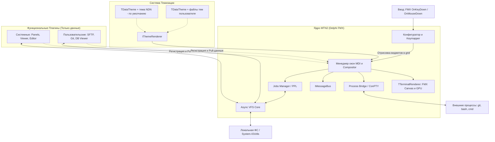

## Техническое описание проекта (System Design Specification)

[English](SDS.md) | **Русский**

### Проект: Modern Terminal Navigator 2 (MTN2) – Delphi Edition

> **Роль документа:** полная спецификация (концепция, структуры данных, API, roadmap).
> **Краткий обзор слоёв, потоков и инвариантов:** см. [ARCHITECTURE.ru.md](ARCHITECTURE.ru.md).
> **Сборка, тесты, CI/CD:** см. [BUILDING.ru.md](BUILDING.ru.md). **Лицензия:** [MPL-2.0](../LICENSE).
> При расхождении формулировок приоритет у этого SDS, кроме инвариантов, явно зафиксированных в Architecture.
> Документ подготовлен с помощью ИИ-ассистентов (см. [README](../README.ru.md#как-создавался-проект)).

**MTN2** – кроссплатформенный двухпанельный файловый менеджер (TUI в GUI-окне) с MDI, ориентированный на **повседневную эксплуатацию**. Визуальный и сценарный базис – **Necromancer's DOS Navigator (NDN)**; удачные практики дополняются из **FAR Manager** и **Total Commander**. Реализация – Delphi / FireMonkey: виртуальная текстовая сетка на GPU-холсте.

---

### 1. Введение и концепция

#### 1.0. Продуктовый фокус

MTN2 – в первую очередь **ежедневный файловый менеджер**, а не демонстрация плагинной платформы и не «ещё один терминал».

| Ориентир            | Что берём                                                                                                                                          |
| ------------------- | -------------------------------------------------------------------------------------------------------------------------------------------------- |
| **NDN (базис)**     | MDI, ощущение интерфейса и диалогов, тема по умолчанию (`NDN`), плотность TUI, работа «клавиатурой вперёд».                                  |
| **FAR**             | Предсказуемый keymap и панели (F-клавиши, `Ctrl+O`, user menu / ассоциации), качественный Viewer/Editor, привычные сценарии навигации и выделения. |
| **Total Commander** | Архивы как папки, вкладки и удобные массовые операции, сравнение каталогов, Multi-Rename, практичный поиск, стабильные copy/move с прогрессом.     |

**Приоритет развития:** паритет повседневных сценариев (навигация, копирование/удаление, поиск, сессии, ассоциации, архивы, сеть) → затем платформа расширений. Порядок экосистемы плагинов: **1) родные плагины MTN2** → **2) Far** → **3) Total Commander** (см. §6.0). Архитектурные контракты соблюдаются с самого начала, но **не опережают** UX файлового менеджера.

Критерий готовности к ежедневной замене NDN/FAR на локальных дисках: пользователь может провести рабочий день в MTN2 без возврата к другому FM для базовых операций.

#### 1.1. Отказ от классической консоли в пользу GUI-TUI гибрида

Вместо запуска приложения внутри системной консоли (cmd.exe, bash) программа создает стандартное окно GUI (FMX Form). Внутри этого окна рендерится **динамическая** виртуальная текстовая сетка: число столбцов и строк (`Cols × Rows`) пересчитывается при изменении размера окна и масштаба (zoom) шрифта/ячейки.

**Ключевые преимущества этого подхода:**

- **Абсолютная переносимость**: Одинаковое поведение графики, шрифтов и клавиатурных сочетаний на Windows, macOS и Linux без необходимости адаптироваться к различиям raw-mode терминалов. *(Windows: интерактивный ConPTY реализован (`31f903c`); POSIX PTY – roadmap, «PTY на Linux/macOS».)*
- **Использование современных шрифтов**: Поддержка TrueType/OpenType моноширинных шрифтов с лигатурами и Unicode (включая эмодзи и иконки Powerline; вне BMP – через grapheme/cluster-aware раскладку ячеек).
- **Свобода цвета**: Полноценная поддержка 32-битного RGBA-цвета, градиентов, эффектов размытия и теней для перекрывающихся окон.
- **Высокая производительность**: Отрисовка текстового буфера средствами GPU (DirectX, Metal, OpenGL/Vulkan) с частотой 60+ FPS.

#### 1.2. Целевые показатели производительности

| Метрика                      | Целевой показатель (v0.1) | Описание / Механизм реализации                                                                                                                 |
| ---------------------------- | ------------------------- | ---------------------------------------------------------------------------------------------------------------------------------------------- |
| **Оперативная память (private bytes)** | ≤ 50 МБ без плагинов | Delphi компилирует в оптимизированный нативный код с минимальным оверхедом; плагины загружаются по требованию |
| **Рендеринг кадра**          | ≤ 16 мс (60 FPS)          | Аппаратное ускорение FMX + двойная буферизация на текстуре (Bitmap)                                                                            |
| **Открытие файлов до 10 ГБ** | < 0.5 сек (первый экран)  | Потоковый Viewer на базе `TFileStream` с фоновым индексированием строк и ленивой загрузкой                                                     |
| **Бинарный артефакт ядра**   | Исполняемый файл и две DLL | Нативное ядро; нужны только Skia (`sk4d.dll`) и Wasmtime (`wasmtime.dll`). Плагины DLL/SO/WASM – необязательные расширения |

Замер на Windows 11, релизная сборка, через несколько секунд после запуска с пустой конфигурацией: около 37 МБ private bytes (61 МБ working set) без плагинов и около 42 МБ (65 МБ) со всеми плагинами, которые идут с программой (большинство загружается при первом обращении). На диске: `MTN2.exe` 22 МБ, `sk4d.dll` 22 МБ, `wasmtime.dll` 11 МБ, плагины 58 МБ. Время кадра и открытие больших файлов на этой сборке заново не измерялись.

---

### 2. Архитектура системы

MTN2 использует модульную архитектуру с разделением логики представления (TUI/GUI рендерер) и логики работы с данными (VFS, Jobs). Обзор слоёв и инвариантов – в [ARCHITECTURE.ru.md](ARCHITECTURE.ru.md).



#### Основные слои

1. **FMX Event / Input Layer**: Перехватывает события клавиатуры и мыши и транслирует их во внутренние команды.
2. **MDI Window Manager & Compositor**: Виртуальные окна (Dual Panel, Viewer, Editor, диалоги), z-order, фокус; общий экранный буфер ячеек.
3. **FMX Canvas Renderer (**`TTerminalRenderer`**)**: Dynamic grid + двухбуферная отрисовка на GPU.
4. **Async VFS**: Единый слой для URI (`file://`, `sftp://`, цепочки архивов через `!/`). Только неблокирующие операции с cancel и ошибками.
5. **Background Jobs (PPL)**: Очередь долгих операций (копирование, удаление, поиск) без зависания UI.
6. **Process Bridge**: Неблокирующий запуск процессов и вывод во внутренний консольный буфер (Windows: настоящий ConPTY; POSIX PTY – цель, «PTY на Linux/macOS»).
7. **Theme Engine**: Делегирование стиля виджетов в `IThemeRenderer` (NDN по умолчанию).

#### Разделение ответственности (кратко)

| Роль                            | Отвечает за                                              |
| ------------------------------- | -------------------------------------------------------- |
| **Ядро**                        | Layout, focus, compositing, keymap, Jobs, declarative UI |
| **Тема (**`IThemeRenderer`**)** | Внешний вид виджетов в ячейках сетки                     |
| **Плагины**                     | Данные и логика («что показать»), без `TCanvas`          |

---

### 3. Спецификация структур данных (Object Pascal)

#### 3.1. Ячейка терминала и экранный буфер

Каждая позиция на экране представлена структурой `TCharCell`. Для символов вне BMP и emoji ядро использует grapheme-aware раскладку (кластер может занимать одну или несколько логических ячеек).

```pascal
type
  TCharCellAttribute = (ccaBold, ccaItalic, ccaUnderline, ccaBlink, ccaReverse);
  TCharCellAttributes = set of TCharCellAttribute;

  TCharCell = record
    CharValue: Char;               // Базовый UTF-16 code unit; кластеры – на уровне раскладчика
    FgColor: TAlphaColor;          // Цвет текста (32-bit RGBA)
    BgColor: TAlphaColor;          // Цвет фона (32-bit RGBA)
    Attributes: TCharCellAttributes;
  end;

  TTerminalRow = array of TCharCell;
  TTerminalGrid = array of TTerminalRow;
```

#### 3.2. Оконный менеджер (MDI)

Каждое окно (Dual Panel, редактор, диалог) инкапсулирует логику взаимодействия и делегирует стилизацию виджетов в `IThemeRenderer`. Локальный буфер `FBuffer` кэширует визуальное представление окна.

```pascal
type
  TWindowState = (wsNormal, wsMaximized, wsMinimized);

  TRectI = record
    Left, Top, Right, Bottom: Integer;
    function Width: Integer;
    function Height: Integer;
  end;

  TTerminalWindow = class
  private
    FId: Cardinal;
    FTitle: string;
    FArea: TRectI;
    FZIndex: Integer;
    FIsFocused: Boolean;
    FState: TWindowState;
    FBuffer: TTerminalGrid;           // Кэшированный буфер отрендеренного окна
    FTheme: IThemeRenderer;           // Ссылка на глобальный/локальный плагин темы
  public
    // Вызывает методы FTheme для отрисовки рамки и элементов во внутренний FBuffer
    procedure RebuildBuffer; virtual;
    procedure Resize(AWidth, AHeight: Integer); virtual;
    // Копирует кэшированный FBuffer в общий буфер композитора
    procedure Paint(const ACompositorBuffer: TTerminalGrid); virtual;
    procedure HandleInput(var AKey: Word; AShift: TShiftState; var AHandled: Boolean); virtual;
  end;
```

#### 3.3. Dual Panel, вкладки и панели

Иерархия (см. также Architecture, §3):

```text
TDualPanelWindow (MDI)
├── Dual Panel Tabs          – вкладки рабочих пространств
└── Active TDualPanelState
    ├── Left:  Panel Tabs → TTab (URI, history, cursor)
    └── Right: Panel Tabs → TTab
```

- **Dual Panel Tabs** – вкладки на всё двухпанельное окно; каждая хранит полный снимок `TDualPanelState`.
- **Panel Tabs** – вкладки каталогов внутри каждой стороны (`Left` / `Right`).
- Viewer / Editor – Dual Panel Tab (`wkDocument`) на той же полосе, что Home/Work; Console – отдельный `TTerminalWindow`.
- **Контракты UI-примитивов (плагин ↔ ядро):** [UI_PRIMITIVES.ru.md](UI_PRIMITIVES.ru.md).

```pascal
type
  TTab = record
    Id: Cardinal;
    Title: string;            // Подпись Panel Tab (home, documents, …)
    CurrentURI: string;       // Например, 'file:///D:/Work'
    History: TArray<string>;  // История переходов (назад/вперед)
    HistoryIndex: Integer;
    CursorIndex: Integer;     // Индекс выделенного элемента
    ScrollOffset: Integer;    // Смещение прокрутки панели
    SelectedURIs: TArray<string>; // multi-select по URI строки
  end;

  TPanelSide = (psLeft, psRight);
  TPanelViewKind = (pvkFiles, pvkInfo); // Ctrl+L – Info на соседней стороне
  TPanelColumnMode = (pcmBrief, pcmSize, pcmDate, pcmFull, pcmCreated, pcmTypes);
  TPanelSortColumn = (pscNone, pscName, pscExt, pscSize, pscModified,
    pscCreated, pscAccessed, pscAttr, pscType);

  TPanelState = record
    Tabs: TArray<TTab>;
    ActiveTabIndex: Integer;
    DriveDirs: array['A'..'Z'] of string; // last path per drive (Alt+F1/F2, Ctrl+←/→)
    ColumnMode: TPanelColumnMode;         // Ctrl+3 – меню режимов
    SortColumn: TPanelSortColumn;         // Ctrl+F3..F9 / Ctrl+F12 / клик заголовка
    SortDescending: Boolean;              // заглавная буква в углу рабочего поля
    ViewKind: TPanelViewKind;
  end;

  TDualPanelState = record
    LeftPanel: TPanelState;
    RightPanel: TPanelState;
    ActiveSide: TPanelSide;
    LeftVisible: Boolean;   // Ctrl+F1
    RightVisible: Boolean;  // Ctrl+F2
  end;

  // Одна вкладка уровня Dual Panel = полный снимок панелей или документ
  TWorkspaceKind = (wkPanels, wkDocument);

  TDualPanelWorkspaceTab = record
    Id: Cardinal;
    Title: string;
    Kind: TWorkspaceKind;   // wkPanels | wkDocument (Viewer/Editor)
    State: TDualPanelState;
  end;

  TDualPanelWindowState = record
    WorkspaceTabs: TArray<TDualPanelWorkspaceTab>;  // Dual Panel Tabs
    ActiveWorkspaceIndex: Integer;
  end;
```

`TDualPanelWindow` – наследник `TTerminalWindow`, владеющий `TDualPanelWindowState`. Геометрия колонок, Brief multi-column, icon reserve и hit-test – `uPanelColumns.pas`. Shell-иконки строк – `uShellIcons.pas` (§4.2). Overlay-меню Sort / Column modes / User menu – `uDualPanelMenus.pas`.

**FAR-буква сортировки.** У каждой файловой панели (`pvkFiles`) в левом верхнем углу **рабочего поля** (первая клетка строки заголовков колонок, `Left+1` / `Top+1` – не на рамке) рисуется глиф текущего `SortColumn`: `n` имя, `x` расширение, `w` время записи, `s` размер, `u` без сортировки, `c` создан, `a` доступ, `t` атрибуты, `y` тип. Заглавная буква – `SortDescending`. Цвет – акцент темы `pcpHotMark` на фоне `pcpColumnHeader`, с запасным контрастом через `ContrastingGlyphFg` (`uThemeDrawing.pas`), чтобы глиф читался на любой палитре. Info / Quick View букву не показывают. `PanelSortModeLetter` – `uPanelColumns.pas`; отрисовка после заголовков – `DrawPanelSortLetter` в `uDualPanelPanelDraw.pas` (`DispatchDrawPanelFiles`).

Верхняя полоса выпадающего меню (F9 / Alt / мышь) управляется `uTopMenuBar.pas`; структура грузится из встроенного ресурса `MENU_MAIN` (RCDATA ← `src/config/menu.json`), с fallback на файл рядом с exe/в исходниках и захардкоженную структуру, если ресурса нет. Меню выше окна прокручивается (`FSubmenuTop` в `uTopMenuBar.pas`, полоса `DrawDialogScrollBar` на правой границе, колесо мыши двигает выбор); в диалогах выше окна содержимое сдвигается вслед за фокусом (`FScrollY` в `uDialogHost.pas`), элементы вне поля зрения не рисуются и не попадают под мышь. Палитра команд (Shift+F9; `uCommandPalette.pas`, `uDualPanelPaletteDialog.pas`, `dialogs/commandpalette.json`) перечисляет живое меню (`TTopMenuController.ListItems`), ищет по названию, категории и синонимам и запускает пункт через `RunItem`. Синонимы складываются из трёх источников: поле `aliases` пункта в `menu.json` (английские), ключи `menu.alias.<действие>` файла строк выбранного языка и необязательный `aliases.json` в папке настроек (перечитывается при каждом открытии палитры). В слове запроса допустимы `?` и `*`.

Смена диска (Alt+F1/Alt+F2, `uDualPanelDrivePopup.pas`) – под списком дисков разделитель и пронумерованные спецпункты `1. System folders` / `2. Recycle bin` / `3. Temporary` / `4. Workspace` (выбор Enter/клик/цифра 1–4). Курсор popup ставится на **текущий** URI активной вкладки панели (`HostPanelPath` = `ActiveTab.CurrentURI`, индекс – `DrivePopupCursorIndex` / глиф `DriveBarGlyphFromUri`: буква диска или `1`–`4`), а не всегда на первый диск. Переход к системным виртуальным папкам Windows (Рабочий стол, Документы, Загрузки и др.) – `sys://folders` VFS (`uSysFoldersVfs.pas`); просмотр и восстановление файлов Корзины – `recycle://` VFS (`uRecycleBinVfs.pas`, `IShellFolder2`/`IFileOperation`; Ctrl+Alt+R restore, F8 = безвозвратный purge); `tmp:///` – плагин Temporary (пункт 3, если схема зарегистрирована); `ws:///` – панель ссылок ядра (`uWorkspaceVfs.pas`, пункт 4, F8 = Unlink). Листинги `sys://` и `recycle://` синтетические: `..` возвращает не «на уровень выше внутри VFS» (родителя там нет), а в директорию, из которой был сделан переход (через историю табов, `TDualPanelWindow.HistoryBack`). F-bar (`uFunctionBar.pas`) в этих листингах переключается на урезанный контекст (`fbcSysFolders`/`fbcRecycleBin`), скрывающий недоступные операции (Copy/Move/MkDir и т.п.).

Оверлеи Dual Panel рисуются снизу вверх (`DispatchDrawOverlays` в `uDualPanelPanelDraw.pas`): Change Drive / jobs / меню / поиск → **диалог** → **stub поверх диалога** → подменю F9. Ввод и клик – в обратном порядке (`uDualPanelWindow` / `uDualPanelClick.pas`): сначала stub, потом диалог. F-bar берёт контекст из `ResolveChromeContext` (`uDualPanelStatus.pas`): видимый stub важнее диалога; вид диалога (`THostDialogKind`) даёт свой набор подписей (`fbcWorkspaceLibrary`, `fbcFolderHotlist`, `fbcColorCoding`, `fbcColorCodingEdit`, списки – `fbcDialogList`), а не общий `Enter:OK`. Строковые литералы в `.pas` идут в кодовой странице компилятора (обычно Windows-1251): типографское тире задавайте как `#$2014`, иначе в UI получится `вЂ"`.

Взаимодействие с внешними окнами ОС по перетаскиванию файлов реализовано нативным мостом Windows OLE Drag & Drop (`uWinFileDragDrop.pas`).

Отрисовка аппаратного мигающего курсора (интервал 530 мс) интегрирована в `TInputLine` (командная строка, поля ввода диалогов) и `TEditorWindow` (редактор/просмотрщик).

История каталогов (Alt+F12) – `uFolderHistory.pas` + dialog `folderhistory.json`.

История введённых команд (Alt+F8) – хранится в `TDualPanelCmdLineManager` (`uDualPanelCmdLine.pas`, `history.json`) + dialog `cmdhistory.json`, единая для cmdline Dual Panel, фоновой консоли (`Ctrl+O`) и вкладок Terminal Workspace (`Ctrl+Shift+N`) – `TBaseConsoleWindow` (`uBaseConsoleWindow.pas`) даёт Alt+F8 обоим наследникам через `OnGetCmdHistory`/`OnCommandExecuted`, а сам ввод хоста-моста в `TMainForm`/`TDualPanelWindow` (`ConsoleGetCmdHistory`/`RecordConsoleCommand`). В Dual Panel выбор строки подставляет её в командную строку (без немедленного запуска); в консоли/терминале – своей строки ввода нет, поэтому команда выполняется сразу (`ExecuteCommandNow`). Команды, набранные прямо в шелле консоли/терминала (Enter на непустой строке ввода, вне alt-screen TUI), тоже пишутся в эту историю – перехват на Enter через `TConsoleBuffer.GetInputAfterPrompt`/`NoteCommandSubmitted`, до отправки в PTY.

---

### 4. Реализация рендерера на FireMonkey (FMX)

Рендеринг – двухбуферный, с **dynamic grid**: `Cols`/`Rows` зависят от клиентской области формы и масштаба ячейки.

#### 4.1. Опциональный движок рендеринга Skia (Skia4Delphi)

По умолчанию рендеринг выполняется штатным графическим движком FMX Canvas (Direct2D/Metal/OpenGL) с минимальными требованиями к бинарному размеру и окружению.

Для повышения четкости моноширинных шрифтов на HiDPI и субпиксельного сглаживания внедрена опциональная поддержка **Skia4Delphi** с легким откатом:
* **Включение Skia**: в `MTN2.dproj` должен быть `DCC_Define` с `SKIA`; в `MTN2.dpr` – `uses FMX.Skia` и `GlobalUseSkia := not NoSkiaRequested` под `{$IFDEF SKIA}`, до `Application.Initialize`. Собранный так exe по умолчанию рисует через Skia.
* **Запуск без Skia**: `MTN2.exe --no-skia` оставляет ту же сборку, но холст – штатный FMX (`GlobalUseSkia := False`). `sk4d.dll` рядом с exe по-прежнему нужен. Полный список ключей – [ARCHITECTURE.ru.md](ARCHITECTURE.ru.md) §10.
* **Откат на этапе сборки**: уберите `SKIA` из `DCC_Define` и блоки `FMX.Skia` / `GlobalUseSkia` в `MTN2.dpr`. Юниты с `{$IFDEF SKIA}` вернутся на ветки без Skia-оптимизаций; canvas – штатный FMX.

**Что даёт Skia в MTN2 сейчас (поверх общего FMX→Skia canvas):**

1. **Текст без растяжения** – глифы центрируются в snapped-ячейке (natural advance), без `Scale` matrix, которая размывала AA. Кэш глифов (`TGlyphCache.GetGlyph`, `uTerminalRenderer.pas`) растеризует каждый символ в **физических** пикселях (`BitmapScale` = масштаб сцены, размер = клетка × масштаб). Поэтому на кадр он копируется 1:1 при любом масштабе Windows (125%, 150%, 200%). Раньше битмап был логического размера и растягивался ближайшим соседом: при дробном масштабе штрихи получались неровными и «мыльными». Смена масштаба (перенос окна на монитор с другим DPI) сбрасывает кэш.
   **Вертикальная посадка** – `CalculateCellMetrics` после расчёта высоты строки вызывает `MeasureInk`: рисует пробные символы (`W Å É g j p q y [ ] | _ ( ) { } Ё Й Д Ц Щ ф у`) тем же вызовом `FillText`, что и кэш, и находит реальные верх и низ «чернил». `FitGlyphLine` оставляет высоту клетки равной округлённой высоте строки и увеличивает её, только если «чернила» не помещаются (Ubuntu Mono 12/18/20: хвосты `g j p q y [ ] | _` раньше теряли нижний ряд пикселей). Верх строки внутри клетки (`GlyphTop`) ставится на целый физический пиксель: база по центру, затем сдвиг, чтобы «чернила» уместились. Глиф рисуется с `TTextAlign.Leading` от `GlyphTop` в прямоугольник заметно выше клетки: `FillText` не рисует строку, которая не влезает в прямоугольник, поэтому обрезает только край битмапа. Результат замера кэшируется по шрифту, кеглю и масштабу. Опция «Межстрочный интервал» (`TTerminalRenderer.SetLineSpacing`, `session.json` → `lineSpacing`, по умолчанию выключена) передаёт в `FitGlyphLine` добавку `cLineSpacingEm` = 0.15 кегля: клетка выше, строка по центру. Сами шрифты сообщают нулевой `lineGap` (Skia, GDI и DirectWrite согласны), а 0.15 – это запас Windows Terminal (Cascadia Mono 11 пт: 17 → 19 px). Почему MTN2 выглядит иначе, чем Far, и когда они совпадают, – в справке, `help/*/settings.md`, раздел «Шрифт и межстрочный интервал». Кегль внутри программы и в `session.json` (`fontSize`) – пиксели FMX при 100%; диалог «Шрифт / экран» показывает его в пунктах (`cFontPoints` в `uDisplaySettings`, 1 пт = 96/72 px, перевод – `DisplayFontSizeAt` / `IndexOfDisplayFontSize`). «ОК» без изменения кегля сохраняет точное значение, даже если его нет в списке. Известное ограничение: под `--no-skia` при 125% у части шрифтов верхний знак Й/Ё/Å может терять 1 px.
2. **Шрифт** – при наличии `CascadiaMono.ttf` выбирается Cascadia Mono, иначе Consolas.
3. **Тени диалогов** – затемнение исходных Fg/Bg ячеек (сохраняется содержимое под тенью), а не плоская серая заливка.
4. **Modal dim** – перед рамкой диалога затемняется весь грид вне bounds (FAR-стиль).
   Тени и затемнение подчиняются `uThemeDrawing.GShadowStyle` (`TShadowStyle` в `uDisplaySettings`: классические / мягкие / нет; диалог «Шрифт / экран», `session.json` → `shadowStyle`). Для `DrawDialogShadow` и `DrawButtonShadow` сила берётся из `ShadowCoverFor` (`cShadowCover` / 80 / 0), для `DimGridExcept` – из `DimCoverFor` (как есть / половина / 0). Все тени диалогов, кнопок и уведомлений проходят через эти функции, темы свои тени не рисуют.
5. **Shell-иконки в панелях** – blit `TBitmap` с alpha в ячейки (`TCharCell.IconId`); HighSpeed=False, чтобы прозрачный фон (`parent_up.png`) просвечивал цвет строки.

Архитектура Host/Theme/cell-grid сохраняется: иконки – гибрид (cell + bitmap overlay в рендерере). Полноценный Quick View / превью медиа – «Quick View, Hex и потоковый Viewer»; отдельный Skia-only paint всего грида – только если профилирование это оправдает.

#### 4.2. Столбец shell-иконок в панелях

Первый столбец списка файлов – растровые иконки Windows (не emoji):

| Элемент | Источник |
| --- | --- |
| Обычные файлы | `SHGetFileInfo` по расширению (`*.ext` + `SHGFI_USEFILEATTRIBUTES`) |
| `.exe` / `.dll` / `.ico` / `.lnk` / … | сначала иконка из файла по URI; иначе – по расширению |
| Каталог | системная folder-icon |
| `..` (parent) | `Assets/parent_up.png` (RCDATA `ICON_PARENT_UP`; зелёная стрелка, прозрачный фон) |

**Загрузка – фоновая («Live reload открытых файлов + фоновая загрузка shell-иконок»).** `SHGetFileInfo`/`ExtractIconEx` уходят на выделенный worker-поток (`TShellIconWorker`), не на UI: `ShellIconIdForRow` при промахе кэша лишь ставит задачу в очередь и сразу возвращает `0` (fallback-глиф остаётся на месте), готовая иконка приходит в кэш через `TThread.Queue` и триггерит `NotifyChanged` (реальный repaint формы). Worker выкачивает оконные сообщения (`MsgWaitForMultipleObjects` + `PeekMessage`/`DispatchMessage`) – без этого COM-маршалинг некоторых shell-расширений (иконки-оверлеи облачных клиентов, антивирусов) мог бы подвесить поток навсегда. `ShellIconIdForRowWait` – синхронный резолв в обход очереди, только для smoke-тестов без message loop.

**Юниты:** `uShellIcons.pas` (кэш id→bitmap + фоновый worker), `uPanelColumns` (`PanelIconReserve` = 2 ячейки иконки + 1 gap), `TTerminalRenderer` (blit по `IconId`), `TDualPanelWindow.DrawList`.

**Smoke:** `src/tests/panels/TestPanelColumns.pas`, `src/tests/panels/TestShellIcons.pas` (покрывает и синхронный, и асинхронный путь резолва). При сборке `build.ps1` копирует `parent_up.png` в `bin/Assets/` (file-fallback рядом с exe).

```pascal
type
  TTerminalRenderer = class
  private
    FBackBuffer: TBitmap;
    FGrid: TTerminalGrid;
    FCols: Integer;
    FRows: Integer;
    FFontName: string;
    FFontSize: Single;
    FZoom: Single;                 // Масштаб (1.0 = 100%)
    FCellWidth: Single;
    FCellHeight: Single;
    FNeedRebuildBuffer: Boolean;
    procedure CalculateCellMetrics(ACanvas: TCanvas);
    procedure RecalcGridDimensions(AClientWidth, AClientHeight: Single);
    procedure RenderGridToBitmap;
  public
    constructor Create;
    destructor Destroy; override;
    procedure Resize(AWidth, AHeight: Single; ACanvas: TCanvas);
    procedure SetZoom(AZoom: Single; AClientWidth, AClientHeight: Single; ACanvas: TCanvas);
    procedure Draw(ACanvas: TCanvas; const ADestRect: TRectF);
    property Grid: TTerminalGrid read FGrid write FGrid;
    property Cols: Integer read FCols;
    property Rows: Integer read FRows;
  end;
```

- **Механика отрисовки**:
  1. `Resize` / `SetZoom` → `CalculateCellMetrics` → `RecalcGridDimensions` (`Cols = Trunc(ClientWidth / CellWidth)`, аналогично для `Rows`) → пересоздание `FGrid` и `Resize` окон композитора.
  2. `RenderGridToBitmap` выполняется только при изменении содержимого или метрик (`FNeedRebuildBuffer`); ping-pong front/back frame.
  3. `Draw` в `OnPaint` копирует готовый front frame через `ACanvas.DrawBitmap`.
  4. Символы – `FillText` (под Skia без stretch); box-drawing – вектор; `IconId` – alpha-blit shell-иконки.
  5. WordWrap у текста ячеек отключён.

---

### 5. Асинхронные операции и Виртуальная ФС (VFS)

#### 5.1. Контракт Async VFS и схемы URI

UI-поток **не вызывает** блокирующие методы провайдера. Все операции выполняются в worker-потоке Jobs Manager и завершаются callback'ом / событием job.

**Поддерживаемые схемы URI в ядре (`v0.2.x`):**

- `file://` – локальная файловая система (`uFileVfs.pas`).
- `sys://folders` – системные виртуальные каталоги Windows (Рабочий стол, Документы, Загрузки, Изображения, Музыка, Видео, Профиль, System32, Program Files и др.) (`uSysFoldersVfs.pas`). Элементы сопоставляются с реальными целевыми путями `TargetURI`.
- `zip://` и `!/` – прозрачные ZIP-архивы (`uZipVfs.pas`) с кэшированием структуры через `uZipArchiveCache.pas`.
- `find://` – виртуальные панели результатов поиска (`uFindVfs.pas`).
- `recycle://` – Корзина Windows (`uRecycleBinVfs.pas`, через `IShellFolder2`, канонический корень `recycle:///`). В основном read-only (`ListDirectoryAsync`/`ExistsAsync`); `DeleteAsync` – настоящая безвозвратная очистка (purge, не повторная отправка в Корзину); `MoveAsync`/`CopyAsync`/`WriteTextAsync` → `vecNotSupported` (для возврата файла используйте `RestoreRecycleBinItem`, Ctrl+Alt+R).
- `ws://` – панель ссылок на файлы и каталоги (`uWorkspaceVfs.pas`, корень `ws:///`). Не копии: F5 записывает reference, F8 снимает его (Unlink). Виртуальные группы – F7. Change Drive **4**. Именованные снимки живого набора – `workspaces.json` + **Commands → Workspaces...** (`Ctrl+Shift+D`); см. `src/plugins/mtn.ws/resource/en/help/readme.md`. Схема в ядре; WASM `mtn.ws` только регистрирует меню.

**Схемы плагинов (появляются, только если модуль загружен):** `7z://` (`mtn.7z`), `tmp:///` (Temporary, Change Drive **3**). WASM-хост отклоняет `register_vfs_scheme` для ядерных `file` / `recycle` / `sys` / `find` / `ws`, чтобы пустая панель не падала в file VFS с «Invalid path».

**Централизованный резолвер конфигурации (`uConfigLocation.pas`):**

Разрешает пути к файлам настроек (`keymap.json`, `session.json`, `history.json`, `workspaces.json`, `associations.json`, `usermenu.json`):
- **Portable режим**: при наличии файла `portable.dat` в директории приложения конфиг читается/пишется рядом с `.exe`. Переключение режимов – «Настройки → Расположение настроек...» (`uConfigMode`): проверка прав и конфликтов, копирование с побайтовой сверкой, смена `portable.dat` и удаление оригиналов; при сбое до смены маркера копии убираются, заменённые файлы возвращаются (`*.before-switch` хранит заменённое).
- **Стандартный режим**: по умолчанию используется `%APPDATA%\MTN2\`.

**Дефолтные JSON-ассеты – встроенные ресурсы, не файлы рядом с exe.** Диалоги (`DIALOG_*`), меню (`MENU_MAIN`) и дефолтный профиль хоткеев (`KEYMAP_DEFAULT`) компилируются как RCDATA в `MTN2.rc`/`MTN2Resource.rc` из `src/dialogs/*.json`, `src/config/menu.json`, `src/keymap.json` соответственно и грузятся из ресурсов exe при старте (`uDialogResources.pas`, `uTopMenuBar.LoadMenuFromResource`, `uKeymap.LoadDefaultKeymapProfile`) – портативный `.exe` не зависит от соседних файлов. Только `keymap.json` дополнительно поддерживает **пользовательский override**: если в конфиг-директории (`GetConfigFilePath`) лежит собственный `keymap.json`, он подмешивается поверх встроенного дефолта через `MergeKeymapJson` – заменяются только явно перечисленные там хоткеи, остальное остаётся от ресурса. При изменении `menu.json`/`keymap.json`/`dialogs/*.json` в исходниках нужно пересобрать `MTN2.dres` (`brcc32 MTN2Resource.rc`, см. `src/build.ps1` или Pre-build в `MTN2.dproj`), иначе изменения не попадут в скомпилированный ресурс. Канонический вывод – `bin\win64\MTN2.exe` (`DCC_ExeOutput=..\bin`); `src\Win64\Debug\MTN2.exe` может остаться со старым `.dres` (типичный симптом: `Dialog resource "DIALOG_WORKSPACES" not found`).

```pascal
type
  TVfsEntry = record
    Name: string;
    Size: Int64;
    IsDirectory: Boolean;
    CreationTime: TDateTime;
    ModificationTime: TDateTime;
  end;

  TVfsErrorCode = (
    vecOk,
    vecNotFound,
    vecAccessDenied,
    vecAlreadyExists,
    vecNotSupported,
    vecCancelled,
    vecIOError
  );

  TVfsError = record
    Code: TVfsErrorCode;
    Message: string;
    URI: string;
  end;

  IJobCancelToken = interface
    ['{C3E1A7D0-2F4B-4A9E-9C11-6B0E8D2A1F40}']
    function IsCancellationRequested: Boolean;
    procedure Cancel;
  end;

  TVfsListCallback = reference to procedure(const AItems: TArray<TVfsEntry>; const AError: TVfsError);
  TVfsBoolCallback = reference to procedure(const ASuccess: Boolean; const AError: TVfsError);
  TVfsStreamCallback = reference to procedure(const AStream: TStream; const AError: TVfsError);
  TVfsProgressCallback = reference to procedure(const ACopied, ATotal: Int64);

  IVirtualFileSystem = interface
    ['{B18C8B56-B101-44B9-A23F-2621C11F490A}']
    procedure ListDirectoryAsync(const AURI: string; ACancel: IJobCancelToken; AOnDone: TVfsListCallback);
    procedure FileExistsAsync(const AURI: string; ACancel: IJobCancelToken; AOnDone: TVfsBoolCallback);
    procedure CreateDirectoryAsync(const AURI: string; ACancel: IJobCancelToken; AOnDone: TVfsBoolCallback);
    procedure DeleteAsync(const AURI: string; ACancel: IJobCancelToken; AOnDone: TVfsBoolCallback);
    procedure RenameAsync(const AFromURI, AToURI: string; ACancel: IJobCancelToken; AOnDone: TVfsBoolCallback);
    procedure GetStreamAsync(const AURI: string; AMode: Word; ACancel: IJobCancelToken; AOnDone: TVfsStreamCallback);
  end;

  // Реестр VFS-провайдеров (file://, sys://folders, sftp://, …)
  TVFSRegistry = class
  public
    class procedure RegisterProvider(const AScheme: string; const AProvider: IVirtualFileSystem);
    class function GetProvider(const AURI: string): IVirtualFileSystem;
  end;
```

Правила:
- Callback'и маршалятся в UI-поток через `TThread.Queue` / очередь событий Jobs.
- Провайдер обязан проверять `ACancel.IsCancellationRequested` в циклах чтения/записи.
- При отмене: `AError.Code = vecCancelled`.
- Владение `TStream` из `GetStreamAsync` переходит вызывающему; закрытие – в `finally` на стороне job.

#### 5.2. Прозрачные архивы (Nested VFS) и кэширование

Архивы (ZIP, TAR, 7Z, …) монтируются как папки. Каноническая грамматика цепочки – сегменты `!/`:

```text
sftp://server.example/home/user/outer.zip!/inner.tar!/docs/readme.txt
file:///D:/data/bundle.zip!/nested.zip!/a.txt
```

1. Часть до первого `!/` – базовый URI (`file`, `sys`, `sftp`, …).
2. Каждый следующий сегмент – путь внутри архивного слоя; тип определяется по имени/сигнатуре.
3. `TVFSRegistry` / Plugin Manager строит стек провайдеров outer → inner.
4. Запись `zip://host/path/archive.zip/entry` допустима только для **однослойного** mount; для вложенности обязательна форма с `!/`.
5. Кэширование оглавления архивов (`uZipArchiveCache.pas`) устраняет повторный разбор структуры при навигации по вложенным папкам.

**Поставка провайдеров:** ZIP в ядре («Прозрачные архивы»); прочие форматы и контейнеры – **родные** VFS-плагины MTN2; затем опционально мосты Far / Total Commander (WCX). Порядок – §6.0.

#### 5.3. Фоновые задачи (Background Jobs)

Долгие операции (копирование, удаление, pack/unpack) оформляются как job с progress, result и cancel. I/O идёт в worker-потоке; UI держит job только пока он **foreground** или в ask. Кнопка **Background** в Copy/Delete отпускает панели (как в Total Commander). Несколько job: локальный `file://` может идти параллельно; один и тот же архив, тот же `sftp://` authority или пересекающиеся URI – в очередь. Список job – Ctrl+Shift+J / клик по статус-строке (`kaJobList`). Поиск по-прежнему на своём контроллере, не в этом списке.

**Остановка пользователем.** Любая отмена, которую инициирует пользователь (Esc, «Отмена» в окне прогресса, «Отмена» и «Отменить все» в списке заданий, Esc во время поиска), идёт через один вопрос – `hdkStopConfirm` (`stopconfirm.json`, текст вопроса задаёт вызывающий код через `TDualPanelWindow.RequestStopConfirm`). Кнопка «Продолжить» по умолчанию и привязана к Esc: она вызывает обработчик отказа и возвращает прежний экран (окно прогресса, список заданий). Кнопка «Прервать» вызывает `RequestCancel`; для задания окно прогресса при этом не возвращается: задание переводится в фон (`BackgroundJob`) и пока воркер не заметил токен отмены, плашка не показывается (`JobHasChip`), хотя запись остаётся в списке заданий. Контроллеры поиска и задания сообщают об Esc событием `OnStopRequest`; пока оно не назначено, они отменяют сами (так проще тестировать).

```pascal
uses
  System.Threading;

procedure CopyFileAsync(const ASourceURI, ADestURI: string;
  ACancel: IJobCancelToken;
  AOnProgress: TVfsProgressCallback;
  AOnDone: TVfsBoolCallback);
begin
  TTask.Run(
    procedure
    var
      SourceStream, DestStream: TStream;
      Buffer: array[0..65535] of Byte;
      ReadBytes: Integer;
      TotalCopied, TotalSize: Int64;
      Error: TVfsError;
      CopiedSnapshot, TotalSnapshot: Int64;
    begin
      Error.Code := vecOk;
      Error.Message := '';
      Error.URI := ASourceURI;
      TotalCopied := 0;
      TotalSize := 0;
      SourceStream := nil;
      DestStream := nil;
      try
        // Получение потоков – внутри worker (через sync-обёртку провайдера
        // либо вложенные async-completion; UI не участвует)
        SourceStream := VFSOpenStreamBlocking(ASourceURI, fmOpenRead, ACancel, Error);
        if Error.Code <> vecOk then
        begin
          FinishCopy(False, Error, AOnDone);
          Exit;
        end;
        DestStream := VFSOpenStreamBlocking(ADestURI, fmCreate, ACancel, Error);
        if Error.Code <> vecOk then
        begin
          FinishCopy(False, Error, AOnDone);
          Exit;
        end;

        TotalSize := SourceStream.Size;
        while True do
        begin
          if ACancel.IsCancellationRequested then
          begin
            Error.Code := vecCancelled;
            Error.Message := 'Cancelled';
            FinishCopy(False, Error, AOnDone);
            Exit;
          end;

          ReadBytes := SourceStream.Read(Buffer, Length(Buffer));
          if ReadBytes = 0 then
            Break;
          DestStream.WriteBuffer(Buffer, ReadBytes);
          Inc(TotalCopied, ReadBytes);

          // Снимки для замыкания: не захватывать TotalCopied напрямую из цикла
          CopiedSnapshot := TotalCopied;
          TotalSnapshot := TotalSize;
          TThread.Queue(nil,
            procedure
            begin
              if Assigned(AOnProgress) then
                AOnProgress(CopiedSnapshot, TotalSnapshot);
            end);
        end;

        FinishCopy(True, Error, AOnDone);
      finally
        SourceStream.Free;
        DestStream.Free;
      end;
    end
  );
end;

procedure FinishCopy(const ASuccess: Boolean; const AError: TVfsError; AOnDone: TVfsBoolCallback);
var
  SuccessSnap: Boolean;
  ErrorSnap: TVfsError;
begin
  SuccessSnap := ASuccess;
  ErrorSnap := AError;
  TThread.Queue(nil,
    procedure
    begin
      if Assigned(AOnDone) then
        AOnDone(SuccessSnap, ErrorSnap);
    end);
end;
```

#### 5.4. Командная строка и эмуляция терминала (PTY)

Поскольку MTN2 – графическое приложение (FMX), запуск консольных программ идёт через process bridge во внутренний буфер. Детали моделей и эволюции – в [ARCHITECTURE.ru.md](ARCHITECTURE.ru.md) §8.

##### Текущее состояние (`v0.2.8`, после дефект-фикс прохода `31f903c` "Fix console")

1. **Одна Command Line** – только у `TDualPanelWindow` (общая для панелей и консольного режима).
2. **Не путь → команда**: Host включает `ConsoleMode` у Dual Panel (панели не рисуются, cmdline/F-keys/status остаются), показывает MDI-`TConsoleWindow` над cmdline; **persistent** shell через настоящий **ConPTY** (`StartShell` + `WriteInput`, см. п.9); one-shot команда – тот же `LaunchProcess`/ConPTY-путь без keep-stdin.
3. `Ctrl+O` **(FAR-style)**: Console MDI над общей cmdline; нижняя линия рамки Console – граница над cmdline. Обратно – обычные панели; shell не убивается.
4. **Буфер**: `TConsoleBuffer` + `TANSIParser` – построчный cell-scrollback (≥10 000) с SGR (16/256/**TrueColor**), EL/ED, OSC strip (с лимитом длины `FOscLen`/`cMaxOscLen` и принудительным `ResetState` при превышении – не виснет на оборванном OSC), tab-раскрытие до 8-колоночного табстопа, lone-CR overwrite; `TConsoleWindow` рисует `TCharCell` Fg/Bg. **Плюс** alternate screen (DECSET/DECRST `1049`/`47`) поверх отдельного 2D `TAltScreenGrid`/`TPrimaryScreenGrid` (`uAltScreenGrid.pas`, `uPrimaryScreenGrid.pas`) с CUP/CUU/CUD/CUF/CUB (`MoveAbs`/`MoveRel`) и save/restore cursor – ядро «Alternate Screen Buffer + интерактивные TUI», детали ниже. Выделение мышью / Shift+стрелки, Ctrl+A, Ctrl+C.
5. **Cmdline UX (`v0.2.4`)**: Tab-complete по именам активной панели; Up/Down – история (`history.json`); Ctrl+Enter / Ctrl+Shift+Enter – имя / путь.
6. **F5 robocopy-lite (`v0.2.5`)**: Only newer / Retry / Exclude mask / Preserve timestamps / Follow symlinks.
7. **Directory Sync (`v0.2.5` / `v0.3.6` / `v0.3.5`)**: one-way Active→Inactive или two-way ⇄ (`Ctrl+Alt+S`); сравнение по дате или по содержимому; dry-run / Synchronize через copy job с `DestURIs`; конфликты two-way (оба изменились с прошлого sync) не копируются.
8. **Terminal Workspaces (`v0.2.7`, доработано после закрытия)**: `TTerminalWorkspaceWindow` с профилями (CMD/PS/pwsh/WSL), raw input, `Ctrl+Shift+N`. **Больше не плавающее MDI-окно** – живёт как Dual Panel Tab (`wkTerminal` в `TWorkspaceKind`, владеет `TDualPanelWindow.FTerminals`), наравне с `wkPanels`/`wkDocument`; открывается/закрывается/рисуется тем же путём, что и Viewer/Editor. **Эфемерна** – как `wkDocument`, не сохраняется и не восстанавливается в `session.json` (старое поле `terminals: [{profile,cwd}]` убрано вместе с всей связанной save/restore-логикой в `uMainForm.pas`/`uSession.pas`). Высота вкладки – на 2 строки меньше полной, снизу видны общие F-key bar и status line Dual Panel (контекст `fbcTerminal`: `Esc:Close`, `Ctrl+A/C/V`; статус – профиль + Running/Not running) вместо собственной строки статуса терминала (убрана). `F10` в Panel Console (`Ctrl+O`) больше не закрывает консоль (только `Esc`/`Ctrl+O`). Process bridge теперь настоящий ConPTY (см. п.9), не pipes. **Enter-последовательность профиль-зависима** (`ProfileReturnSeq`, `uShellProfiles.pas`): cmd/PS/pwsh – CRLF (piped stdin без CRLF не сабмитит строку); WSL – одиночный LF (CRLF под Linux `icrnl` доходит как два Enter подряд, второй пустой перерисовывает промпт – было видно как дублирование промпта после каждой команды в WSL-консоли). **Исторически** (под pipes, до перехода на ConPTY в `31f903c`) PowerShell/pwsh виснул навсегда на любой ошибке команды, не лечилось `try/catch`/`$ErrorActionPreference='Stop'`; приложенческая митигация – `ProfileInitCommand` (`$ErrorActionPreference='SilentlyContinue'` при старте профиля) + `PsPipeSafeCommand`/`IsSimplePsExpression` (безопасно оборачивает простые команды в `| % {"$_"}`, чтобы результат обошёл движок форматирования) – **оставлена в коде как defense-in-depth**; сама причина (pipes без реального console-handle) устранена переходом на `CreatePseudoConsole`: зависаний PowerShell/pwsh на ошибках команд нет.
9. **Process bridge**: `uConPty.pas` / `TConPtySession` – настоящий **ConPTY** (`CreatePseudoConsole`/`ResizePseudoConsole`/`ClosePseudoConsole`), безусловно для `Start`/`StartShell` (нет отдельного pipe-only fallback пути); `Resize` реально меняет размер псевдоконсоли. `Terminate` – упорядоченное закрытие: close stdin → `TerminateProcess` → `ClosePseudoConsole` → join reader-потока с таймаутом 2 сек (не блокирует UI навсегда) → закрытие хендлов; per-profile кодировка ввода/вывода (`ProfileOutputEncoding`, cmd – OEM/CP866, PS/pwsh/WSL – UTF-8) с pending multi-byte хвостом (`FDecodeTail`) между чанками `ReadFile`.
10. **Синхронизация cwd**: смена локального URI активной панели → тихий `cd /d` в живой shell (`OnShellCwdSync`), **по умолчанию выключено** (`session.json` → `autoSyncConsoleCwd`, default `false` – консоль и активная панель держат каждая свой каталог). Ручная синхронизация в обе стороны по `Ctrl+Shift+O` (`kaSyncConsoleDir`, keymap.json): при активной Dual Panel – каталог активной панели → консоль (`TDualPanelWindow.SyncConsoleDirNow`); при активной фоновой консоли – её `WorkingDir` → активная панель (`TConsoleWindow.OnSyncDirToPanels` → `TMainForm.ConsoleSyncDirToPanels` → `TDualPanelWindow.SetActivePanelDir`), пункт меню Commands → "Sync console dir".
11. **Viewer / Editor**: `TEditorWindow` + `TEditorDoc` как Dual Panel Tab (`OpenDocument`); F3 = ViewOnly, F4 = edit. Документ целиком в RAM (потоковый Viewer – цель «Quick View, Hex и потоковый Viewer» / инвариант Architecture). **Live reload** («Live reload открытых файлов + фоновая загрузка shell-иконок»): локальный файл без несохранённых правок молча перечитывается при внешнем изменении на диске (`TDirectoryWatcher` на содержащем каталоге); `ContentGen` – счётчик перезагрузок для инвалидации внешних кэшей (например, Markdown fence-индекса).
12. **Panel icons**: первый столбец – shell-иконки Windows (`uShellIcons`), загрузка фоновая («Live reload открытых файлов + фоновая загрузка shell-иконок», не блокирует UI); `..` → `parent_up.png`; gap перед Name (§4.2).
13. **Skia** (`DCC_Define SKIA`): чёткий mono-текст, modal dim, alpha-blit иконок (§4.1). Ключ `--no-skia` переключает холст на штатный FMX, не пересобирая exe ([ARCHITECTURE.ru.md](ARCHITECTURE.ru.md) §10).
14. **Alt+F12**: история папок (`folderhistory.json` / dialog `DIALOG_FOLDERHISTORY`).
15. **Alt+F8**: история введённых команд (`cmdhistory.json` / dialog `DIALOG_CMDHISTORY`), источник – тот же `history.json`, что и Up/Down в cmdline (п.5). Доступен и в cmdline Dual Panel (выбор строки подставляет её, не запускает), и в фоновой консоли/вкладках Terminal Workspace (`TBaseConsoleWindow.OpenCmdHistoryDialog`, свой `TDialogHost`), где выбор строки выполняет её сразу (`ExecuteCommandNow`) – там нет своей строки ввода для правки.
16. **Естественный выход шелла из фоновой консоли**: ConPTY не закрывает write-конец output pipe, пока сам процесс жив внутри псевдоконсоли – после `exit` внутри шелла блокирующий `ReadFile` в reader-потоке не получает EOF сам по себе (в отличие от `Terminate`, который явно зовёт `TerminateProcess`+`ClosePseudoConsole`). Ватчер `TConPtySession.StartExitWatcher` ждёт выход процесса на собственном дубликате хендла и сам закрывает псевдоконсоль, разблокируя `ReadFile` → штатный `QueueExit`/`OnExit`. Фоновая консоль после этого **по умолчанию перезапускает шелл** на последнем `cwd` (`TConsoleWindow.RestartOnExit`, default `true`, `session.json` → `consoleRestartOnExit`); вкладка Terminal Workspace (`Ctrl+Shift+N`) по умолчанию **закрывается** (`TTerminalWorkspaceWindow.CloseOnExit`, default `true`, `session.json` → `terminalCloseOnExit`).

##### Целевые модели (канон после «Панельный persistent shell + FAR Ctrl+O» – «Alternate Screen Buffer + интерактивные TUI»)

| Режим                  | Назначение                                   | Shell                                        | Ввод                                                        |
| ---------------------- | -------------------------------------------- | -------------------------------------------- | ----------------------------------------------------------- |
| **Panel Console**      | FAR-практика: cmdline под панелями + вывод   | Долгоживущий `cmd.exe`; PS/WSL – позже | Команды с cmdline; `cd` синхронизируется с URI панели       |
| **Console Window**     | MDI-окно вывода/сессии (как Viewer)          | Тот же session Panel Console или отдельный   | Scroll; Esc/F10; `Ctrl+O` → панели                          |
| **Terminal Workspace** | Мультиплексор (Windows Terminal / tmux-like) | Профиль: CMD / PowerShell / WSL              | Raw passthrough в PTY (кроме системных хоткеев вкладок/MDI) |

**Инвариант:** для cmdline под панелями канон – **persistent shell + sync** `cd`, а не бесконечная серия one-shot `cmd /c`. One-shot (`v0.1.13`–`0.1.14`) – промежуточный вариант.

##### Механизм (целевой)

1. **Command Line Widget** – ввод под панелями; submit → запись в stdin фонового PTY (или очередь, пока shell занят).
2. **Вывод** – VT-поток → `IANSIParser` → экранный `TTerminalGrid` + scrollback; `Ctrl+O` показывает этот буфер (панели скрыты или Console MDI на переднем плане – UX FAR-toggle).
3. **Синхронизация пути**: при смене каталога панели Host невидимо отправляет в shell `cd /d "<path>"` (cmd) / эквивалент профиля; ошибки sync не ломают панели.
4. **PTY-мост**: ConPTY (Windows) / `forkpty` (POSIX); resize PTY при изменении сетки окна.
5. **Чтение**: worker/`TProcessOutputReader` → только `TThread.Queue` в UI.

##### Ключевые типы (целевые)

```pascal
type
  IANSIParser = interface
    ['{E43B3674-325A-4B6A-B6D7-90C3664C268E}']
    procedure ParseChunk(const ABytes: TBytes; const AScreen: TTerminalGrid);
  end;

  // Долгоживущая PTY-сессия (panel console / terminal workspace).
  IPtySession = interface
    ['{A7C2E901-4B1D-4F0A-9C3E-2D8F6B1A0E55}']
    function StartShell(const AProfile, ACwd: string; ACols, ARows: Word): Boolean;
    procedure WriteInput(const AText: string);
    procedure Resize(ACols, ARows: Word);
    procedure Terminate;
    function IsRunning: Boolean;
  end;

  // Профиль оболочки для Terminal Workspace.
  TShellProfile = (spCmd, spPowerShell, spPowerShellCore, spWsl);
```

Реализации сегодня: `uConPty.pas` (pipe capture; имя историческое), `uConsoleBuffer.pas` (line-buffer), `uConsoleWindow.pas`. Целевые `IANSIParser` / VT-grid / `IPtySession`+ConPTY – «Панельный persistent shell + FAR Ctrl+O» – «Alternate Screen Buffer + интерактивные TUI».

---

### 6. Плагины и расширяемость

MTN2 реализует микроядерную плагинную архитектуру на основе **Model-View-Presenter** с **Pull-моделью** данных. Контракты примитивов: [UI_PRIMITIVES.ru.md](UI_PRIMITIVES.ru.md).

#### 6.0. Приоритет экосистемы плагинов

Расширения поставляются в таком порядке (более поздний слой **не** заменяет предыдущий):

| Приоритет        | Слой                        | Назначение                                                                                                                                                                                                 |
| ---------------- | --------------------------- | ---------------------------------------------------------------------------------------------------------------------------------------------------------------------------------------------------------- |
| **1 (основной)** | **Родные плагины MTN2**     | Host API / Pull / JSON / `IVirtualFileSystem` из §6.1–6.3. Панели, темы, Viewer/Editor, VFS (SFTP, дополнительные архивы, «заход внутрь» контейнеров). Сначала in-process, затем DLL/SO, опционально WASM. |
| **2**            | **Плагины Far Manager**     | Мост (Windows): VFS/`OpenPlugin` → модель панели MTN2. После стабильного родного Plugin Manager.                                                                                                           |
| **3**            | **Плагины Total Commander** | Мост (Windows): packer **WCX** / file-system **WFX** → тот же Nested VFS / панель. После Far-моста или параллельно, но не раньше родного API.                                                              |

**Инвариант:** любой внешний формат (RAR, 7Z, ISO, «плагин открывает файл как папку») в продукте должен уметь жить как **родной** VFS/panel-плагин. Мосты Far/TC – совместимость с уже написанной экосистемой, не единственный путь поддержки форматов.

Встроенный ZIP («Прозрачные архивы») – часть ядра; прочие архивы и контейнеры – через родной VFS-плагин (или позже через Far/TC-мост).

#### Стратегия поставки плагинов (сейчас → позже)

Пока MTN2 развивается как ежедневный файловый менеджер, разработка ведётся в виде **единой кодовой базы** (монолитный исполняемый файл): системные «плагины» (панели, Viewer/Editor, тема, локальный VFS и т.д.) компилируются вместе с ядром как обычные Delphi-модули/классы. При этом **все требования взаимодействия плагинов и ядра обязательны уже сейчас** – границы Host API, Pull-модель, запрет Canvas у плагинов, async VFS, `invalidate`, контракты из [UI_PRIMITIVES.ru.md](UI_PRIMITIVES.ru.md). Цель: не смешивать UI и данные даже внутри одного бинарника.

После **стабилизации** ежедневного FM (`0.2.x`) порядок выноса такой:
1. **Родной Plugin Manager + DLL/SO** – вынос отработанных модулей и приём сторонних родных плагинов (в т.ч. VFS для архивов/контейнеров).
2. **WASM Host** – изолированная песочница для безопасных родных плагинов.
3. **Far API Wrapper**, затем **Total Commander packer/FS bridge** – совместимость, не замена родного API.

Смена формы поставки не должна ломать контракты: те же вызовы, JSON и жизненный цикл, что отработаны в монолите.

#### 6.1. Разделение обязанностей: Ядро, Тема и Плагины

1. **Ядро (Core)**: Layout MDI, сетка ячеек, размеры, клиппинг, focus, keymap, пул Jobs, declarative UI. Ядро решает *структуру* экрана («где и что за контейнер»).
2. **Системный плагин темизации (**`IThemeRenderer`**)**: Визуальный стиль в ячейках – рамки, кнопки, скроллбары, палитра. Тема решает *как выглядят* виджеты.
3. **Остальные плагины (системные и пользовательские)**: Только *что отображать* (сухие данные).
  - Системные модули: панели файлового менеджера, Viewer, Editor.
  - Пользовательские: SFTP, Git, просмотрщики БД.
  - Без доступа к Canvas/текстуре; только Pull-данные и логические события.

#### 6.2. Базовые визуальные контейнеры ядра и Декларативный UI

Плагин может описать кастомный диалог **JSON-декларацией**; ядро парсит и собирает UI из примитивов.

Оглавление контрактов плагин ↔ ядро: [UI_PRIMITIVES.ru.md](UI_PRIMITIVES.ru.md).

**Основные компоненты ядра:**

1. **Панель (Panel)** – список с scroll, курсором, multi-select (внутри Dual Panel + Panel Tabs). Контракт: [PANEL_PLUGIN.ru.md](PANEL_PLUGIN.ru.md).
2. **Текстовое поле (Input Line)**. Контракт: [INPUT_PLUGIN.ru.md](INPUT_PLUGIN.ru.md).
3. **Текстовая область (Text Area)** – Viewer / Editor. Контракт: [TEXTAREA_PLUGIN.ru.md](TEXTAREA_PLUGIN.ru.md).
4. **Диалоговое окно (Dialog)**. Контракт: [DIALOG_PLUGIN.ru.md](DIALOG_PLUGIN.ru.md).
5. **Панель инструментов (Toolbar / Button Bar)** – обычно F1–F12. Контракт: [TOOLBAR_PLUGIN.ru.md](TOOLBAR_PLUGIN.ru.md).
6. **Строка состояния (Status Line / Status Bar)** – одно- или двухстрочный примитив с логическими сегментами (текущий URI, свободное место, число/размер выделенных, тип файла под курсором, прогресс job). Данные поставляет Host или плагин (сухой текст/метрики); внешний вид сегментов и разделителей задаёт `IThemeRenderer`. В декларативном UI: `{ "type": "status", "id": "panel_status", "segments": ["uri", "selected", "free"] }`. Контракт: [STATUS_PLUGIN.ru.md](STATUS_PLUGIN.ru.md).
7. **Графический оверлей (Media Overlay)** – растровые превью поверх сетки. Плагин запрашивает превью логически (URI + bounds); рисует ядро/`Overlay Renderer`, не плагин. Контракт: [OVERLAY_PLUGIN.ru.md](OVERLAY_PLUGIN.ru.md).

**Пример JSON-декларации:**

```json
{
  "type": "dialog",
  "title": "Поиск файлов",
  "width": 50, "height": 10,
  "children": [
    { "type": "label", "text": "Маска поиска:" },
    { "type": "input", "id": "search_mask", "value": "*.*" },
    { "type": "checkbox", "id": "search_subdirs", "text": "В подпапках", "checked": true },
    { "type": "button", "id": "btn_start", "text": "Начать поиск" }
  ]
}
```

#### 6.3. Протокол взаимодействия и Pull-модель данных

1. Пользователь прокручивает список в Панели.
2. Ядро вычисляет видимый диапазон строк.
3. Ядро запрашивает у плагина только эти строки.
4. Плагин возвращает текстовые/JSON метаданные (без цветов и стилей).

##### Пример C-совместимого API (DLL/SO; WASM Host – целевой контракт на будущее)

```pascal
function mtn_plugin_get_item_count(WindowId: Integer): Integer; cdecl;

procedure mtn_plugin_get_row_json(WindowId: Integer; RowIndex: Integer;
  OutBuffer: PAnsiChar; MaxLen: Integer); cdecl;

procedure mtn_plugin_handle_event(WindowId: Integer; EventType: Integer;
  Param1: Integer; Param2: Integer); cdecl;
```

##### Пример JSON строки панели

```json
{
  "text": "my_document.pdf",
  "size": "14.2 MB",
  "is_directory": false,
  "file_type": "document",
  "is_hidden": false,
  "is_readonly": true
}
```

*Примечание: плагин не возвращает* `fg_color` */* `bg_color` */* `bold`*. Стилизацию решают ядро и активная тема.*

#### 6.4. Системный плагин темизации (`IThemeRenderer`)

```pascal
type
  TThemeWidgetFlag = (twFocused, twPressed, twHovered, twDisabled, twSelected);
  TThemeWidgetState = set of TThemeWidgetFlag;

  IThemeRenderer = interface
    ['{8A5D3F6A-4E2B-4A1C-8DF0-DF29D55C7B7D}']
    // Палитра/фон рабочего стола композитора.
    function DesktopColor: TAlphaColor;
    procedure DrawDesktop(const AGrid: TTerminalGrid; const ABounds: TRectI);

    procedure DrawWindowFrame(const AGrid: TTerminalGrid; const ABounds: TRectI;
      const ATitle: string; AState: TThemeWidgetState);

    procedure DrawButton(const AGrid: TTerminalGrid; const ABounds: TRectI;
      const AText: string; AState: TThemeWidgetState);

    procedure DrawCheckBox(const AGrid: TTerminalGrid; const ABounds: TRectI;
      const AText: string; AChecked: Boolean; AState: TThemeWidgetState);

    procedure DrawScrollBar(const AGrid: TTerminalGrid; const ABounds: TRectI;
      APosition, AMax: Integer; AVertical: Boolean; AState: TThemeWidgetState);

    procedure DrawTabBar(const AGrid: TTerminalGrid; const ABounds: TRectI;
      const ATabNames: TArray<string>; AActiveTabIndex: Integer;
      AState: TThemeWidgetState; AKind: TTabBarKind = tbkPanel);
    // AKind: tbkWorkspace = Dual Panel Tabs; tbkPanel = Panel Tabs внутри стороны.

    procedure DrawToolBar(const AGrid: TTerminalGrid; const ABounds: TRectI;
      const AItems: TArray<string>; AState: TThemeWidgetState);

    // Отрисовка строки состояния (сегменты – уже отформатированный текст от Host)
    procedure DrawStatusLine(const AGrid: TTerminalGrid; const ABounds: TRectI;
      const ASegments: TArray<string>; AState: TThemeWidgetState);
  end;
```

##### Реализации

Единственная реализация – `TDataTheme`: цвета, символы, начертания и наборы рамок берёт из файла темы (`*.theme.json`, формат – `docs/THEMES.md`). Корневая тема `NDN` вшита в exe (`src/Assets/themes/NDN.theme.json`), остальные поставляются файлами `resource\themes\*.theme.json` рядом с exe:

- **`NDN` (по умолчанию, классическая Far, стиль Necromancer's DOS Navigator)** – тёмно-синие панели, двойные рамки, табы в стиле NDN, цветовая кодировка типов файлов.
- **`ModernUnicode`** – тёмная палитра, одинарные рамки, TrueColor.
- **`ASCII`** – только ASCII (`+`, `-`, `|`) для минималистичного GUI-стиля без псевдографики Unicode; **не** для системной консоли (её в архитектуре нет).
- **`NortonCommander`**, **`MidnightCommander`**, **`TotalCommander`** – оформление классических файловых менеджеров: синие панели с голубым текстом и двойными рамками (Norton), синие панели с одинарными рамками и бирюзовыми строкой меню и панелью клавиш (Midnight), светлые панели Windows (Total).
- **`Monochrome`**, **`HighContrast`** – чёрно-белая и контрастная схемы.
- **`SolarizedDark`**, **`SolarizedLight`**, **`Dracula`**, **`Nord`**, **`GruvboxDark`**, **`Monokai`**, **`TokyoNight`**, **`OneDark`**, **`DarkPlus`**, **`Light`** – палитры популярных редакторов и светлая тема.
- **`GreenPhosphor`**, **`AmberPhosphor`** – одноцветные «мониторные» схемы с двойными рамками.
- **`NavigatorGray`**, **`NavigatorDark`**, **`NavigatorNight`**, **`NavigatorLCD`** – схемы в духе классических DOS-навигаторов: серые панели с пурпурными кнопками, чёрные панели с синим меню, чёрные с бирюзовыми акцентами и серая шкала для ЖК-экранов (`NavigatorLCD` расширяет `Monochrome`).
- Свои темы пользователя – файлы в `<конфиг>\themes`, создаются и настраиваются в диалоге «Настройки → Тема...».

#### 6.5. Внутренняя шина сообщений (`IMessageBus`)

```pascal
type
  TMessageListener = reference to procedure(const AEventType: string; const AJSONData: string);

  IMessageBus = interface
    ['{884A4CF9-8F74-4C2E-B4C2-CD77ED20EA7F}']
    procedure Publish(const AEventType: string; const AJSONData: string);
    procedure Subscribe(const AEventType: string; AListener: TMessageListener);
    procedure Unsubscribe(const AEventType: string; AListener: TMessageListener);
  end;
```

#### 6.6. Подсистема скриптинга и макросов

Макросы выполняет плагин `mtn.lua` (`src/plugins/mtn.lua`) на Lua 5.4 или 5.5. Библиотека Lua подключается при запуске: на Windows это `lua55.dll` / `lua54.dll` рядом с плагином, на Linux – системная `liblua5.5` / `liblua5.4` или файл рядом с плагином; без неё плагин остаётся в списке, а команды макросов сообщают, что именно установить.

Макрос – текстовый файл Lua в папке `macros` каталога настроек; файл вызывает `macro { name, area, requires, key, menu, run }`. Состояние Lua – песочница: базовая библиотека, `string`, `table`, `math`, `utf8`, `coroutine`; `io`, `os`, `package`, `debug` недоступны. Макрос выполняется в сопрограмме: каждый вызов `mtn.key`, `mtn.text`, `mtn.action` уходит в главный поток через `PostToMain` и возвращается, когда программа обработала действие. Счётчик инструкций и Esc останавливают макрос, который не завершается.

Уровень 2 API использует функции `THostApiTable` (`Doc*`, `Panel*`, `Clipboard*`, `ShowDialog`, `Subscribe`) без изменения ABI: `mtn.editor.*` читает и заменяет текст документа, `mtn.panel.*` читает список панели и меняет курсор, отметки и папку, `mtn.clipboard.*` работает с буфером, `mtn.input` / `mtn.confirm` / `mtn.choose` строят диалог JSON и ждут ответа, `mtn.exec` запускает программу из списка `exec` макроса через `PlatformRunCaptured` в отдельном потоке (по умолчанию 10 с, не больше 60 с, вывод до 1 МБ). Вызов `mtn.on(тема, функция)` при загрузке файла регистрирует обработчик события шины (`doc.*`, `panel.*`): он запускается как макрос и получает payload таблицей; события во время работы макроса или другого обработчика отбрасываются. Реализация – `uLuaHostFns.pas`. Вызов `mtn.column{...}` при загрузке файла объявляет колонку схемы `file` (`RegisterPanelColumns`); значения функции `value` вычисляются в отдельной сопрограмме с тем же бюджетом инструкций, что у макроса, для обеих панелей при загрузке и на каждое событие `panel.dir` и передаются через `SetPanelColumnValues` (до 3000 файлов, текстом, без сортировки); сбойная колонка отключается до перезагрузки.

Запись (`Ctrl+.`) собирает нажатые клавиши через подписку на шину и сохраняет их как макрос с вызовами `mtn.key` / `mtn.text`. Клавиша макроса проверяется через `KeyOwner` хоста: занятую клавишу плагин не назначает без подтверждения. Условия `requires` и область `area` проверяются перед стартом по состоянию программы (`mtn.state()`).

Окна плагина – диалоги JSON v2.0 (`ShowDialog`), справка – страница `help.md` плагина. Тесты – `TestLuaMacros.pas`.

#### 6.7. Внутренние ассоциации файлов и Пользовательское меню

При `Enter` / `F4` ядро сверяет RegEx-ассоциации и маршрутизирует:
- встроенный модуль (Viewer / Hex / Editor);
- внешний процесс через PTY;
- системный `ShellExecute` (если явно задано).

**Пользовательское меню (F2)** – дерево собственных команд пользователя в духе NDN/FAR («Меню пользователя F2 и меню папки»): пункты-команды с горячей клавишей, вложенные подменю и разделители.

- **Где хранится.** Главное меню – `usermenu.json` в каталоге конфигурации (`uConfigLocation`). Меню папки – `.mtn2menu.json` в самой папке; действует на неё и на все вложенные, выигрывает ближайшее вверх по дереву (меню в корне проекта работает в любой его подпапке). Файл перечитывается при каждом открытии, ручная правка применяется без перезапуска. Пока главное меню не сохранено, показываются примеры (Проводник, Блокнот, SHA-256, подменю Git).
- **Формат.** `{"version":1,"items":[{"kind":"command","hotkey":"E","caption":"...","command":"..."},{"kind":"separator"},{"kind":"submenu","hotkey":"G","caption":"Git","items":[...]}]}`. Поле `kind` необязательно: строка с `items` считается подменю.
- **Клавиши в меню.** Enter / → – выполнить или войти в подменю; горячая клавиша пункта – то же (в любой раскладке: «Ф» = `A`); ← / Esc – на уровень выше, Esc на верхнем уровне закрывает; Ins – новый пункт перед курсором; F4 – изменить; Del – удалить (с подтверждением); Ctrl+↑/↓ – переставить; **Shift+F2** – переключить меню папки ↔ главное (в папке без меню открывается пустое, первый Ins создаёт `.mtn2menu.json` в текущей папке). Мышь: щелчок по строке – выполнить/войти, вне меню – закрыть.
- **Выполнение.** Команда выполняется в консоли панели (как набранная в командной строке, с видимым выводом), рабочий каталог – папка активной панели; текст командной строки не очищается. Оболочка консоли может быть cmd, PowerShell или WSL – синтаксис команды пользователь выбирает под свой профиль.

- **Возврат в панели.** У пункта-команды поле `ReturnMode` (`umrDefault` / `umrReturn` / `umrStay`; в `usermenu.json` – `returnToPanels`: нет ключа / `true` / `false`). `umrDefault` берёт значение из `GConsoleSettings.ReturnToPanels` (Параметры → Консоль...). Остальные механизмы возврата – ARCHITECTURE §8.5.
- **Подстановки** (имена FAR Manager, `uUserMenu.ExpandUserMenuCommand`):

| Подстановка | Значение |
| --- | --- |
| `!!` | символ `!` |
| `!.!` | имя файла под курсором с расширением |
| `!` | то же без расширения |
| `!\` | папка панели с завершающим `\` |
| `!:` | диск папки панели (`C:`) |
| `!&` | выделенные имена (или текущее), через пробел, в кавычках при необходимости |
| `!@!` | путь к временному UTF-8 файлу со списком полных путей выделенного (`%TEMP%\MTN2\list-*.txt`, файлы старше суток удаляются при создании следующего) |
| `!?Вопрос?ответ!` | спросить у пользователя перед запуском (отдельный диалог ввода на каждый запрос; отмена любого запроса отменяет команду) |
| `!#` / `!^` | последующие подстановки относятся к пассивной / активной панели |

- **Код.** Модель, JSON и подстановки – `uUserMenu.pas`; всплывающее меню (навигация, отрисовка, клавиши редактирования) – `uUserMenuController.pas`; диалоги редактирования/удаления/запросов, выбор главного меню или меню папки и запуск – `uDualPanelUserMenu.pas`; диалог пункта – `src/dialogs/usermenuedit.json` (`DIALOG_USERMENUEDIT`). Контекст панелей для подстановок собирает `TDualPanelWindow.HostUserMenuContext`, запуск – `HostRunUserMenuCommand`.

#### 6.8. Родные VFS-плагины и совместимость Far / Total

##### 6.8.1. Родные плагины MTN2 (приоритет 1)

Целевой путь расширения Nested VFS и «захода внутрь» файлов:
- реализация `IVirtualFileSystem` (или panel-плагин с URI) по контрактам §5–§6;
- регистрация в Plugin Manager / `TVFSRegistry` по схеме, расширению или сигнатуре;
- грамматика `!/` общая с ядром (как у ZIP «Прозрачные архивы»);
- поставка: in-process → DLL/SO («Родные плагины: Plugin Manager + DLL/SO») → опционально WASM («WASM Host для родных плагинов»).

Примеры: TAR/7Z/RAR, ISO, «документ как папка», сетевые схемы beyond `file://` (`sftp://` – «Сетевой VFS», **реализовано** in-process, `uSftpVfs.pas`; остальные протоколы – плагин `mtn.net`: FTP, FTPS, SFTP по паролю (`nsftp://`), SCP, WebDAV, S3; **реализовано**).

##### 6.8.2. Плагины Far Manager (приоритет 2, Windows)

**Far API Wrapper** загружает VFS-плагины FAR (`*.dll`), эмулирует `PluginStartupInfo` и транслирует `PluginPanelItem` → JSON / Pull MTN2.

- **Поддерживаются:** VFS-плагины (архивы, FTP, Network, Registry) – «открыть как панель / каталог».
- **Не поддерживаются:** кастомные диалоги FAR и прямая работа с консольным экранным буфером.
- **Зависимость:** стабильный родной Host API и Plugin Manager («Родные плагины: Plugin Manager + DLL/SO»+); см. «Far API Wrapper».

##### 6.8.3. Плагины Total Commander (приоритет 3, Windows)

**TC Plugin Bridge** подключает экосистему Total Commander после (или вслед за) Far-мостом:

| Тип TC                | Роль в MTN2                                                                  |
| --------------------- | ---------------------------------------------------------------------------- |
| **WCX** (packer)      | Архив/контейнер как слой Nested VFS (`…file.ext!/…`); list / extract наружу. |
| **WFX** (file system) | Виртуальная ФС как panel/VFS URI (сеть, облака, специальные пространства).   |
| **WDX / WLX / и пр.** | Вне обязательного минимума; позже по потребности (колонки, Lister).          |

- **Зависимость:** родной Plugin Manager; желательно уже работающий Far-мост как образец адаптации чужого ABI («Total Commander plugin bridge»).
- Неподдерживаемые UI-колбэки TC отвергаются явно, без краша ядра.

---

### 7. Дорожная карта (Roadmap)

> Справка для пользователя (клавиши, меню, настройки) – встроенная справка по **F1**: темы лежат в `bin/win64/resource/<язык>/help/` (`index.md` – титульная страница с содержанием, одна тема на раздел), окно справки – `uHelpViewer.pas`.

Разработка идёт версиями; каждая версия заканчивается запускаемой сборкой и проверкой по чек-листу. Порядок отражает продуктовый фокус (§1.0). Контракты плагин↔ядро соблюдаются с первого содержательного слоя UI (монолит, см. §6).

**Версии:** `0.1.x` – путь к ежедневному локальному FM; `0.2.x` – паритет NDN/FAR/TC + консоль/терминал; `0.3.x` – платформа: родные плагины → WASM; `0.4.x` – Linux (`mtn2-tui`, `mtn2-sdl`), сетевые плагины (`mtn.net`), подсветка синтаксиса (`mtn.highlight`), палитра команд, расширяемость плагинами; мосты к плагинам Far и Total Commander остаются позже.

**Направления:**

| Направление                  | Суть                                                                     |
| ---------------------------- | ------------------------------------------------------------------------ |
| **FM паритет**               | архивы, keymap из файла, sync, Multi-Rename                              |
| **Консоль / терминал**       | persistent shell, VT, cmdline UX, workspaces, alt screen, POSIX PTY, IPC |
| **Просмотр / автоматизация** | потоковый Viewer / Quick View/Hex, Markdown, макросы, темы               |
| **Платформа**                | родные DLL/SO → WASM → сетевые плагины; мосты Far / Total Commander позже |
| **UI / локализация**         | язык; шрифт и прочие визуальные параметры (без перезапуска)              |
| **Ввод / меню**              | акцентные буквы в переводах, выделение мышью и по словам, меню F2, выход |

Консольный трек не блокирует архивы и keymap. Полноценный VT и Terminal Workspaces идут после базового FM `0.2`, когда панельный shell уже канонизирован (§5.4).

**Приоритет:** функции повседневной работы под Windows важнее POSIX-порта и экосистемы сторонних плагинов. Проект остаётся кроссплатформенным по цели: код, добавляемый сейчас, не должен закрывать путь к другим платформам (см. §8.4 в ARCHITECTURE.md – карта точек связности с Windows).

**Открытое и отложенное:**

- **PTY на macOS** ([#61](https://github.com/Laex/MTN2/issues/61)): Linux реализован (`mtn2-sdl`, `mtn2-tui`; проверка на разных дистрибутивах – [#70](https://github.com/Laex/MTN2/issues/70)), macOS остаётся целью. Новый код в консольном/VFS-слое не должен намертво завязываться на Windows API там, где portable-абстракция дешева (см. ARCHITECTURE.md §8.4).
- **Мосты к плагинам Far и Total Commander** ([#59](https://github.com/Laex/MTN2/issues/59)): родные плагины, WASM и сетевые (`mtn.net`: FTP, FTPS, SFTP, SCP, WebDAV, S3) есть; мостов нет. Это инфраструктура под сторонний контент, а не функция для обычной работы; имеет смысл, когда станет ясно, каких плагинов не хватает.
- **Задачи (Tasks):** наборы профилей и команд, запускаемые одним действием. Частично пересекается с меню пользователя (F2) и рабочими пространствами.
- **Вынос терминала в отдельное окно** и возврат во вкладку. Между окнами MTN2 сессия `TConPtySession` остаётся в процессе, меняется только окно, которое её показывает (нужна вторая форма FMX и отвязка `TConsoleWindow` от главной формы). Перенос терминала, открытого вне программы, надёжен только при отдельном процессе-хосте оболочки, к которому подключаются окна MTN2 (переделка слоя ConPTY); иначе остаётся зеркало буфера консоли.
- **Отдельные оболочка, окружение и история команд для каждой вкладки панелей** ([#79](https://github.com/Laex/MTN2/issues/79), [#78](https://github.com/Laex/MTN2/issues/78)): консольная программа из панели может идти во вкладке-терминале, но своей оболочки на вкладку панелей нет, история общая.
- **Правила оформления диалогов** ([#69](https://github.com/Laex/MTN2/issues/69)) и **новый язык интерфейса** ([#62](https://github.com/Laex/MTN2/issues/62)): нужна помощь; правила пока только в коде и в `TestDialogAlignment`.
- **Позже:** разрезка и склейка файлов, поиск дубликатов; формы множественного числа в переводах, перевод уже открытого диалога.

**Известные недочёты:**

- Консоль: при работе сторонних программ позиция курсора MTN2 должна следовать за выводом, а консоль – прокручиваться за выводом.
- `dialogs/help.json` остаётся только запасным вариантом на случай, если нет папки `help`.
- Горячие точки по истории исправлений: `uDualPanelWindow.pas`, `uMainForm.pas`, `uEditorWindow.pas`. Новые функции выносятся в отдельные модули, как `uHelpViewer` и `uHelpContext`.
- Самые сложные функции (разбор ввода и рисования, цикломатическая сложность выше 40): `uDialogHost.HandleInputCore`, `uDualPanelWindow.HandleInput`, `uConsoleBuffer.AppendOutputEx`, `uDialogJson.ParseControlObject`, `uDualPanelInput.DispatchModalDialogInput`, `uTopMenuBar.HandleInput`, `uWasmPluginHost.DefineAllHostImports`. Их стоит делить на части вместе с тестами; у `uMainForm.pas` собственных тестов нет.
- Копирование в `mtn2-tui` через OSC 52 не работает в терминалах без его поддержки (PuTTY); запасной путь с удалённой стороны невозможен, см. `LINUX.md`.
