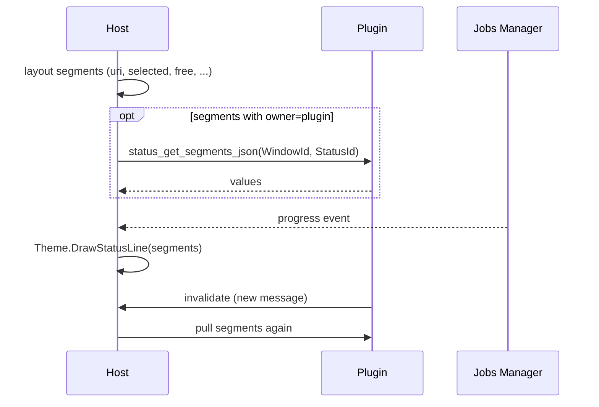

# Status Line Interaction with a Plugin

**English** | [Русский](STATUS_PLUGIN.ru.md)

> **Role of this document:** the contract between the status line (Status Line / Status Bar) and a plugin.  
> **Series:** [UI_PRIMITIVES.md](UI_PRIMITIVES.md).  
> **Context:** [SDS.md](SDS.md) §6.2, `IThemeRenderer.DrawStatusLine`; often used together with [PANEL_PLUGIN.md](PANEL_PLUGIN.md).

---

## 1. Scope and roles

Status Line is a one- or two-line primitive with logical segments (URI, free space, selected count/size, file type, job progress, message).

```text
TDualPanelWindow / Dialog / Viewer
└── Status Line (StatusId)
    ├── Segment layout (ids)
    ├── Resolved text segments[]
    └── Data sources: Host | Plugin | Jobs
```

| Participant | Responsibility |
|---|---|
| **Host** | Geometry, default segment set, size/date formatting, progress from Jobs, `DrawStatusLine`. |
| **Plugin** | Optional segments and values (`message`, custom metrics); invalidate on change. |
| **IThemeRenderer** | Separators, segment colors by *role* (normal/warn/error), not by arbitrary RGB from the plugin. |

**Currently:** the Dual Panel status line is Host-only (`TryFormatChromeStatus` / `ResolveChromeContext` in `uDualPanelStatus.pas`). The cdecl segment pull is not exported yet.

---

## 2. Lifecycle



| Stage | Action |
|---|---|
| **configure** | Declaration or Host default: the list of segment ids. |
| **pull** | The Host collects the texts: its own and the plugin's. |
| **draw** | The theme lays the segments out into cells. |
| **update** | Jobs/plugin/panel → invalidate → pull. |

---

## 3. API and JSON

```pascal
procedure mtn_status_get_segments_json(WindowId, StatusId: Integer;
  OutBuffer: PAnsiChar; MaxLen: Integer); cdecl;

procedure mtn_plugin_handle_event(WindowId: Integer; EventType: Integer;
  Param1: Integer; Param2: Integer); cdecl;

procedure mtn_host_invalidate(WindowId: Integer); cdecl;
```

### 3.1. Declaration (in a Dialog or the panel config)

```json
{
  "type": "status",
  "id": "panel_status",
  "segments": ["uri", "selected", "free", "file_type", "message"]
}
```

### 3.2. Plugin response (only its own / overridable fields)

```json
{
  "message": "Indexing…",
  "message_role": "info",
  "custom": [
    { "id": "branch", "text": "main", "role": "normal" }
  ]
}
```

| Field / segment | Filled by | Meaning |
|---|---|---|
| `uri` | **Host** (`TTab.CurrentURI`) | Current path |
| `selected` | **Host** (selection + pull size) | `3 (1.2 MB)` |
| `free` | **Host** / VFS meta job | Free space of the volume |
| `file_type` | **Host** from the panel row JSON | Type under the cursor |
| `progress` | **Host** / Jobs | `45%` / `12 MB / 30 MB` |
| `message` | **Plugin** or Host | Arbitrary status |
| `custom[]` | **Plugin** | Additional segments |

### 3.3. Segment roles (for the theme)

`normal` | `info` | `warn` | `error` | `progress`

The plugin specifies a **role**, not a color.

---

## 4. Events

| EventType | Name | Param1 | Param2 | Semantics |
|---|---|---|---|---|
| 90 | `refresh` | StatusId | 0 | The Host asks to update the values |
| 91 | `click_segment` | StatusId | SegmentIndex | Click on a segment (if enabled) |

A click on `uri` may open the path dialog (Host); a click on `branch` runs a plugin command.

---

## 5. State ownership

| State | Owner |
|---|---|
| Segment id layout, geometry | **Host** |
| uri / selected / free / progress | **Host** (+ Jobs/VFS) |
| message / custom | **Plugin** |
| Visual separators | **Theme** |

Invariant: for a file panel the status is usually updated on `cursor` / `select` from [PANEL_PLUGIN.md](PANEL_PLUGIN.md) without any involvement of the status plugin – the Host reads the row JSON itself.

---

## 6. Threads

* Building the segment texts runs on the UI thread; `free` and other long-running metrics are cached from background jobs.
* The plugin does not block the UI in `get_segments_json`.

---

## 7. Invariants

1. No RGB/styles from the plugin – only text + `role`.
2. Job progress is drawn by the Host; the plugin does not duplicate the copy progress bar if Jobs already sends it to the Host.
3. Two-line status: the Host passes the theme two segment arrays (`line0`, `line1`) or two StatusIds.
4. `DrawStatusLine` receives ready-made segment strings.
