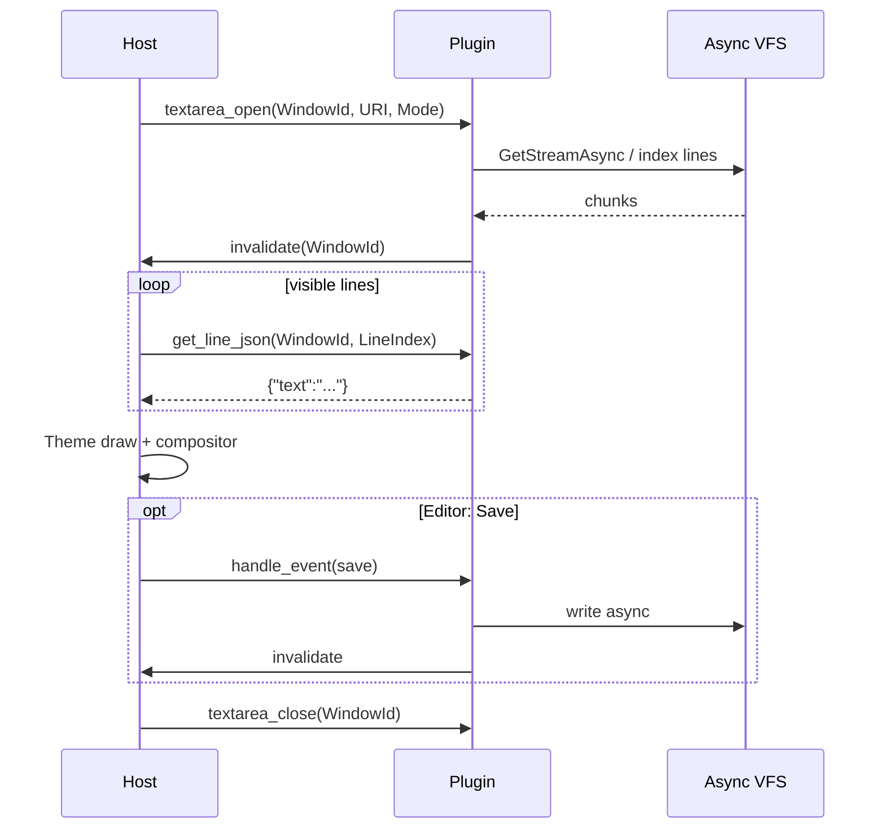

# Text Area (Viewer / Editor) interaction with a plugin

**English** | [Русский](TEXTAREA_PLUGIN.ru.md)

> **Document role:** contract between the multi-line text area and a plugin (viewing and editing).  
> **Series:** [UI_PRIMITIVES.md](UI_PRIMITIVES.md).  
> **Context:** [SDS.md](SDS.md) §5–6, [ARCHITECTURE.md](ARCHITECTURE.md) (streaming Viewer).

---

## 1. Scope and roles

Text Area is an MDI window or an area inside a window for viewing/editing text (and hex in a specialized mode).

```text
TTerminalWindow (Viewer | Editor)
├── URI / Mode (text | hex | wrap)
├── Cursor / Scroll / Selection
└── Bound Plugin (WindowId)
    └── Document model (lines index, dirty, encoding)
```

| Participant | Responsibility |
|---|---|
| **Host** | Layout, scroll offset, cursor, selection, keymap (F3/F4, Save, Search), rendering visible lines through the theme; **vertical scrollbar** (click on ▲/▼/track) and chrome (F-keys, status). |
| **Plugin** | Document: number of lines/characters, serving the visible range, save/load via the VFS, dirty flag. |
| **Async VFS** | Streaming read/write; files > 10 MB are not loaded into RAM as a whole. |
| **IThemeRenderer** | Window frame, gutter, **`DrawScrollBar`**, statuses/toolbar; syntax highlighting – logical tokens from the plugin, colors from the theme (planned). |

---

## 2. Lifecycle



| Stage | Action |
|---|---|
| **open** | Bind URI/mode; start background indexing. |
| **pull lines** | The Host requests only the visible range (+ the cursor line). |
| **edit** | Editor: the Host sends logical edits; the plugin updates the model. |
| **save / reload** | Events; I/O in a worker. |
| **close** | Cancel index/save jobs; request a confirmation when dirty. |

---

## 3. API and JSON

```pascal
function mtn_textarea_open(WindowId: Integer; const URI: PAnsiChar;
  Mode: Integer): Integer; cdecl;  // 0=view, 1=edit, 2=hex

procedure mtn_textarea_close(WindowId: Integer); cdecl;

function mtn_textarea_get_line_count(WindowId: Integer): Int64; cdecl;

procedure mtn_textarea_get_line_json(WindowId: Integer; LineIndex: Int64;
  OutBuffer: PAnsiChar; MaxLen: Integer); cdecl;

procedure mtn_textarea_get_meta_json(WindowId: Integer;
  OutBuffer: PAnsiChar; MaxLen: Integer); cdecl;

procedure mtn_plugin_handle_event(WindowId: Integer; EventType: Integer;
  Param1: Integer; Param2: Integer); cdecl;

procedure mtn_host_invalidate(WindowId: Integer); cdecl;
```

### 3.1. Document metadata

```json
{
  "uri": "file:///D:/Work/readme.md",
  "mode": "edit",
  "encoding": "utf-8",
  "crlf": true,
  "dirty": false,
  "read_only": false,
  "size": 32847,
  "indexing": false
}
```

### 3.2. Line JSON

```json
{
  "text": "Hello, MTN2",
  "line_ending": "lf"
}
```

For hex mode:

```json
{
  "offset": 256,
  "hex": "48 65 6C 6C 6F",
  "ascii": "Hello"
}
```

Currently the plugin does **not** return token colors. Planned: an array of logical spans `{ "start", "len", "token": "keyword" }` – the theme maps them to colors.

**Markdown Viewer (planned, cell-aware):** a separate Text Area mode for `.md`. The plugin parses the markup in a worker and serves the visible lines with spans (`heading`, `emphasis`, `code`, `link`, `list_item`, `quote`, ...); the Host/theme style the cells. Images from MD are Overlay requests ([OVERLAY_PLUGIN.md](OVERLAY_PLUGIN.md)). This is rendering into `TTerminalGrid`, not an HTML/WYSIWYG preview. See the SDS roadmap.

---

## 4. Events

| EventType | Name | Param1 | Param2 | Semantics |
|---|---|---|---|---|
| 40 | `scroll` | FirstVisibleLine | 0 | Informational; the pull follows the Host ScrollOffset anyway |
| 41 | `caret` | Line | Column | Cursor moved |
| 42 | `insert` | Line | Column | Insertion; the text comes via `mtn_host_get_event_payload` |
| 43 | `delete` | Line | Column | Deletion; length/range in the payload |
| 44 | `save` | 0 | 0 | Save |
| 45 | `reload` | 0 | 0 | Re-read from disk |
| 46 | `find` | 0 | 0 | Search; the pattern is in the payload |
| 47 | `replace` | 0 | 0 | Replace (Editor) |
| 48 | `set_mode` | Mode | 0 | view/edit/hex |
| 49 | `close_query` | 0 | 0 | Close request; the plugin answers with dirty via meta |

```pascal
procedure mtn_host_get_event_payload(WindowId: Integer;
  OutBuffer: PAnsiChar; MaxLen: Integer); cdecl;
```

Simple Editor: it is acceptable to simplify – the Host keeps the whole buffer of a small file and calls the plugin only for load/save; the contract above is the target for large files and for uniform Pull.

---

## 5. State ownership

| State | Owner |
|---|---|
| ScrollOffset (top line), caret, selection UI, scrollbar hit-test | **Host** |
| Content / line index / dirty / encoding | **Plugin** |
| Window URI | **Host** (source of truth for the title/session) |

**Scrollbar (currently):** the Host draws a vertical bar in the right column of the window body (`Theme.DrawScrollBar`); the thumb position = `TopLine / max(0, LineCount − ViewHeight)`. The plugin does not draw the scrollbar and does not handle clicks on it. Viewer find and Editor clipboard/undo belong to the Host.

Architecture invariant: files > 10 MB are streamed; `get_line_json` does not read the whole file.

---

## 6. Threads

1. `get_line_count` / `get_line_json` – UI thread, O(1)/O(line), no I/O.
2. Indexing and save – worker; progress can be shown in the Status Line via the Event Bus.
3. `Synchronize` is forbidden.

---

## 7. Relation to associations

The Host opens Text Area via F3/F4 / associations. A panel plugin only supplies the `uri`; the choice of Viewer vs Editor belongs to the core.

---

## 8. Invariants

1. The plugin has no Canvas; there are currently no line colors.
2. Pull only of the visible range.
3. Dirty + `close_query`: the Host shows a confirmation dialog (the Dialog primitive), not the plugin directly.
4. On `close` – cancel all jobs of the document.
5. The scrollbar belongs to the Host/theme; the plugin supplies only `LineCount` / lines.
