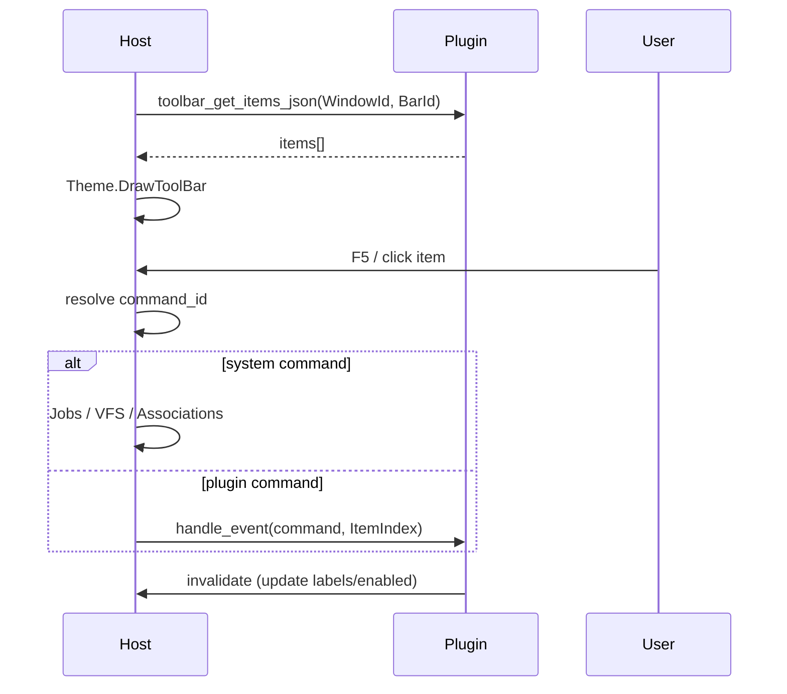

# Toolbar / Button Bar Interaction with a Plugin

**English** | [Русский](TOOLBAR_PLUGIN.ru.md)

> **Role of this document:** the contract between the toolbar (usually F1–F12) and a plugin.  
> **Series:** [UI_PRIMITIVES.md](UI_PRIMITIVES.md).  
> **Context:** [SDS.md](SDS.md) §6.2, `IThemeRenderer.DrawToolBar`.

---

## 1. Scope and roles

Toolbar (Button Bar) is a row of command buttons bound to hotkeys. Most often it is the bottom/top strip of the Dual Panel or the context strip of the Viewer/Editor.

```text
TDualPanelWindow / TTerminalWindow
└── Toolbar (BarId)
    ├── Items[0..N] (key, label, enabled, command_id)
    └── Bound Plugin or Host keymap provider (WindowId)
```

| Participant | Responsibility |
|---|---|
| **Host** | Bar placement, clicks/hotkeys, command invocation, drawing via `DrawToolBar`. |
| **Plugin** | The set of items (or a delta to the system set), enable/disable, handling of its own `command_id`s. |
| **Keymapper** | Global/local bindings; the Toolbar shows the current key labels. |
| **IThemeRenderer** | Appearance of the buttons and captions. |

The system F-keys (F3 Viewer, F5 Copy, …) may be defined entirely by the **core**; a plugin extends or overrides items for its own mode.

**Currently:** the bottom F-bar of the Dual Panel is Host-only (`uFunctionBar.pas` + `ResolveChromeContext` in `uDualPanelStatus.pas`). The context depends on the overlay (panels / dialog / stub / Change Drive / job). The cdecl `mtn_toolbar_get_items_json` is not exported yet.

---

## 2. Lifecycle



| Stage | Action |
|---|---|
| **pull items** | The Host requests the current list on show / after invalidate. |
| **invoke** | Physical input → logical command. |
| **update** | The plugin changes enabled/text → `invalidate`. |

---

## 3. API and JSON

```pascal
procedure mtn_toolbar_get_items_json(WindowId, BarId: Integer;
  OutBuffer: PAnsiChar; MaxLen: Integer); cdecl;

procedure mtn_plugin_handle_event(WindowId: Integer; EventType: Integer;
  Param1: Integer; Param2: Integer); cdecl;

procedure mtn_host_invalidate(WindowId: Integer); cdecl;
```

### 3.1. Button set JSON

```json
{
  "bar_id": "main",
  "items": [
    { "id": "help", "key": "F1", "text": "Help", "enabled": true, "owner": "host" },
    { "id": "user_menu", "key": "F2", "text": "Menu", "enabled": true, "owner": "host" },
    { "id": "view", "key": "F3", "text": "View", "enabled": true, "owner": "host" },
    { "id": "edit", "key": "F4", "text": "Edit", "enabled": true, "owner": "host" },
    { "id": "copy", "key": "F5", "text": "Copy", "enabled": true, "owner": "host" },
    { "id": "git_status", "key": "F9", "text": "Git", "enabled": true, "owner": "plugin" }
  ]
}
```

| Field | Purpose |
|---|---|
| `id` | Stable `command_id`. |
| `key` | Displayed key (the actual binding is the Keymapper's). |
| `text` | Button caption (logical; style is the theme's). |
| `enabled` | Availability. |
| `owner` | `host` – executed by the core; `plugin` – `handle_event` goes to the plugin. |

Currently the Host may ignore `owner` and decide itself from its command table; the field is there for user plugins.

---

## 4. Events

| EventType | Name | Param1 | Param2 | Semantics |
|---|---|---|---|---|
| 80 | `command` | ItemIndex | BarId | Activation of an item with `owner=plugin` |
| 81 | `refresh` | BarId | 0 | The Host asks to rebuild the items (mode/panel change) |

Payload (optional):

```json
{ "command_id": "git_status", "side": "left", "uri": "file:///D:/Work" }
```

The context (active side, selection) is added by the **Host**, so the plugin does not read the UI directly.

---

## 5. State ownership

| State | Owner |
|---|---|
| Bar geometry, hit-testing | **Host** |
| Item set per mode / enable | **Host (system) + Plugin (its own)** |
| Actual key bindings | **Keymapper (Host)** |

On a `key` conflict the Keymapper wins; the Toolbar only reflects the label.

---

## 6. Threads

* `get_items_json` runs on the UI thread, without I/O.
* A plugin command handler may start a Job; the UI is updated via invalidate.

---

## 7. Invariants

1. The plugin does not draw buttons – only JSON items.
2. System file operations (Copy/Move/Delete) are initiated by the Host (Jobs), even if the caption on the bar was updated by a plugin.
3. On a Panel Tab / Viewer→Editor mode change, the Host sends `refresh` or switches the bar profile itself.
4. The colors of the "active" F-key are set by the theme, not the plugin.
